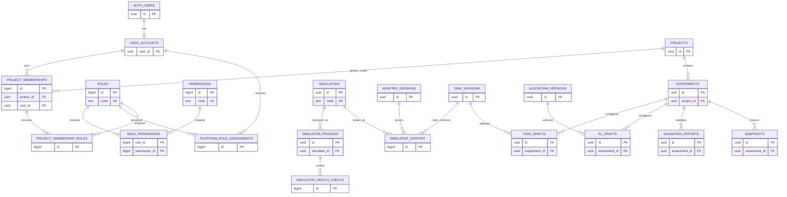
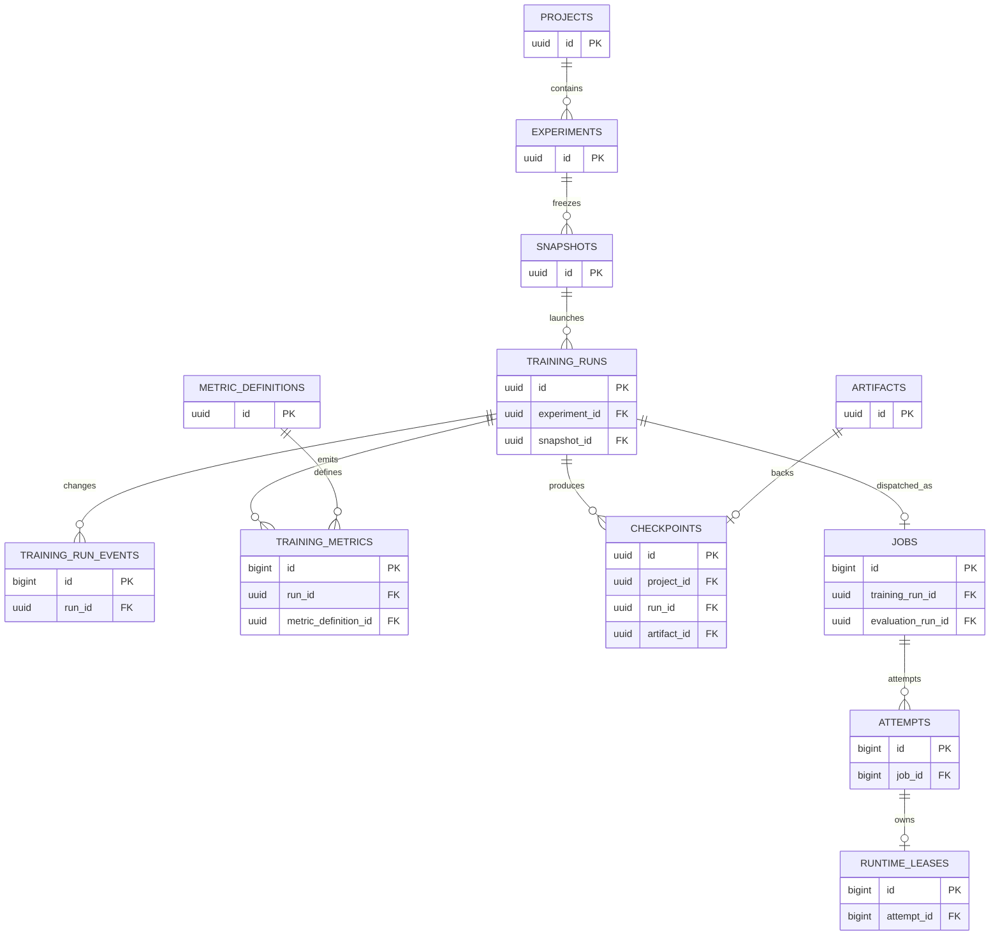
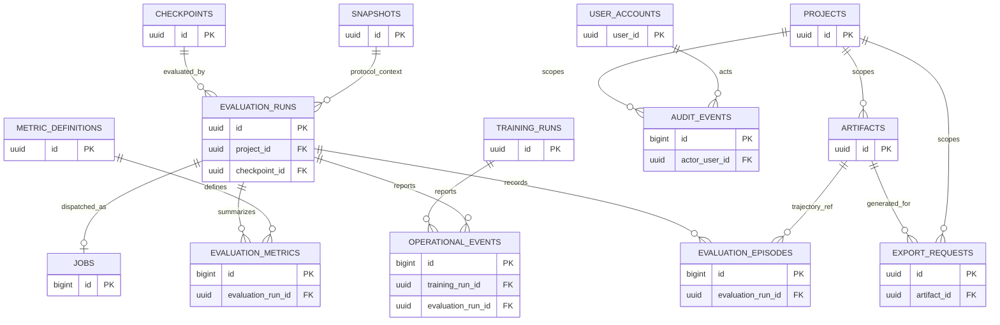

# THIẾT KẾ DATABASE TỔNG THỂ — DRONE RL TRAINING PLATFORM

| Thuộc tính | Giá trị |
|---|---|
| Phiên bản | 0.2 — thiết kế logic và baseline migration MVP |
| Ngày rà soát | 07/11/2026 |
| Phạm vi | 17 module trong `Module_design/MODULE_DESIGN.md` và ba thư mục đặc tả module |
| Hệ quản trị | PostgreSQL theo `ADR-005`; Supabase PostgreSQL/Auth là phương án triển khai cần phê duyệt |
| Dữ liệu tệp | Local Artifact Storage trong MVP theo `ADR-006`; Supabase Storage là phương án sau, chưa được chọn |

> **Trạng thái triển khai:** `database/migrations/0001_mvp_baseline.sql` hiện thực lát cắt
> PostgreSQL 15+ độc lập provider cho project/experiment, catalog version, immutable config
> snapshot, training/evaluation run, PostgreSQL-backed job claim, attempt/lease, metric,
> checkpoint, artifact metadata và operational event. Baseline chưa phải tuyên bố hỗ trợ
> simulator/task/algorithm; các catalog entry vẫn ở trạng thái `configured`/`candidate` cho
> đến khi có contract/integration test. Supabase Auth/Data API/RLS, ORM và retention policy
> vẫn là TBD, không được migration tự quyết định.

## 1. Căn cứ và nguyên tắc

Thứ tự nguồn: `PROJECT_INITIATION.md` → `REQUIREMENTS_ANALYSIS.md` → `SYSTEM_ARCHITECTURE.md` → `Module_design/MODULE_DESIGN.md` → đặc tả `MOD-01`…`MOD-17` trong ba thư mục `Application Modules`, `Execution & Integration Modules`, `Data & Platform Support Modules`. Đây là **thiết kế logic để review**, không tạo schema trên một project Supabase. Các mã `FR-*`, `NFR-*`, `BRL-*`, `AC-*`, `ADR-*`, `MOD-*` giữ nguyên.

- MVP: một task Hovering **hoặc** Position Control sau technical spike; PPO trước; mỗi simulator chỉ công bố `supported` sau integration test đúng version. SAC/TD3, Trajectory Tracking, multi-agent, distributed training, raw video/sensor và custom Python nằm ngoài lát cắt đầu tiên nếu chưa được duyệt.
- PostgreSQL giữ metadata, config snapshot bất biến, job/run state và metrics chọn lọc. Checkpoint/model/log/trajectory/export bytes nằm trong Artifact Storage.
- Training và evaluation có record và metric namespace riêng; evaluation trỏ checkpoint đã xác minh, không sửa policy nguồn.
- Mỗi run trỏ experiment, project, snapshot, seed và runtime version thực tế; số liệu không có định nghĩa phải lưu `unavailable`, không đổi thành `0`.
- Quyền do Backend MOD-01 quyết định trên project/object context; frontend không được kết nối trực tiếp tới bảng private. `iam.user_accounts.user_id` là ID ứng dụng: ở local mode do IAM cấp; nếu chọn Supabase Auth thì đồng nhất với `auth.users(id)` và thêm FK, không tạo password/session table ứng dụng.

### 1.1. Quy ước thiết kế

| Quy ước | Áp dụng |
|---|---|
| Schema | `iam`, `research`, `catalog`, `config`, `execution`, `results`, `platform` là **đề xuất** schema private, không thuộc Data API exposed schema theo mặc định. Không tạo object ứng dụng trong `auth`, `storage`, `realtime`. |
| PK | `uuid` cho định danh domain/API và FK xuyên module; `bigint generated always as identity` cho chuỗi dữ liệu nội bộ có tốc độ ghi cao. `auth.users.id` dùng `uuid`. |
| Kiểu | `text` có `CHECK` cho trạng thái; `timestamptz` cho thời gian; `jsonb` chỉ cho cấu trúc biến thiên có schema version và validation; `double precision` cho metric đo RL, từ chối NaN/Infinity ở boundary **và** bằng DB check. |
| Chung | Các aggregate có `created_at timestamptz not null default now()`, `updated_at timestamptz`, `row_version bigint not null default 1` nếu sửa được. Bảng append-only dùng `occurred_at`/`created_at`, không có `updated_at`. |
| Xóa | Mặc định `on delete restrict` cho lineage; archive/disable thay hard delete. Bảng phụ thuần có thể cascade khi parent chưa từng được dùng trong run. Actor audit là snapshot ID nullable, không cascade audit. |
| FK | Mọi cột `*_id` nêu là FK được index nếu chưa là leftmost column của PK/unique/index khác; composite FK dùng để bảo đảm cùng project/experiment/run. |
| Mã ổn định | `simulator_code`, `task_code`, `algorithm_code`, `metric_code`, `permission_code` không dùng numeric ID trong snapshot/UI. |

**Ký hiệu bảng bên dưới:** `PK`, `FK`, `UQ`, `CK`, `NN` lần lượt là primary key, foreign key, unique, check, not null. Trừ cột được ghi `?`, các cột được liệt kê là `NN`. `id uuid` sinh ở Backend hoặc DB (`gen_random_uuid()` nếu khả dụng); không yêu cầu extension UUIDv7. Các bảng nội bộ có `id bigint identity` trừ khi ghi rõ PK khác. JSON có version ở cột kế bên hoặc bên trong envelope, validator ứng dụng và giới hạn kích thước.

## 2. Data ownership theo module

| Module | Bảng thuộc quyền sở hữu logic | Ghi chú ranh giới |
|---|---|---|
| `MOD-01` | `iam.user_accounts`, `iam.roles`, `iam.permissions`, `iam.role_permissions`, `iam.platform_role_assignments`, `iam.project_memberships`, `iam.project_membership_roles` | Auth user chỉ được tham chiếu nếu chọn Supabase Auth. |
| `MOD-02` | `research.projects`, `research.experiments` | Membership của project thuộc MOD-01. |
| `MOD-03` | `catalog.simulators`, `catalog.simulator_profiles`, `catalog.simulator_support`, `catalog.simulator_health_checks` | Readiness theo thời điểm, không phải trạng thái run. |
| `MOD-04` | `config.task_drafts` | Cấu hình task người dùng chỉnh sửa; Task Contract thuộc MOD-14. |
| `MOD-05` | `config.rl_drafts` | Hyperparameters, seed, checkpoint policy; algorithm descriptor thuộc MOD-13. |
| `MOD-06` | `config.validation_reports`, `config.snapshots` | Snapshot bất biến là input của run. |
| `MOD-07` | `execution.training_runs`, `execution.training_run_events` | Trạng thái nghiệp vụ training. |
| `MOD-08` | Không cần bảng read model riêng ở MVP | Đọc `results.training_metrics`, status từ MOD-07. |
| `MOD-09` | `results.checkpoints` | Usability/model lineage; bytes và storage state thuộc MOD-16. |
| `MOD-10` | `execution.evaluation_runs`, `results.evaluation_episodes`, `results.evaluation_metrics` | Protocol snapshot nằm trên evaluation run; `config.snapshots` tham chiếu cấu hình task/environment, không thay protocol. |
| `MOD-11` | `results.export_requests` | So sánh tính lúc query; CSV nằm ở artifact. |
| `MOD-12` | `execution.jobs`, `execution.attempts`, `execution.runtime_leases` | Process, claim, heartbeat; không sở hữu business state. |
| `MOD-13` | `catalog.algorithm_versions`, `results.metric_definitions` phần algorithm | Controller in-memory; metrics ghi qua MOD-16. |
| `MOD-14` | `catalog.task_versions`, `results.metric_definitions` phần task | Contract/version, semantics Gymnasium. |
| `MOD-15` | `catalog.adapter_versions` | Mapping/capability version; không lưu raw state từng step. |
| `MOD-16` | `platform.artifacts` và persistence của bảng do module khác sở hữu | Không trở thành owner semantics của run/model/metric. |
| `MOD-17` | `platform.operational_events`, `platform.audit_events` | Log bytes có thể nằm ở `platform.artifacts`. |

## 3. ERD theo miền

Mermaid dưới đây chỉ biểu diễn FK chính; mọi bảng và cột chi tiết được nêu ở Mục 4. `AUTH_USERS` là thực thể ngoài schema ứng dụng, chỉ tồn tại trong phương án Supabase Auth.

### 3.1. Identity, project, cấu hình và catalog

### 3.2. Training, worker, metrics và artifacts

### 3.3. Evaluation, export và vận hành

**Quan hệ ngoài sơ đồ:** `results.export_requests` có thể chọn nhiều nguồn training/evaluation bằng `source_manifest jsonb` version hóa, validate từng ID và quyền tại thời điểm tạo **và** tải; chưa tạo polymorphic FK `source_type/source_id`. `platform.operational_events.run_id` có thể trỏ training run hoặc evaluation run; để bảo đảm FK, dùng hai cột nullable riêng `training_run_id` và `evaluation_run_id` với check tối đa một cột khác null. Audit lưu `object_type/object_id` như snapshot sự kiện, không coi đó là FK đến object có thể bị archive.

## 4. Thiết kế bảng và ràng buộc

### 4.1. Danh tính và project

| Bảng | Cột chính và kiểu | Khóa/ràng buộc |
|---|---|---|
| `iam.user_accounts` | `user_id uuid`, `display_name text`, `status text`, `locked_at timestamptz?`, `disabled_at timestamptz?` | PK `user_id`; thêm FK `user_id → auth.users(id)` **chỉ nếu Supabase Auth được chọn**; local mode cấp ID trong IAM. Status `pending/active/locked/disabled`; không lưu email/password/token bản sao. Provider khác cần mapping được duyệt trước migration. |
| `iam.roles` | `id bigint identity`, `code text`, `scope text`, `name text`, `active boolean` | UQ `code`; scope `platform/project`; system role chỉ archive/disable. |
| `iam.permissions` | `id bigint identity`, `code text`, `resource_type text`, `action text`, `active boolean` | UQ `code`, UQ `(resource_type,action)`; permission catalog có version migration. |
| `iam.role_permissions` | `role_id bigint`, `permission_id bigint` | PK `(role_id,permission_id)`, hai FK restrict; index `permission_id`. |
| `iam.platform_role_assignments` | `id bigint identity`, `user_id uuid`, `role_id bigint`, `status text`, `granted_at timestamptz`, `revoked_at timestamptz?`, `granted_by_user_id uuid?` | FK user/role; role phải có scope `platform` (service validation/constraint trigger); UQ partial `(user_id,role_id) where status='active'`. |
| `iam.project_memberships` | `id bigint identity`, `project_id uuid`, `user_id uuid`, `status text`, `joined_at timestamptz?`, `ended_at timestamptz?` | FK project/user restrict; status `invited/active/suspended/ended`; UQ partial `(project_id,user_id) where status <> 'ended'`. |
| `iam.project_membership_roles` | `id bigint identity`, `membership_id bigint`, `role_id bigint`, `status text`, `granted_at timestamptz`, `revoked_at timestamptz?` | FK membership/role; role scope `project`; UQ partial `(membership_id,role_id) where status='active'`. |
| `research.projects` | `id uuid`, `name text`, `description text?`, `objective text?`, `status text`, `created_by_user_id uuid` | PK `id`; FK creator → user, `active/archived`; archive bảo toàn lineage; tên không rỗng. |
| `research.experiments` | `id uuid`, `project_id uuid`, `name text`, `objective text?`, `description text?`, `status text`, `created_by_user_id uuid` | FK `(project_id)` → projects; UQ `(id,project_id)` để composite FK downstream; `draft/active/archived`; không sở hữu run. |

### 4.2. Simulator, task, algorithm và cấu hình

| Bảng | Cột chính và kiểu | Khóa/ràng buộc |
|---|---|---|
| `catalog.simulators` | `id uuid`, `code text`, `name text`, `status text` | UQ `code`; `configured/unsupported/supported`; `supported` chỉ sau evidence theo `AC-018`. |
| `catalog.adapter_versions` | `id uuid`, `adapter_code text`, `version text`, `simulator_id uuid`, `capabilities jsonb`, `mapping_version text`, `evidence_ref text?` | FK simulator; UQ `(adapter_code,version)`; capability/version có schema validator; không mặc định hai simulator cùng unit/frame. |
| `catalog.task_versions` | `id uuid`, `task_code text`, `version text`, `contract jsonb`, `contract_checksum text`, `status text` | UQ `(task_code,version)`; contract bất biến gồm observation/action/reward/termination/timing/metric; status chỉ `supported` sau test. |
| `catalog.algorithm_versions` | `id uuid`, `algorithm_code text`, `version text`, `config_schema jsonb`, `framework_version text`, `status text` | UQ `(algorithm_code,version)`; PPO là candidate MVP, SAC/TD3 không seed `supported` mặc định. |
| `catalog.simulator_support` | `id bigint identity`, `simulator_id uuid`, `adapter_version_id uuid`, `task_version_id uuid`, `runtime_version text`, `test_evidence_ref text`, `verified_at timestamptz`, `status text` | FK simulator/adapter/task; UQ `(adapter_version_id,task_version_id,runtime_version)`; `supported` cần evidence; validate adapter thuộc cùng simulator. |
| `catalog.simulator_profiles` | `id uuid`, `simulator_id uuid`, `alias text`, `endpoint_hint text?`, `secret_ref text?`, `status text` | FK simulator; UQ `(simulator_id,alias)`; chỉ opaque `secret_ref`, không lưu credential/plain endpoint secret. |
| `catalog.simulator_health_checks` | `id bigint identity`, `profile_id uuid`, `adapter_version_id uuid`, `status text`, `runtime_version text?`, `capability_summary jsonb?`, `checked_at timestamptz`, `expires_at timestamptz?`, `error_code text?` | FK profile/adapter; CK `expires_at > checked_at` khi có; `ready/unavailable/degraded/unknown`; kết quả cũ không đủ để chạy. |
| `config.task_drafts` | `id uuid`, `experiment_id uuid`, `task_version_id uuid`, `simulator_profile_id uuid`, `drone_code text?`, `parameters jsonb`, `schema_version text`, `status text`, `row_version bigint` | FK experiment/task/profile; UQ partial `(experiment_id) where status='current'` nếu chọn một draft hiện hành; JSON chỉ chứa cấu hình allowlist, không code tùy ý. |
| `config.rl_drafts` | `id uuid`, `experiment_id uuid`, `algorithm_version_id uuid`, `hyperparameters jsonb`, `seed bigint?`, `total_timesteps bigint`, `checkpoint_interval bigint?`, `schema_version text`, `status text`, `row_version bigint` | FK experiment/algorithm; CK timesteps > 0, interval > 0 khi có; seed được materialize trước snapshot. |
| `config.validation_reports` | `id uuid`, `experiment_id uuid`, `task_draft_id uuid`, `rl_draft_id uuid`, `validator_version text`, `issues jsonb`, `result text`, `checked_at timestamptz` | FK tới experiment/drafts; `valid/invalid/unknown`; check cùng experiment qua composite FK hoặc transaction; báo source/path/severity. |
| `config.snapshots` | `id uuid`, `experiment_id uuid`, `project_id uuid`, `task_draft_id uuid`, `rl_draft_id uuid`, `validation_report_id uuid`, `payload jsonb`, `schema_version text`, `sha256 text`, `seed bigint`, `created_at timestamptz` | FK `(experiment_id,project_id)` → experiments `(id,project_id)`; FK drafts/report; UQ `(id,experiment_id,project_id)` cho run; `payload` canonical/effective config, version references, không secret; DB role chỉ INSERT/SELECT, ngăn UPDATE/DELETE bằng quyền/trigger sau khi triển khai. |

`catalog.task_versions.contract` chứa frame, unit, observation order/shape/dtype, action mode/bounds, timing, reward, termination và metric definitions. `catalog.adapter_versions.capabilities` chứa source state/control/clock/mapping. `config.snapshots.payload` **materialize** IDs + codes + versions + effective defaults để phiên bản catalog mới không làm đổi ý nghĩa run cũ. Schema chi tiết của từng JSON cần được version hóa trước migration; không thay toàn bộ quan hệ bằng JSONB.

### 4.3. Training, evaluation và worker

| Bảng | Cột chính và kiểu | Khóa/ràng buộc |
|---|---|---|
| `execution.training_runs` | `id uuid`, `project_id uuid`, `experiment_id uuid`, `snapshot_id uuid`, `requested_by_user_id uuid`, `status text`, `idempotency_key text`, `current_step bigint default 0`, `started_at timestamptz?`, `ended_at timestamptz?`, `stop_requested_at timestamptz?`, `error_code text?`, `row_version bigint` | FK snapshot `(snapshot_id,experiment_id,project_id)` → snapshots; FK requester; UQ `(requested_by_user_id,idempotency_key)`; `queued/running/stop_requested/completed/failed/stopped`, không `paused` mặc định; terminal chỉ theo state machine MOD-07. |
| `execution.training_run_events` | `id bigint identity`, `run_id uuid`, `event_id uuid`, `sequence_no bigint`, `previous_status text?`, `next_status text`, `source_attempt_id bigint?`, `occurred_at timestamptz` | FK run/attempt; UQ `event_id`, UQ `(run_id,sequence_no)`; append-only, late event không đảo terminal state. |
| `execution.evaluation_runs` | `id uuid`, `project_id uuid`, `experiment_id uuid`, `snapshot_id uuid`, `checkpoint_id uuid`, `requested_by_user_id uuid`, `protocol jsonb`, `protocol_schema_version text`, `protocol_sha256 text`, `status text`, `completeness text`, `source_checksum text`, `post_checksum text?`, `started_at timestamptz?`, `ended_at timestamptz?`, `row_version bigint` | FK `(snapshot_id,experiment_id,project_id)` → snapshots cho cấu hình task/environment; FK `(checkpoint_id,project_id)` → checkpoints; protocol bất biến do MOD-10 sở hữu, có seed/episode/scenario; CK episodes > 0 tại validator; `completeness=complete/partial/none`; `post_checksum=source_checksum` mới đủ điều kiện hoàn thành. Source checkpoint phải Available, cùng project và tương thích với task/simulator của snapshot. |
| `execution.jobs` | `id bigint identity`, `training_run_id uuid?`, `evaluation_run_id uuid?`, `status text`, `priority smallint default 0`, `queued_at timestamptz`, `claimed_at timestamptz?`, `worker_id text?`, `fencing_token bigint default 0`, `row_version bigint` | Exactly one run FK bằng CK `num_nonnulls(training_run_id,evaluation_run_id)=1`; UQ `training_run_id` và UQ `evaluation_run_id` (nullable UQ hợp lệ); `queued/claimed/running/terminal`; claim atomic. |
| `execution.attempts` | `id bigint identity`, `job_id bigint`, `attempt_no integer`, `worker_id text`, `fencing_token bigint`, `process_id bigint?`, `process_started_at timestamptz?`, `heartbeat_at timestamptz?`, `status text`, `exit_code integer?`, `runtime_metadata jsonb?`, `started_at timestamptz?`, `ended_at timestamptz?` | FK job; UQ `(job_id,attempt_no)`; UQ partial `(job_id) where status in ('claimed','starting','running','stopping')`; runtime metadata version hóa gồm Python, thư viện RL, algorithm, task, adapter, simulator và environment/hardware khi có, không có secret; stale attempt không được ghi heartbeat/metric/checkpoint. |
| `execution.runtime_leases` | `id bigint identity`, `attempt_id bigint`, `runtime_key text`, `status text`, `acquired_at timestamptz`, `expires_at timestamptz`, `released_at timestamptz?` | FK attempt; UQ partial `(runtime_key) where status='active'`; mặc định 1 run/world, timeout/reconciliation; CK expiry > acquired. |

`execution.jobs` là hàng đợi PostgreSQL theo `ADR-005`, không thêm Redis/Celery. Claim bằng transaction ngắn với `FOR UPDATE SKIP LOCKED`, cập nhật fencing token và ghi attempt/lease trong transaction; spawn process **sau commit**. Nếu spawn lỗi, ghi failure event/release lease. Stop: cooperative cancellation → grace timeout → supervisor cleanup; chưa có evidence cleanup thì không ghi `stopped`. Exact resume là `FR-031` Should và `MD-Q08/Q-015` mở.

### 4.4. Metrics, checkpoint và export

| Bảng | Cột chính và kiểu | Khóa/ràng buộc |
|---|---|---|
| `results.metric_definitions` | `id uuid`, `metric_code text`, `version text`, `phase text`, `task_version_id uuid?`, `algorithm_version_id uuid?`, `definition text`, `unit text?`, `aggregation text`, `source text`, `status text` | UQ `(metric_code,version,phase,task_version_id,algorithm_version_id)` cần xử lý nullable bằng `NULLS NOT DISTINCT` nếu PostgreSQL ≥15 hoặc partial unique tương ứng; CK owner task/algorithm đúng loại; version bất biến. |
| `results.training_metrics` | `id bigint identity`, `run_id uuid`, `attempt_id bigint`, `metric_definition_id uuid`, `sequence_no bigint`, `step bigint?`, `episode bigint?`, `value double precision?`, `availability text`, `occurred_at timestamptz` | FK run/attempt/definition; UQ `(attempt_id,sequence_no,metric_definition_id)`; `available/unavailable`; `value` chỉ có khi available và finite; batch write theo episode/rollout. |
| `platform.artifacts` | `id uuid`, `project_id uuid`, `experiment_id uuid?`, `training_run_id uuid?`, `evaluation_run_id uuid?`, `artifact_type text`, `storage_key text?`, `status text`, `byte_size bigint?`, `checksum_sha256 text?`, `media_type text?`, `format_version text?`, `manifest jsonb`, `schema_version text`, `committed_at timestamptz?` | FK project/experiment/runs; CK `byte_size >= 0`, sha256 đúng định dạng khi có; status `staging/verifying/available/invalid/missing/archived`; UQ storage key khi có; `available` đòi `storage_key`, `byte_size`, checksum, committed_at; parent theo loại artifact được validator kiểm tra. |
| `results.checkpoints` | `id uuid`, `project_id uuid`, `run_id uuid`, `artifact_id uuid`, `checkpoint_key text`, `step bigint`, `status text`, `format_version text`, `algorithm_version_id uuid`, `load_verified_at timestamptz?`, `load_status text`, `resume_capability text`, `created_at timestamptz` | FK `(run_id,project_id)` → training_runs và `(artifact_id,project_id)` → artifacts; UQ `(id,project_id)`, UQ `artifact_id`, UQ `(run_id,checkpoint_key)` cho idempotency; CK step ≥ 0; lifecycle `staging/verifying/available/invalid/missing`; `available` chỉ khi artifact available + checksum/load probe thành công; resume không suy ra từ evaluation-loadable. |
| `results.evaluation_episodes` | `id bigint identity`, `evaluation_run_id uuid`, `episode_no integer`, `seed bigint`, `return_value double precision?`, `episode_length bigint`, `outcome text`, `terminated boolean`, `truncated boolean`, `trajectory_artifact_id uuid?` | FK evaluation run/artifact; UQ `(evaluation_run_id,episode_no)`; outcome `success/failure/time_limit/partial`; cả `terminated` và `truncated` được lưu riêng; CK nonnegative length. |
| `results.evaluation_metrics` | `id bigint identity`, `evaluation_run_id uuid`, `metric_definition_id uuid`, `value double precision?`, `availability text`, `sample_count integer?`, `aggregation text`, `computed_at timestamptz` | FK evaluation run/definition; UQ `(evaluation_run_id,metric_definition_id,aggregation)`; finite/availability CK như training; chỉ tính từ episode theo protocol. |
| `results.export_requests` | `id uuid`, `project_id uuid`, `requested_by_user_id uuid`, `source_manifest jsonb`, `manifest_schema_version text`, `status text`, `artifact_id uuid?`, `created_at timestamptz`, `completed_at timestamptz?` | FK project/user/artifact; UQ `artifact_id` khi có; `queued/running/available/failed`; source IDs/filter/field/metric version; xác thực từng nguồn và tải theo quyền hiện hành. |

Kiểm tra chéo project ở mức DB: UQ `(id,project_id)` trên `training_runs`, `evaluation_runs`, `artifacts`, `checkpoints`; dùng composite FK cho checkpoint/evaluation và artifact consumer. `training_metrics.attempt_id` phải thuộc đúng job/run; `evaluation_episodes.trajectory_artifact_id` phải thuộc cùng evaluation run. Đây là invariant liên bảng, cần composite FK bổ sung hoặc constraint trigger đã test. `config.snapshots` không bị sửa khi evaluation protocol thay đổi: protocol mới tạo evaluation run mới.

### 4.5. Vận hành và audit

| Bảng | Cột chính và kiểu | Khóa/ràng buộc |
|---|---|---|
| `platform.operational_events` | `id bigint identity`, `event_id uuid`, `component text`, `layer text`, `severity text`, `error_code text?`, `message_code text`, `safe_details jsonb?`, `correlation_id uuid?`, `training_run_id uuid?`, `evaluation_run_id uuid?`, `attempt_id bigint?`, `log_artifact_id uuid?`, `occurred_at timestamptz`, `received_at timestamptz` | UQ `event_id`; FK run/evaluation/attempt/artifact; CK tối đa 1 loại run; payload bounded, đã redact; append-only; không lưu full traceback có secret vào DB. |
| `platform.audit_events` | `id bigint identity`, `event_id uuid`, `actor_user_id uuid?`, `actor_ref text`, `actor_type text`, `action text`, `object_type text`, `object_id uuid?`, `project_id uuid?`, `outcome text`, `reason_code text?`, `correlation_id uuid?`, `occurred_at timestamptz` | UQ `event_id`; actor FK `on delete set null` nếu user bị xóa, `actor_ref` là định danh snapshot đã kiểm soát PII để bảo toàn audit; append-only; không FK polymorphic object; gồm start/stop/grant/revoke/retention action khi policy yêu cầu. |

Audit reliability: thao tác nhạy cảm ghi audit trong cùng DB transaction hoặc transactional outbox **nếu được duyệt**; không cho mất audit rồi báo thành công giả. Event nhiều volume có batch/limit/dedup, không ghi mỗi simulation step. Log file thuộc Artifact Storage, `operational_events.log_artifact_id` chỉ là reference. `MD-Q11/Q-022` còn mở nên không tự định thời hạn xóa.

## 5. Index và truy vấn trọng yếu

| Truy vấn | Index đề xuất |
|---|---|
| Project theo user; member theo project | `project_memberships(user_id,status,project_id)` và `(project_id,status)`; partial unique hiện hành. |
| Experiment theo project | `experiments(project_id,created_at desc,id)`. |
| Health mới nhất | `simulator_health_checks(profile_id,checked_at desc,id)`; TTL đọc theo `expires_at`. |
| Run history | `training_runs(experiment_id,created_at desc,id)`; `evaluation_runs(experiment_id,created_at desc,id)`. |
| Dispatcher claim | Partial `jobs(priority desc,queued_at,id) where status='queued'`; tránh full scan job terminal. |
| Heartbeat/reconciliation | Partial `attempts(heartbeat_at,id) where status in ('claimed','starting','running','stopping')`; runtime lease unique active. |
| Metrics chart | `training_metrics(run_id,metric_definition_id,step,id)`; `evaluation_metrics(evaluation_run_id,metric_definition_id)`. |
| Checkpoint list | `checkpoints(run_id,step desc,id)`; `artifacts(project_id,status,created_at desc)`. |
| Log/audit query | `operational_events(training_run_id,occurred_at desc)` và `(evaluation_run_id,occurred_at desc)` khi nonnull; `audit_events(project_id,occurred_at desc)`. |

PK/UQ đã tạo index, không lặp lại index tương đương. Cần rà toàn bộ FK không nằm bên trái index trước migration; đặc biệt `granted_by_user_id`, `requested_by_user_id`, `adapter_version_id`, `task_version_id`, `metric_definition_id`, `artifact_id` nullable. Các index phụ chỉ chốt sau query plan/benchmark (`EXPLAIN (ANALYZE, BUFFERS)` trên dữ liệu đại diện); metrics nhiều volume mới cân nhắc partition. PostgreSQL không tự index FK.

## 6. Quyền truy cập và Supabase

Kiến trúc hiện tại chọn FastAPI modular monolith và PostgreSQL; **chưa quyết định dùng Supabase Auth, Data API hay Storage**. Nếu chọn Supabase Auth, `iam.user_accounts.user_id` tham chiếu **chỉ** `auth.users(id)`; không dùng `auth.users` làm bảng profile API. Backend xử lý user lifecycle, session revocation và recheck `user_accounts.status` cho thao tác nhạy cảm; JWT chưa hết hạn không tự vô hiệu khi xóa user. Role/permission không lấy từ `raw_user_meta_data`.

Đề xuất giữ bảy schema ứng dụng ở chế độ private, Backend dùng DB role least privilege; browser gọi Backend. Bật RLS phòng thủ cho bảng chứa dữ liệu user/project; không dựa vào RLS để thay authorization ở Backend. Nếu sau này expose schema qua Data API, mỗi bảng phải có **GRANT riêng + RLS + policy per operation** và test allow/deny cho `anon`, `authenticated`, user khác project, admin. `TO authenticated` đơn lẻ không đủ; policy cần ownership/membership predicate, `UPDATE` cần `SELECT`, `USING` và `WITH CHECK`. Khi gọi `(select auth.uid())`, chỉ dùng trong request có user JWT thật; service key không được đưa vào frontend. View exposed trên PostgreSQL ≥15 dùng `security_invoker = true`. `SECURITY DEFINER` chỉ dùng nếu thật cần thiết, ở schema private với `search_path` cố định, revoke EXECUTE và test quyền.

Theo [Supabase changelog](https://supabase.com/changelog/45329-breaking-change-tables-not-exposed-to-data-and-graphql-api-automatically), bảng `public` mới không tự được expose qua Data API kể từ rollout 2026; thiết kế này không dựa vào auto grant. [Supabase User Management](https://supabase.com/docs/guides/auth/managing-user-data), [Row Level Security](https://supabase.com/docs/guides/database/postgres/row-level-security) và [Securing your API](https://supabase.com/docs/guides/api/securing-your-api) là tài liệu đối chiếu cho giai đoạn triển khai. Không có lý do thêm Redis/Celery, Supabase Queues/Cron/Realtime hoặc Storage cho MVP nếu PostgreSQL queue/local artifact đã đáp ứng.

## 7. Luồng dữ liệu và transaction cần bảo đảm

1. **Tạo run:** trong cùng DB transaction, xác nhận experiment/snapshot hợp lệ và cùng project, lưu `training_runs` + `jobs(queued)` + idempotency key; chỉ publish `run_id` sau commit. `FR-009`, `AC-006`, `AC-015`.
2. **Claim:** transaction ngắn `FOR UPDATE SKIP LOCKED`, kiểm tra capacity/runtime key, tăng fencing token, tạo attempt/lease, commit; sau đó mới spawn process. Heartbeat/event/metric từ token cũ bị reject. `ADR-005`, `NFR-006`.
3. **Checkpoint:** tạo artifact staging → stream bytes → close/flush → checksum/size/load verify → atomic publish → đánh dấu artifact available → MOD-09 kiểm tra usability và đánh dấu checkpoint loadable. Lỗi giữa DB và file được reconciliation; checkpoint incomplete không được liệt kê usable. `BRL-012`, `AC-009`.
4. **Evaluation:** tạo `evaluation_runs` với checkpoint Available + immutable protocol + checksum nguồn, job riêng; worker chỉ inference, lưu episodes/metric, kiểm tra checksum policy sau chạy, mới mark complete. Kết quả thiếu episode là partial. `BRL-006/007`, `AC-011/012`.
5. **Export:** authorize mọi source ID, ghi request/manifest, tạo CSV staging, verify/publish artifact; recheck quyền khi download. `AC-014/016`.
6. **Stop/crash:** lưu stop request, supervisor thực hiện cooperative cancellation rồi timeout/cleanup; MOD-07/MOD-10 quyết định terminal theo event; operational event chứa layer/correlation. `AC-008/017`.

## 8. Truy vết coverage và quyết định mở

| Luồng/yêu cầu | Bảng chính | Tình trạng |
|---|---|---|
| `FR-001–FR-004`, `NFR-010–NFR-012`, `AC-016` | `iam.*`, `platform.audit_events` | Auth provider/Admin/ma trận quyền còn mở. |
| `FR-005–FR-010`, `AC-001/015` | `research.*`, `config.snapshots` | Tên trùng/archive policy còn mở. |
| `FR-011–FR-021`, `AC-002–AC-004/018` | `catalog.simulators`, `catalog.simulator_profiles`, `catalog.simulator_support`, `catalog.simulator_health_checks`, `catalog.task_versions`, `config.task_drafts` | Simulator version/task/action/frame còn mở; không seed supported. |
| `FR-022–FR-026`, `AC-005` | `catalog.algorithm_versions`, `config.rl_drafts`, `config.snapshots` | PPO version/default còn mở; SAC/TD3 mở rộng. |
| `FR-027–FR-033`, `AC-006/008/017` | training_runs/events, jobs, attempts, runtime_leases, operational_events | Capacity/timeout/resume còn mở. |
| `FR-034–FR-043`, `AC-007/009/010/013` | metric_definitions, training_metrics, checkpoints, artifacts | Bộ metric/retention còn mở. |
| `FR-044–FR-052`, `AC-011/012/014` | evaluation_runs/episodes/metrics, export_requests, artifacts | Protocol/trajectory/CSV policy còn mở. |
| `MOD-16/17`, `ADR-006/008`, `NFR-019–NFR-022` | artifacts, snapshots, operational_events, audit_events | Backup/retention/volume còn mở. |

| Câu hỏi mở | Quyết định cần trước migration |
|---|---|
| `MD-Q01/02`, `Q-003/013/014` | Chọn local/LAN, provider Auth, Platform Admin và permission matrix. Local một user có thể dùng system identity cấu hình sẵn; nếu cần nhiều local account, thiết kế credential/session store riêng sau khi chốt phương thức login, không tự thêm bảng lúc này. |
| `MD-Q03–06`, `Q-001/002/005/007/008/009` | Fork/version simulator, task đầu, action/observation, frame/unit; chốt JSON schemas và evidence. |
| `MD-Q07/08`, `Q-012/015` | Worker concurrency, lease TTL, stop timeout, exact resume. |
| `MD-Q09/10`, `Q-016/017/018/019` | Metric definitions, evaluation protocol và trajectory/export scope. |
| `MD-Q11`, `Q-022/024` | Backup/retention/quota, raw video/sensor có ngoài MVP không. |

## 9. Kiểm chứng trước triển khai và mở rộng baseline

- Chốt schema workflow (`supabase/schemas` declarative hay migration imperative) và chọn provider Auth; không áp migration khi các FK cross-module/JSON contract chưa được review.
- Kiểm tra FK/cascade/index bằng catalog PostgreSQL; migration áp dụng trên DB sạch và DB có dữ liệu giả lập.
- Test constraint: snapshot bất biến; run/snapshot cùng experiment/project; một queued job mỗi run; một active attempt/runtime lease; metric đúng run/attempt; checkpoint/project và evaluation/checkpoint cùng scope.
- Test concurrency: hai dispatcher claim cùng job, fencing stale worker, concurrent stop/complete, crash/reconciliation.
- Test artifact: partial write, checksum sai, atomic commit fail, DB/file mất đồng bộ, restore xác minh bytes và lineage.
- Test evaluation: policy checksum/weights không đổi; `terminated` và `truncated` không bị gộp; partial không hiển thị complete.
- Test authorization/RLS khi dùng Data API: anon/user khác project/admin hạn quyền; UPDATE không chuyển owner; download/export kiểm tra lại quyền.
- Chạy database advisors và `EXPLAIN (ANALYZE, BUFFERS)` cho claim queue, lịch sử run và metric chart trên dữ liệu đại diện. Đây là **tài liệu thiết kế**, chưa có DB/runtime để chạy các test truy vấn.

Baseline hiện có smoke test tại `database/tests/0001_mvp_baseline_test.sql`. Test kiểm tra
migration trên database rỗng, snapshot bất biến, một job không bị claim hai lần, điều kiện
artifact `available` và semantics metric `unavailable`. Parallel claim nhiều connection,
stale fencing token, crash reconciliation, backup/restore và dữ liệu benchmark vẫn phải được
bổ sung trước khi công bố worker/database production-ready.

## 10. Nguồn kỹ thuật

- [Supabase User Management](https://supabase.com/docs/guides/auth/managing-user-data), [Supabase RLS](https://supabase.com/docs/guides/database/postgres/row-level-security), [Securing your API](https://supabase.com/docs/guides/api/securing-your-api).
- [Supabase breaking change về Data API grants](https://supabase.com/changelog/45329-breaking-change-tables-not-exposed-to-data-and-graphql-api-automatically).
- [PostgreSQL constraints](https://www.postgresql.org/docs/current/ddl-constraints.html), [indexes](https://www.postgresql.org/docs/current/indexes.html), [row locking và SKIP LOCKED](https://www.postgresql.org/docs/current/sql-select.html#SQL-FOR-UPDATE-SHARE).
- Skill `supabase-postgres-best-practices`: quy tắc kiểu dữ liệu, PK, FK index, composite/partial index, least privilege, RLS, `SKIP LOCKED`, transaction ngắn và batch insert.

## 11. Ma trận triển khai baseline

| Năng lực | Hiện thực | Truy vết | Trạng thái |
|---|---|---|---|
| Project/experiment và lineage | `research.projects`, `research.experiments` | `FR-005–FR-010`, `AC-001/015`, `MOD-02` | Baseline |
| Config snapshot bất biến | `config.snapshots` + trigger chặn update/delete | `FR-009`, `AC-015`, `MOD-06` | Baseline |
| Training run và idempotency | `execution.training_runs` | `AC-006/008/017`, `MOD-07` | Baseline; transition service còn cần triển khai |
| Evaluation tách biệt, policy checksum | `execution.evaluation_runs` | `AC-011/012`, `NFR-020`, `ADR-007` | Baseline |
| Atomic claim và fencing | `execution.claim_next_job`, `execution.attempts` | `ADR-005`, `NFR-006`, `MOD-12` | Baseline; parallel/fault test còn thiếu |
| Artifact/checkpoint metadata | `platform.artifacts`, `results.checkpoints` | `AC-009/010`, `ADR-006`, `NFR-007/021` | Baseline; file reconciliation thuộc bước sau |
| Metrics theo phase | `results.training_metrics`, `results.evaluation_metrics` | `AC-007/012/013`, `ADR-008` | Baseline |
| Lỗi theo tầng | `platform.operational_events` | `AC-017`, `NFR-004`, `MOD-17` | Baseline |
