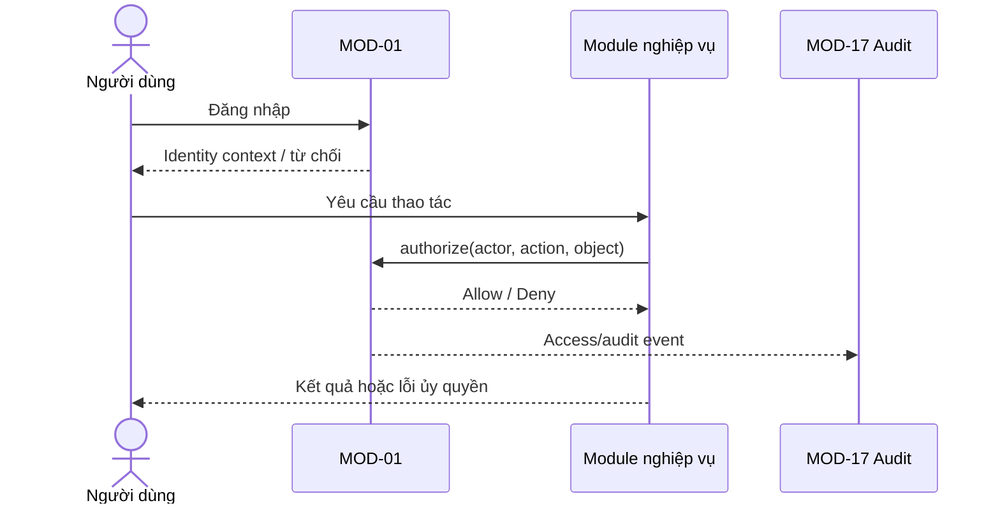

# MODULE SPECIFICATION: IDENTITY & ACCESS MANAGEMENT

## 1. Module Overview

| Thuộc tính | Nội dung |
|---|---|
| Module ID | MOD-01 |
| Module Name | Identity & Access Management |
| Category | Business/Application Module |
| Phase | MVP tối thiểu theo mô hình triển khai; mở rộng khi vận hành nhiều người dùng |
| Priority | Should; trở thành Must khi có nhiều người dùng/vai trò |
| Description | Xác thực danh tính, quản lý tài khoản/vai trò và thực thi kiểm soát truy cập theo project và đối tượng nghiệp vụ. |

## 2. Module Objectives

- Xác định actor trước khi thực hiện chức năng cần bảo vệ.
- Ngăn truy cập trái phép tới project, experiment, run, model và dữ liệu liên quan.
- Cung cấp một điểm quyết định quyền nhất quán cho toàn Backend Modular Monolith.
- Hỗ trợ mô hình local/LAN đơn giản ở MVP và có đường mở rộng sang nhiều người dùng.

## 3. Scope and Boundaries

### 3.1 In Scope

- Xác thực theo phương thức đăng nhập được phê duyệt; tạo, khóa/mở và xem trạng thái tài khoản.
- Gán vai trò, membership và quyền theo project/phạm vi đối tượng.
- Quyết định cho phép/từ chối hành động; cung cấp identity context cho module gọi.
- Phát sinh sự kiện audit cho đăng nhập, thay đổi quyền và các quyết định truy cập quan trọng.

### 3.2 Out of Scope

- Quản lý nội dung khoa học của project/experiment; quản lý secret kỹ thuật; hệ thống IAM multi-tenant phức tạp.
- Lưu audit log dài hạn (MOD-17); mã hóa/vận hành secret store; xác định quyền nghiệp vụ riêng thay cho module sở hữu đối tượng.

### 3.3 Module Boundaries

MOD-01 sở hữu danh tính, vai trò, membership và chính sách quyền. Module nghiệp vụ vẫn sở hữu đối tượng và phải gửi `actor + action + object/project context` để kiểm tra. Frontend chỉ dùng kết quả nhằm trình bày; Backend luôn tái kiểm tra quyền.

## 4. Responsibilities

- Xác thực, thiết lập/thu hồi phiên truy cập và chuẩn hóa identity context.
- Quản lý vòng đời tài khoản, vai trò và membership trong phạm vi được duyệt.
- Thực thi authorization cấp project/object; mặc định từ chối khi thiếu ngữ cảnh hoặc chính sách.
- Che giấu dữ liệu nhạy cảm trong phản hồi từ chối và phát sự kiện audit.
- Không quyết định trạng thái run, tính hợp lệ cấu hình hay quyền sở hữu artifact vật lý.

## 5. Requirements Traceability

| Requirement ID | Description | Priority |
|---|---|---|
| FR-001 | Truy cập/xác thực người dùng | Should; Must nếu nhiều người dùng |
| FR-002 | Gán vai trò và quyền theo project/phạm vi | Should |
| FR-003 | Quản lý tài khoản | Could; cần xác nhận MVP |
| FR-004 | Từ chối thao tác vượt quyền | Must nếu có nhiều vai trò |
| NFR-010 | Chỉ truy cập project/object theo quyền | Must nếu nhiều người dùng |
| NFR-011 | Không làm lộ thông tin xác thực/secret | Should; Must nếu có secret |
| NFR-012 | Có dấu vết thao tác quan trọng | Should |
| AC-016 | Từ chối và không tiết lộ dữ liệu vượt quyền | Acceptance |

## 6. Actors and Permissions

| Actor | Permission | Description |
|---|---|---|
| Researcher/Lecturer/Learner/Developer | Đăng nhập; thao tác theo membership | Không có quyền mặc định ngoài phạm vi được cấp. |
| Platform Administrator | Quản lý tài khoản/vai trò/phạm vi | Không mặc nhiên được sửa nội dung khoa học của experiment. |
| Business modules | Kiểm tra quyền | Gửi đầy đủ actor, action và object context. |
| MOD-17 | Nhận sự kiện audit | Không tham gia quyết định quyền. |

## 7. Functional Decomposition

### 7.1 Module Components

- Authentication Service; Session/Token Service; Account Service.
- Role & Membership Service; Authorization Policy Engine; Access Event Publisher.

### 7.2 Sub-functions

| Function ID | Function | Input | Output | Description |
|---|---|---|---|---|
| IAM-F01 | Authenticate | Credential/login assertion | Identity context hoặc lỗi | Xác minh theo cơ chế được duyệt. |
| IAM-F02 | Manage account | Account data/status | Account đã cập nhật | Chỉ Admin được phép. |
| IAM-F03 | Assign access | User, role, scope | Membership/role binding | Kiểm tra role và scope tồn tại. |
| IAM-F04 | Authorize | Actor, action, resource context | Allow/Deny + reason code | Quyết định tại Backend. |
| IAM-F05 | Revoke access | Session/binding | Trạng thái thu hồi | Ngăn tiếp tục sử dụng quyền đã thu hồi. |

## 8. Business Rules

| Rule ID | Rule | Description |
|---|---|---|
| IAM-R01 | Deny by default | Thiếu identity, action, scope hoặc policy thì từ chối. |
| IAM-R02 | Object access inherits project scope | Truy cập experiment/run/model đòi hỏi quyền trên project cha và quyền hành động phù hợp. |
| IAM-R03 | Least privilege | Chỉ cấp quyền tối thiểu, có thể thu hồi và không suy diễn quyền Admin. |
| IAM-R04 | No sensitive disclosure | Lỗi xác thực/phân quyền không tiết lộ credential, secret hay dữ liệu đối tượng. |
| IAM-R05 | Auditable changes | Thay đổi tài khoản, role, membership phải phát sự kiện actor/action/object/time. |

## 9. Workflow and Process

- Alternative: triển khai local một người dùng dùng identity cục bộ đã cấu hình, nhưng vẫn truyền actor hệ thống và kiểm tra policy tối thiểu.
- Exception: tài khoản khóa, phiên hết hạn, object không tồn tại hoặc membership bị thu hồi đều trả lỗi chuẩn hóa và không thực hiện thay đổi nghiệp vụ.

## 10. Data Requirements

- **Input:** credential/assertion; thông tin account; role; project membership; actor/action/resource context.
- **Output:** identity context; quyết định allow/deny; sự kiện audit đã loại bỏ secret.
- **Internal/Ownership:** User Account, Role, Permission, Project Membership, Session/Token reference; MOD-01 là owner logic.
- **Validation:** định danh duy nhất; role/action nằm trong catalog; scope tồn tại; không nhận secret trong log; cập nhật binding phải chống lost update.
- Password/token/secret không được lưu dạng rõ; dữ liệu trả về chỉ gồm trường cần thiết.

## 11. Interfaces and Dependencies

- **Upstream:** Frontend; tất cả module nghiệp vụ yêu cầu authorization.
- **Downstream:** MOD-16 lưu metadata; MOD-17 lưu audit; project context từ MOD-02.
- **Contract logic:** `authenticate`, `authorize`, `manageAccount`, `assignRole`, `assignProjectMembership`, `revokeAccess`.
- Hợp đồng authorization phải trả reason code ổn định nhưng không để lộ sự tồn tại/nội dung object ngoài quyền.

## 12. Error Handling

| Error ID | Scenario | Handling |
|---|---|---|
| IAM-E01 | Credential không hợp lệ | Từ chối chung, không nêu phần credential sai; ghi security event. |
| IAM-E02 | Phiên hết hạn/thu hồi | Yêu cầu xác thực lại; không thực hiện thao tác. |
| IAM-E03 | Không đủ quyền | Deny, không trả dữ liệu object; phát audit event phù hợp. |
| IAM-E04 | Role/scope không hợp lệ | Không lưu binding; trả lỗi validation. |
| IAM-E05 | Store/audit tạm lỗi | Không báo cập nhật quyền thành công giả; transaction rollback hoặc đánh dấu retry an toàn. |

## 13. Security and Quality Requirements

- Central authorization ở Backend; hash credential; session expiry/revocation; chống brute-force theo chính sách triển khai.
- Redact credential, token và simulator secret khỏi response/log; dùng correlation ID.
- Quyết định quyền phải nhất quán và đủ nhanh cho mọi request; mục tiêu định lượng chốt sau benchmark.
- Policy, role catalog và migration phải version hóa; test regression khi thêm action/object type.

## 14. Testing and Acceptance Criteria

- Unit test policy matrix, precedence, deny-by-default, session expiry và validation tài khoản.
- Integration test MOD-02/07/09/10/11 với authorization và MOD-17 audit.
- AC: actor hợp lệ chỉ thấy/thao tác object trong scope; actor không quyền nhận từ chối và không thấy metadata; thay đổi role có hiệu lực theo chính sách; credential/secret không xuất hiện trong log/response.
- Test chéo project, ID enumeration, tài khoản khóa, token thu hồi và concurrent membership updates.

## 15. Assumptions and Open Issues

- **Assumptions:** nhóm người dùng nhỏ; local/LAN ban đầu; một người có thể có nhiều vai trò.
- **Constraints:** chưa triển khai multi-tenant phức tạp; mọi module phải gọi authorization ở Backend.
- **Open:** MD-Q01/Q-003 mô hình triển khai; MD-Q02/Q-014 có Admin trong MVP; Q-013 số người dùng/có quản lý nhóm; phương thức login và thời hạn phiên.
- **Risks:** mô hình quyền thay đổi muộn; local-mode bị dùng như cơ chế bỏ qua authorization; audit làm lộ dữ liệu nhạy cảm.

## 16. References and Change History

- Related Documents: `MODULE_DESIGN.md`, `REQUIREMENTS_ANALYSIS.md`, `SYSTEM_ARCHITECTURE.md`, `MODULE_SPEC_TEMPLATE.md`.
- Version: 0.1; Date: 02/11/2026; Approval Status: Chờ rà soát.

| Version | Change | Status |
|---|---|---|
| 0.1 | Thiết kế chi tiết ban đầu MOD-01 | Chờ rà soát |
