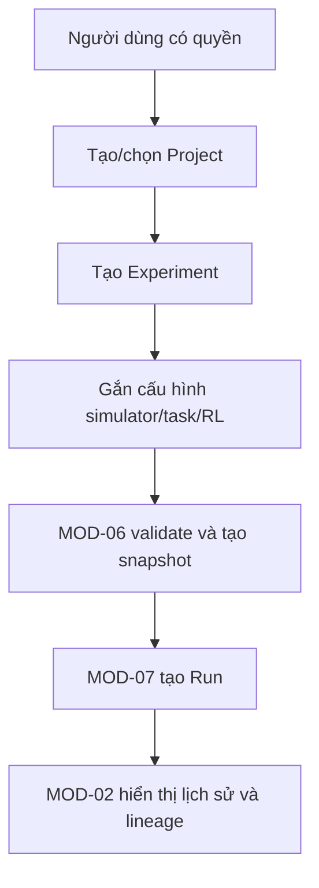

# MODULE SPECIFICATION: PROJECT & EXPERIMENT MANAGEMENT

## 1. Module Overview

| Thuộc tính | Nội dung |
|---|---|
| Module ID | MOD-02 |
| Module Name | Project & Experiment Management |
| Category | Business/Application Module |
| Phase / Priority | MVP / Must |
| Description | Tổ chức project nghiên cứu, experiment, cấu hình làm việc và lịch sử run trong một cây truy vết nhất quán. |

## 2. Module Objectives

- Cung cấp không gian tổ chức toàn bộ vòng đời thí nghiệm RL.
- Bảo đảm experiment/run/kết quả truy ngược được về project và mục tiêu thí nghiệm.
- Cho phép xem lịch sử mà không trộn trách nhiệm cấu hình kỹ thuật hay thực thi RL.

## 3. Scope and Boundaries

### 3.1 In Scope

- Tạo, xem, cập nhật và ngừng sử dụng project/experiment theo quyền.
- Quản lý metadata, mục tiêu, trạng thái logic và liên kết lịch sử run.
- Điều phối việc tạo snapshot trước run với MOD-06; trình bày tóm tắt run từ MOD-07.

### 3.2 Out of Scope

- Xác thực/quyền (MOD-01), validation/snapshot nội dung (MOD-06), vòng đời run (MOD-07), file artifact (MOD-16).
- Xóa dây chuyền dữ liệu đã có lineage; thực thi simulator/RL; thiết kế lớp học/nhóm nghiên cứu ở MVP.

### 3.3 Module Boundaries

MOD-02 sở hữu Project và Experiment cùng quan hệ cha-con. Cấu hình task/algorithm do MOD-03–05 sở hữu, snapshot bất biến do MOD-06 tạo, run do MOD-07 sở hữu; MOD-02 chỉ giữ/tham chiếu các liên kết đó.

## 4. Responsibilities

- Cấp định danh, duy trì metadata và tính toàn vẹn project–experiment.
- Áp dụng quyền qua MOD-01 cho mọi truy vấn/thay đổi.
- Cung cấp aggregate view lịch sử run nhưng không tự suy diễn trạng thái.
- Ngăn sửa/xóa làm mất truy vết của snapshot, run, model và evaluation.

## 5. Requirements Traceability

| Requirement ID | Description | Priority |
|---|---|---|
| FR-005 | Tạo project nghiên cứu có định danh | Must |
| FR-006 | Xem danh sách/chi tiết và cập nhật project | Must |
| FR-007 | Tạo experiment thuộc đúng project | Must |
| FR-008 | Xem và quản lý experiment theo quyền | Must |
| FR-009 | Lưu/đóng băng cấu hình dùng cho run (phối hợp MOD-06) | Must |
| FR-010 | Xem lịch sử run theo experiment | Must |
| NFR-005 | Metadata truy xuất sau khi run kết thúc/lỗi | Must |
| NFR-019, NFR-021 | Tái lập và lineage dữ liệu | Must |
| AC-001, AC-015 | Tạo đúng liên kết và truy vết thí nghiệm | Acceptance |

## 6. Actors and Permissions

| Actor | Permission | Description |
|---|---|---|
| Researcher | C/R/U/D project, experiment trong phạm vi sở hữu | D là archive/ngừng sử dụng nếu đã có lineage. |
| Lecturer | C/R/U theo phạm vi phụ trách | Xem lịch sử được giao. |
| Learner | R; C/U experiment nếu được cấp | Không mặc định quản lý project. |
| Algorithm Developer | R; C/U experiment kiểm thử nếu được cấp | Không mặc định đổi ownership. |
| MOD-06/MOD-07 | Đọc context, gắn snapshot/run | Qua contract nội bộ và authorization context. |

## 7. Functional Decomposition

### 7.1 Module Components

- Project Service; Experiment Service; Project Membership Facade.
- Experiment Configuration Reference; Run History Query; Archive Policy.

### 7.2 Sub-functions

| Function ID | Function | Input | Output | Description |
|---|---|---|---|---|
| PEM-F01 | Create/update project | Actor, project metadata | Project | Validate và lưu theo quyền. |
| PEM-F02 | Create/update experiment | Project, experiment metadata | Experiment | Gắn đúng project cha. |
| PEM-F03 | List/detail | Scope, filter, pagination | Authorized views | Không lộ object ngoài quyền. |
| PEM-F04 | Attach configuration reference | Experiment, config reference | Updated experiment | Không sao chép quyền sở hữu config. |
| PEM-F05 | Get run history | Experiment, filters | Run summaries | Dữ liệu trạng thái từ MOD-07. |
| PEM-F06 | Archive | Project/experiment, reason | Archived state | Bảo toàn lineage. |

## 8. Business Rules

| Rule ID | Rule | Description |
|---|---|---|
| BRL-001 | Experiment có định danh và cấu hình truy xuất được | Ghi đủ tham chiếu cấu hình/phiên bản ở mức có sẵn. |
| BRL-002 | Run tham chiếu experiment/configuration cụ thể | Không chấp nhận run mồ côi. |
| PEM-R01 | Project là aggregate root tổ chức | Experiment thuộc đúng một project trong MVP. |
| PEM-R02 | Published lineage is preserved | Có run/snapshot thì archive thay cho hard delete. |
| PEM-R03 | Names are contextual | Tên bắt buộc, trim/giới hạn độ dài; quy tắc trùng tên cần chốt theo project. |

## 9. Workflow and Process

- Alternative: tạo experiment trong project hiện có; lưu draft chưa hoàn chỉnh nhưng không được dùng để tạo run.
- Exception: thiếu trường, không đủ quyền, project archived hoặc lỗi lưu trữ thì không tạo/cập nhật thành công giả.

## 10. Data Requirements

- **Input:** project name/description/objective; experiment name/objective/description; filters; configuration references.
- **Output:** Project, Experiment, authorized lists, run-history summaries và lineage links.
- **Ownership:** Project, Experiment, trạng thái archive và quan hệ cha-con. Membership thuộc MOD-01; snapshot/run/artifact chỉ là reference.
- **Validation:** ID bất biến; parent tồn tại/đang hoạt động; trường bắt buộc; optimistic concurrency; timestamp/actor cho thay đổi.

## 11. Interfaces and Dependencies

- **Upstream:** UI-01; MOD-06, MOD-07, MOD-09–11 cần project/experiment context.
- **Downstream:** MOD-01 authorization; MOD-03–05 config references; MOD-06 snapshot; MOD-07 run history; MOD-16 persistence.
- **Contracts:** create/update/list/archive project/experiment; getExperimentContext; attachSnapshotReference; queryRunHistory.
- Không đọc trực tiếp bảng private của module khác; dùng query/contract hoặc read model được phê duyệt.

## 12. Error Handling

| Error ID | Scenario | Handling |
|---|---|---|
| PEM-E01 | Thiếu/trùng metadata theo policy | Trả lỗi theo field, không lưu partial aggregate. |
| PEM-E02 | Không có quyền | Từ chối, không lộ project/experiment. |
| PEM-E03 | Parent không tồn tại/archived | Không tạo experiment hoặc snapshot mới. |
| PEM-E04 | Xung đột cập nhật | Trả conflict và bản version hiện hành. |
| PEM-E05 | Yêu cầu xóa có lineage | Từ chối hard delete; đề nghị archive. |
| PEM-E06 | Không lấy được lịch sử run | Vẫn trả metadata experiment và đánh dấu phần history unavailable. |

## 13. Security and Quality Requirements

- Authorization mọi command/query; lọc theo scope từ nguồn, không lọc sau khi đã tải toàn bộ.
- Transaction bảo đảm liên kết project–experiment; dữ liệu tồn tại sau run lỗi/kết thúc.
- Pagination và index logic cho danh sách/lịch sử; ngưỡng hiệu năng chốt sau benchmark.
- Dùng ID ổn định, timestamps UTC, version field và module contract rõ để bảo trì.

## 14. Testing and Acceptance Criteria

- Unit: validation, archive policy, parent invariant, optimistic concurrency.
- Integration: MOD-01 scope; MOD-06 snapshot; MOD-07 history; MOD-16 persistence.
- AC-001: tạo project/experiment có ID riêng và liên kết đúng; AC-015: từ run truy về experiment/config/simulator/task/algorithm.
- Test project archived, experiment draft, cross-project access, run failed/stopped và concurrent update.

## 15. Assumptions and Open Issues

- **Assumptions:** experiment thuộc một project; draft được phép nhưng không chạy; archive bảo toàn dữ liệu.
- **Constraints:** Backend Modular Monolith; metadata ở PostgreSQL; không thiết kế multi-tenant/lớp học trong MVP.
- **Open:** quy tắc tên duy nhất; quyền delete/archive; template/clone experiment; quản lý nhóm/lớp (Q-013); retention (Q-022).
- **Risks:** nhầm MOD-02 là owner snapshot/run; hard delete phá lineage; aggregate history gây coupling truy vấn.

## 16. References and Change History

- Related Documents: `MODULE_DESIGN.md`, `REQUIREMENTS_ANALYSIS.md`, `SYSTEM_ARCHITECTURE.md`, `MODULE_SPEC_TEMPLATE.md`.
- Version: 0.1; Date: 02/11/2026; Approval Status: Chờ rà soát.

| Version | Change | Status |
|---|---|---|
| 0.1 | Thiết kế chi tiết ban đầu MOD-02 | Chờ rà soát |
