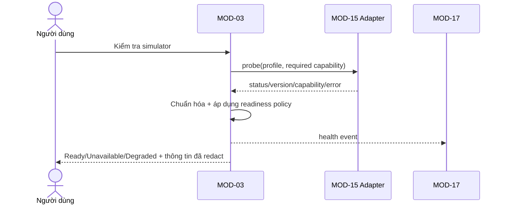

# MODULE SPECIFICATION: SIMULATOR CATALOG & HEALTH MANAGEMENT

## 1. Module Overview

| Thuộc tính | Nội dung |
|---|---|
| Module ID | MOD-03 |
| Module Name | Simulator Catalog & Health Management |
| Category | Business/Application Module |
| Phase / Priority | MVP / Must |
| Description | Công bố catalog simulator được hỗ trợ, quản lý cấu hình kết nối không nhạy cảm và cung cấp health/capability/version status cho lựa chọn và validation. |

## 2. Module Objectives

- Chỉ cho người dùng chọn simulator đã được tích hợp và kiểm chứng.
- Cho biết readiness, version, capability và lỗi cơ bản trước khi tạo run.
- Cô lập nghiệp vụ catalog/health khỏi chi tiết API runtime của từng simulator.

## 3. Scope and Boundaries

### 3.1 In Scope

- Catalog Project AirSim và Gym-PyBullet-Drones theo phiên bản được phê duyệt.
- Tạo yêu cầu health check; chuẩn hóa trạng thái, version/build, capability summary và thời điểm kiểm tra.
- Chọn/gắn simulator hợp lệ cho experiment; quản lý TTL của health result nếu được duyệt.

### 3.2 Out of Scope

- Gọi API simulator cụ thể, mapping state/action, khởi tạo/reset/step (MOD-15).
- Định nghĩa task (MOD-14), cấu hình task (MOD-04), giữ secret trực tiếp hoặc điều phối process simulator.

### 3.3 Module Boundaries

MOD-03 sở hữu catalog entry và health record chuẩn hóa. MOD-15 sở hữu adapter/cách probe. `Ready` chỉ phản ánh probe theo contract tại một thời điểm, không thay thế pre-run revalidation của MOD-06/07.

## 4. Responsibilities

- Quản lý simulator identity, support status, approved version range và adapter reference.
- Yêu cầu health probe, chuẩn hóa và lưu kết quả có timestamp/correlation ID.
- Không đánh dấu Ready khi probe thất bại/không đủ capability bắt buộc.
- Chỉ xuất thông tin kết nối đã redact; cung cấp dữ liệu cho MOD-04/06/07.

## 5. Requirements Traceability

| Requirement ID | Description | Priority |
|---|---|---|
| FR-011 | Liệt kê simulator đã cấu hình/công bố hỗ trợ | Must |
| FR-012 | Kiểm tra kết nối/sẵn sàng | Must |
| FR-013 | Ghi nhận/hiển thị version/build | Should |
| FR-014 | Chọn simulator cho experiment | Must |
| FR-015 | Hiển thị lỗi tích hợp, không báo thành công giả | Must |
| NFR-013, NFR-015–018 | Điểm mở rộng, version, phân tầng lỗi, semantics/capability | Should/Must |
| AC-002, AC-003, AC-018 | Health đúng; không chạy khi unavailable; adapter được test | Acceptance |

## 6. Actors and Permissions

| Actor | Permission | Description |
|---|---|---|
| Researcher/Developer | Xem catalog, chạy health check, chọn simulator | Chỉ trong phạm vi được cấp. |
| Lecturer/Learner | Xem/chọn simulator được phép | Không sửa connection profile. |
| Platform Administrator | Quản lý catalog/profile, health check | Secret chỉ qua cơ chế bảo vệ. |
| MOD-15 | Thực thi probe | Trả kết quả chuẩn hóa và raw diagnostic reference. |

## 7. Functional Decomposition

### 7.1 Module Components

- Simulator Catalog Service; Connection Profile Facade; Health Check Coordinator.
- Version/Capability Normalizer; Readiness Policy; Health History Query.

### 7.2 Sub-functions

| Function ID | Function | Input | Output | Description |
|---|---|---|---|---|
| SIM-F01 | List catalog | Actor, filters | Supported simulators | Lọc theo quyền/status. |
| SIM-F02 | Request probe | Simulator/profile | Health result | Gọi MOD-15 với timeout. |
| SIM-F03 | Normalize result | Adapter probe result | Status/version/capabilities | Không che mất error layer. |
| SIM-F04 | Select for experiment | Experiment, simulator | Selection reference | Chỉ khi policy đáp ứng. |
| SIM-F05 | Get health/version | Simulator | Latest/history view | Kèm timestamp và độ tươi. |

## 8. Business Rules

| Rule ID | Rule | Description |
|---|---|---|
| BRL-003 | Chỉ chạy khi simulator readiness được xác nhận | Failure/Unknown/Expired không đủ điều kiện. |
| BRL-004 | Tổ hợp phải tương thích | Capability từ MOD-15/MOD-14 là nguồn validation. |
| SIM-R01 | Ready is time-bound | Kết quả phải có checkedAt và TTL/policy; TTL còn mở. |
| SIM-R02 | Support is evidence-based | Chỉ `Supported` khi adapter contract/integration test đạt cho version. |
| SIM-R03 | Secrets are opaque | Catalog/profile view không trả credential/secret. |
| SIM-R04 | Status is not fabricated | Không suy diễn Ready chỉ từ process tồn tại hoặc cấu hình có mặt. |

## 9. Workflow and Process

- Alternative: tái sử dụng health result còn hiệu lực nếu policy cho phép.
- Exception: timeout, version không hỗ trợ, runtime không thấy, simulator bận hoặc capability thiếu → không Ready; người dùng có thể sửa và retry.

## 10. Data Requirements

- **Input:** simulator ID/type; connection profile reference; required capability; probe request.
- **Output:** normalized status, checkedAt/expiresAt, version/build, capability summary, diagnostic code.
- **Ownership:** Simulator Catalog Entry, Support Declaration, Connection Profile metadata, Health Check Record, Experiment Simulator Selection reference.
- **Validation:** simulator/adapter/version known; endpoint/profile format; timeout bounds; secret fields opaque; monotonic timestamps; stale result được gắn cờ.

## 11. Interfaces and Dependencies

- **Upstream:** UI-02; MOD-04 danh mục khả dụng; MOD-06/07 pre-run validation.
- **Downstream:** MOD-15 probe/capabilities; MOD-14 task capability; MOD-16 persistence; MOD-17 diagnostic/audit; MOD-01 authorization.
- **External:** Project AirSim, Gym-PyBullet-Drones chỉ qua MOD-15.
- **Contracts:** listSupported; checkHealth; getLatestHealth; getCapabilities; selectSimulator; validateReadiness.

## 12. Error Handling

| Error ID | Scenario | Handling |
|---|---|---|
| SIM-E01 | Runtime/endpoint không tìm thấy | Unavailable, diagnostic code và retry guidance. |
| SIM-E02 | Timeout/mất kết nối | Unavailable/Unknown theo policy; không dùng kết quả cũ như mới. |
| SIM-E03 | Version không hỗ trợ/không xác định | Degraded/Unsupported; chặn selection/run nếu version bắt buộc. |
| SIM-E04 | Simulator bận | Busy/Degraded; capacity/pre-run policy quyết định tiếp. |
| SIM-E05 | Adapter lỗi | Gắn layer `adapter`, correlation ID; MOD-17 nhận chi tiết. |
| SIM-E06 | Secret/config không hợp lệ | Thông báo đã redact; không ghi secret vào log. |

## 13. Security and Quality Requirements

- Chỉ Admin sửa profile; người dùng thường chỉ thấy alias và trường công khai; redact lỗi/log.
- Probe có timeout/cancellation, không làm treo Backend; health history truy xuất được.
- Version và adapter build được ghi để tái lập; lỗi phân biệt platform/adapter/simulator.
- Thêm simulator qua registry/contract, không sửa quy trình experiment cốt lõi.

## 14. Testing and Acceptance Criteria

- Unit: readiness policy, TTL/stale, version range, normalization và secret redaction.
- Contract/integration test riêng cho từng adapter/version: connect, reset/capability probe và failure modes.
- AC-002: probe thành công/thất bại phản ánh đúng; AC-003: unavailable không tạo Running; AC-018: bằng chứng test gắn version.
- Test timeout, busy, wrong version, stale cache, missing capability và concurrent checks.

## 15. Assumptions and Open Issues

- **Assumptions:** hai simulator mục tiêu; adapter là nguồn probe; mỗi support declaration gắn version.
- **Constraints:** hai simulator không đồng nhất physics/semantics; mọi tuyên bố support cần test thực tế.
- **Open:** Q-001/Q-002 repository/version chính xác; Q-003/Q-004 topology; TTL health; tiêu chí Degraded/Busy; ownership của việc khởi động runtime.
- **Risks:** health pass nhưng runtime hỏng trước run; version API không đủ; probe có side effect; lộ secret qua diagnostic.

## 16. References and Change History

- Related Documents: `MODULE_DESIGN.md`, `REQUIREMENTS_ANALYSIS.md`, `SYSTEM_ARCHITECTURE.md`, `MODULE_SPEC_TEMPLATE.md`.
- Version: 0.1; Date: 02/11/2026; Approval Status: Chờ rà soát.

| Version | Change | Status |
|---|---|---|
| 0.1 | Thiết kế chi tiết ban đầu MOD-03 | Chờ rà soát |
