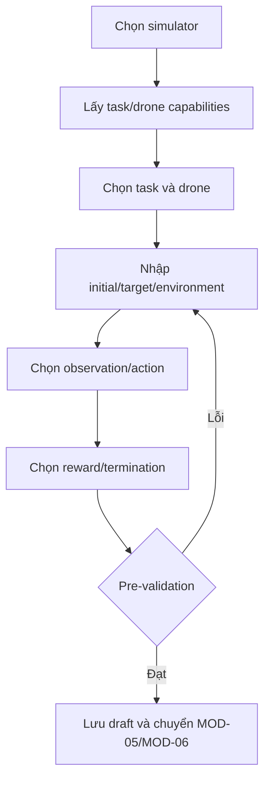

# MODULE SPECIFICATION: DRONE, ENVIRONMENT & TASK CONFIGURATION

## 1. Module Overview

| Thuộc tính | Nội dung |
|---|---|
| Module ID / Category | MOD-04 / Business/Application Module |
| Module Name | Drone, Environment & Task Configuration |
| Phase / Priority | MVP với task mẫu / Must |
| Description | Xây dựng cấu hình bài toán bay gồm drone, task, điều kiện môi trường, observation/action, reward và termination trong capability được hỗ trợ. |

## 2. Module Objectives

- Biến mục tiêu thí nghiệm thành cấu hình task rõ nghĩa, có thể kiểm tra và truy xuất.
- Chỉ cung cấp các lựa chọn thực sự được Task Registry và simulator adapter hỗ trợ.
- Ngăn giả định hai simulator có observation/action, hệ tọa độ hay đơn vị giống nhau.

## 3. Scope and Boundaries

### 3.1 In Scope

- Chọn drone/model, task; nhập initial/target/environment parameters.
- Chọn/xác nhận observation space, action space, reward profile và termination profile.
- Lưu draft/version tham chiếu và thực hiện validation cấp trường/capability sơ bộ.

### 3.2 Out of Scope

- Thực thi `reset/step`, mapping vật lý và simulator API (MOD-14/15); algorithm/hyperparameters (MOD-05).
- Validation liên module cuối cùng và snapshot bất biến (MOD-06); custom reward code tùy ý trong MVP.

### 3.3 Module Boundaries

MOD-04 sở hữu cấu hình nghiệp vụ mà người dùng chỉnh sửa. Task Contract/capability chuẩn thuộc MOD-14; adapter capability thuộc MOD-15. MOD-06 là cổng validation cuối trước run.

## 4. Responsibilities

- Lấy catalog task/drone/schema theo simulator/version; tạo và cập nhật draft cấu hình.
- Kiểm tra type, range, required field, bounds và compatibility đã công bố.
- Lưu reward/termination selection có version; trình bày lỗi theo field/quy tắc.
- Không tạo task runtime, không gọi simulator và không tự mở rộng capability.

## 5. Requirements Traceability

| Requirement ID | Description | Priority |
|---|---|---|
| FR-016 | Chọn mô hình drone được simulator/task hỗ trợ | Must nếu task yêu cầu |
| FR-017 | Chọn nhiệm vụ bay trong catalog được hỗ trợ | Must cho task MVP |
| FR-018 | Cấu hình điều kiện ban đầu, mục tiêu và tham số task | Must cho task MVP |
| FR-019 | Cấu hình observation/action nằm trong capability | Must |
| FR-020 | Cấu hình reward/termination được hỗ trợ | Must cho task mẫu |
| FR-021 | Kiểm tra tương thích tổ hợp task | Must; MOD-06 phối hợp |
| NFR-017–018 | Đúng semantics và khai báo coordinate/unit/order/bounds | Must |
| AC-004 | Chặn observation/action không tương thích | Acceptance |

## 6. Actors and Permissions

| Actor | Permission | Description |
|---|---|---|
| Researcher/Developer | C/R/U cấu hình task | Trong experiment được cấp. |
| Lecturer | C/R/U cấu hình mẫu theo quyền | Không công bố capability mới. |
| Learner | Dùng/chỉnh trường được phép | Q-023 còn mở. |
| MOD-14/MOD-15 | Cung cấp contract/capability | Nguồn sự thật kỹ thuật. |

## 7. Functional Decomposition

### 7.1 Module Components

- Task/Drone Catalog Query; Configuration Draft Service; Schema-driven Parameter Service.
- Observation/Action Selector; Reward/Termination Profile Selector; Compatibility Pre-validator.

### 7.2 Sub-functions

| Function ID | Function | Input | Output | Description |
|---|---|---|---|---|
| DTC-F01 | List choices | Simulator/version | Task/drone capability list | Chỉ lựa chọn supported. |
| DTC-F02 | Configure task | Task + params | Draft config | Validate schema/range. |
| DTC-F03 | Configure spaces | Observation/action selections | Space config | Ghi order, shape, unit, bounds. |
| DTC-F04 | Configure reward/termination | Versioned profiles/params | Config references | Không chạy code người dùng. |
| DTC-F05 | Pre-validate | Full task draft | Errors/warnings | Validation sơ bộ trước MOD-06. |

## 8. Business Rules

| Rule ID | Rule | Description |
|---|---|---|
| BRL-004 | Task/space/algorithm phải tương thích adapter | Cấu hình không hợp lệ không được chạy. |
| BRL-005 | Coordinate/unit/order/action bounds phải tường minh | Lưu trong contract/config reference. |
| BRL-009 | Reward/metric phụ thuộc task | Không dùng chung ý nghĩa mặc định. |
| DTC-R01 | Catalog-driven configuration | Không nhận task/drone/profile chưa đăng ký. |
| DTC-R02 | Draft is not executable | Chỉ snapshot đã validate mới dùng cho run. |

## 9. Workflow and Process

- Alternative: lưu draft chưa hoàn chỉnh; đổi simulator làm invalid các lựa chọn không còn hỗ trợ.
- Exception: capability/version biến mất, giá trị ngoài range hoặc schema mismatch → giữ draft, đánh dấu invalid và nêu trường cần sửa.

## 10. Data Requirements

- **Input:** simulator capability reference; drone/task IDs; initial/target/environment params; observation/action/reward/termination selection.
- **Output:** Task Configuration Draft, validation issues, dependency/version references.
- **Ownership:** draft và lựa chọn nghiệp vụ; không sở hữu Task Contract hay adapter capability.
- **Validation:** required/type/range; vector order/shape/unit; action bounds; task–drone–simulator support; reward/termination parameter constraints.

## 11. Interfaces and Dependencies

- Upstream: MOD-02 experiment, UI-03. Downstream: MOD-03, MOD-14, MOD-15 capabilities; MOD-05; MOD-06; MOD-16.
- Contracts: listSupportedTasks/Drones; getConfigurationSchema; saveDraft; validateDraft; getTaskConfiguration.
- Mọi reference tới contract/profile phải gồm identifier và version.

## 12. Error Handling

| Error ID | Scenario | Handling |
|---|---|---|
| DTC-E01 | Task/drone không supported | Từ chối selection, trả alternatives. |
| DTC-E02 | Param ngoài range/thiếu | Lỗi theo field; giữ draft hợp lệ trước đó. |
| DTC-E03 | Space không tương thích | Chặn executable status; chỉ rõ dimension/order/bounds. |
| DTC-E04 | Capability stale | Yêu cầu refresh/revalidation. |
| DTC-E05 | Lưu thất bại/xung đột | Không báo thành công; trả conflict/version. |

## 13. Security and Quality Requirements

- Authorization theo experiment; không cho custom executable code trong reward MVP.
- Schema/capability version hóa; validation deterministic; lỗi có code và path.
- Golden vectors kiểm tra coordinate/unit/action; cấu hình đủ metadata tái lập.
- UI/query catalog có pagination/cache an toàn; không cache qua version không tương thích.

## 14. Testing and Acceptance Criteria

- Unit schema/range/cross-field; property tests bounds/shape; golden tests vector order/unit.
- Integration với MOD-03/14/15/06 cho từng simulator và task MVP.
- AC-004: cấu hình observation/action sai bị chặn và có lỗi rõ; cấu hình hợp lệ lưu/truy xuất đúng version.
- Test đổi simulator, stale capability, draft thiếu, Learner restricted fields và concurrent edit.

## 15. Assumptions and Open Issues

- Task MVP là Hovering hoặc Position Control sau spike; Trajectory Tracking có thể Phase 2.
- Open: MD-Q04/Q-005 task đầu; MD-Q05/Q-007 action mode; MD-Q06/Q-008 observation/sensor; Q-009 coordinate; Q-010 custom reward; Q-023 quyền Learner.
- Risks: chốt Task Contract muộn; catalog quảng bá capability chưa test; config UI che mất semantics quan trọng.

## 16. References and Change History

- Related Documents: `MODULE_DESIGN.md`, `REQUIREMENTS_ANALYSIS.md`, `SYSTEM_ARCHITECTURE.md`, `MODULE_SPEC_TEMPLATE.md`.
- Version 0.1, 02/11/2026, Chờ rà soát.

| Version | Change | Status |
|---|---|---|
| 0.1 | Thiết kế chi tiết ban đầu MOD-04 | Chờ rà soát |
