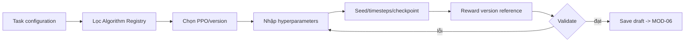

# MODULE SPECIFICATION: RL ALGORITHM & TRAINING CONFIGURATION

## 1. Module Overview

| Thuộc tính | Nội dung |
|---|---|
| Module ID / Category | MOD-05 / Business/Application Module |
| Module Name | RL Algorithm & Training Configuration |
| Phase / Priority | MVP với PPO / Must; SAC/TD3 Phase 2 |
| Description | Quản lý lựa chọn algorithm, hyperparameters, seed, training budget, checkpoint policy và reward reference có phiên bản. |

## 2. Module Objectives

- Cấu hình PPO an toàn, rõ nghĩa và tái lập cho task đã chọn.
- Tách schema cấu hình khỏi implementation vòng lặp training.
- Cho phép mở rộng algorithm qua registry mà không sửa quy trình experiment cốt lõi.

## 3. Scope and Boundaries

### 3.1 In Scope

- Liệt kê algorithm đã tích hợp; hiển thị schema/defaults/constraint.
- Cấu hình hyperparameters, seed, total timesteps, checkpoint frequency và reward config reference.
- Validation type/range/cross-field và compatibility sơ bộ với spaces/task.

### 3.2 Out of Scope

- Thực thi learn/predict (MOD-13), task spaces (MOD-04/14), snapshot cuối (MOD-06), lưu file checkpoint (MOD-09/13/16).
- Auto hyperparameter tuning lớn; custom algorithm/reward code qua UI; SAC/TD3 trong lát cắt MVP đầu.

### 3.3 Module Boundaries

MOD-05 sở hữu editable RL Configuration. MOD-13 sở hữu Algorithm Registry/runtime contract và cung cấp schema/capabilities. MOD-06 xác thực liên module và đóng băng.

## 4. Responsibilities

- Tạo/đọc/cập nhật draft RL configuration theo experiment và quyền.
- Gắn algorithm/version, schema version, seed, budget, checkpoint policy, reward version.
- Chặn giá trị sai và báo compatibility issue; không cam kết runtime nếu chưa qua MOD-06.
- Không biến default không rõ version thành cấu hình tái lập.

## 5. Requirements Traceability

| Requirement ID | Description | Priority |
|---|---|---|
| FR-022 | Chọn algorithm tương thích | Must PPO; SAC/TD3 Should |
| FR-023 | Nhập/kiểm tra hyperparameters | Must PPO cốt yếu |
| FR-024 | Seed, timesteps, checkpoint frequency | Must |
| FR-026 | Lưu reward definition/version | Must |
| NFR-013, NFR-015, NFR-019 | Extensibility, version metadata, reproducibility | Should/Must |
| AC-005 | Lưu và truy xuất cấu hình PPO hợp lệ | Acceptance |

## 6. Actors and Permissions

| Actor | Permission | Description |
|---|---|---|
| Researcher/Algorithm Developer | C/R/U full configuration | Theo experiment scope. |
| Lecturer | Dùng/chỉnh template theo quyền | Không đăng ký runtime algorithm. |
| Learner | Chỉnh tập tham số được phép | Theo chính sách Q-023. |
| MOD-13 | Cung cấp registry/schema | Nguồn capability runtime. |

## 7. Functional Decomposition

### 7.1 Module Components

- Algorithm Catalog Query; Hyperparameter Schema Validator; Training Budget Service.
- Seed & Checkpoint Policy; Reward Version Reference; Configuration Draft Service.

### 7.2 Sub-functions

| Function ID | Function | Input | Output | Description |
|---|---|---|---|---|
| RLC-F01 | List algorithms | Task/space context | Compatible candidates | PPO trong MVP. |
| RLC-F02 | Get schema/defaults | Algorithm/version | Versioned schema | Default được materialize khi lưu. |
| RLC-F03 | Save hyperparameters | Values/schema | Draft hoặc field errors | Không bỏ qua unknown field. |
| RLC-F04 | Set training controls | Seed/timesteps/checkpoint policy | Training config | Kiểm tra range/cross-field. |
| RLC-F05 | Validate compatibility | RL + task context | Issues | Pre-validation trước MOD-06. |

## 8. Business Rules

| Rule ID | Rule | Description |
|---|---|---|
| BRL-001 | Config và version truy xuất được | Materialize giá trị hiệu lực/default. |
| BRL-004 | Algorithm tương thích environment | Space/action support phải match. |
| BRL-009 | Reward definition theo task | Lưu ID/version/parameters chính xác. |
| RLC-R01 | Registry-only | Không chọn algorithm chưa đăng ký/test. |
| RLC-R02 | Seed is explicit | Seed bắt buộc hoặc policy sinh seed phải lưu giá trị đã sinh. |
| RLC-R03 | No silent coercion | Không âm thầm sửa/clip hyperparameter người dùng. |

## 9. Workflow and Process

- Alternative: đổi algorithm làm invalid/loại các trường không thuộc schema mới sau xác nhận người dùng.
- Exception: registry/schema unavailable, unknown parameter, range/cross-field lỗi → giữ draft và không đánh dấu valid.

## 10. Data Requirements

- Input: algorithm ID/version, schema version, hyperparameters, seed, timestep budget, checkpoint interval, reward reference.
- Output: RL Configuration Draft và validation issues.
- Ownership: editable RL config; registry definition thuộc MOD-13, reward task definition thuộc MOD-04/14.
- Validation: JSON-like type/schema; finite numeric values; positive budget/frequency; allowed distributions/schedules; task space compatibility.

## 11. Interfaces and Dependencies

- Upstream: MOD-02/04, UI-04. Downstream: MOD-13 registry, MOD-06, MOD-16, MOD-01.
- Contracts: listAlgorithms; getAlgorithmSchema; saveRLConfig; validateRLConfig; getEffectiveConfig.
- Schema và config đều có version; không gọi training framework trực tiếp.

## 12. Error Handling

| Error ID | Scenario | Handling |
|---|---|---|
| RLC-E01 | Algorithm/version chưa hỗ trợ | Từ chối và liệt kê supported versions. |
| RLC-E02 | Hyperparameter sai | Lỗi field/rule, không coerce âm thầm. |
| RLC-E03 | Không tương thích spaces | Chặn valid status; nêu capability mismatch. |
| RLC-E04 | Schema thay đổi/stale | Yêu cầu migrate/review; không tự nâng version. |
| RLC-E05 | Lưu xung đột | Optimistic conflict; giữ cả input người dùng. |

## 13. Security and Quality Requirements

- Authorization theo experiment; schema không cho chèn code/command/file path tùy ý.
- Validation deterministic; config/version/seed đầy đủ cho reproducibility.
- Registry extension qua contract; test migration khi schema đổi.
- Form/schema response đủ nhanh; benchmark trước khi đặt ngưỡng.

## 14. Testing and Acceptance Criteria

- Unit từng PPO parameter, cross-field, defaults materialization, seed/checkpoint policy.
- Contract test schema MOD-13; integration MOD-04/06; regression mỗi algorithm version.
- AC-005: PPO hợp lệ được lưu và truy xuất; invalid param bị từ chối rõ ràng.
- Test NaN/Infinity, boundary, unknown fields, stale schema, đổi task/space và quyền Learner.

## 15. Assumptions and Open Issues

- PPO là algorithm MVP; Stable-Baselines3/runtime cụ thể phải được chốt/version hóa.
- Open: Q-010 reward custom; Q-011 SAC/TD3; Q-015 resume state; Q-023 Learner permissions; bộ PPO parameters/defaults chính xác.
- Risks: config schema lệch runtime; defaults thay đổi theo library; seed không đủ bảo đảm deterministic tuyệt đối.

## 16. References and Change History

- Related Documents: `MODULE_DESIGN.md`, `REQUIREMENTS_ANALYSIS.md`, `SYSTEM_ARCHITECTURE.md`, `MODULE_SPEC_TEMPLATE.md`.
- Version 0.1, 02/11/2026, Chờ rà soát.

| Version | Change | Status |
|---|---|---|
| 0.1 | Thiết kế chi tiết ban đầu MOD-05 | Chờ rà soát |
