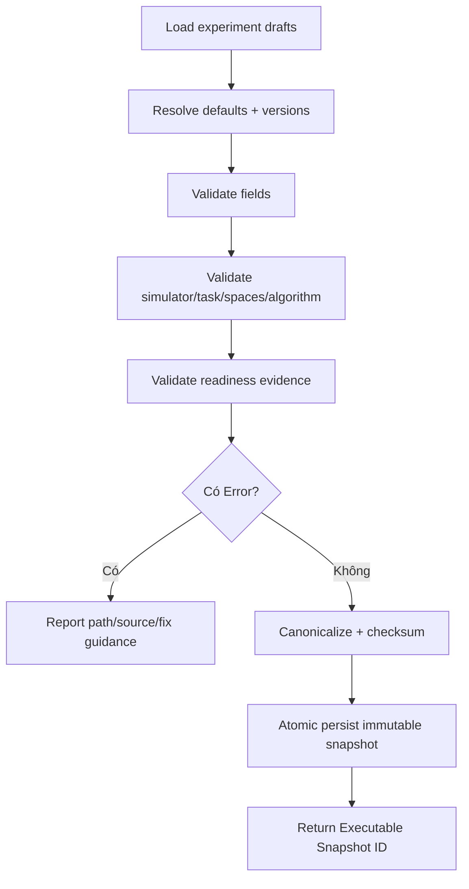

# MODULE SPECIFICATION: CONFIGURATION VALIDATION & SNAPSHOT

## 1. Module Overview

| Thuộc tính | Nội dung |
|---|---|
| Module ID / Category | MOD-06 / Business/Application Module |
| Module Name | Configuration Validation & Snapshot |
| Phase / Priority | MVP / Must |
| Description | Cổng kiểm tra liên module và đóng băng cấu hình bất biến dùng để tạo training/evaluation run. |

## 2. Module Objectives

- Phát hiện sớm tổ hợp simulator–task–spaces–algorithm không hợp lệ.
- Tạo một snapshot đầy đủ, bất biến, có checksum/version để run và kết quả truy nguyên được.
- Tách draft có thể sửa khỏi cấu hình thực thi đã phê duyệt.

## 3. Scope and Boundaries

### 3.1 In Scope

- Aggregate draft từ MOD-02–05; validation required/type/range/cross-module/capability/readiness.
- Trả lỗi/cảnh báo có path/source/severity; tạo snapshot canonical và checksum khi đạt.
- Revalidate các điều kiện dễ thay đổi trước run; quản lý supersession của snapshot.

### 3.2 Out of Scope

- Sửa draft thay người dùng; thực thi run; sở hữu catalog/task/algorithm; lưu binary artifact.
- Bảo đảm simulator tiếp tục khỏe sau thời điểm validation; resume compatibility runtime.

### 3.3 Module Boundaries

Module nguồn vẫn sở hữu draft. MOD-06 sở hữu Validation Report và Configuration Snapshot bất biến. MOD-07 chỉ nhận snapshot `Valid/Executable`; mọi thay đổi tạo snapshot mới.

## 4. Responsibilities

- Orchestrate validator theo thứ tự; tổng hợp lỗi mà không làm mất nguồn.
- Materialize default/effective values, dependency versions và readiness evidence.
- Canonicalize, checksum và lưu snapshot atomically; bảo đảm idempotency.
- Không coi warning là error trừ khi policy quy định; lưu policy/version đã dùng.

## 5. Requirements Traceability

| Requirement ID | Description | Priority |
|---|---|---|
| FR-009 | Đóng băng cấu hình dùng cho run | Must |
| FR-021 | Kiểm tra task/observation/action/reward/simulator | Must |
| FR-025 | Kiểm tra RL parameters và environment compatibility | Must |
| NFR-017–019 | Semantics, mapping declaration, reproducibility | Must |
| AC-003–006, AC-015 | Chặn unavailable/invalid; snapshot đúng và truy vết | Acceptance |

## 6. Actors and Permissions

| Actor | Permission | Description |
|---|---|---|
| Researcher/Developer/Learner theo quyền | Yêu cầu validate/snapshot | Không sửa snapshot. |
| MOD-07/MOD-10 | Lấy/kiểm tra snapshot | Chỉ dùng executable snapshot. |
| MOD-03–05/13–15 | Cung cấp config/capability validator | Không ghi trực tiếp snapshot. |

## 7. Functional Decomposition

### 7.1 Module Components

- Configuration Aggregator; Validation Orchestrator; Rule/Capability Validators.
- Canonicalizer; Snapshot Builder/Repository; Checksum & Version Service.

### 7.2 Sub-functions

| Function ID | Function | Input | Output | Description |
|---|---|---|---|---|
| CVS-F01 | Aggregate | Experiment/config refs | Effective draft | Phát hiện missing/stale refs. |
| CVS-F02 | Validate | Effective draft + capabilities | Validation report | Có error/warning/source/path. |
| CVS-F03 | Build snapshot | Valid report/config | Immutable snapshot | Materialize values/version. |
| CVS-F04 | Check executable | Snapshot + current volatile state | Decision | Recheck readiness/capacity-ref. |
| CVS-F05 | Compare snapshots | IDs | Structured diff | Hỗ trợ traceability. |

## 8. Business Rules

| Rule ID | Rule | Description |
|---|---|---|
| BRL-001/002 | Snapshot truy xuất và run tham chiếu cụ thể | Snapshot ID bất biến. |
| BRL-003/004/005 | Readiness và compatibility tường minh | Error chặn run. |
| CVS-R01 | Immutable after creation | Thay đổi tạo snapshot mới. |
| CVS-R02 | Deterministic canonicalization | Cùng effective config/policy tạo cùng checksum. |
| CVS-R03 | Error blocks; warnings are explicit | Không bỏ qua warning âm thầm. |
| CVS-R04 | Evidence is versioned | Lưu validator/policy/catalog/contract version. |

## 9. Workflow and Process

- Alternative: validation-only không tạo snapshot; snapshot mới supersede bản cũ nhưng không xóa bản đã có run.
- Exception: dependency timeout/stale → issue `Unknown/Retryable`, không tạo executable snapshot theo fail-closed policy.

## 10. Data Requirements

- Input: project/experiment refs; simulator health/version; task/space/reward config; algorithm/training config; validator policy.
- Output: Validation Report; Snapshot gồm effective config, versions, seed, metadata, checksum, timestamps, creator.
- Ownership: validation report và immutable snapshot; binary files không thuộc module.
- Validation: canonical format; no secrets; all references resolvable; checksum integrity; atomic persistence; unique idempotency key.

## 11. Interfaces and Dependencies

- Upstream: MOD-02–05, UI-03/04, MOD-07/10. Downstream: MOD-03/13/14/15 capabilities, MOD-16 persistence, MOD-01.
- Contracts: validateExperiment; createSnapshot; getSnapshot; verifySnapshot; compareSnapshots; checkExecutable.
- Snapshot schema phải version hóa và có migration/read compatibility.

## 12. Error Handling

| Error ID | Scenario | Handling |
|---|---|---|
| CVS-E01 | Thiếu/stale config reference | Error có source/path; yêu cầu refresh. |
| CVS-E02 | Compatibility/range lỗi | Tổng hợp tất cả lỗi an toàn; không snapshot. |
| CVS-E03 | Validator dependency unavailable | Retryable error, fail closed. |
| CVS-E04 | Persistence/checksum lỗi | Rollback; không trả snapshot ID hợp lệ. |
| CVS-E05 | Snapshot tampered/schema unknown | Từ chối executable, phát operational event. |

## 13. Security and Quality Requirements

- Authorization theo experiment; loại secret khỏi snapshot nhưng lưu opaque secret reference nếu cần.
- Deterministic/idempotent; atomic write; checksum verification; snapshot tồn tại sau run lỗi.
- Validator độc lập/testable, issue code ổn định; thời gian validation có timeout.
- Reproducibility: materialize defaults và phiên bản simulator/task/algorithm/runtime ở mức thu thập được.

## 14. Testing and Acceptance Criteria

- Unit canonicalization/checksum/rule severity; property test deterministic; mutation test immutable.
- Integration với MOD-03–05/13–16; fault injection timeout/persistence.
- AC-003/004: unavailable/incompatible bị chặn; AC-006: run nhận snapshot; AC-015: truy ngược đầy đủ.
- Test same input idempotency, default changes, stale capabilities, secret redaction, snapshot tampering.

## 15. Assumptions and Open Issues

- PostgreSQL là nguồn trạng thái chuẩn; snapshot tạo trước run và không sửa.
- Open: thời hạn readiness; warning override policy; ai được override; schema/canonical format; metadata phần cứng thu lúc snapshot hay runtime.
- Dependencies: mọi module phải cung cấp versioned descriptors/validators.
- Risks: snapshot thiếu default ngầm; validation TOCTOU; validator modules không đồng nhất error semantics.

## 16. References and Change History

- Related Documents: `MODULE_DESIGN.md`, `REQUIREMENTS_ANALYSIS.md`, `SYSTEM_ARCHITECTURE.md`, `MODULE_SPEC_TEMPLATE.md`.
- Version 0.1, 02/11/2026, Chờ rà soát.

| Version | Change | Status |
|---|---|---|
| 0.1 | Thiết kế chi tiết ban đầu MOD-06 | Chờ rà soát |
