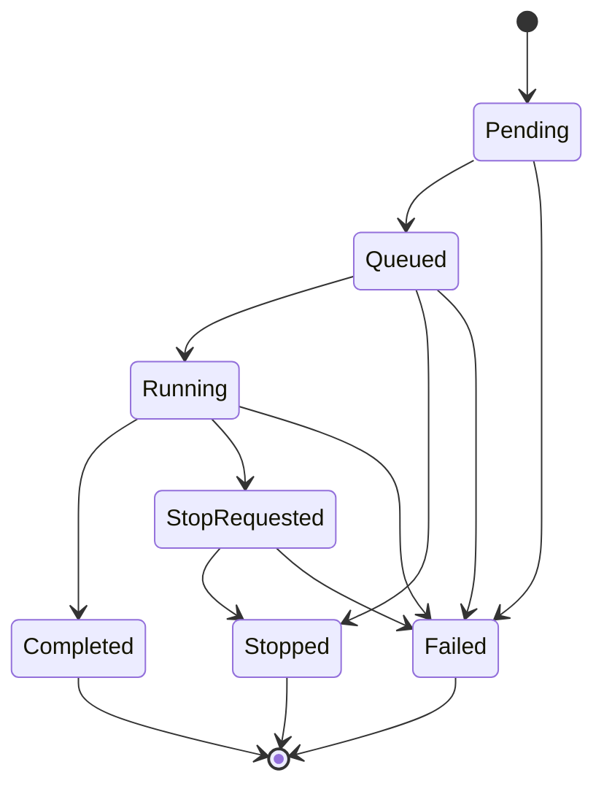

# MODULE SPECIFICATION: TRAINING RUN MANAGEMENT

## 1. Module Overview

| Thuộc tính | Nội dung |
|---|---|
| Module ID / Category | MOD-07 / Business/Application Module |
| Module Name | Training Run Management |
| Phase / Priority | MVP / Must |
| Description | Quản lý vòng đời nghiệp vụ của training run từ pre-run gate, tạo/dispatch, theo dõi trạng thái, yêu cầu dừng đến kết thúc/lỗi. |

## 2. Module Objectives

- Tạo run có snapshot và lineage đầy đủ, phản ánh đúng trạng thái thực thi.
- Cung cấp lệnh start/stop an toàn mà không chạy training loop trong Backend.
- Đối soát lỗi/heartbeat/exit để không báo hoàn thành hoặc Running giả.

## 3. Scope and Boundaries

### 3.1 In Scope

- Pre-run validation quyền, snapshot, readiness và capacity decision.
- Tạo Run Record, state machine, dispatch request, status/stop/resume-capability query.
- Nhận runtime events; ghi final state, timestamps, error summary và log reference.

### 3.2 Out of Scope

- Tạo process/heartbeat/cleanup (MOD-12); training loop (MOD-13); metrics chart (MOD-08).
- Lưu checkpoint binary (MOD-13/16); cam kết resume chính xác khi runtime chưa chứng minh.

### 3.3 Module Boundaries

MOD-07 là nguồn trạng thái nghiệp vụ chuẩn của Training Run. MOD-12 là nguồn sự thật về process/lease và gửi event; chỉ MOD-07 áp dụng transition nghiệp vụ hợp lệ và công bố trạng thái cho UI.

## 4. Responsibilities

- Bảo đảm start command idempotent; gắn project/experiment/snapshot/actor.
- Thực thi state machine tối thiểu `Pending/Queued → Running → Completed|Failed|Stopped`.
- Điều phối cooperative stop; đối soát late/duplicate/out-of-order events.
- Ghi error category/component/correlation ID; không tự đọc simulator hoặc thực thi RL.

## 5. Requirements Traceability

| Requirement ID | Description | Priority |
|---|---|---|
| FR-027 | Kiểm tra quyền, snapshot, readiness và tài nguyên | Must |
| FR-028 | Tạo và khởi chạy training run | Must |
| FR-029 | Theo dõi trạng thái hiện tại và thời điểm cập nhật | Must |
| FR-030 | Yêu cầu dừng và ghi trạng thái kết thúc | Must |
| FR-031 | Resume khi runtime/checkpoint hỗ trợ | Should/TBD |
| FR-032–FR-033 | Ghi lỗi và xem log | Must |
| NFR-001, NFR-003–006, NFR-014, NFR-016 | Không cản training; capacity; reliability; cleanup; error layer | Must |
| AC-003, AC-006, AC-008, AC-017 | Chặn invalid; tạo/dừng/lỗi đúng | Acceptance |

## 6. Actors and Permissions

| Actor | Permission | Description |
|---|---|---|
| Researcher/Developer | Start/stop/view run | Theo project scope. |
| Learner | Start/stop trong giới hạn được cấp | Áp dụng quota/policy. |
| Lecturer | View/monitor; stop nếu policy cho phép | Không mặc định thực thi. |
| Platform Admin | Hỗ trợ/view/stop theo policy vận hành | Cần audit. |
| MOD-12 | Claim và gửi runtime events | Không tự sửa DB trạng thái ngoài contract. |

## 7. Functional Decomposition

### 7.1 Module Components

- Pre-run Gate; Run Command Service; Run State Machine; Dispatch Port.
- Stop/Reconciliation Service; Error/Log Reference Service; Run Query Service.

### 7.2 Sub-functions

| Function ID | Function | Input | Output | Description |
|---|---|---|---|---|
| RUN-F01 | Validate launch | Actor, snapshot, current readiness/capacity | Decision/issues | Fail closed. |
| RUN-F02 | Create/dispatch | Idempotency key + snapshot | Run ID/state | Atomic record trước dispatch. |
| RUN-F03 | Apply runtime event | Run/version/event | New state/no-op | Kiểm tra transition/order. |
| RUN-F04 | Request stop | Actor/run/reason | StopRequested/current state | Idempotent. |
| RUN-F05 | Reconcile | DB state + supervisor evidence | Correct final state | Xử lý crash/lost heartbeat. |
| RUN-F06 | Get logs/errors | Run/scope | References/summary | Chi tiết theo quyền. |

## 8. Business Rules

| Rule ID | Rule | Description |
|---|---|---|
| BRL-002 | Run tham chiếu experiment/snapshot cụ thể | Không có run mồ côi. |
| BRL-003/004/014 | Readiness, compatibility, capacity bắt buộc | Không tạo Running khi gate fail. |
| BRL-011 | Trạng thái phản ánh thực thi | Paused chỉ khi có hỗ trợ thật. |
| BRL-013 | Failure giữ error/final state | Không báo Completed giả. |
| RUN-R01 | Terminal states are immutable | Chỉ reconciliation được sửa sai theo policy/audit. |
| RUN-R02 | Commands/events idempotent | Retry không tạo run/transition trùng. |

## 9. Workflow and Process

- Main: gate đạt → persist run/snapshot → dispatch → receive started/progress/exit → terminal state.
- Alternative: capacity policy cho queue; stop lặp lại trả trạng thái hiện tại. Exception: dispatch fail/worker crash/lost heartbeat được reconcile thành Failed/Stopped theo evidence.

## 10. Data Requirements

- Input: actor, experiment, snapshot ID/checksum, idempotency key, stop reason, runtime events.
- Output: Run Record/state/timestamps, dispatch command, stop command, error/log references.
- Ownership: Training Run aggregate, state-transition history, command status, error summary; process/metrics/artifacts thuộc module khác.
- Validation: immutable lineage; optimistic version/sequence; allowed transitions; timestamps UTC; correlation/run ID; terminal consistency.

## 11. Interfaces and Dependencies

- Upstream: UI-05, MOD-02 history, MOD-08/09. Downstream: MOD-01, MOD-03/06, MOD-12, MOD-16/17.
- Contracts: launchRun; requestStop; getRun; listRuns; applyRuntimeEvent; reconcileRun; getRunLogs.
- Event contract version hóa, có event ID/sequence/occurredAt/component; không dùng WebSocket làm nguồn trạng thái chuẩn.

## 12. Error Handling

| Error ID | Scenario | Handling |
|---|---|---|
| RUN-E01 | Gate fail | Không dispatch/Running; trả issues. |
| RUN-E02 | Dispatch/worker start fail | Run Failed với layer/correlation; không orphan record. |
| RUN-E03 | Stop runtime unreachable | Giữ StopRequested, supervisor retry/timeout/reconcile. |
| RUN-E04 | Duplicate/out-of-order event | Idempotent no-op hoặc reject có audit. |
| RUN-E05 | Lost heartbeat/crash | Supervisor evidence → Failed; giữ checkpoint hợp lệ gần nhất. |
| RUN-E06 | Persistence lỗi | Không phát dispatch khi chưa persist; transaction/outbox policy. |

## 13. Security and Quality Requirements

- Authorization start/stop/view; audit actor/action/run/time; redact log nhạy cảm.
- DB là source of truth; optimistic locking; outbox/idempotency; reconciliation định kỳ.
- Query monitoring không khóa training; capacity limit cấu hình; error phân tầng.
- State machine và event schema version hóa; correlation xuyên Backend–Worker–Adapter.

## 14. Testing and Acceptance Criteria

- Unit toàn bộ transition/guard/idempotency; property test terminal invariants.
- Integration MOD-06/12/16/17; fault injection crash, lost heartbeat, storage fail, duplicate event.
- AC-006 snapshot/lineage đúng; AC-008 stop và trạng thái cuối đúng; AC-017 lỗi có layer và xem được; AC-003 không Running khi simulator unavailable.
- Test concurrent start/stop, start retry, stale event và server restart/reconciliation.

## 15. Assumptions and Open Issues

- Worker là process riêng; PostgreSQL nguồn trạng thái chuẩn; queue chuyên dụng chưa bắt buộc.
- Open: MD-Q07/Q-012 concurrency/capacity/queue; MD-Q08/Q-015 resume; stop timeout/escalation; quyền Admin stop.
- Risks: TOCTOU readiness, split-brain supervisor, orphan process, event ordering, resume bị hiểu quá khả năng.

## 16. References and Change History

- Related Documents: `MODULE_DESIGN.md`, `REQUIREMENTS_ANALYSIS.md`, `SYSTEM_ARCHITECTURE.md`, `MODULE_SPEC_TEMPLATE.md`.
- Version 0.1, 02/11/2026, Chờ rà soát.

| Version | Change | Status |
|---|---|---|
| 0.1 | Thiết kế chi tiết ban đầu MOD-07 | Chờ rà soát |
