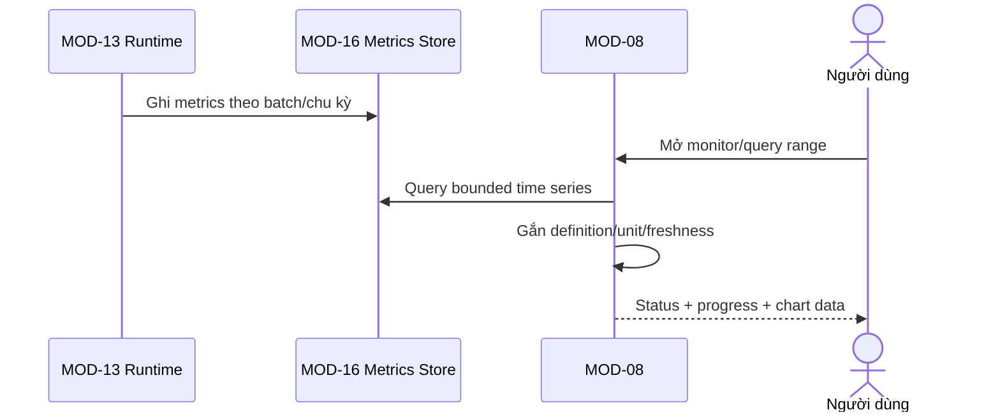

# MODULE SPECIFICATION: TRAINING MONITORING & METRICS

## 1. Module Overview

| Thuộc tính | Nội dung |
|---|---|
| Module ID / Category | MOD-08 / Business/Application Module |
| Module Name | Training Monitoring & Metrics |
| Phase / Priority | MVP metrics cơ bản / Must |
| Description | Cung cấp read model trạng thái, tiến độ và time-series metrics training có định nghĩa cho giám sát/biểu đồ. |

## 2. Module Objectives

- Giúp người dùng theo dõi run mà không làm gián đoạn training loop.
- Bảo đảm metric có nguồn, timestamp/step, định nghĩa, unit và applicability.
- Không bịa dữ liệu khi runtime không cung cấp hoặc dữ liệu đã stale.

## 3. Scope and Boundaries

### 3.1 In Scope

- Query trạng thái/progress từ MOD-07; query reward, episode length, loss và resource metric nếu có.
- Downsample/aggregate/paginate time series; cung cấp metric catalog và chart-ready data.
- Polling/WebSocket notification theo chu kỳ; đánh dấu freshness/completeness.

### 3.2 Out of Scope

- Thu metric trong training process (MOD-13); quản lý state machine (MOD-07); so sánh/export (MOD-11).
- Truy vấn simulator trực tiếp khi render UI; bắt buộc gửi mọi timestep; tự tính metric không có định nghĩa.

### 3.3 Module Boundaries

MOD-08 sở hữu monitoring query/read model và presentation contract; raw/normalized metric records nằm qua MOD-16, definition chủ yếu từ MOD-14/13. Biểu đồ training thuộc MOD-08; phân tích liên run thuộc MOD-11.

## 4. Responsibilities

- Kiểm tra quyền và run scope; trả trạng thái/progress nhất quán.
- Chuẩn hóa query time range/step/episode/aggregation; giới hạn payload.
- Gắn metric definition, unit, source, availability/freshness và sampling metadata.
- Không để polling/subscription tạo backpressure lên worker.

## 5. Requirements Traceability

| Requirement ID | Description | Priority |
|---|---|---|
| FR-034 | Reward | Must |
| FR-035–FR-036 | Episode Length, Training Loss khi có | Should |
| FR-037 | Trạng thái/timestep/episode/progress | Must |
| FR-038 | Resource info | Could |
| FR-049 | Biểu đồ training tối thiểu Reward/progress | Must |
| NFR-001–002, NFR-009 | Không cản training; kịp thời; metric có nghĩa | Must/Should |
| AC-007, AC-013 | Đúng run/source/time và có definition/unit | Acceptance |

## 6. Actors and Permissions

| Actor | Permission | Description |
|---|---|---|
| Researcher/Lecturer/Learner/Developer | View run/metrics theo project | Developer có thể thấy metric kỹ thuật theo quyền. |
| Platform Admin | Resource/diagnostic view nếu policy | Không mặc nhiên xem nội dung khoa học. |
| MOD-13/MOD-16 | Cung cấp metrics/records | MOD-08 chỉ đọc/query. |

## 7. Functional Decomposition

### 7.1 Module Components

- Monitoring Query Service; Metric Catalog Resolver; Time-series Query/Aggregation.
- Progress View Builder; Subscription/Notification Gateway; Freshness/Availability Evaluator.

### 7.2 Sub-functions

| Function ID | Function | Input | Output | Description |
|---|---|---|---|---|
| MON-F01 | Get status/progress | Run ID | State/progress/freshness | Từ MOD-07/runtime record. |
| MON-F02 | List metrics | Run/task/algorithm | Metric descriptors | Applicability rõ. |
| MON-F03 | Query series | Metric/range/granularity | Points + metadata | Bounded/paginated. |
| MON-F04 | Build chart model | Series + aggregation | Chart-ready response | Không đổi nghĩa metric. |
| MON-F05 | Subscribe | Run/topic | Notifications | Chỉ signal có dữ liệu mới. |

## 8. Business Rules

| Rule ID | Rule | Description |
|---|---|---|
| BRL-008/009 | Metric có definition/source/unit/context | Không áp dụng thì `Unavailable`, không tạo 0 giả. |
| BRL-011 | State từ MOD-07 | Metric stale không thay đổi state. |
| MON-R01 | No simulator query on UI refresh | Chỉ đọc persisted/read model. |
| MON-R02 | Sampling is explicit | Trả aggregation/sampling/downsampling metadata. |
| MON-R03 | Run isolation | Mọi point phải gắn đúng run và source time/step. |

## 9. Workflow and Process

- Alternative: polling hoặc notification; subscription chỉ báo cập nhật, client query dữ liệu chuẩn.
- Exception: store unavailable/metric absent/stale → trả partial result có status, không dùng cache cũ như mới.

## 10. Data Requirements

- Input: run ID, metric keys, time/step/episode range, resolution, aggregation.
- Output: state/progress, metric descriptors, points, units, source/freshness/completeness.
- Internal/read ownership: query presets/cache ephemeral; metric record ownership thuộc data/runtime contracts.
- Validation: finite values hoặc explicit null; monotonic sequence where applicable; allowed aggregation; range/payload limits; timestamp UTC.

## 11. Interfaces and Dependencies

- Upstream: UI-05, MOD-11. Downstream: MOD-01, MOD-07, MOD-13 catalog, MOD-14 definitions, MOD-16 store.
- Contracts: getRunMonitor; listMetricDescriptors; queryMetricSeries; subscribeRunUpdates.
- WebSocket/polling không thay DB; contract trả definition version và query metadata.

## 12. Error Handling

| Error ID | Scenario | Handling |
|---|---|---|
| MON-E01 | Run/metric không tồn tại hoặc ngoài quyền | Not found/deny không lộ dữ liệu. |
| MON-E02 | Metric không áp dụng/không được runtime cung cấp | `Unavailable` + reason. |
| MON-E03 | Store timeout | Partial/error retryable; state vẫn có thể trả riêng. |
| MON-E04 | Dữ liệu malformed/non-finite | Bỏ point lỗi có warning/telemetry; không đổi sang 0. |
| MON-E05 | Query quá lớn | Yêu cầu range/resolution nhỏ hơn hoặc paginate. |

## 13. Security and Quality Requirements

- Authorization trước query/subscription; chống ID enumeration và payload abuse.
- Read path không khóa write/training; batch/periodic update; cache bounded.
- Metric descriptor/version/units bắt buộc; observability độ trễ và dropped points.
- Mục tiêu latency/update frequency chốt sau benchmark phần cứng đích.

## 14. Testing and Acceptance Criteria

- Unit aggregation, range, freshness, availability, descriptor resolution.
- Load/integration khi training đang chạy; đo throughput ảnh hưởng so baseline.
- AC-007 đúng run/time/source; AC-013 definition/unit và `Unavailable`; FR-049 reward/progress chart.
- Test high cardinality, late/out-of-order points, terminal run, store timeout và unauthorized subscription.

## 15. Assumptions and Open Issues

- Metrics được runtime ghi batch; UI không cần mỗi timestep; PostgreSQL/read store dùng được cho MVP.
- Open: MD-Q09/Q-016 metric set/formula; update/latency threshold; retention/downsampling; resource metrics; chart resolution.
- Risks: metric meaning drift; volume lớn; monitoring làm chậm storage; stale data bị hiểu là live.

## 16. References and Change History

- Related Documents: `MODULE_DESIGN.md`, `REQUIREMENTS_ANALYSIS.md`, `SYSTEM_ARCHITECTURE.md`, `MODULE_SPEC_TEMPLATE.md`.
- Version 0.1, 02/11/2026, Chờ rà soát.

| Version | Change | Status |
|---|---|---|
| 0.1 | Thiết kế chi tiết ban đầu MOD-08 | Chờ rà soát |
