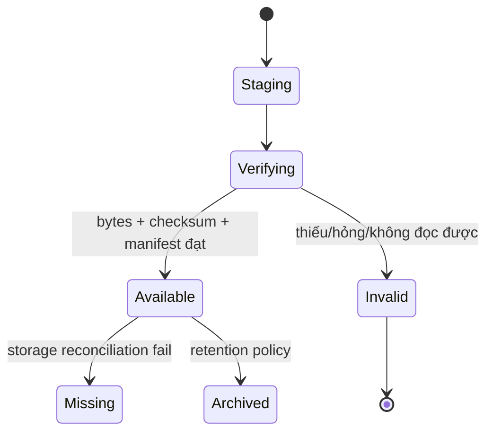

# MODULE SPECIFICATION: MODEL & CHECKPOINT MANAGEMENT

## 1. Module Overview

| Thuộc tính | Nội dung |
|---|---|
| Module ID / Category | MOD-09 / Business/Application Module |
| Module Name | Model & Checkpoint Management |
| Phase / Priority | MVP / Must |
| Description | Quản lý registry, trạng thái khả dụng, metadata, lineage và truy xuất model/checkpoint; binary artifact do MOD-16 lưu. |

## 2. Module Objectives

- Chỉ công bố checkpoint đã ghi hoàn tất, đọc được và có metadata nguồn gốc.
- Cho phép tìm, xem, tải và kiểm tra khả năng nạp trước evaluation/resume.
- Bảo toàn lineage từ artifact về run/experiment/config/runtime.

## 3. Scope and Boundaries

### 3.1 In Scope

- Đăng ký checkpoint/model metadata qua lifecycle `Staging → Verifying → Available|Invalid`.
- List/filter/detail; load-compatibility verification; tạo authorized download/export request.
- Giữ checksum, format, algorithm/runtime version, source run/snapshot và availability reason.

### 3.2 Out of Scope

- Tạo/serialize model (MOD-13), ghi/stream binary (MOD-16), chạy evaluation (MOD-10/13).
- Cam kết resume optimizer/runtime state; chuyển đổi format tùy ý; model registry thương mại.

### 3.3 Module Boundaries

MOD-09 sở hữu logical Model/Checkpoint Record và usability status. MOD-16 sở hữu Artifact Record/storage locator/bytes; MOD-13 cung cấp manifest và verifier theo runtime.

## 4. Responsibilities

- Đăng ký atomically sau upload staging; verify existence/readability/checksum/manifest.
- Không hiển thị artifact incomplete như Available; đánh dấu missing/corrupt rõ ràng.
- Authorization list/detail/download; tạo lineage view và compatibility report.
- Không trả physical path/secret; sử dụng opaque artifact reference.

## 5. Requirements Traceability

| Requirement ID | Description | Priority |
|---|---|---|
| FR-039 | Tự động lưu checkpoint theo policy (phối hợp runtime) | Must |
| FR-040–FR-041 | List và metadata | Must |
| FR-042 | Tải/xuất format hỗ trợ | Should |
| FR-043 | Kiểm tra khả năng nạp/tương thích | Must |
| NFR-007, NFR-019, NFR-021–022 | Atomic validity, reproducibility, lineage, retention | Must/Should |
| AC-009–010, AC-015 | Chỉ artifact hợp lệ; metadata/lineage đầy đủ | Acceptance |

## 6. Actors and Permissions

| Actor | Permission | Description |
|---|---|---|
| Researcher/Developer | List/detail/download/verify | Trong project được cấp. |
| Lecturer/Learner | View/download theo quyền | Không đổi metadata nguồn. |
| MOD-13 | Đề nghị đăng ký + verifier | Cung cấp manifest/checksum. |
| MOD-10 | Yêu cầu load verification | Chỉ nhận Available + compatible. |
| MOD-16 | Artifact store | Không quyết định business availability. |

## 7. Functional Decomposition

### 7.1 Module Components

- Model/Checkpoint Registry; Registration Workflow; Artifact Verification Coordinator.
- Metadata/Lineage Query; Compatibility Service; Download Authorization Facade.

### 7.2 Sub-functions

| Function ID | Function | Input | Output | Description |
|---|---|---|---|---|
| MCM-F01 | Register staged artifact | Run/snapshot/manifest/artifact ref | Record Staging | Idempotent theo artifact/checkpoint key. |
| MCM-F02 | Verify/commit | Record + target runtime optional | Available/Invalid report | Check bytes/checksum/manifest/load probe. |
| MCM-F03 | List/detail | Scope/filters | Authorized metadata | Không trả locator vật lý. |
| MCM-F04 | Check load compatibility | Checkpoint + runtime/protocol | Compatibility report | Phân biệt evaluation/resume. |
| MCM-F05 | Request download | Actor + record | Authorized stream/token | Qua MOD-16. |

## 8. Business Rules

| Rule ID | Rule | Description |
|---|---|---|
| BRL-012 | Chỉ checkpoint hoàn tất + metadata được coi dùng được | Staging/Invalid không dùng. |
| BRL-001/002 | Lineage experiment/run/config rõ | Parent refs bất biến. |
| MCM-R01 | Checksum before Available | Kích thước/checksum phải khớp manifest. |
| MCM-R02 | Loadable is purpose-specific | Load evaluation không đồng nghĩa resume đầy đủ. |
| MCM-R03 | Immutable provenance | Không sửa nguồn run/algorithm/task/simulator sau commit. |
| MCM-R04 | Deletion follows retention policy | Không xóa vật lý chỉ từ lệnh metadata tùy ý. |

## 9. Workflow and Process

- Main: runtime ghi staging → MOD-16 atomic commit → MOD-09 verify/register Available → user/MOD-10 query.
- Exception: upload/checksum/load probe lỗi → Invalid; checkpoint hợp lệ trước đó không bị ảnh hưởng.

## 10. Data Requirements

- Input: source run/snapshot, step/time, artifact ref, size/checksum/format, algorithm/task/simulator/runtime versions, verifier result.
- Output: model/checkpoint metadata, status, lineage, compatibility report, authorized download response.
- Ownership: registry record, logical labels/status/verification history; bytes/locator thuộc MOD-16.
- Validation: immutable parents; checksum/size/format; artifact exists/readable; unique key; safe display name; metadata completeness.

## 11. Interfaces and Dependencies

- Upstream: UI-06, MOD-10, MOD-11. Downstream: MOD-01, MOD-07/13, MOD-16/17.
- Contracts: registerCheckpoint; verifyCheckpoint; listModels; getModel; checkCompatibility; requestDownload; reconcileArtifact.
- Download streaming không đi qua memory Backend nếu storage adapter hỗ trợ; luôn kiểm tra quyền tại thời điểm yêu cầu.

## 12. Error Handling

| Error ID | Scenario | Handling |
|---|---|---|
| MCM-E01 | Upload incomplete/missing | Không Available; Staging timeout/Invalid. |
| MCM-E02 | Checksum/read/load fail | Invalid + reason/layer; không dùng evaluation. |
| MCM-E03 | Runtime incompatible | Record vẫn Available nhưng compatibility=false cho target. |
| MCM-E04 | Artifact mất sau commit | Mark Missing qua reconciliation; alert MOD-17. |
| MCM-E05 | Download unauthorized/store fail | Deny hoặc retryable error; không lộ locator. |

## 13. Security and Quality Requirements

- Authorization theo project; opaque artifact IDs; validate filename/content manifest; không thực thi artifact khi verify metadata đơn thuần.
- Staging→verify→atomic commit; reconciliation; checksum; lineage bất biến.
- Pagination/index cho list; download streaming/range nếu cần; threshold benchmark sau.
- Verifier theo algorithm/runtime version; format/version ghi rõ để bảo trì.

## 14. Testing and Acceptance Criteria

- Unit lifecycle, immutable provenance, purpose-specific compatibility, authorization.
- Integration MOD-13/16 với interrupted write/corrupt/missing; evaluation load probe.
- AC-009 chỉ checkpoint hoàn tất/đọc được Available; AC-010 hiển thị run/experiment/algorithm/task/simulator/version; AC-015 lineage đầy đủ.
- Test duplicate register, checksum mismatch, concurrent reconciliation, forbidden download và retention archive.

## 15. Assumptions and Open Issues

- Artifact storage cục bộ MVP; metadata PostgreSQL; checkpoint format theo runtime.
- Open: MD-Q08/Q-015 resume exact; supported export formats; final-model semantics; Q-022 retention/backup; labeling/promotion model.
- Risks: DB/file split-brain; verifier load unsafe/tốn tài nguyên; người dùng hiểu Available là resumable.

## 16. References and Change History

- Related Documents: `MODULE_DESIGN.md`, `REQUIREMENTS_ANALYSIS.md`, `SYSTEM_ARCHITECTURE.md`, `MODULE_SPEC_TEMPLATE.md`.
- Version 0.1, 02/11/2026, Chờ rà soát.

| Version | Change | Status |
|---|---|---|
| 0.1 | Thiết kế chi tiết ban đầu MOD-09 | Chờ rà soát |
