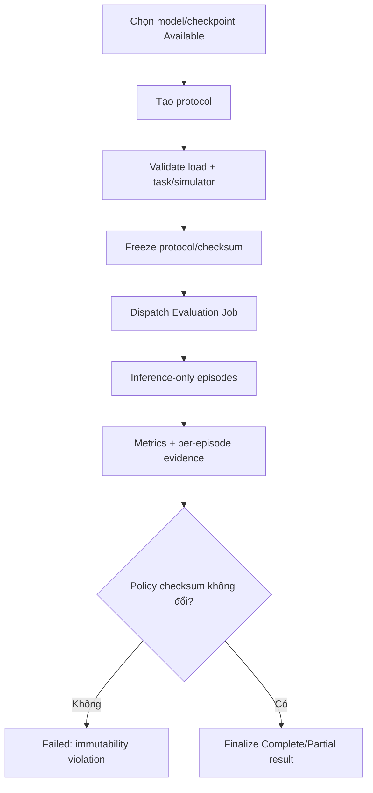

# MODULE SPECIFICATION: EVALUATION MANAGEMENT

## 1. Module Overview

| Thuộc tính | Nội dung |
|---|---|
| Module ID / Category | MOD-10 / Business/Application Module |
| Module Name | Evaluation Management |
| Phase / Priority | MVP / Must |
| Description | Quản lý protocol, vòng đời và kết quả evaluation độc lập từ model/checkpoint, bảo đảm policy input chỉ đọc và không cập nhật trọng số. |

## 2. Module Objectives

- Đánh giá policy trong điều kiện kiểm thử xác định, tách biệt dữ liệu training.
- Ghi protocol/snapshot/model lineage và completeness để kết quả tái lập, diễn giải được.
- Cưỡng chế read-only policy và thu Success Rate/Position Error khi task định nghĩa.

## 3. Scope and Boundaries

### 3.1 In Scope

- Tạo/validate Evaluation Protocol (model, task/simulator, seeds, episodes/scenarios, metrics).
- Tạo Evaluation Run, dispatch, trạng thái/dừng/lỗi và tổng kết result.
- Lưu checksum policy trước/sau, metric summary, per-episode refs và completeness.

### 3.2 Out of Scope

- Inference loop/process (MOD-12/13); task metric formula (MOD-14); artifact bytes (MOD-16).
- So sánh/visualization/export (MOD-11); cập nhật/fine-tune policy; tự suy diễn kết luận khoa học.

### 3.3 Module Boundaries

MOD-10 sở hữu Evaluation Protocol/Run/Result. MOD-09 cung cấp verified model; MOD-06 đóng băng evaluation config; MOD-12/13 thực thi; MOD-11 đọc kết quả.

## 4. Responsibilities

- Kiểm tra quyền, model loadability, task/simulator compatibility và protocol completeness.
- Tạo record/snapshot trước dispatch; dùng controller/job type riêng training.
- Cưỡng chế inference-only, verify policy checksum unchanged; đánh dấu partial result.
- Không ghi training metric namespace hoặc sửa model registry provenance.

## 5. Requirements Traceability

| Requirement ID | Description | Priority |
|---|---|---|
| FR-044 | Tạo evaluation từ model/checkpoint + config riêng | Must |
| FR-045 | Không cập nhật policy | Must |
| FR-046 | Success Rate theo protocol/task | Must khi áp dụng |
| FR-047 | Position Error | Must khi áp dụng |
| NFR-020–021 | Tách evaluation, protocol và lineage | Must |
| AC-011–012 | Policy không đổi; lưu status/model/protocol/metrics/completeness | Acceptance |

## 6. Actors and Permissions

| Actor | Permission | Description |
|---|---|---|
| Researcher/Developer | Create/start/stop/view | Theo project/model scope. |
| Lecturer | Create/view theo project | Có thể dùng protocol mẫu. |
| Learner | Theo quyền | Không mặc định đổi protocol hạn chế. |
| MOD-12/13 | Execute/report | Job/controller evaluation riêng. |

## 7. Functional Decomposition

### 7.1 Module Components

- Evaluation Protocol Service; Compatibility/Pre-run Gate; Evaluation Run State Machine.
- Execution Port; Result Finalizer; Policy Immutability Verifier; Evaluation Query.

### 7.2 Sub-functions

| Function ID | Function | Input | Output | Description |
|---|---|---|---|---|
| EVAL-F01 | Define protocol | Model, task/sim, episodes/seeds/scenarios/metrics | Draft protocol | Versioned. |
| EVAL-F02 | Validate/freeze | Draft + capabilities | Snapshot/issues | Fail closed. |
| EVAL-F03 | Start/stop evaluation | Snapshot/idempotency key | Eval Run/state | Dispatch job riêng. |
| EVAL-F04 | Record episode/result | Runtime events | Episode/result data | Không trộn training. |
| EVAL-F05 | Finalize | Evidence/checksums | Complete/Partial/Failed result | Kiểm tra policy bất biến. |

## 8. Business Rules

| Rule ID | Rule | Description |
|---|---|---|
| BRL-006 | Training và Evaluation khác nhau | Controller, records và datasets riêng. |
| BRL-007 | Evaluation chỉ rõ model và protocol | References bất biến. |
| BRL-009 | Metric phụ thuộc task/protocol | Lưu definition/version/formula ref. |
| EVAL-R01 | Policy is read-only | Không optimizer/learn/update; checksum phải không đổi. |
| EVAL-R02 | Completeness explicit | Dừng/lỗi/thiếu episode không trình bày như complete. |
| EVAL-R03 | Same model, new protocol = new result | Không ghi đè kết quả cũ. |

## 9. Workflow and Process

- Alternative: cùng model đánh giá protocol khác tạo run/result riêng.
- Exception: model không nạp, simulator lỗi, stop hoặc thiếu episode → Failed/Stopped/Partial với evidence, không complete giả.

## 10. Data Requirements

- Input: model/checkpoint ID/checksum; task/simulator refs; episodes, seeds, scenarios, time limit, metric definitions.
- Output: Protocol Snapshot, Evaluation Run/Result, per-episode refs, aggregate metrics, completeness, checksums.
- Ownership: protocol/run/result; policy artifact thuộc MOD-09/16, metric definition MOD-14.
- Validation: positive episodes; deterministic stored seeds; supported scenario/metric; immutable refs; no optimizer/training flag; checksum equality.

## 11. Interfaces and Dependencies

- Upstream: UI-07, MOD-11. Downstream: MOD-01, MOD-03/06/09, MOD-12–16, MOD-17.
- Contracts: create/validateProtocol; start/stopEvaluation; applyEvaluationEvent; finalizeResult; get/listEvaluation.
- Execution payload phân biệt `jobType=EVALUATION`; policy mount/handle read-only khi hạ tầng cho phép.

## 12. Error Handling

| Error ID | Scenario | Handling |
|---|---|---|
| EVAL-E01 | Model unavailable/incompatible | Không dispatch; compatibility report. |
| EVAL-E02 | Protocol/metric invalid | Field/rule issues; không freeze. |
| EVAL-E03 | Runtime/simulator fail | Final state Failed/Partial, giữ data hợp lệ. |
| EVAL-E04 | Policy checksum changed | Failed nghiêm trọng; quarantine result, audit. |
| EVAL-E05 | Missing episodes/metrics | Partial + missing reason; không tự tạo giá trị. |
| EVAL-E06 | Duplicate/out-of-order event | Idempotent/sequence guard như run. |

## 13. Security and Quality Requirements

- Authorization trên project/model/result; policy read-only; audit start/stop/violation.
- Process riêng, failure isolation, state reconciliation; no policy update.
- Protocol/version/seed/hardware-runtime metadata để tái lập; data namespace tách training.
- Capacity/latency theo MOD-12; metric computation không làm thay đổi policy.

## 14. Testing and Acceptance Criteria

- Unit protocol/state/completeness/aggregation; static/runtime guard cấm learn/optimizer.
- Integration policy read-only, checksum pre/post, MOD-09 load, MOD-12/13 failure injection.
- AC-011 inference-only và policy không đổi; AC-012 lưu model/protocol/status/metrics, partial không giả complete.
- Test stop giữa episode, repeated seeds, unsupported metric, simulator loss và duplicate finalization.

## 15. Assumptions and Open Issues

- Evaluation process/controller riêng; model checkpoint đủ để inference.
- Open: Q-017 episodes/seeds/scenarios; MD-Q09/Q-016 metric formulas/success; policy checksum method; stop/partial aggregation rules.
- Risks: library vô tình update buffer/state; protocol khác nhau bị so sánh trực tiếp; nondeterminism simulator.

## 16. References and Change History

- Related Documents: `MODULE_DESIGN.md`, `REQUIREMENTS_ANALYSIS.md`, `SYSTEM_ARCHITECTURE.md`, `MODULE_SPEC_TEMPLATE.md`.
- Version 0.1, 02/11/2026, Chờ rà soát.

| Version | Change | Status |
|---|---|---|
| 0.1 | Thiết kế chi tiết ban đầu MOD-10 | Chờ rà soát |
