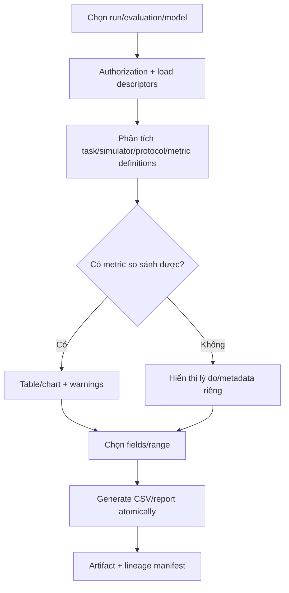

# MODULE SPECIFICATION: RESULT ANALYSIS & EXPORT

## 1. Module Overview

| Thuộc tính | Nội dung |
|---|---|
| Module ID / Category | MOD-11 / Business/Application Module |
| Module Name | Result Analysis & Export |
| Phase / Priority | MVP cơ bản; mở rộng Phase 2 / Must CSV, Should comparison |
| Description | Truy vấn, trực quan hóa quỹ đạo, so sánh kết quả và xuất dữ liệu/báo cáo có lineage, quyền và cảnh báo khả năng so sánh. |

## 2. Module Objectives

- Biến dữ liệu training/evaluation đã lưu thành view phân tích và tệp xuất có thể truy nguyên.
- Chỉ so sánh metric chung khi công khai definition/protocol/điều kiện khác biệt.
- Xuất đúng dữ liệu người dùng được phép mà không tự tạo kết luận khoa học.

## 3. Scope and Boundaries

### 3.1 In Scope

- Chọn run/evaluation/model; tạo bảng/biểu đồ so sánh metrics chung và cảnh báo mismatch.
- Trực quan hóa trajectory/reference/actual ở mức 2D hoặc dạng được duyệt.
- Xuất CSV metrics/trajectory; báo cáo cơ bản nếu ưu tiên; manifest lineage/export metadata.

### 3.2 Out of Scope

- Training chart live (MOD-08); tính lại vật lý/metric khi không có definition; thu telemetry.
- 3D interactive/video/full BI trong MVP; kết luận model nào “tốt hơn”; xuất dữ liệu vượt quyền.

### 3.3 Module Boundaries

MOD-11 sở hữu Analysis Request/View, Comparability Report và Export Job/Manifest. Nguồn metric/result/model/artifact vẫn thuộc MOD-08/09/10/16.

## 4. Responsibilities

- Authorization tất cả nguồn trước query/export; validate selection/fields/range.
- Join theo public contracts/lineage, không đọc private storage schema tùy tiện.
- So sánh metric theo stable key + definition version/unit; cảnh báo task/sim/protocol khác.
- CSV encoding/header/schema rõ; export atomic; partial/missing data được ghi trong manifest.

## 5. Requirements Traceability

| Requirement ID | Description | Priority |
|---|---|---|
| FR-048 | So sánh evaluation/model và cảnh báo điều kiện | Should |
| FR-050 | Xem reference/actual trajectory | Should; 2D/3D TBD |
| FR-051 | Xuất CSV | Must |
| FR-052 | Báo cáo thực nghiệm cơ bản | Could |
| NFR-009, NFR-020–022 | Metric semantics, evaluation separation, lineage, retention | Must/Should |
| AC-013–015 | Definition; CSV đúng scope; truy vết | Acceptance |

## 6. Actors and Permissions

| Actor | Permission | Description |
|---|---|---|
| Researcher/Lecturer | Analyze/compare/export/report theo project | Được thấy condition warnings. |
| Learner | View/export dữ liệu được cấp | Có thể hạn chế model/result của người khác. |
| Algorithm Developer | Analyze/export phục vụ kiểm thử | Theo project scope. |
| MOD-08/09/10/16 | Data providers | Không nhận quyền từ caller một cách ngầm định. |

## 7. Functional Decomposition

### 7.1 Module Components

- Result Selection/Query; Metric Alignment & Comparability Analyzer.
- Trajectory View Builder; CSV Exporter; Basic Report Composer; Export Job/Manifest.

### 7.2 Sub-functions

| Function ID | Function | Input | Output | Description |
|---|---|---|---|---|
| RAE-F01 | Select/query results | Authorized IDs/filters | Dataset summaries | Training/eval rõ loại. |
| RAE-F02 | Assess comparability | Results + descriptors/protocols | Compatible fields + warnings | Không kết luận thay người dùng. |
| RAE-F03 | Build comparison | Metrics/aggregation | Table/chart model | Units/definition version tường minh. |
| RAE-F04 | Build trajectory view | Reference/actual/range | 2D/data view | Coordinate frame/unit ghi rõ. |
| RAE-F05 | Export CSV/report | Selection/fields/format | Artifact + manifest | Atomic, authorized, reproducible. |

## 8. Business Rules

| Rule ID | Rule | Description |
|---|---|---|
| BRL-008/009 | Metric có definition/source/unit và task context | Không so key trùng nhưng nghĩa khác. |
| BRL-010 | So sánh phải công khai điều kiện | Cảnh báo simulator/task/protocol/config khác. |
| RAE-R01 | No automatic scientific conclusion | Chỉ trình bày dữ liệu/cảnh báo. |
| RAE-R02 | Export authorization is evaluated at execution | Không dựa vào quyền cache cũ. |
| RAE-R03 | Export carries lineage | Manifest có source IDs, filters, fields, generatedAt, schema version. |
| RAE-R04 | Missing is explicit | Không đổi missing/NaN thành 0. |

## 9. Workflow and Process

- Alternative: export một result/metric không cần comparison.
- Exception: nguồn thiếu, quyền thay đổi, metric incompatible hoặc tạo file lỗi → không công bố file incomplete; trả phần có thể xem kèm lý do.

## 10. Data Requirements

- Input: result/run/model IDs; metric keys; trajectory/reference fields; ranges; aggregation; export format.
- Output: comparison/trajectory view, warnings, CSV/report artifact reference, export manifest.
- Ownership: analysis/export request, comparability report, export metadata; source data không sao chép lâu dài trừ artifact đã duyệt.
- Validation: same metric definition/unit or explicit conversion policy; bounded rows/fields; CSV injection escaping; coordinate frame; access scope.

## 11. Interfaces and Dependencies

- Upstream: UI-07. Downstream: MOD-01, MOD-02, MOD-08/09/10, MOD-14 definitions, MOD-16 storage, MOD-17.
- Contracts: queryResults; assessComparability; buildTrajectoryView; requestExport; getExportStatus/download.
- Export lớn có thể thành job; file chỉ `Available` sau atomic commit; download qua MOD-16.

## 12. Error Handling

| Error ID | Scenario | Handling |
|---|---|---|
| RAE-E01 | Source thiếu/ngoài quyền | Loại/từ chối theo request semantics; không lộ metadata. |
| RAE-E02 | Metric definitions/units incompatible | Không gộp; warning + separate columns/views. |
| RAE-E03 | Trajectory frame/unit thiếu | Không vẽ gây hiểu nhầm; cung cấp raw authorized data/warning. |
| RAE-E04 | Export quá lớn | Async/paginate hoặc yêu cầu thu hẹp. |
| RAE-E05 | Generation/storage fail | Failed; xóa staging theo policy, không download incomplete. |
| RAE-E06 | Quyền bị thu hồi giữa job | Recheck trước commit/download; deny/archive theo policy. |

## 13. Security and Quality Requirements

- Object/field-level authorization; sanitize filename/CSV cells; opaque artifact ref; audit export nhạy cảm.
- Streaming/async cho dữ liệu lớn; row/timeout limits; query index; benchmark ngưỡng sau.
- Deterministic column/schema/order; definition/version/unit và lineage trong manifest.
- Atomic export; checksum; retention/backup theo MOD-16/17; partial status tường minh.

## 14. Testing and Acceptance Criteria

- Unit comparability matrix, unit/definition mismatch, CSV escaping/schema, missing values.
- Integration MOD-08/10/16; large export; access revoked mid-job; corrupted source.
- AC-013 metric có định nghĩa; AC-014 CSV đúng run/evaluation/fields và tải được; AC-015 manifest truy về experiment/config/run/model.
- Test formula/version mismatch, trajectory coordinate mismatch, multi-project selection và failed atomic commit.

## 15. Assumptions and Open Issues

- CSV là format bắt buộc; chart training live do MOD-08; 3D/video không bắt buộc MVP.
- Open: MD-Q10/Q-018 2D/3D/video; Q-019 JSON/XLSX/PDF; report template; max export size; unit conversion; retention Q-022.
- Risks: comparison gây hiểu nhầm; CSV injection/data leakage; query/export lớn ảnh hưởng training storage; semantic drift.

## 16. References and Change History

- Related Documents: `MODULE_DESIGN.md`, `REQUIREMENTS_ANALYSIS.md`, `SYSTEM_ARCHITECTURE.md`, `MODULE_SPEC_TEMPLATE.md`.
- Version 0.1, 02/11/2026, Chờ rà soát.

| Version | Change | Status |
|---|---|---|
| 0.1 | Thiết kế chi tiết ban đầu MOD-11 | Chờ rà soát |
