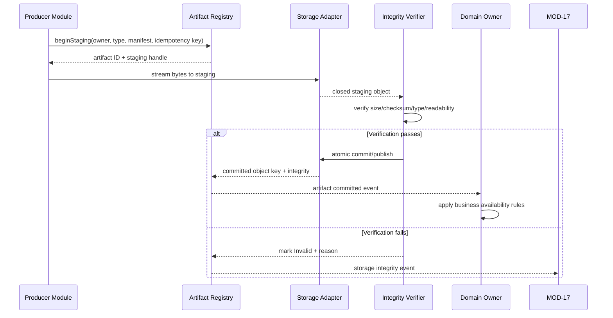
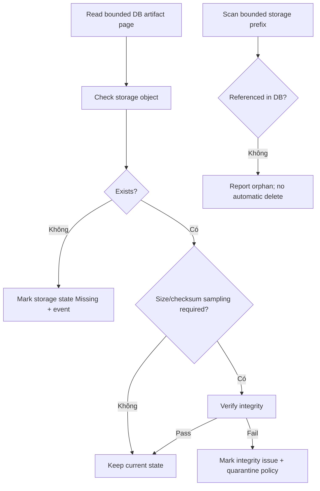

# MODULE SPECIFICATION: DATA & ARTIFACT MANAGEMENT

## 1. Module Overview

| Thuộc tính | Nội dung |
|---|---|
| Module ID | MOD-16 |
| Module Name | Data & Artifact Management |
| Category | Data & Platform Support Module |
| Phase | MVP |
| Priority | Must |
| Description | Cung cấp lớp persistence dùng chung trên PostgreSQL và Artifact Storage; quản lý metadata, configuration snapshot, metrics, artifact lifecycle, checksum, lineage, atomic commit, reconciliation, retention và backup trong khi giữ ownership nghiệp vụ tại module nguồn. |

## 2. Module Objectives

- Giữ PostgreSQL là nguồn dữ liệu chuẩn cho metadata và trạng thái có cấu trúc.
- Lưu checkpoint, model, log, trajectory và export ngoài database; DB chỉ giữ metadata/reference/checksum/status.
- Bảo đảm artifact chỉ được công bố khả dụng sau staging, verify và atomic commit.
- Duy trì lineage từ artifact/metrics/run về project, experiment và configuration snapshot.
- Cung cấp persistence contract ổn định để các module nghiệp vụ không phụ thuộc trực tiếp vào filesystem path hoặc storage vendor.
- Hỗ trợ khôi phục và đối soát khi DB và Artifact Storage lệch trạng thái.

## 3. Scope and Boundaries

### 3.1 In Scope

- PostgreSQL repositories/transaction boundary cho metadata, snapshot, run/evaluation references, metrics batch và artifact records.
- Artifact Storage abstraction cho local filesystem ở MVP và đường mở rộng object storage.
- Artifact lifecycle: `Staging → Verifying → Available | Invalid`, cùng trạng thái `Missing/Archived/Deleted` khi policy cho phép.
- Checksum, size, MIME/type, format/version, object key và manifest validation.
- Atomic commit/publish, idempotent registration và cleanup staging.
- Lineage/reference integrity, authorized locator resolution và streaming handoff.
- Metrics batch ingest/query support, pagination và retention/downsampling hook.
- Backup/restore manifest, storage reconciliation, orphan/missing detection và capacity/quota telemetry.

### 3.2 Out of Scope

- Quyết định state transition nghiệp vụ của run/evaluation/model (MOD-07, MOD-09, MOD-10).
- Tạo checkpoint/model, tính metrics hoặc tạo CSV/report (MOD-13, MOD-11).
- Authorization policy và quyền project/object (MOD-01); MOD-16 chỉ thực thi access context đã được xác minh tại contract boundary.
- Nội dung audit/operational policy và log interpretation (MOD-17).
- Lưu raw video/camera/LiDAR mặc định trong MVP; cloud object storage hoặc data lake khi chưa được phê duyệt.
- Tự xóa dữ liệu khi retention/backup/hold policy chưa được chốt.

### 3.3 Module Boundaries

- Domain module sở hữu ý nghĩa và invariants của aggregate; MOD-16 sở hữu persistence mechanism, artifact record và integrity của storage operation.
- MOD-09 sở hữu trạng thái usability của model/checkpoint; MOD-16 sở hữu bytes, locator và storage integrity. `Available` ở Artifact Storage không tự động đồng nghĩa model usable cho evaluation/resume.
- MOD-17 sở hữu audit/operational records; log file bytes có thể được MOD-16 lưu dưới dạng artifact.
- Physical path/object key là nội bộ; module/UI chỉ dùng opaque artifact ID/reference.
- Database transaction không thể atomic trực tiếp với filesystem; consistency đạt qua staged workflow, idempotency và reconciliation.

## 4. Responsibilities

- Cung cấp transaction/repository contract có optimistic concurrency và idempotency.
- Persist immutable configuration snapshot trước khi run bắt đầu và xác minh checksum khi đọc.
- Nhận metrics theo batch/chu kỳ; không buộc worker ghi từng timestep.
- Validate artifact manifest, giới hạn size/type/path và chống path traversal.
- Commit artifact bằng rename/operation atomic trong phạm vi backend storage hỗ trợ.
- Không trả locator vật lý hoặc secret storage cho client/module không cần biết.
- Đối soát record–bytes định kỳ; phát hiện `orphan`, `missing`, checksum mismatch và staging quá hạn.
- Thực thi retention/delete chỉ theo policy phê duyệt, authorization và backup/legal hold nếu có.

## 5. Requirements Traceability

| Requirement ID | Description | Priority |
|---|---|---|
| FR-009–FR-010 | Lưu immutable snapshot và truy vấn lịch sử run | Must |
| FR-032–FR-033 | Lưu error/log reference gắn run | Must |
| FR-034–FR-038 | Nhận metrics/progress/resource data theo batch | Must/Should/Could |
| FR-039–FR-043 | Lưu, verify, list metadata và cung cấp checkpoint/model bytes | Must/Should |
| FR-044–FR-048 | Lưu evaluation protocol/result/metrics và nguồn model | Must/Should |
| FR-049–FR-052 | Cung cấp dữ liệu biểu đồ, trajectory và export artifact | Must/Should/Could |
| NFR-005 | Metadata còn truy xuất sau success/stop/failure | Must |
| NFR-007 | Checkpoint incomplete/corrupt không được coi hợp lệ | Must |
| NFR-019–NFR-021 | Reproducibility, tách evaluation và lineage dữ liệu | Must |
| NFR-022 | Retention/delete/backup được phê duyệt | Should/TBD |
| AC-006–AC-007, AC-009–AC-015, AC-017 | Snapshot, metrics, artifact, evaluation, export và lỗi truy vết đúng | Acceptance |

## 6. Actors and Permissions

| Actor | Permission | Description |
|---|---|---|
| Backend Business Modules | CRUD metadata qua repository contract | Chỉ trên aggregate/scope do module đó sở hữu. |
| MOD-06 | Persist/read immutable snapshot | Không sửa snapshot sau commit. |
| MOD-08 | Query metrics/read model | Không ghi metric runtime giả. |
| MOD-09 | Register/verify/query model/checkpoint metadata | Không truy cập raw filesystem path. |
| MOD-11 | Đọc source và ghi export artifact | Recheck authorization trước publish/download. |
| MOD-12/MOD-13 | Ghi heartbeat, metrics batch, checkpoint/log/trajectory | Dùng service identity và run/attempt context. |
| MOD-17 | Ghi/read audit metadata và lưu log artifact | Audit semantics do MOD-17 sở hữu. |
| Platform Operator | Backup/restore/reconcile/retention theo quyền | Mọi destructive operation phải audit. |

## 7. Functional Decomposition

### 7.1 Module Components

- **Persistence Transaction Manager:** transaction, optimistic version, idempotency và repository unit-of-work.
- **Configuration Snapshot Store:** immutable canonical payload, schema version và checksum.
- **Metrics Store:** batch ingest, validation, query index và retention/downsampling hook.
- **Artifact Registry:** opaque ID, type/status, owner/lineage, manifest và storage reference.
- **Artifact Storage Adapter:** local filesystem MVP; object storage extension qua contract.
- **Staging & Atomic Commit Coordinator:** temporary write, verify, rename/publish và rollback cleanup.
- **Checksum & Integrity Verifier:** streaming checksum/size/readability.
- **Lineage Resolver:** project/experiment/run/evaluation/model/config references.
- **Authorized Download/Streaming Facade:** range/stream hoặc short-lived delivery mechanism khi được phê duyệt.
- **Reconciliation & Orphan Cleanup:** DB↔storage scan có giới hạn.
- **Retention, Backup & Restore Coordinator:** policy execution, manifests và verification.

### 7.2 Sub-functions

| Function ID | Function | Input | Output | Description |
|---|---|---|---|---|
| DAM-F01 | Execute transaction | Unit-of-work, expected versions | Commit/rollback result | Không phát success khi persistence fail. |
| DAM-F02 | Persist snapshot | Canonical config, schema, checksum | Immutable snapshot ref | Idempotent theo content/idempotency key. |
| DAM-F03 | Ingest metric batch | Run/attempt + metric records | Accepted/rejected counts | Validate toàn batch hoặc policy partial rõ. |
| DAM-F04 | Begin artifact staging | Owner, type, manifest | Staging handle/artifact ID | Opaque, scoped, expiring. |
| DAM-F05 | Write/stream artifact | Staging handle + bytes/stream | Size/checksum progress | Không buffer file lớn toàn bộ trong memory. |
| DAM-F06 | Verify artifact | Staging bytes + manifest | Integrity report | Size/checksum/type/readability. |
| DAM-F07 | Commit artifact | Verified staging handle | Available artifact ref | Atomic publish trong storage backend. |
| DAM-F08 | Resolve/download | Authorized context + artifact ID | Stream/denial | Không trả physical path. |
| DAM-F09 | Query lineage | Artifact/run/evaluation ID | Lineage graph/refs | Chỉ trong scope được phép. |
| DAM-F10 | Reconcile storage | Cursor/policy | Missing/orphan/stale report | Không tự xóa ngoài policy. |
| DAM-F11 | Apply retention | Approved policy + candidates | Archived/deleted report | Có dry-run, backup/hold checks. |
| DAM-F12 | Backup/restore verify | Backup target/manifest | Verified restore report | Kiểm tra cả DB và artifact correspondence. |

## 8. Business Rules

| Rule ID | Rule | Description |
|---|---|---|
| BRL-001–BRL-002 | Config/run lineage truy xuất được | Snapshot và parent refs bất biến. |
| BRL-007 | Evaluation chỉ rõ model/protocol | Persist references và checksum, không ghi đè result cũ. |
| BRL-008 | Metric có definition/source/time | Record thiếu context không được công bố như metric chuẩn. |
| BRL-012 | Checkpoint chỉ usable sau verify | Bytes staging/incomplete không Available. |
| DAM-R01 | Metadata in DB, large bytes outside DB | Không lưu checkpoint/log/trajectory binary lớn trong cột thông thường. |
| DAM-R02 | Staging before publish | Mọi artifact phải qua staging và integrity verification. |
| DAM-R03 | Artifact identity is opaque | Client/module không xây path từ user input hoặc ID nghiệp vụ. |
| DAM-R04 | Lineage is immutable | Parent project/experiment/run/snapshot/model không đổi sau commit. |
| DAM-R05 | Idempotent writes | Retry cùng key/payload không tạo artifact/metric trùng; payload khác cùng key bị conflict. |
| DAM-R06 | No silent data repair | Missing/corrupt được đánh dấu và phát event, không tự tạo bytes/metric thay thế. |
| DAM-R07 | Retention is policy-driven | Không hard-delete nếu policy, backup hoặc hold chưa xác nhận. |
| DAM-R08 | Restore must be verified | Backup tồn tại chưa đủ; phải test restore và checksum/lineage. |
| DAM-R09 | Domain state remains owned | MOD-16 không tự chuyển run/model/evaluation sang terminal business state. |

## 9. Workflow and Process

### 9.1 Artifact Commit Workflow

### 9.2 Reconciliation Workflow

- **Alternative Workflow:** metrics được ghi batch trong PostgreSQL transaction; notification chỉ báo có dữ liệu mới, không thay thế dữ liệu chuẩn.
- **Exception Workflow:** DB commit thành công nhưng storage publish lỗi hoặc ngược lại → giữ trạng thái trung gian/repair marker, chạy reconciliation; không trả artifact Available giả.

## 10. Data Requirements

- **Input Data:** domain metadata; canonical snapshot; metrics batch; artifact stream; manifest; lineage refs; retention/backup policy; authorization context.
- **Output Data:** persisted refs; artifact ID/status/checksum/size/type; query pages; metric series; lineage report; reconciliation/backup report; authorized stream.
- **Internal Data:** staging locator/token; storage object key; transaction/idempotency record; checksum state; reconciliation cursor; deletion candidate/hold state.
- **Data Ownership:** domain module sở hữu business aggregate; MOD-16 sở hữu artifact record/storage locator/integrity state và persistence infrastructure.
- **Validation Rules:** schema version; FK/reference integrity; expected row version; timestamps UTC; size/type/quota; checksum algorithm allowlist; sanitized filename/display name; no path traversal; immutable parent refs.

### 10.1 Artifact Manifest tối thiểu

| Trường | Ý nghĩa |
|---|---|
| `artifact_id`, `artifact_type`, `format_version` | Định danh opaque và loại/định dạng. |
| `project_id`, `experiment_id`, `run_or_evaluation_id` | Lineage bắt buộc theo loại artifact. |
| `snapshot_id`, `model_or_checkpoint_id` | Reference khi áp dụng. |
| `producer_component`, `producer_version`, `attempt_id` | Nguồn tạo artifact. |
| `content_length`, `checksum_algorithm`, `checksum` | Integrity. |
| `mime_type`, `compression`, `logical_filename` | Metadata hiển thị/stream an toàn. |
| `created_at`, `committed_at`, `status` | Lifecycle timestamps. |
| `retention_class`, `hold_state` | Chỉ có hiệu lực khi policy được phê duyệt. |

### 10.2 Phân loại lưu trữ

| Dữ liệu | Nơi lưu | Ghi chú |
|---|---|---|
| Project/experiment/run/evaluation metadata | PostgreSQL | Module nguồn sở hữu semantics. |
| Immutable configuration snapshot | PostgreSQL/JSON version hóa | Canonical payload + checksum; không chứa secret rõ. |
| Metrics summary/time series MVP | PostgreSQL theo batch | Index/query/retention dựa benchmark. |
| Checkpoint/model | Artifact Storage | DB giữ manifest, checksum, status, lineage. |
| Logs/trajectory/export | Artifact Storage | DB giữ reference/summary; trajectory format TBD. |
| Video/raw sensor | Ngoài MVP mặc định | Chỉ thêm sau capacity/retention approval. |

## 11. Interfaces and Dependencies

- **Upstream Modules:** MOD-01–MOD-15 đều có thể dùng persistence contract; nguồn ghi chính gồm MOD-06–MOD-13, MOD-17.
- **Downstream/External Systems:** PostgreSQL; local filesystem trong MVP; backup target được phê duyệt; object storage là extension.
- **Contracts:** `executeUnitOfWork`, `save/getSnapshot`, `ingest/queryMetrics`, `beginStaging`, `writeArtifact`, `verifyArtifact`, `commitArtifact`, `getArtifactMetadata`, `openAuthorizedStream`, `queryLineage`, `reconcile`, `applyRetention`, `backup`, `verifyRestore`.
- Repository contract phải tách domain model khỏi ORM/storage schema; artifact adapter phải tách object key/path khỏi caller.
- Không đưa file lớn qua REST memory buffer nếu có thể stream/range an toàn.

## 12. Error Handling

| Error ID | Scenario | Handling |
|---|---|---|
| DAM-E01 | PostgreSQL transaction/constraint fail | Rollback; trả conflict/retryable/validation đúng loại; không success giả. |
| DAM-E02 | Optimistic version conflict | Không ghi đè; trả expected/actual version an toàn. |
| DAM-E03 | Staging write interrupted/disk full | Giữ/mark Invalid; cleanup theo timeout; không publish. |
| DAM-E04 | Checksum/size/type mismatch | Mark Invalid/quarantine; phát integrity event. |
| DAM-E05 | Atomic commit/publish fail | Không Available; retry idempotent hoặc reconcile. |
| DAM-E06 | DB record có nhưng bytes mất | Mark storage `Missing`; domain owner quyết định business impact. |
| DAM-E07 | Orphan bytes không có DB record | Report/quarantine; không tự xóa trước retention policy. |
| DAM-E08 | Unauthorized/path traversal request | Deny, audit; không tiết lộ locator/existence ngoài quyền. |
| DAM-E09 | Query/metric batch quá lớn | Paginate/chunk/reject theo limit; không làm nghẽn training. |
| DAM-E10 | Backup/restore verification fail | Backup không đạt; giữ bản trước; cảnh báo vận hành. |
| DAM-E11 | Retention conflict với reference/hold | Bỏ qua candidate và báo policy conflict. |

## 13. Security and Quality Requirements

- **Security:** least-privilege DB/storage roles; encryption in transit; filesystem permissions; opaque IDs; path normalization; MIME/extension không được tin tuyệt đối; redact secret; authorization trước metadata/stream/delete.
- **Performance:** batch insert metrics; index theo access pattern; streaming I/O; bounded reconciliation; không checksum lại toàn bộ kho mỗi chu kỳ; benchmark trước partition/downsampling.
- **Reliability:** transaction, idempotency, staging/atomic publish, checksum, reconciliation, backup/verified restore và graceful disk-full handling.
- **Maintainability:** repository/storage ports, schema/artifact format versioning, migration có rollback/forward strategy, không để module nghiệp vụ biết path/vendor.
- **Reproducibility:** immutable snapshot/manifest; dependency/version/seed/lineage; artifact checksum; training và evaluation namespace rõ.

## 14. Testing and Acceptance Criteria

- **Unit Testing:** manifest/schema, checksum, path sanitization, idempotency, lifecycle, retention candidate và lineage invariants.
- **Database Testing:** transaction rollback, optimistic lock, FK/reference, batch metrics, pagination/index và concurrent writers.
- **Artifact Integration Testing:** partial write, process crash, disk full, checksum mismatch, atomic rename/commit, missing/orphan reconciliation và authorized streaming.
- **Backup/Restore Testing:** khôi phục DB + artifacts vào môi trường kiểm thử và xác minh checksum/lineage/loadability.
- **Acceptance:** AC-006 snapshot/run refs tồn tại; AC-007 metrics đúng run/source/time; AC-009 artifact incomplete không Available; AC-010/015 lineage đầy đủ; AC-012 evaluation partial rõ; AC-014 CSV đúng source và tải được; AC-017 error/log reference truy xuất được.
- Test phải chứng minh evaluation artifact không ghi đè policy nguồn và checkpoint Available có bytes/checksum/manifest nhất quán.

## 15. Assumptions and Open Issues

- **Assumptions:** PostgreSQL + local filesystem trong MVP; dữ liệu structured vừa phải; video/raw sensor không lưu mặc định.
- **Constraints:** DB và filesystem không có distributed transaction; cần workflow/reconciliation; PostgreSQL là nguồn metadata chuẩn.
- **Dependencies:** domain modules cung cấp ownership/lineage; MOD-01 authorization; MOD-17 operations; backup target/hạ tầng chưa chốt.
- **Open Decisions:** MD-Q11/Q-022 retention, backup, quota và dung lượng; local path/layout; trajectory CSV hay Parquet; metric retention/downsampling/partitioning; object storage phase; checksum algorithm; max artifact/export size; delete/restore RTO/RPO.
- **Risks:** DB/file split-brain; disk đầy giữa training; orphan lớn; backup DB không đồng bộ artifacts; path traversal; checksum cost; retention xóa dữ liệu còn tham chiếu; metrics volume làm chậm metadata workload.

## 16. References and Change History

- **Related Documents:** `PROJECT_INITIATION.md`, `REQUIREMENTS_ANALYSIS.md`, `SYSTEM_ARCHITECTURE.md`, `Module_design/MODULE_DESIGN.md`, `Module_design/MODULE_SPEC_TEMPLATE.md`, `MOD-06_CONFIGURATION_VALIDATION_SNAPSHOT.md`, `MOD-08_TRAINING_MONITORING_METRICS.md`, `MOD-09_MODEL_CHECKPOINT_MANAGEMENT.md`, `MOD-10_EVALUATION_MANAGEMENT.md`, `MOD-11_RESULT_ANALYSIS_EXPORT.md`.
- **Version:** 0.1.
- **Date:** 07/11/2026.
- **Approval Status:** Chờ rà soát.

| Version | Change | Status |
|---|---|---|
| 0.1 | Thiết kế chi tiết ban đầu MOD-16 | Chờ rà soát |
