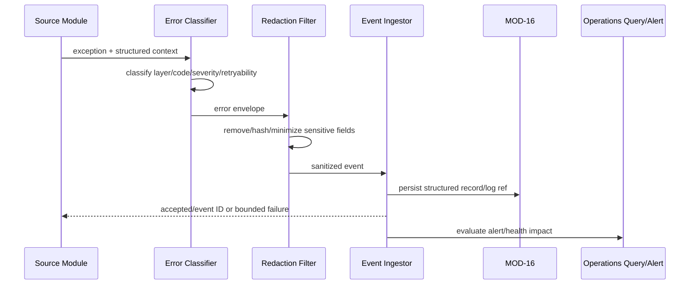
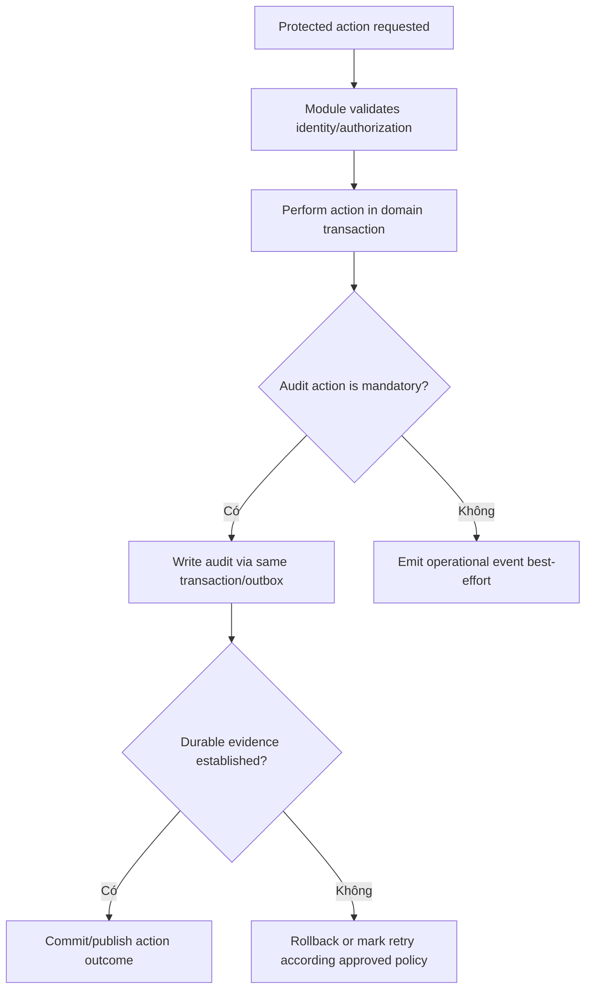

# MODULE SPECIFICATION: PLATFORM OPERATIONS & AUDIT

## 1. Module Overview

| Thuộc tính | Nội dung |
|---|---|
| Module ID | MOD-17 |
| Module Name | Platform Operations & Audit |
| Category | Data & Platform Support Module |
| Phase | MVP với structured error/log và operational status cơ bản; audit mở rộng theo mô hình multi-user |
| Priority | Must cho lỗi/vận hành cơ bản; Should cho audit đầy đủ |
| Description | Thu nhận và chuẩn hóa operational event, security/audit event, structured error, component health và log reference; hỗ trợ chẩn đoán, truy vết thao tác quan trọng, redaction, retention và cảnh báo mà không thay thế business state hoặc authorization. |

## 2. Module Objectives

- Giúp phân biệt lỗi ở API, dispatcher, worker, RL Core, task, adapter, simulator và storage.
- Tạo audit trail cho đăng nhập, thay đổi quyền, start/stop run và thao tác quan trọng đã được phê duyệt.
- Cung cấp component/worker/storage health view phục vụ vận hành local/LAN.
- Bảo vệ credential, token, secret và dữ liệu khoa học nhạy cảm khỏi log/audit.
- Liên kết event/log với actor, project, object, run, attempt và correlation ID để chẩn đoán đầu-cuối.
- Không biến hệ thống logging thành nguồn trạng thái nghiệp vụ cạnh tranh hoặc làm gián đoạn training loop.

## 3. Scope and Boundaries

### 3.1 In Scope

- Structured operational event và error envelope có schema/version.
- Audit event append-only cho action quan trọng theo policy.
- Log ingestion/buffering/reference; file log bytes lưu qua MOD-16.
- Correlation/trace context xuyên Backend–Worker–Task–Adapter–Simulator/Storage.
- Redaction, field allowlist, severity/category/component classification.
- Component health/status summary từ heartbeat/probe/evidence của module nguồn.
- Query/filter/pagination cho operator và người dùng được phép xem log run.
- Alert/notification hook cơ bản cho critical failure, stale worker, storage issue và policy violation.
- Retention/export/backup metadata theo policy phối hợp MOD-16.

### 3.2 Out of Scope

- Xác thực/authorization hoặc quyết định allow/deny (MOD-01).
- Sở hữu state machine của run/evaluation/job hoặc tự sửa trạng thái nghiệp vụ (MOD-07, MOD-10, MOD-12).
- Health probe simulator trực tiếp và quyết định Ready/Supported (MOD-03, MOD-15).
- Lưu checkpoint/model/trajectory/export bytes (MOD-16).
- Full SIEM/SOC, distributed tracing platform, automated incident response, billing/usage analytics và cloud-scale log pipeline trong MVP.
- Ghi toàn bộ observation/action/raw sensor hoặc secret để “debug”.

### 3.3 Module Boundaries

- Module nguồn sở hữu sự kiện và business outcome; MOD-17 sở hữu ingestion schema, redaction, persistence/query policy và audit trail.
- Operational log có thể best-effort theo criticality; audit bắt buộc phải đi qua reliable transaction/outbox hoặc fail-closed policy được phê duyệt cho action nhạy cảm.
- Component health là view từ evidence có timestamp/freshness, không phải lý do duy nhất để MOD-07/MOD-12 thay đổi run state.
- Log file vật lý thuộc MOD-16; MOD-17 lưu/search metadata, structured entries và reference.
- Audit record append-only không thay thế bảng trạng thái hiện hành của MOD-01 hay module nghiệp vụ.

## 4. Responsibilities

- Chuẩn hóa event/error code, component/layer, severity, outcome, timestamp và correlation context.
- Redact trước khi persist/forward; không dựa vào UI để che secret.
- Bảo đảm audit event ghi actor/action/object/scope/outcome/time và không bị sửa bởi người dùng thường.
- Phân biệt primary error với secondary cleanup/logging error để không che nguyên nhân gốc.
- Cung cấp log/error view theo quyền và không tiết lộ sự tồn tại/metadata object ngoài scope.
- Áp rate limit/sampling cho telemetry lặp lại nhưng không sample bỏ audit event bắt buộc.
- Phát cảnh báo có dedup/cooldown; không tự restart/kill process nếu chưa có runbook và quyền rõ.
- Theo dõi chính pipeline observability: dropped events, queue depth, ingestion lag và storage failure.

## 5. Requirements Traceability

| Requirement ID | Description | Priority |
|---|---|---|
| FR-001–FR-004 | Security event cho auth/account/role/access decision quan trọng | Should/Must theo mô hình user |
| FR-012–FR-015 | Health/version/integration error của simulator được truy vết | Must/Should |
| FR-032 | Lưu error status/time/basic information theo run | Must |
| FR-033 | Người có quyền xem log liên quan run | Must |
| NFR-004 | Runtime/storage failure phản ánh đúng và không completed giả | Must |
| NFR-006 | Stop/cleanup có evidence để phát hiện process mồ côi | Must |
| NFR-010–NFR-011 | Query theo quyền và không lộ secret | Must/Should |
| NFR-012 | Audit start/stop và thay đổi quyền | Should |
| NFR-016 | Phân biệt tầng lỗi bằng code/component/correlation | Must |
| NFR-022 | Retention/delete/backup log/audit theo policy | Should/TBD |
| AC-002–AC-003, AC-008, AC-016–AC-018 | Health, stop, access denial, run/adapter error có evidence | Acceptance |

## 6. Actors and Permissions

| Actor | Permission | Description |
|---|---|---|
| Tất cả backend/execution modules | Emit structured operational/audit events | Không ghi trực tiếp storage schema nội bộ. |
| MOD-01 | Emit auth/access/role/account events | Không giao authorization decision cho MOD-17. |
| MOD-03/MOD-15 | Emit simulator health/integration diagnostics | Secret/raw endpoint phải redact. |
| MOD-07/MOD-10/MOD-12 | Emit run/job/stop/crash/cleanup events | Business state vẫn do module nguồn sở hữu. |
| Researcher/Developer | Xem log/error của run trong project được cấp | Chi tiết kỹ thuật có thể lọc theo policy. |
| Platform Administrator/Operator | Xem operational health, audit và diagnostic theo quyền | Không mặc nhiên xem nội dung khoa học của mọi project. |
| Auditor/Security role tương lai | Read/export audit theo scope | Không sửa/xóa audit record tùy ý. |
| MOD-16 | Persist structured records/log artifacts | Không quyết định event severity/business outcome. |

## 7. Functional Decomposition

### 7.1 Module Components

- **Operational Event Ingestor:** validate schema, deduplicate và route.
- **Audit Event Recorder:** reliable append-only record cho action bắt buộc.
- **Error Classification Service:** category/component/layer/retryability/impact.
- **Correlation Context Propagator:** request/run/job/attempt/component IDs.
- **Redaction & Data Minimization Filter:** secret/token/path/user-data policies.
- **Log Sink & Reference Manager:** structured entry và log artifact reference qua MOD-16.
- **Component Health Aggregator:** freshness-aware status từ module evidence.
- **Operations Query Service:** filter/pagination/authorized detail.
- **Alert Rule Evaluator:** threshold/dedup/cooldown/routing hook.
- **Retention & Audit Export Coordinator:** phối hợp MOD-16 và policy.
- **Observability Pipeline Monitor:** ingestion lag/drop/storage health.

### 7.2 Sub-functions

| Function ID | Function | Input | Output | Description |
|---|---|---|---|---|
| POA-F01 | Emit operational event | Event envelope | Accepted/rejected/event ID | Async/bounded theo criticality. |
| POA-F02 | Record audit event | Actor/action/object/outcome | Durable audit ref | Append-only và reliable. |
| POA-F03 | Classify error | Exception/source context | Error envelope | Giữ primary cause/layer. |
| POA-F04 | Redact payload | Event/log fields | Sanitized payload + redaction report | Thực hiện trước persistence. |
| POA-F05 | Attach correlation | Request/run/attempt context | Correlated event | Không dùng message text để join. |
| POA-F06 | Register log artifact | Run/component + artifact ref | Searchable log reference | Bytes do MOD-16 lưu. |
| POA-F07 | Aggregate component health | Heartbeats/probes/events | Health view + freshness | Không thay source state. |
| POA-F08 | Query operations/audit | Authorized filters/cursor | Page/detail | Chống ID enumeration. |
| POA-F09 | Evaluate alert rules | Event/health stream | Alert signal/no-op | Dedup/cooldown. |
| POA-F10 | Apply retention/export | Approved policy/scope | Manifest/report | Destructive path phải audit. |
| POA-F11 | Monitor pipeline | Counters/lag/drop/storage | Pipeline health | Tránh observability failure im lặng. |

## 8. Business Rules

| Rule ID | Rule | Description |
|---|---|---|
| BRL-013 | Run failure giữ lỗi cơ bản và final state | MOD-17 lưu diagnostic; MOD-07 áp business transition. |
| IAM-R04 | Không tiết lộ dữ liệu nhạy cảm | Auth/access error dùng reason code an toàn. |
| IAM-R05 | Thay đổi account/role/membership có audit | Actor/action/object/time/outcome bắt buộc. |
| POA-R01 | Audit is append-only | Không update/delete tùy ý; correction là event mới liên kết record cũ. |
| POA-R02 | Redact before storage | Credential/token/secret/private key không được ghi rồi mới che khi đọc. |
| POA-R03 | Criticality controls delivery | Audit bắt buộc reliable; debug telemetry có thể drop/sampling có metric. |
| POA-R04 | Source owns business truth | Event/log không tự chuyển run/account/simulator state. |
| POA-R05 | Correlation fields are structured | Dùng IDs/schema, không phân tích message text làm logic. |
| POA-R06 | Primary error is preserved | Cleanup/logging error không ghi đè root cause. |
| POA-R07 | Health is time-bound | Mọi status có observedAt/expiresAt/freshness; stale không hiển thị Healthy. |
| POA-R08 | Access is scoped | Người dùng chỉ xem event/log thuộc project/object được cấp và field được phép. |
| POA-R09 | Retention is approved | Không xóa log/audit khi MD-Q11/Q-022 chưa chốt. |
| POA-R10 | No uncontrolled cardinality | Giới hạn labels/fields/message size để bảo vệ storage/query. |

## 9. Workflow and Process

### 9.1 Operational Error Workflow

### 9.2 Audit Workflow

- **Alternative Workflow:** high-volume debug events được sample/deduplicate theo policy và counters ghi số dropped; audit/security events không bị sample.
- **Exception Workflow:** event store unavailable → critical audit path fail-closed hoặc transactional outbox; non-critical telemetry buffered có giới hạn rồi drop có counter, không block training vô hạn.

## 10. Data Requirements

- **Input Data:** event/error/audit envelope; actor/action/object/scope/outcome; component/run/attempt/correlation context; health/heartbeat/probe; log artifact ref.
- **Output Data:** durable event/audit ID; error summary/reference; health view; alert signal; authorized query/export; pipeline health metrics.
- **Internal Data:** dedup key; redaction policy/version; alert state/cooldown; ingestion cursor; retention class; previous health observation.
- **Data Ownership:** MOD-17 sở hữu operational event, structured error, audit record, health read model và alert metadata. Module nguồn sở hữu business object/state; MOD-16 sở hữu persistence/artifact bytes.
- **Validation Rules:** schema version; event ID/idempotency; UTC timestamp + receive time; known component/layer/severity/action; bounded payload; valid references; no forbidden fields; actor identity from trusted context.

### 10.1 Operational Event Envelope tối thiểu

| Trường | Ý nghĩa |
|---|---|
| `event_id`, `schema_version`, `event_type` | Định danh/idempotency và contract. |
| `occurred_at`, `received_at` | Thời gian nguồn và ingest; cho phép phát hiện clock skew. |
| `component`, `layer`, `severity` | API/dispatcher/worker/rl_core/task/adapter/simulator/storage. |
| `correlation_id`, `request_id`, `run_id`, `attempt_id` | Context truy vết khi áp dụng. |
| `error_code`, `outcome`, `retryability` | Phân loại máy đọc được. |
| `message_template`, `sanitized_details` | Nội dung đã redact và bounded. |
| `log_artifact_ref` | Reference opaque tới log bytes nếu có. |

### 10.2 Audit Event Envelope tối thiểu

| Trường | Ý nghĩa |
|---|---|
| `audit_id`, `schema_version`, `occurred_at` | Định danh/version/time. |
| `actor_type`, `actor_id`, `session_or_service_ref` | Ai thực hiện từ trusted identity context. |
| `action`, `object_type`, `object_id`, `project_id` | Hành động và scope; không chứa object payload đầy đủ. |
| `decision_or_outcome`, `reason_code` | Success/denied/failed với code an toàn. |
| `correlation_id`, `source_component` | Truy vết nguồn. |
| `before_ref`, `after_ref` | Optional hash/version/diff đã tối giản, không lưu secret. |
| `retention_class`, `integrity_metadata` | Chỉ áp dụng sau khi policy được phê duyệt. |

### 10.3 Sự kiện audit tối thiểu đề xuất

- đăng nhập thành công/thất bại có rate limiting và không lưu credential;
- tạo/khóa/mở/vô hiệu hóa account;
- gán/thu hồi role hoặc project membership;
- start/stop/force-terminate run/evaluation;
- thay đổi simulator connection profile hoặc support declaration;
- download/export artifact nhạy cảm khi policy yêu cầu;
- retention delete, restore, backup verification và operator override.

## 11. Interfaces and Dependencies

- **Upstream Modules:** tất cả MOD-01–MOD-16 có thể phát event; nguồn trọng yếu gồm MOD-01, MOD-03, MOD-07, MOD-09, MOD-10, MOD-12–MOD-16.
- **Downstream Modules/Systems:** MOD-16 persistence/log artifact/backup; Backend admin query; notification/alert channel tương lai.
- **Contracts:** `emitOperationalEvent`, `recordAuditEvent`, `classifyError`, `registerLogArtifact`, `reportHealthEvidence`, `queryEvents`, `queryAudit`, `getComponentHealth`, `evaluateAlerts`, `exportAudit`, `applyRetention`.
- Event producer phải truyền structured context; MOD-17 không yêu cầu producer serialize exception chứa secret/raw observation.
- Correlation context phải được truyền qua REST/job envelope/worker event/adapter error contracts.

## 12. Error Handling

| Error ID | Scenario | Handling |
|---|---|---|
| POA-E01 | Event schema/field không hợp lệ | Reject/quarantine có producer metric; không làm crash consumer. |
| POA-E02 | Secret/forbidden field phát hiện | Redact/drop field, tăng security counter; cảnh báo nếu critical. |
| POA-E03 | Duplicate event/audit ID | Idempotent no-op nếu payload khớp; conflict nếu khác. |
| POA-E04 | Event store tạm unavailable | Buffer/retry bounded; audit bắt buộc dùng outbox/fail-closed policy. |
| POA-E05 | Log artifact write fail | Giữ structured error + missing log reason; không che primary failure. |
| POA-E06 | Query ngoài quyền | Deny/not-found an toàn; audit truy cập nhạy cảm khi cần. |
| POA-E07 | Event storm/cardinality cao | Rate limit/sample/dedup non-audit; giữ counters và critical events. |
| POA-E08 | Clock skew/out-of-order | Giữ occurred/received time; sort bằng sequence khi có; không sửa time nguồn âm thầm. |
| POA-E09 | Alert delivery fail | Retry/dedup; alert state ghi rõ pending/failed; không lặp vô hạn. |
| POA-E10 | Retention/export/backup fail | Không xóa source; ghi operational/audit failure và cho phép retry an toàn. |
| POA-E11 | Observability pipeline tự mất health | Phát local/fallback signal, metric dropped/lag và cảnh báo operator. |

## 13. Security and Quality Requirements

- **Security:** field allowlist; regex/pattern redaction chỉ là lớp phụ; token/credential/secret/private path không persist; least privilege; audit append-only; authorization cho query/export; chống log injection và payload abuse.
- **Performance:** async/batch cho non-critical events; bounded buffer; pagination/index; rate limit/cardinality guard; không log mỗi timestep/observation mặc định.
- **Reliability:** transactional outbox/fail-closed cho audit bắt buộc; idempotency; health freshness; primary error preservation; pipeline self-monitoring; backup/restore test.
- **Maintainability:** event/error/action catalog version hóa; structured fields thay vì parse text; producer SDK/helper; schema compatibility và deprecation policy.
- **Reproducibility:** correlation với snapshot/runtime/adapter/algorithm versions; event timestamp/sequence; audit thay đổi quyền/config; không tuyên bố log đủ tái lập nếu metadata nguồn thiếu.

## 14. Testing and Acceptance Criteria

- **Unit Testing:** classification, severity, redaction, dedup, health freshness, audit required fields, alert cooldown và retention candidates.
- **Security Testing:** token/password/secret/path injection; log forging/newline; ID enumeration; unauthorized audit query/export; oversized payload.
- **Integration Testing:** MOD-01 role/account audit; MOD-03/15 simulator error; MOD-07/12 start-stop-crash-cleanup; MOD-16 storage/backup event.
- **Fault Injection:** audit store unavailable, log disk full, event storm, duplicate/out-of-order event, clock skew và pipeline restart.
- **Acceptance:** AC-002/003 health failure có diagnostic nhưng không Ready; AC-008 stop có actor/runtime/cleanup evidence; AC-016 deny không lộ object; AC-017 lỗi run có layer/code/correlation/log ref; AC-018 adapter test evidence gắn version.
- Test xác nhận credential/token/simulator secret không xuất hiện trong structured record, log artifact, error response hoặc audit export.

## 15. Assumptions and Open Issues

- **Assumptions:** local/LAN nhóm nhỏ; structured logs + PostgreSQL metadata + file log artifact đủ cho MVP; Platform Admin có thể chưa được phê duyệt.
- **Constraints:** không full SIEM; observability không phải nguồn run state; không ghi raw sensor/video; audit depth phụ thuộc mô hình multi-user.
- **Dependencies:** MOD-01 identity context; producer modules phát event chuẩn; MOD-16 persistence/backup; deployment/alert channel chưa chốt.
- **Open Decisions:** MD-Q01/Q-003 topology; MD-Q02/Q-014 Admin; MD-Q11/Q-022 retention/backup; danh sách action bắt buộc audit; outbox/fail-closed policy theo action; log level/cardinality/size; alert channel/on-call; audit export format; integrity/tamper-evidence requirement.
- **Risks:** log lộ secret; audit làm transaction nhạy cảm chậm; event storm lấp lỗi gốc; clock/correlation thiếu; operator có quyền quá rộng; retention xóa bằng chứng; logging failure che primary error.

## 16. References and Change History

- **Related Documents:** `PROJECT_INITIATION.md`, `REQUIREMENTS_ANALYSIS.md`, `SYSTEM_ARCHITECTURE.md`, `Module_design/MODULE_DESIGN.md`, `Module_design/MODULE_SPEC_TEMPLATE.md`, `MOD-01_IDENTITY_ACCESS_MANAGEMENT.md`, `MOD-03_SIMULATOR_CATALOG_HEALTH_MANAGEMENT.md`, `MOD-07_TRAINING_RUN_MANAGEMENT.md`, `MOD-12_WORKER_JOB_RUNTIME_MANAGEMENT.md`, `MOD-16_DATA_ARTIFACT_MANAGEMENT.md`.
- **Version:** 0.1.
- **Date:** 07/11/2026.
- **Approval Status:** Chờ rà soát.

| Version | Change | Status |
|---|---|---|
| 0.1 | Thiết kế chi tiết ban đầu MOD-17 | Chờ rà soát |
