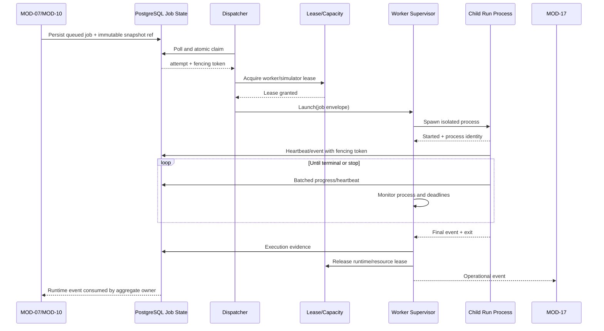
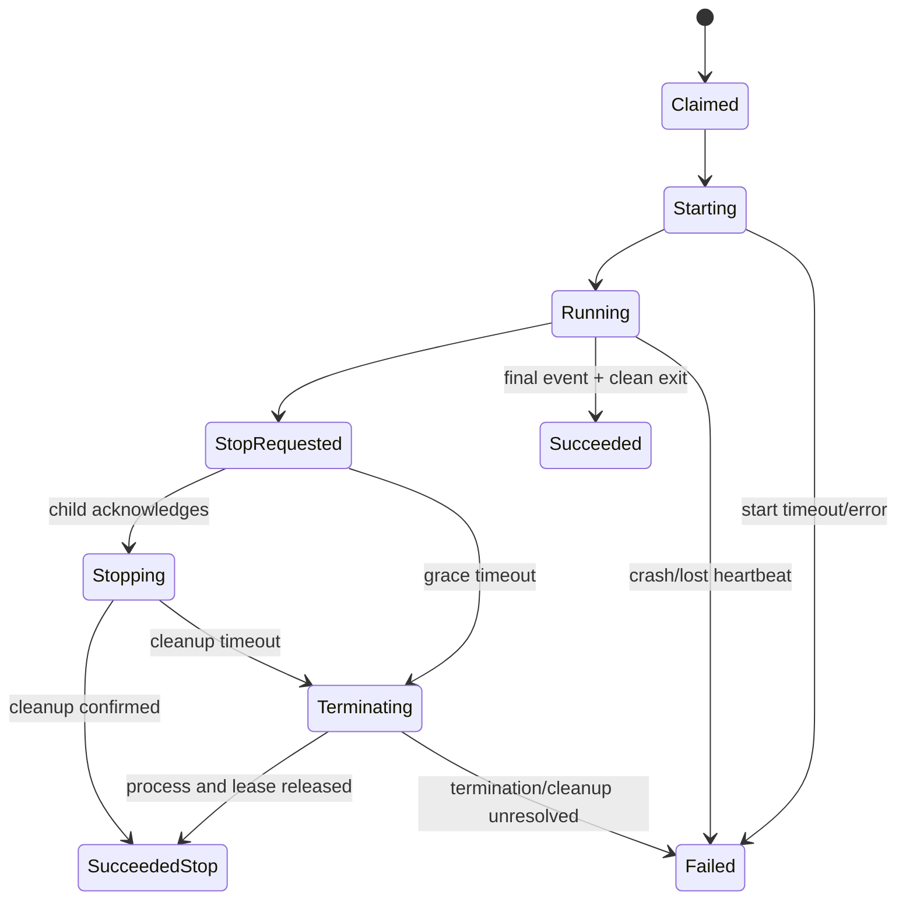

# MODULE SPECIFICATION: WORKER & JOB RUNTIME MANAGEMENT

## 1. Module Overview

| Thuộc tính | Nội dung |
|---|---|
| Module ID | MOD-12 |
| Module Name | Worker & Job Runtime Management |
| Category | Execution & Integration Module |
| Phase | MVP |
| Priority | Must |
| Description | Claim job an toàn, quản lý lease/capacity, khởi chạy process cô lập cho từng training/evaluation run, giám sát heartbeat, cooperative stop, timeout, cleanup và reconciliation giữa process thực tế với trạng thái run. |

## 2. Module Objectives

- Tách workload training/evaluation dài hạn khỏi FastAPI request và process Backend.
- Bảo đảm tại một thời điểm chỉ một worker hợp lệ thực thi một run/attempt.
- Cô lập crash, dependency và tài nguyên simulator theo từng process.
- Dừng và thu hồi tài nguyên có kiểm soát, không để process hoặc simulator runtime mồ côi trong trường hợp hệ thống có thể quản lý.
- Cung cấp bằng chứng runtime đáng tin cậy để MOD-07/MOD-10 cập nhật trạng thái nghiệp vụ, không báo `Running`, `Completed` hoặc `Stopped` giả.

## 3. Scope and Boundaries

### 3.1 In Scope

- Poll/claim job từ PostgreSQL-backed job state bằng thao tác atomic.
- Quản lý worker identity, execution attempt, lease/fencing token và heartbeat.
- Áp dụng capacity policy theo worker, simulator, runtime/world và tài nguyên được cấu hình.
- Spawn process riêng từ entry point được allowlist; truyền job envelope và immutable snapshot reference.
- Theo dõi startup, PID/process handle, exit code, timeout, stop/cancel và cleanup.
- Reconciliation khi Worker Supervisor restart, heartbeat quá hạn, process crash hoặc DB/process không đồng bộ.
- Phát runtime event/error đã chuẩn hóa cho MOD-07, MOD-10 và MOD-17.

### 3.2 Out of Scope

- Xác thực quyền người dùng, kiểm tra cấu hình nghiệp vụ hoặc tạo Run Record (MOD-01, MOD-06, MOD-07, MOD-10).
- Thực thi PPO/inference, tính reward, metrics hoặc checkpoint serialization (MOD-13).
- Định nghĩa Gymnasium task hay gọi simulator API trực tiếp (MOD-14, MOD-15).
- Sở hữu trạng thái nghiệp vụ cuối của Training Run/Evaluation Run; MOD-12 chỉ cung cấp execution evidence.
- Distributed scheduler, cluster GPU, Celery/Redis, Kubernetes orchestration và automatic retry quy mô lớn trong MVP.

### 3.3 Module Boundaries

- MOD-07 sở hữu Training Run aggregate và state machine nghiệp vụ; MOD-10 sở hữu Evaluation Run/Result.
- MOD-12 sở hữu Job Execution/Attempt, worker lease, process lifecycle và runtime evidence.
- Child process do MOD-12 tạo nhưng nội dung thực thi bên trong thuộc MOD-13.
- PostgreSQL là nguồn trạng thái chuẩn trong MVP; không tạo nguồn trạng thái cạnh tranh trong memory hoặc WebSocket.
- MOD-12 không chuyển run sang trạng thái nghiệp vụ terminal bằng cách ghi tùy ý. Nó phát event có version/sequence để module sở hữu aggregate áp dụng transition.

## 4. Responsibilities

- Claim đúng một job đủ điều kiện, không double execution khi nhiều dispatcher/supervisor cùng poll.
- Kiểm tra capacity và runtime lease ngay trước khi start để giảm TOCTOU.
- Tạo execution attempt bất biến gắn `job_id`, `run_id`, `job_type`, `snapshot_ref`, `attempt_no` và `fencing_token`.
- Quản lý cooperative cancellation trước, sau đó timeout/escalation theo policy đã cấu hình.
- Gọi cleanup cho process, file handle, IPC, Task Environment và runtime lease trên cả success/failure/stop.
- Reconcile orphan/stale attempt và phát error đúng tầng `dispatcher`, `worker`, `runtime`, `adapter`, `simulator` hoặc `storage` khi có evidence.
- Không tự retry training/evaluation từ đầu nếu chưa có policy idempotency/resume được phê duyệt.

## 5. Requirements Traceability

| Requirement ID | Description | Priority |
|---|---|---|
| FR-027 | Phối hợp kiểm tra capacity/resource trước khi thực thi | Must |
| FR-028 | Nhận và thực thi training job đã được tạo hợp lệ | Must |
| FR-029 | Cung cấp heartbeat/process evidence cho trạng thái run | Must |
| FR-030 | Chuyển stop request tới process và xác nhận kết thúc | Must |
| FR-031 | Chỉ phục hồi khi runtime/checkpoint chứng minh hỗ trợ | Should/TBD |
| FR-032–FR-033 | Phát lỗi phân tầng và log reference | Must |
| FR-039 | Cho phép callback checkpoint chạy trong process được quản lý | Must |
| FR-044–FR-045 | Thực thi evaluation job riêng và không nhập nhằng với training | Must |
| NFR-001 | Process training không chạy trong API/monitor request | Must |
| NFR-003, NFR-014 | Capacity gate và giới hạn concurrency theo tài nguyên | Must |
| NFR-004–NFR-006 | Trạng thái đúng, metadata còn truy xuất, stop không để process mồ côi | Must |
| NFR-016 | Lỗi phân biệt đúng tầng | Must |
| AC-006, AC-008, AC-011, AC-017 | Start/stop/evaluation/failure có evidence đúng | Acceptance |

## 6. Actors and Permissions

| Actor | Permission | Description |
|---|---|---|
| MOD-07 Training Run Management | Enqueue, request stop, nhận runtime event | Chỉ gửi run/snapshot đã qua pre-run gate. |
| MOD-10 Evaluation Management | Enqueue evaluation, request stop, nhận runtime event | Job bắt buộc có `job_type = evaluation`. |
| Platform Operator | Xem worker/attempt health; thao tác vận hành theo quyền | Không được sửa scientific config hoặc giả lập completion. |
| Dispatcher | Poll và claim job | Dùng service identity tối thiểu, không có quyền đọc secret ngoài nhu cầu. |
| Worker Supervisor | Spawn/monitor/stop/reconcile process | Chỉ chạy entry point được cấu hình/allowlist. |
| Child Run Process | Đọc snapshot, ghi heartbeat/event/artifact qua contract | Không có quyền nhận job khác hoặc tự thay snapshot. |
| MOD-17 | Nhận operational event/log | Không điều khiển process. |

## 7. Functional Decomposition

### 7.1 Module Components

- **Job Dispatcher:** chọn job đủ điều kiện theo queued time, priority và capability.
- **Atomic Claim & Lease Manager:** tạo claim, lease expiry, heartbeat và fencing token.
- **Capacity & Runtime Lease Policy:** kiểm tra slot worker, simulator compatibility và exclusive runtime/world.
- **Worker Supervisor:** tạo, theo dõi và thu hồi child process.
- **Process Launcher:** ánh xạ `job_type/runtime_profile` tới entry point và Python environment được allowlist.
- **Cancellation Coordinator:** chuyển stop request, theo dõi grace period và escalation.
- **Heartbeat Monitor:** phát hiện attempt stale theo monotonic/wall-clock evidence phù hợp.
- **Exit Classifier:** chuẩn hóa exit code/signal/exception thành runtime event.
- **Reconciliation Service:** đối chiếu DB lease, OS process và runtime lease sau restart/crash.

### 7.2 Sub-functions

| Function ID | Function | Input | Output | Description |
|---|---|---|---|---|
| WJR-F01 | Poll eligible jobs | Worker capability, capacity, queue cursor | Candidate job IDs | Không load toàn bộ snapshot khi chưa claim. |
| WJR-F02 | Claim job atomically | Job ID, worker ID, expected version | Execution attempt + fencing token | Một job chỉ có một active claim. |
| WJR-F03 | Acquire runtime lease | Simulator/runtime requirement | Lease hoặc capacity decision | Mặc định exclusive một runtime/world cho một run. |
| WJR-F04 | Launch isolated process | Job envelope, runtime profile | Process identity/start event | Chỉ dùng entry point đã đăng ký. |
| WJR-F05 | Record heartbeat | Attempt, fencing token, progress summary | Lease extended/rejected | Stale token không được gia hạn. |
| WJR-F06 | Request cooperative stop | Attempt, stop reason/deadline | Stop acknowledgement | Idempotent và không đổi snapshot. |
| WJR-F07 | Escalate termination | Attempt, policy, process evidence | Terminated/cleanup failure | Chỉ sau grace timeout. |
| WJR-F08 | Handle process exit | Exit code/signal/final event | Classified execution event | Không tự suy diễn business completion nếu thiếu final evidence. |
| WJR-F09 | Reconcile stale attempts | DB state, process table, lease | Reconciliation report/events | Chạy khi startup và định kỳ. |
| WJR-F10 | Release resources | Attempt/process/runtime lease | Cleanup result | Idempotent trên mọi exit path. |

## 8. Business Rules

| Rule ID | Rule | Description |
|---|---|---|
| BRL-011 | Run state phải phản ánh thực thi | Runtime evidence không được tạo trạng thái thành công giả. |
| BRL-014 | Concurrency tuân theo capacity policy | Không start vượt slot hoặc runtime lease. |
| WJR-R01 | Single active attempt | Mỗi job chỉ có một attempt active; claim dùng atomic compare-and-set/row lock. |
| WJR-R02 | Fencing stale workers | Mọi heartbeat/event/commit kèm fencing token; token cũ bị từ chối sau re-claim. |
| WJR-R03 | Snapshot is immutable | Child process chỉ đọc snapshot ID/checksum đã gắn khi enqueue. |
| WJR-R04 | Exclusive simulator by default | Một run sở hữu một simulator runtime/world cho tới khi spike chứng minh chia sẻ an toàn. |
| WJR-R05 | Cooperative stop first | Gửi cancellation, chờ điểm an toàn, rồi mới terminate/kill theo policy. |
| WJR-R06 | Terminal evidence required | Exit code 0 không đủ để kết luận Completed nếu thiếu final event/cleanup evidence. |
| WJR-R07 | No blind retry | Crash không tự động tạo training attempt mới nếu chưa có retry/resume policy rõ. |
| WJR-R08 | Cleanup is idempotent | Release process/runtime/file/IPC có thể gọi lặp mà không gây lỗi dây chuyền. |
| WJR-R09 | Job types are explicit | `training` và `evaluation` dùng controller/payload/output namespace riêng. |

## 9. Workflow and Process

### 9.1 Main Workflow

### 9.2 Stop Workflow

- **Alternative Workflow:** capacity chưa có → giữ job queued, ghi reason/next eligibility; không claim lâu rồi giữ slot vô hạn.
- **Exception Workflow:** supervisor crash → supervisor mới chạy reconciliation, kiểm tra PID/process identity và fencing token trước khi tiếp quản hoặc đánh dấu stale.
- **Không cho phép:** HTTP request giữ mở suốt run, shell command lấy trực tiếp từ user config, hoặc child tự chọn một snapshot khác.

## 10. Data Requirements

- **Input Data:** Job ID; Run/Evaluation ID; job type; immutable snapshot ID/checksum; runtime profile; required capabilities; priority/queued time; stop request; resource policy.
- **Output Data:** execution attempt; worker/process identity; lease/fencing token; heartbeat; started/final/exit event; cleanup report; error/log reference.
- **Internal Data:** poll cursor; capacity counters; active lease cache có thể rebuild; cancellation deadline; reconciliation checkpoint.
- **Data Ownership:** MOD-12 sở hữu Worker Registration, Execution Attempt, Worker/Runtime Lease và Process Evidence. MOD-07/MOD-10 sở hữu run state; MOD-16 sở hữu persistence/artifact; MOD-17 sở hữu log/audit dài hạn.
- **Validation Rules:** IDs/version/checksum bắt buộc; job type allowlist; attempt number tăng đơn điệu; heartbeat chỉ từ active fencing token; timestamps UTC; process identity phải chống PID reuse bằng start time/OS handle khi khả dụng.

### 10.1 Job Envelope tối thiểu

| Trường | Ý nghĩa |
|---|---|
| `schema_version` | Phiên bản contract worker. |
| `job_id`, `run_id`, `job_type` | Định danh và phân biệt training/evaluation. |
| `snapshot_id`, `snapshot_checksum` | Cấu hình bất biến đã được validate. |
| `attempt_id`, `attempt_no`, `fencing_token` | Chống double execution/stale writer. |
| `runtime_profile_id/version` | Python environment/entry point đã khóa phiên bản. |
| `required_capabilities` | Simulator, adapter, task, algorithm và resource requirements. |
| `correlation_id` | Truy vết xuyên Backend–Worker–Adapter. |
| `stop_policy` | Grace timeout/escalation policy đã phê duyệt. |

## 11. Interfaces and Dependencies

- **Upstream Modules:** MOD-07 tạo training job; MOD-10 tạo evaluation job; MOD-06 cung cấp snapshot; MOD-03 cung cấp readiness/capability summary.
- **Downstream Modules:** MOD-13 child entry point; MOD-16 persistence/artifact/log sink; MOD-17 operational events.
- **External Systems:** OS process manager; Project AirSim/PyBullet runtime chỉ gián tiếp qua MOD-13→MOD-14→MOD-15.
- **Contracts:** `enqueueJob`, `claimJob`, `renewLease`, `launchAttempt`, `requestStop`, `recordHeartbeat`, `recordExecutionEvent`, `releaseLease`, `reconcileAttempts`.
- Event contract phải có `event_id`, `schema_version`, `attempt_id`, `fencing_token`, `sequence_no`, `occurred_at`, `component`, `event_type`, `payload_ref` và `correlation_id`.
- MOD-12 không phụ thuộc UI và không gửi timestep thô qua WebSocket.

## 12. Error Handling

| Error ID | Scenario | Handling |
|---|---|---|
| WJR-E01 | Atomic claim conflict | Candidate khác đã claim; no-op và poll job khác. |
| WJR-E02 | Capacity/runtime lease unavailable | Giữ/requeue theo policy, không spawn process. |
| WJR-E03 | Process start thất bại/timeout | Release lease; phát `worker_start_failed`; không để Running giả. |
| WJR-E04 | Heartbeat quá hạn | Kiểm tra process evidence; cancel/terminate/reconcile theo policy. |
| WJR-E05 | Process crash/non-zero exit | Thu log/exit evidence, cleanup và phát failure event đúng tầng. |
| WJR-E06 | Stop không được child acknowledge | Chờ grace period rồi escalate; giữ trạng thái đang dừng cho tới khi có evidence. |
| WJR-E07 | Terminate/cleanup thất bại | Đánh dấu reconciliation required; cảnh báo MOD-17; không báo Stopped giả. |
| WJR-E08 | DB tạm mất kết nối | Child dùng bounded retry/buffer; nếu vượt ngưỡng thì fail-safe stop theo policy. |
| WJR-E09 | Stale fencing token | Từ chối heartbeat/event/write; yêu cầu process cũ dừng. |
| WJR-E10 | Supervisor restart/PID reuse | Reconcile bằng process start identity, không chỉ PID. |

## 13. Security and Quality Requirements

- **Security:** entry point/runtime profile allowlist; không thực thi command/Python tùy ý từ snapshot; service account least privilege; redact secret; validate IPC/event payload; log mọi force-termination và thao tác operator.
- **Performance:** poll có backoff/jitter; claim theo batch nhỏ; heartbeat/metrics không ghi mỗi timestep; capacity benchmark trước khi tăng concurrency.
- **Reliability:** atomic claim, fencing token, lease expiry, idempotent cleanup, startup/periodic reconciliation và bounded shutdown.
- **Maintainability:** state/event/error code version hóa; adapter process launcher theo registry; correlation ID xuyên tầng; không nhúng logic PPO/simulator vào supervisor.
- **Reproducibility:** ghi attempt, runtime profile, Python/dependency version, worker identity, timestamps và exit evidence; process restart không được âm thầm đổi environment.

## 14. Testing and Acceptance Criteria

- **Unit Testing:** claim guard, lease expiry, fencing, capacity decision, stop escalation, exit classification và reconciliation matrix.
- **Concurrency Testing:** nhiều dispatcher claim cùng job; concurrent stop/exit; stale heartbeat sau re-claim; supervisor restart trong lúc start/stop.
- **Integration Testing:** MOD-07/MOD-10 event flow; MOD-13 child process; MOD-16 persistence; MOD-17 diagnostics.
- **Fault Injection:** child crash, simulator hang, DB disconnect, disk full, start timeout, lost heartbeat, terminate failure và host restart mô phỏng.
- **Acceptance:** AC-006 job hợp lệ được claim đúng một lần; AC-008 cooperative stop hoặc escalation kết thúc process và giải phóng lease; AC-011 evaluation chạy controller riêng; AC-017 lỗi được phân tầng và truy vết.
- **Invariant bắt buộc:** không có hai active attempts hợp lệ cho một job; terminal business state không được MOD-12 tự bịa; sau stop/terminal không còn process/runtime lease thuộc attempt trong trường hợp kiểm soát được.

## 15. Assumptions and Open Issues

- **Assumptions:** MVP đơn node/local-LAN; PostgreSQL-backed queue; một run/process; một runtime/world độc quyền; MOD-13 có entry point training/evaluation riêng.
- **Constraints:** không thêm Redis/Celery nếu chưa benchmark; dependency simulator có thể cần Python environment riêng; OS/process semantics khác nhau phải được adapter hóa.
- **Dependencies:** MOD-06 snapshot; MOD-07/MOD-10 aggregate; MOD-13 execution; MOD-16 storage; MOD-17 operations.
- **Open Decisions:** MD-Q07/Q-012 concurrency target; heartbeat interval/lease TTL; queue priority/fairness; grace/terminate timeout; worker restart policy; ownership khởi động Project AirSim runtime; Q-015 resume.
- **Risks:** split-brain supervisor; PID reuse; lease hết hạn khi DB chậm; force kill làm hỏng artifact; simulator native process thoát khỏi process tree; retry gây thí nghiệm trùng.

## 16. References and Change History

- **Related Documents:** `PROJECT_INITIATION.md`, `REQUIREMENTS_ANALYSIS.md`, `SYSTEM_ARCHITECTURE.md`, `Module_design/MODULE_DESIGN.md`, `Module_design/MODULE_SPEC_TEMPLATE.md`, `MOD-07_TRAINING_RUN_MANAGEMENT.md`, `MOD-10_EVALUATION_MANAGEMENT.md`.
- **Version:** 0.1.
- **Date:** 07/11/2026.
- **Approval Status:** Chờ rà soát.

| Version | Change | Status |
|---|---|---|
| 0.1 | Thiết kế chi tiết ban đầu MOD-12 | Chờ rà soát |
