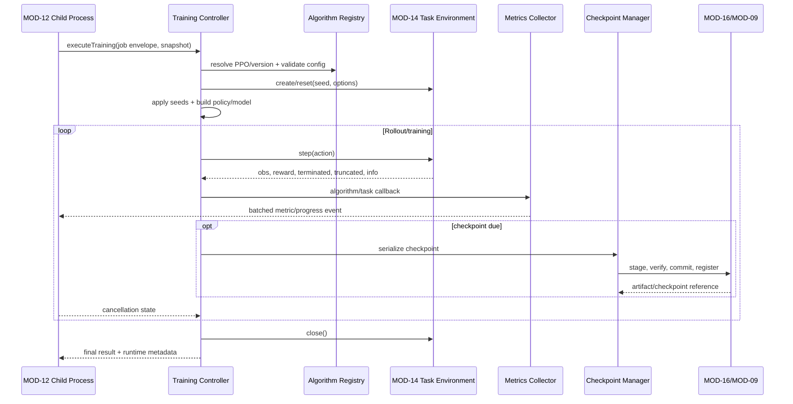
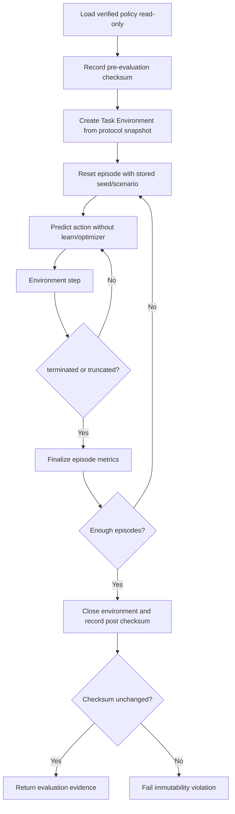

# MODULE SPECIFICATION: RL CORE ENGINE

## 1. Module Overview

| Thuộc tính | Nội dung |
|---|---|
| Module ID | MOD-13 |
| Module Name | RL Core Engine |
| Category | Execution & Integration Module |
| Phase | MVP với PPO; SAC/TD3 là phần mở rộng |
| Priority | Must với PPO training/evaluation |
| Description | Cung cấp Algorithm Registry và các controller thực thi training/evaluation trên Gymnasium Task Environment, thu metrics, tạo checkpoint an toàn và ghi runtime metadata mà không phụ thuộc trực tiếp vào API simulator. |

## 2. Module Objectives

- Thực thi luồng PPO đầu-cuối từ immutable configuration snapshot.
- Tách training và evaluation thành controller khác nhau; evaluation không cập nhật policy.
- Chuẩn hóa điểm mở rộng algorithm mà không hard-code PPO vào Backend/UI.
- Thu metrics/checkpoint/runtime metadata đủ để giám sát, đánh giá và tái lập trong giới hạn hạ tầng.
- Chỉ tương tác với simulator thông qua MOD-14 Gymnasium Task Environment.

## 3. Scope and Boundaries

### 3.1 In Scope

- Đăng ký algorithm factory, version, configuration schema và compatibility descriptor.
- Khởi tạo PPO model/policy, thực thi `learn` và xử lý callback/cancellation.
- Nạp policy/checkpoint ở chế độ evaluation/inference, chạy episode và xác minh policy input không bị thay đổi.
- Thu algorithm metrics, task metrics, progress và resource metadata ở tần suất có kiểm soát.
- Tạo checkpoint manifest, serialize vào staging, yêu cầu verify/atomic commit và đăng ký metadata.
- Thu seed, runtime/library version, OS/hardware metadata ở mức lấy được.

### 3.2 Out of Scope

- Tạo/claim process, heartbeat lease hoặc force termination (MOD-12).
- Sở hữu Training Run/Evaluation Run state machine nghiệp vụ (MOD-07, MOD-10).
- Định nghĩa task semantics, reward, termination hay gọi simulator API (MOD-14, MOD-15).
- Sở hữu binary artifact hoặc model registry record (MOD-16, MOD-09).
- Cấu hình draft/hyperparameter UI, final snapshot validation (MOD-05, MOD-06).
- Custom Python algorithm/reward do người dùng tải lên, distributed RL và large-scale hyperparameter tuning trong MVP.

### 3.3 Module Boundaries

- MOD-13 nhận một snapshot đã validate và một `Gymnasium Env` factory/instance từ MOD-14; không gọi Project AirSim/PyBullet client.
- MOD-05 sở hữu editable RL configuration; MOD-13 sở hữu runtime algorithm descriptor/factory và kiểm tra runtime cuối.
- MOD-13 phát metric/checkpoint events; MOD-08/MOD-09/MOD-10 sở hữu view/registry/result nghiệp vụ.
- MOD-12 sở hữu lifecycle process. MOD-13 chỉ phản hồi cancellation tại safe point và trả final execution result.

## 4. Responsibilities

- Kiểm tra algorithm/version/config schema đúng với snapshot trước khi khởi tạo.
- Materialize seed và áp dụng cho Python/NumPy/framework/environment theo khả năng, đồng thời ghi rõ giới hạn deterministic.
- Thực thi training/evaluation theo controller riêng và output namespace riêng.
- Không tự tạo metric khi framework/task không cung cấp; dùng `not_available` có lý do.
- Ghi metrics theo episode/rollout/batch, không ghi từng timestep mặc định.
- Lưu checkpoint theo staging → flush/close → checksum/load verification → atomic commit → registration.
- Đảm bảo `close()` environment trong `finally` và phát final event đúng với kết quả thực tế.

## 5. Requirements Traceability

| Requirement ID | Description | Priority |
|---|---|---|
| FR-022–FR-025 | Registry, PPO schema, runtime validation và compatibility | Must với PPO |
| FR-026 | Sử dụng reward/task version từ snapshot | Must |
| FR-034–FR-036 | Thu Reward, Episode Length và Training Loss khi có định nghĩa | Must/Should |
| FR-039 | Tự động tạo checkpoint theo policy | Must |
| FR-044 | Thực thi evaluation từ model/protocol riêng | Must |
| FR-045 | Evaluation không cập nhật policy | Must |
| NFR-001 | Metrics/checkpoint callback không làm gián đoạn loop quá mức | Must |
| NFR-013 | Algorithm mở rộng qua registry | Should |
| NFR-015, NFR-019 | Runtime version/seed/config/hardware metadata | Must |
| NFR-020 | Training/evaluation tách dữ liệu và policy read-only | Must |
| AC-005, AC-007, AC-009, AC-011–AC-013, AC-015 | PPO, metrics, checkpoint, evaluation và lineage đúng | Acceptance |

## 6. Actors and Permissions

| Actor | Permission | Description |
|---|---|---|
| MOD-12 Child Process | Gọi training/evaluation entry point | Chỉ với job envelope/snapshot đã claim. |
| MOD-05 | Đọc algorithm catalog/schema | Không gọi framework training trực tiếp. |
| MOD-06 | Validate registry compatibility | Dùng descriptor version hóa. |
| MOD-08 | Nhận metric/progress events | Không điều khiển model. |
| MOD-09 | Nhận checkpoint manifest/verifier | Sở hữu usability/registry status. |
| MOD-10 | Cung cấp evaluation protocol và nhận episode/result events | Không được chuyển thành training call. |
| Platform Operator/Developer | Xem diagnostic/version theo quyền | Không chèn code/entry point tùy ý lúc runtime. |

## 7. Functional Decomposition

### 7.1 Module Components

- **Algorithm Registry:** descriptor, factory, config schema, supported spaces và checkpoint capabilities.
- **Runtime Configuration Loader:** nạp snapshot bất biến, kiểm tra checksum/schema/version.
- **Seed & Determinism Coordinator:** áp seed và ghi deterministic settings/limitations.
- **Training Controller:** khởi tạo PPO, `learn`, callbacks, cooperative stop và finalization.
- **Evaluation Controller:** nạp policy read-only, `predict`/inference, episode loop và checksum verification.
- **Metrics Collector:** nhận algorithm/task callback, chuẩn hóa và batch.
- **Checkpoint Manager:** serialize, staging, manifest/checksum và handoff MOD-16/MOD-09.
- **Runtime Metadata Collector:** library/OS/hardware/worker metadata.
- **Execution Result Builder:** tạo final result/error envelope cho MOD-12.

### 7.2 Sub-functions

| Function ID | Function | Input | Output | Description |
|---|---|---|---|---|
| RLC-F01 | List algorithm descriptors | Runtime profile/filter | Versioned descriptors | PPO trước trong MVP. |
| RLC-F02 | Validate runtime config | Snapshot + task spaces | Validation report | Fail trước khi `learn/predict`. |
| RLC-F03 | Configure seeds | Seed + deterministic policy | Applied seed report | Ghi thành phần không kiểm soát được. |
| RLC-F04 | Execute training | Snapshot, environment, cancellation | Final training result | Policy được cập nhật theo algorithm. |
| RLC-F05 | Execute evaluation | Policy ref, protocol, environment | Episode/final result | Không tạo optimizer/không gọi learn. |
| RLC-F06 | Collect metrics | Callback/task info | Metric batches | Có key/definition/version/step/time. |
| RLC-F07 | Save checkpoint | Model state + checkpoint policy | Artifact manifest/reference | Atomic workflow qua MOD-16/MOD-09. |
| RLC-F08 | Collect runtime metadata | Process/environment | Metadata snapshot | Version thực tế, không chỉ version cấu hình. |
| RLC-F09 | Verify policy immutability | Pre/post policy checksum/manifest | Pass/fail evidence | Bắt buộc cho evaluation. |
| RLC-F10 | Finalize execution | Controller outcome + cleanup | Final event/error | Chỉ sau flush/close attempt. |

## 8. Business Rules

| Rule ID | Rule | Description |
|---|---|---|
| BRL-006 | Training và Evaluation là hoạt động khác nhau | Controller, job type, metric namespace và output record tách biệt. |
| BRL-008 | Metric có định nghĩa/nguồn/thời điểm | Event thiếu metadata không được công bố như metric chuẩn. |
| BRL-009 | Reward/metric phụ thuộc task | Không gán cùng nghĩa cho mọi task. |
| BRL-012 | Checkpoint chỉ usable sau verify | Không register Available từ file staging/chưa đọc được. |
| RLC-R01 | Registry-only algorithms | Chỉ khởi tạo algorithm/version đã đăng ký và contract test. |
| RLC-R02 | Snapshot-driven execution | Runtime không đọc draft/config mới nhất thay cho snapshot của run. |
| RLC-R03 | Evaluation is inference-only | Không gọi `learn`, optimizer step, gradient update hoặc ghi đè artifact nguồn. |
| RLC-R04 | Missing metrics stay missing | Không đổi missing/NaN thành 0 hoặc tự bịa loss. |
| RLC-R05 | Callbacks are bounded | Metric/checkpoint callback có batch/rate limit và không block loop vô hạn. |
| RLC-R06 | Checkpoint purpose is explicit | Evaluation-loadable không đồng nghĩa resumable; manifest ghi capability. |
| RLC-R07 | Cleanup is mandatory | Environment/callback/storage handles được đóng trên mọi exit path. |
| RLC-R08 | Reproducibility is evidence-based | Lưu seed/version/settings nhưng không tuyên bố deterministic tuyệt đối nếu chưa test. |

## 9. Workflow and Process

### 9.1 Training Workflow

### 9.2 Evaluation Workflow

- **Alternative Workflow:** cooperative stop giữa các safe point → flush metric batch, đóng environment, trả partial/stopped evidence.
- **Exception Workflow:** validation/load/environment/storage lỗi → phân loại tầng, giữ checkpoint hợp lệ trước đó, cleanup rồi trả failure; không bắt đầu controller còn lại.

## 10. Data Requirements

- **Input Data:** immutable snapshot; algorithm ID/version/schema; hyperparameters; seed; task/environment factory; checkpoint policy; evaluation protocol/model reference; cancellation handle.
- **Output Data:** progress/metric batches; checkpoint manifest/reference; runtime metadata; episode result; pre/post policy checksum; final execution result/error.
- **Internal Data:** model/policy/optimizer state; callback state; metric buffer; episode accumulator; temporary checkpoint staging handle.
- **Data Ownership:** MOD-13 sở hữu runtime descriptor, in-memory controller state và event schema. MOD-05 sở hữu editable config; MOD-08 metrics view; MOD-09 model registry; MOD-10 evaluation result; MOD-16 artifact bytes/metadata persistence.
- **Validation Rules:** algorithm/task spaces compatible; numeric finite/range; total timestep positive; snapshot checksum match; model format/version compatible; evaluation protocol không chứa training flag; metric keys registered/versioned.

### 10.1 Algorithm Descriptor tối thiểu

| Trường | Ý nghĩa |
|---|---|
| `algorithm_id`, `algorithm_version` | Định danh implementation ổn định. |
| `framework`, `framework_version` | Ví dụ Stable-Baselines3/PyTorch đã khóa. |
| `config_schema_version` | Schema hyperparameter dùng để validate/materialize default. |
| `supported_observation_spaces` | Box/Dict... theo implementation đã test. |
| `supported_action_spaces` | Continuous/discrete và constraints. |
| `checkpoint_format_version` | Dùng cho load/evaluation/resume compatibility. |
| `supports_training`, `supports_evaluation` | Capability rõ ràng. |
| `supports_exact_resume` | Mặc định false cho tới khi integration test chứng minh. |

### 10.2 Metric Event tối thiểu

`run_id`, `attempt_id`, `metric_key`, `definition_version`, `source`, `phase`, `step/episode`, `value`, `unit`, `aggregation`, `occurred_at`, `sequence_no` và `availability`. Training/evaluation phải có `phase` khác nhau.

## 11. Interfaces and Dependencies

- **Upstream Modules:** MOD-05 config/schema consumer; MOD-06 snapshot; MOD-12 execution envelope; MOD-10 evaluation protocol.
- **Downstream Modules:** MOD-14 Environment Factory; MOD-08 metric ingest; MOD-09 checkpoint registry; MOD-16 persistence/artifact; MOD-17 diagnostic.
- **External Libraries:** Gymnasium, Stable-Baselines3, PyTorch, NumPy theo version/lockfile đã phê duyệt.
- **Contracts:** `listAlgorithms`, `getAlgorithmDescriptor`, `validateRuntimeConfig`, `executeTraining`, `executeEvaluation`, `emitMetricBatch`, `saveCheckpoint`, `collectRuntimeMetadata`, `verifyPolicyUnchanged`.
- MOD-13 không import/call trực tiếp Project AirSim hoặc Gym-PyBullet-Drones API; phụ thuộc hướng xuống chỉ qua MOD-14 contract.

## 12. Error Handling

| Error ID | Scenario | Handling |
|---|---|---|
| RLC-E01 | Algorithm/version/schema không đăng ký | Fail trước khởi tạo environment; báo layer `rl_core/config`. |
| RLC-E02 | Space/config không tương thích | Validation failure có path/rule; không gọi `learn`. |
| RLC-E03 | Model/checkpoint load lỗi | Evaluation/resume bị từ chối; checkpoint không bị sửa. |
| RLC-E04 | NaN/Inf trong observation/action/loss | Dừng theo policy, lưu diagnostic đã giới hạn/redact; không âm thầm thay giá trị. |
| RLC-E05 | Metric sink tạm lỗi | Bounded buffer/retry; không block vô hạn; fail hoặc degrade theo policy đã duyệt. |
| RLC-E06 | Checkpoint staging/verify/commit lỗi | Giữ artifact cũ; bản mới không Available; training tiếp tục hay fail theo policy. |
| RLC-E07 | Cancellation nhận được | Dừng tại safe point, flush bounded data, close và trả stopped evidence. |
| RLC-E08 | Environment/adapter/simulator exception | Preserve error layer/cause/correlation; cleanup và trả failure. |
| RLC-E09 | Policy checksum thay đổi sau evaluation | Fail/quarantine result; phát security/quality event. |
| RLC-E10 | Cleanup/close lỗi | Gắn secondary cleanup error; không che mất primary failure. |

## 13. Security and Quality Requirements

- **Security:** không tải arbitrary Python/pickle không tin cậy từ user; checkpoint chỉ từ storage/registry được phép; không log full config có secret; validate paths/manifest; evaluation artifact read-only.
- **Performance:** batch metrics; callback overhead đo benchmark; checkpoint interval có lower bound; không serialize model trên mỗi timestep; resource collection có sampling interval.
- **Reliability:** `try/finally` cleanup; final event chỉ sau flush/close attempt; checkpoint atomic; missing metric explicit; failure không làm hỏng artifact trước đó.
- **Maintainability:** registry/factory/descriptor version hóa; controller không chứa simulator-specific code; algorithm plugin có contract tests; error codes ổn định.
- **Reproducibility:** lưu effective config/defaults, seed, task/adapter/simulator/algorithm/library versions, deterministic settings và hardware metadata ở mức thu thập được.

## 14. Testing and Acceptance Criteria

- **Unit Testing:** registry resolution, schema validation, seed application, callback batching, checkpoint schedule, evaluation guards và metric normalization.
- **Contract Testing:** mỗi algorithm descriptor/factory phải tạo được model với supported spaces, save/load checkpoint và phát metric schema hợp lệ.
- **Integration Testing:** PPO + MOD-14 task mẫu; MOD-12 cancellation; MOD-09/16 atomic checkpoint; MOD-10 evaluation read-only.
- **Evaluation Safety Tests:** cấm `learn/optimizer.step`, checksum policy trước/sau, multiple episodes/seeds và partial result.
- **Fault Injection:** storage fail, NaN observation, simulator disconnect, callback exception, cancellation giữa rollout, corrupt checkpoint.
- **Acceptance:** AC-005 PPO config hợp lệ chạy được; AC-007 metrics đúng run/source/time; AC-009 chỉ checkpoint verified được đăng ký; AC-011 policy không đổi; AC-012 partial/failed rõ ràng; AC-013 metric có definition/unit hoặc not_available.
- Không tuyên bố SAC/TD3 hoặc exact resume được hỗ trợ trước khi contract/integration tests tương ứng đạt.

## 15. Assumptions and Open Issues

- **Assumptions:** PPO là algorithm MVP; Stable-Baselines3/PyTorch được chọn nhưng version chính xác phải khóa; Task Environment tuân Gymnasium.
- **Constraints:** evaluation tách controller/record; không custom code; metrics/checkpoint không được làm gián đoạn loop đáng kể.
- **Dependencies:** MOD-05/06 config; MOD-12 process; MOD-14 environment; MOD-08/09/10/16 persistence/view.
- **Open Decisions:** Q-011 SAC/TD3 release; Q-015 exact resume; Q-016 metric/loss catalog; PPO hyperparameter/default version; deterministic policy; checkpoint interval/format; metric batch frequency; hardware metadata scope.
- **Risks:** framework callback/version drift; checkpoint load có side effect; nondeterminism GPU/simulator; metric overhead; evaluation vô tình thay đổi normalization/buffer state dù weights không đổi.

## 16. References and Change History

- **Related Documents:** `PROJECT_INITIATION.md`, `REQUIREMENTS_ANALYSIS.md`, `SYSTEM_ARCHITECTURE.md`, `Module_design/MODULE_DESIGN.md`, `Module_design/MODULE_SPEC_TEMPLATE.md`, `MOD-05_RL_ALGORITHM_TRAINING_CONFIGURATION.md`, `MOD-08_TRAINING_MONITORING_METRICS.md`, `MOD-09_MODEL_CHECKPOINT_MANAGEMENT.md`, `MOD-10_EVALUATION_MANAGEMENT.md`.
- **Version:** 0.1.
- **Date:** 07/11/2026.
- **Approval Status:** Chờ rà soát.

| Version | Change | Status |
|---|---|---|
| 0.1 | Thiết kế chi tiết ban đầu MOD-13 | Chờ rà soát |
