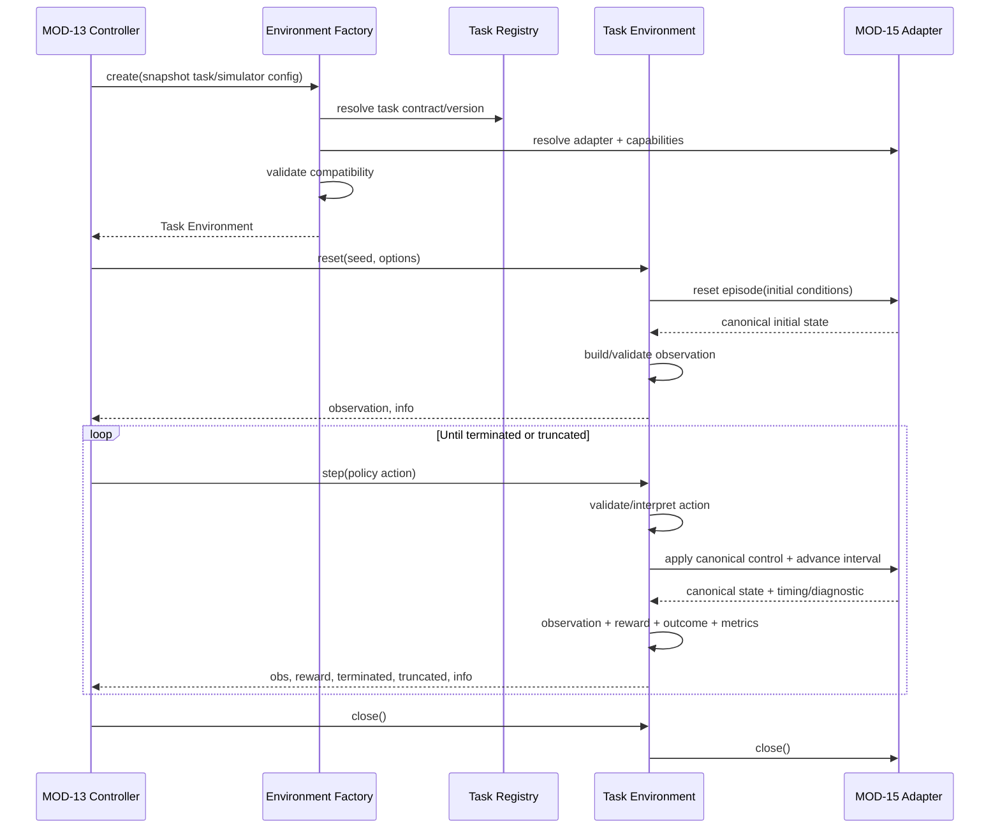
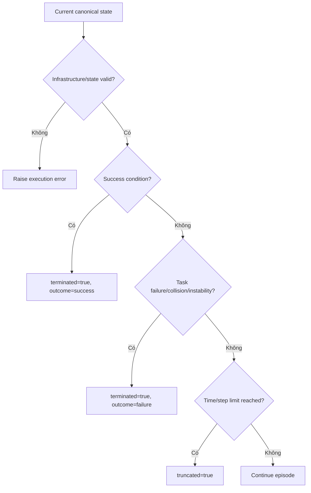

# MODULE SPECIFICATION: TASK ENVIRONMENT & TASK REGISTRY

## 1. Module Overview

| Thuộc tính | Nội dung |
|---|---|
| Module ID | MOD-14 |
| Module Name | Task Environment & Task Registry |
| Category | Execution & Integration Module |
| Phase | MVP với một task mẫu Hovering hoặc Position Control sau technical spike |
| Priority | Must cho task MVP |
| Description | Định nghĩa Task Contract có phiên bản, đăng ký task/capability và cung cấp Gymnasium Task Environment với observation/action/reward/terminated/truncated/metrics rõ nghĩa, độc lập với API riêng của simulator. |

## 2. Module Objectives

- Tạo hợp đồng Gymnasium ổn định giữa RL Core và simulator integration.
- Biểu diễn rõ semantics khoa học của task: observation, action, reward, success/failure, time limit và metric.
- Ngăn giả định AirSim và PyBullet có cùng frame, unit, timestep, dynamics hoặc raw state.
- Cho phép một task được triển khai trên nhiều adapter chỉ khi compatibility và integration test đã chứng minh.
- Bảo đảm kết quả run truy ngược được tới đúng Task Contract/version.

## 3. Scope and Boundaries

### 3.1 In Scope

- Task Registry với task ID/version, lifecycle và compatibility declaration.
- Task Contract version hóa gồm observation/action/timing/reward/termination/metric/reproducibility metadata.
- Environment Factory tạo Gymnasium Task Environment từ snapshot và adapter tương thích.
- Thực thi `reset(seed, options)`, `step(action)` và `close()` đúng Gymnasium semantics.
- Xây observation chuẩn từ canonical simulator state; kiểm tra shape/dtype/finite/range/order.
- Diễn giải policy action thành canonical control intent trước khi giao adapter.
- Tính reward, success/failure, `terminated`, `truncated` và task metrics.

### 3.2 Out of Scope

- Gọi API Project AirSim/Gym-PyBullet-Drones, quản lý connection/runtime hoặc raw protocol (MOD-15).
- Thực thi PPO/policy update/inference controller (MOD-13).
- Sở hữu task configuration draft hoặc immutable run snapshot (MOD-04, MOD-06).
- Tự quyết định simulator được công bố Supported khi chưa có adapter integration evidence (MOD-03/MOD-15).
- Custom reward/termination Python code do người dùng cung cấp, raw camera/LiDAR pipeline và multi-agent task trong MVP.

### 3.3 Module Boundaries

- MOD-14 sở hữu **ngữ nghĩa task** và canonical task interface.
- MOD-15 sở hữu **giao tiếp simulator**, raw state/control, unit/frame conversion tại biên simulator và timing capability.
- Task Environment kiểm tra policy action và tạo canonical control intent; adapter chuyển intent đó thành command cụ thể.
- Adapter trả canonical state bundle đã khai báo; Task Environment chọn/order/normalize observation và tính reward/termination.
- Lỗi hạ tầng/simulator không được biến thành episode `terminated`; lỗi được propagate để MOD-12/13 đánh dấu execution failure.

## 4. Responsibilities

- Công bố task descriptor/contract/config schema và version compatibility.
- Validate task config với adapter capabilities trước khi tạo environment.
- Gọi adapter lifecycle đúng thứ tự và bảo đảm `close()` idempotent.
- Phân biệt `terminated` (MDP/task outcome) với `truncated` (time/step limit ngoài MDP).
- Kiểm tra mọi action trước khi gửi; không clip âm thầm nếu contract không quy định.
- Không tạo observation giả khi state thiếu/NaN/sai timestamp/shape.
- Phát task metric kèm definition/version/unit/source; không dùng một công thức cho mọi task.

## 5. Requirements Traceability

| Requirement ID | Description | Priority |
|---|---|---|
| FR-016 | Khai báo drone/model phù hợp task/adapter | Must nếu task yêu cầu |
| FR-017–FR-018 | Registry task và schema điều kiện task | Must cho task MVP |
| FR-019 | Observation/action contract | Must |
| FR-020 | Reward và termination trong phạm vi hỗ trợ | Must cho task MVP |
| FR-021 | Compatibility giữa task và simulator/adapter | Must |
| FR-046 | Success Rate từ success semantics của task | Must khi áp dụng |
| FR-047 | Position Error theo định nghĩa task | Must khi áp dụng |
| FR-050 | Cung cấp trajectory/reference/actual có frame/unit | Should |
| NFR-017 | Đúng Gymnasium reset/step/close và terminated/truncated | Must |
| NFR-018 | Frame/unit/order/bounds được khai báo và kiểm tra | Must |
| AC-004, AC-013, AC-018 | Compatibility, metric definition và adapter/task contract tests | Acceptance |

## 6. Actors and Permissions

| Actor | Permission | Description |
|---|---|---|
| MOD-04 | Đọc task catalog/config schema | Không đăng ký runtime task qua UI. |
| MOD-06 | Đọc contract/capability để validate snapshot | Contract ID/version phải bất biến. |
| MOD-13 | Tạo và sử dụng Gymnasium environment | Chỉ qua Environment Factory. |
| MOD-15 | Cung cấp adapter capability/canonical state/control port | Không tính reward/termination task. |
| RL/Control Engineer | Định nghĩa/review task contract qua source/migration | Không cho end user chạy arbitrary code. |
| Researcher/Lecturer/Learner | Chọn/configure task qua MOD-04 theo quyền | Không gọi Task Environment trực tiếp. |

## 7. Functional Decomposition

### 7.1 Module Components

- **Task Registry:** ánh xạ task ID/version tới descriptor, config schema và factory.
- **Task Contract Repository:** cung cấp contract bất biến/versioned.
- **Compatibility Resolver:** đối chiếu task requirements với adapter/runtime capabilities.
- **Environment Factory:** tạo adapter phù hợp và inject vào task environment.
- **Gymnasium Task Environment:** lifecycle `reset/step/close`.
- **Observation Builder:** chọn, order, normalize và validate observation.
- **Action Interpreter:** validate policy action và tạo canonical control intent.
- **Reward Evaluator:** tính reward components từ state transition/task config.
- **Termination Evaluator:** success/failure/terminated/truncated/time limit.
- **Task Metrics Collector:** position error, success indicator và trajectory fields theo definition.

### 7.2 Sub-functions

| Function ID | Function | Input | Output | Description |
|---|---|---|---|---|
| TEN-F01 | List task descriptors | Simulator/adapter capability | Supported task candidates | Chỉ công bố mapping có evidence. |
| TEN-F02 | Get task contract | Task ID/version | Immutable contract | Bao gồm spaces/timing/reward/termination/metrics. |
| TEN-F03 | Validate compatibility | Contract + config + adapter capability | Report | Fail closed nếu thiếu capability. |
| TEN-F04 | Create environment | Snapshot + adapter factory | Gymnasium environment | Không dùng draft mới hơn. |
| TEN-F05 | Reset task | Seed/options/initial conditions | Observation + info | Reset adapter, task state và counters. |
| TEN-F06 | Step task | Policy action | Obs, reward, terminated, truncated, info | Một control interval có semantics rõ. |
| TEN-F07 | Build observation | Canonical state + config | Validated observation | Shape/dtype/order/unit/version xác định. |
| TEN-F08 | Interpret action | Policy action + action contract | Canonical control intent | Bounds/scale/control mode rõ. |
| TEN-F09 | Evaluate outcome | Previous/current state + config | Reward/outcome/metrics | Task-specific, deterministic theo input. |
| TEN-F10 | Close environment | Environment/adapter state | Cleanup result | Idempotent, gọi trên mọi exit path. |

## 8. Business Rules

| Rule ID | Rule | Description |
|---|---|---|
| BRL-004 | Task/observation/action/algorithm/adapter phải tương thích | Thiếu capability thì không tạo environment. |
| BRL-005 | Frame/unit/order/action bounds phải tường minh | Contract chứa metadata và test định lượng. |
| BRL-008–BRL-009 | Metric/reward có định nghĩa theo task | Không suy diễn cùng nghĩa giữa task/simulator. |
| TEN-R01 | Contract versions are immutable | Thay semantics tạo version mới, không sửa ngầm version cũ. |
| TEN-R02 | Gymnasium semantics are strict | `reset` và `step` đúng tuple; `terminated` khác `truncated`. |
| TEN-R03 | Infrastructure errors are not episode outcomes | Adapter disconnect/timeout/invalid state raise execution error. |
| TEN-R04 | No silent coercion | Action/observation sai không tự clip/cast/default nếu contract không cho phép. |
| TEN-R05 | Canonical boundary is explicit | Canonical state/control có schema/version; adapter chịu conversion simulator-specific. |
| TEN-R06 | Reset is complete | Seed, task counter, previous state, reward/metric accumulator và adapter episode state được reset nhất quán. |
| TEN-R07 | Step after terminal is invalid | Phải reset trước step tiếp theo, trừ khi wrapper contract quy định rõ. |
| TEN-R08 | Close is idempotent | Có thể gọi nhiều lần, kể cả reset/step thất bại. |
| TEN-R09 | Support requires evidence | Task–adapter mapping chỉ Supported khi contract/integration/golden tests đạt cho version. |

## 9. Workflow and Process

### 9.1 Environment Creation and Episode Workflow

### 9.2 Termination Decision

- **Alternative Workflow:** adapter hỗ trợ nhiều control mode; contract chọn đúng mode/version và Action Interpreter tạo intent tương ứng.
- **Exception Workflow:** reset/step/close lỗi → preserve adapter/simulator error layer, thử cleanup có timeout và propagate lên MOD-13; không trả transition giả.

## 10. Data Requirements

- **Input Data:** task ID/version; task parameters; initial/target state; observation/action config; reward/termination config; timing; seed; adapter capability/state.
- **Output Data:** Gymnasium observations/rewards/flags/info; task metric events; trajectory/reference fields; compatibility report.
- **Internal Data:** episode counter; step count; previous/current canonical state; reward components; success/failure state; normalization parameters; RNG state thuộc task.
- **Data Ownership:** MOD-14 sở hữu Task Descriptor/Contract, canonical task semantics và factory. MOD-04 sở hữu editable config; MOD-06 snapshot; MOD-15 adapter capability/raw mapping; MOD-08/10 sở hữu persisted metrics/results.
- **Validation Rules:** schema/version tồn tại; values finite; observation/action shape/dtype/bounds; frame/unit/order; positive timing; reward weights/ranges; termination consistency; required capability present.

### 10.1 Task Contract tối thiểu

| Nhóm | Trường bắt buộc |
|---|---|
| Identity | `task_id`, `task_version`, description, lifecycle/support status. |
| Compatibility | Simulator/adapter version ranges, required capabilities, tested evidence refs. |
| Drone | Vehicle model/profile requirements. |
| Observation | Fields, order, shape, dtype, frame, unit, range, normalization/version. |
| Action | Control mode, shape, dtype, bounds, unit, scaling, control rate. |
| Timing | Physics step capability, control interval, substeps, episode limits, timeout. |
| Reward | Component IDs/version, formula/parameters/weights, aggregation. |
| Termination | Success, task failure, collision/instability và truncation conditions. |
| Metrics | Metric key, definition version, formula, source, unit, aggregation. |
| Reproducibility | Seed policy, initial condition schema, known nondeterminism. |

### 10.2 Canonical State/Control Contract

- Canonical state phải có schema version, simulation timestamp/step, frame/unit metadata và validity flags.
- Canonical control intent phải có mode, values, frame/unit, duration/control interval và bounds evidence.
- Không buộc hai adapter có raw observation giống nhau; chỉ canonical fields mà task yêu cầu mới phải tương thích.

## 11. Interfaces and Dependencies

- **Upstream Modules:** MOD-04 task config; MOD-06 snapshot validator; MOD-13 RL Core; MOD-10 evaluation protocol.
- **Downstream Modules:** MOD-15 adapter registry/factory; MOD-16 contract metadata persistence nếu được duyệt; MOD-17 diagnostics.
- **External Libraries:** Gymnasium API theo version khóa; NumPy/typing/schema validation theo runtime.
- **Contracts:** `listTasks`, `getTaskContract`, `validateTaskCompatibility`, `createEnvironment`; runtime `reset`, `step`, `close`; adapter port `resetEpisode`, `applyControlAndAdvance`, `readCanonicalState`, `close`.
- MOD-14 không gọi Backend REST trong `step()` và không truy vấn database/simulator catalog mỗi timestep.

## 12. Error Handling

| Error ID | Scenario | Handling |
|---|---|---|
| TEN-E01 | Task/version không đăng ký | Từ chối factory; trả supported versions. |
| TEN-E02 | Adapter capability thiếu/không tương thích | Fail trước runtime, compatibility issue có path. |
| TEN-E03 | Reset không trả state hợp lệ | Cleanup và raise layer task/adapter/simulator; không tạo observation giả. |
| TEN-E04 | Action sai shape/dtype/bounds/NaN | Từ chối step theo contract; diagnostic có giới hạn. |
| TEN-E05 | Canonical state thiếu/stale/NaN | Raise execution error; không thay default. |
| TEN-E06 | Observation builder sai shape/dtype | Fail task contract/runtime; lưu expected/actual metadata. |
| TEN-E07 | Reward/metric computation lỗi | Fail hoặc mark metric unavailable theo mức ảnh hưởng; không trả reward giả. |
| TEN-E08 | Step sau terminal/close | Usage error ổn định; yêu cầu reset/new environment. |
| TEN-E09 | Adapter disconnect/timeout | Propagate infrastructure error; không chuyển thành terminated/truncated. |
| TEN-E10 | Close lỗi | Ghi secondary cleanup error; tiếp tục supervisor cleanup. |

## 13. Security and Quality Requirements

- **Security:** task/reward/termination từ registry đã review; không eval code/expression tùy ý; validate info payload; không để simulator secret trong `info`/metric/log.
- **Performance:** `step()` không gọi DB/network ngoài adapter bắt buộc; preallocate/avoid copy khi đo được cần thiết; raw sensor ngoài MVP; benchmark wrapper overhead.
- **Reliability:** deterministic pure functions cho reward/termination khi có thể; strict validation; close idempotent; infrastructure error không bị nuốt.
- **Maintainability:** Task Contract/schema/version rõ; factory/registry; task-specific code không rò vào adapter/RL Core; thay semantics tạo version mới.
- **Reproducibility:** seed, initial conditions, normalization, timing, frame/unit và contract versions được ghi; golden vectors giữ trong test fixtures.

## 14. Testing and Acceptance Criteria

- **Unit Testing:** observation/action schema, reward components, success/failure, time limit, reset state và metric formulas.
- **Gymnasium Contract Testing:** `reset` tuple; `step` 5-tuple; spaces contain observations/actions; dtype/shape/range; `terminated/truncated`; close/reset lifecycle.
- **Property Testing:** finite values, action bounds, invariants reward/termination, repeated reset với seed trong phạm vi deterministic đã tuyên bố.
- **Golden Testing:** frame/unit/sign/quaternion order và action scaling với state/control mẫu đã biết cho từng adapter.
- **Integration Testing:** mỗi task–adapter–simulator version phải kiểm tra reset/step/close, success/failure/time-limit và cleanup.
- **Acceptance:** AC-004 chặn tổ hợp/space sai; AC-013 metric có definition/unit; AC-018 từng adapter chứng minh task mẫu theo version.
- Không công bố Hovering, Position Control hoặc Trajectory Tracking là Supported nếu chưa có contract và integration evidence tương ứng.

## 15. Assumptions and Open Issues

- **Assumptions:** một task MVP được chốt sau spike; state observation gọn ưu tiên; một drone/single-agent mỗi environment.
- **Constraints:** Gymnasium semantics; không custom code; simulator khác nhau không mặc định tương đương; evaluation không cập nhật policy.
- **Dependencies:** MOD-04/06 config; MOD-13 controller; MOD-15 adapter; MOD-08/10 metric consumers.
- **Open Decisions:** MD-Q04/Q-005 task đầu; MD-Q05/Q-007 action mode; MD-Q06/Q-008 observation/sensor; Q-009 canonical frame/unit; Q-010 reward config; Q-016 metric formula; control interval/physics substeps; collision/success thresholds.
- **Risks:** task contract chốt muộn; reward hacking; frame/unit sai dấu; `terminated/truncated` bị gộp; nondeterministic reset; semantics task lệch giữa simulator dù schema giống nhau.

## 16. References and Change History

- **Related Documents:** `PROJECT_INITIATION.md`, `REQUIREMENTS_ANALYSIS.md`, `SYSTEM_ARCHITECTURE.md`, `Module_design/MODULE_DESIGN.md`, `Module_design/MODULE_SPEC_TEMPLATE.md`, `MOD-04_DRONE_ENVIRONMENT_TASK_CONFIGURATION.md`, `MOD-10_EVALUATION_MANAGEMENT.md`.
- **Version:** 0.1.
- **Date:** 07/11/2026.
- **Approval Status:** Chờ rà soát.

| Version | Change | Status |
|---|---|---|
| 0.1 | Thiết kế chi tiết ban đầu MOD-14 | Chờ rà soát |
