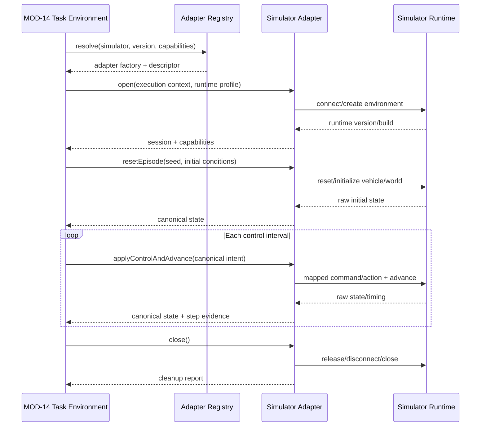
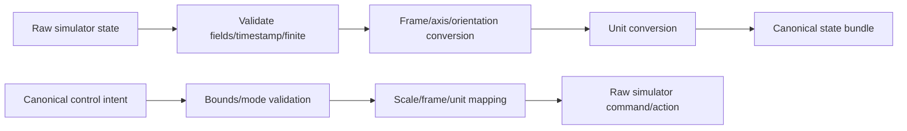

# MODULE SPECIFICATION: SIMULATOR ADAPTER INTEGRATION

## 1. Module Overview

| Thuộc tính | Nội dung |
|---|---|
| Module ID | MOD-15 |
| Module Name | Simulator Adapter Integration |
| Category | Execution & Integration Module |
| Phase | MVP với adapter độc lập cho Project AirSim và Gym-PyBullet-Drones sau technical spike |
| Priority | Must; mỗi simulator chỉ được công bố hỗ trợ khi integration test đạt |
| Description | Cung cấp adapter registry và adapter riêng cho từng simulator để quản lý connection/runtime lifecycle, reset/advance/control/state, capability/version probe và chuyển đổi frame/unit/control mà không đưa API simulator vào RL Core hoặc Task Definition. |

## 2. Module Objectives

- Cô lập khác biệt API, dependency, runtime và lifecycle của từng simulator.
- Cung cấp adapter contract ổn định cho MOD-14 trong khi vẫn công khai khác biệt capability.
- Chuyển đổi raw simulator state/control sang canonical state/control theo Task Contract đã phê duyệt.
- Quản lý timing, reset, error và cleanup an toàn cho từng simulator/version.
- Chỉ tuyên bố capability/support dựa trên bằng chứng technical spike và contract/integration test.

## 3. Scope and Boundaries

### 3.1 In Scope

- Simulator Adapter Registry theo simulator ID, adapter version, runtime version range và capability.
- Project AirSim Adapter: client connection, vehicle/world selection, reset/init, command/state/sensor, clock/step capability và disconnect.
- Gym-PyBullet-Drones Adapter: environment construction, reset, action/advance, raw state, render/headless và close.
- Health/version/capability probe cho MOD-03.
- Raw↔canonical mapping về frame, unit, axis/sign, quaternion/Euler, control mode và timing.
- Timeout, cancellation, error classification và cleanup ở biên simulator.
- Runtime ownership/lease hook để phối hợp MOD-12.

### 3.2 Out of Scope

- Định nghĩa observation vector cuối, reward, success/failure, `terminated/truncated` theo task (MOD-14).
- Thực thi policy/PPO/evaluation hoặc thu algorithm metrics (MOD-13).
- Sở hữu simulator catalog/health history hoặc quyết định Supported ở tầng nghiệp vụ (MOD-03).
- Quản lý process/job/worker hoặc capacity toàn hệ thống (MOD-12).
- Tự cài/download simulator, điều khiển drone thật, PX4 SITL/HITL, Sim-to-Real và multi-agent trong MVP.
- Giả lập một capability không có thật để làm hai simulator trông giống nhau.

### 3.3 Module Boundaries

- MOD-15 sở hữu simulator-specific API/client/environment, raw data và conversion tại biên simulator.
- MOD-14 sở hữu task semantics và Gymnasium interface. Với PyBullet environment có sẵn Gym API, adapter vẫn phải che API/version cụ thể; MOD-14 không phụ thuộc trực tiếp package đó.
- Adapter không tính reward/termination task và không cập nhật run state/database trong mỗi step.
- MOD-12 cấp runtime lease/execution context; adapter không tự chia sẻ world/runtime giữa nhiều run.
- Một adapter/version chỉ được ghi `supported` khi MOD-03 nhận test evidence tương ứng.

## 4. Responsibilities

- Resolve đúng adapter implementation theo simulator/runtime/version/capability.
- Probe không gây side effect nguy hiểm; trả version/build/capability/error đã chuẩn hóa.
- Connect/reset/advance/read/close với timeout/cancellation rõ ràng.
- Chuyển đổi state/control bằng mapping có version và test định lượng.
- Duy trì simulation timing evidence: physics step, control interval/substeps, simulation time và wall time.
- Không dùng `sleep()` làm stepping mặc định khi simulator hỗ trợ clock/step điều khiển được.
- Release vehicle control, connection, renderer/environment/process handle thuộc adapter trên cả success/failure.

## 5. Requirements Traceability

| Requirement ID | Description | Priority |
|---|---|---|
| FR-011–FR-013 | Registry/probe simulator, readiness và runtime version | Must/Should |
| FR-014–FR-015 | Cung cấp adapter hợp lệ và lỗi tích hợp không thành công giả | Must |
| FR-016–FR-021 | Drone/task capability, observation/action và compatibility | Must trong phạm vi adapter |
| NFR-013 | Thêm simulator qua adapter/registry contract | Should |
| NFR-015–NFR-016 | Version metadata và lỗi phân tầng | Must |
| NFR-017 | Adapter contract/lifecycle đúng | Must |
| NFR-018 | Frame/unit/order/action mapping được kiểm tra | Must |
| AC-002–AC-004, AC-018 | Health, readiness, compatibility và test riêng từng simulator | Acceptance |

## 6. Actors and Permissions

| Actor | Permission | Description |
|---|---|---|
| MOD-03 | Probe version/health/capability | Chỉ nhận dữ liệu đã chuẩn hóa/redact. |
| MOD-06 | Đọc adapter descriptor/capability | Dùng để validate snapshot. |
| MOD-12 | Cấp execution context/runtime lease và cancellation | Không gọi raw simulator control. |
| MOD-14 | Tạo adapter và gọi lifecycle/control/state port | Không truy cập client/package riêng. |
| Simulation Engineer | Đăng ký implementation/mapping/test evidence | Qua source review và lockfile, không qua user input. |
| Platform Operator | Cấu hình endpoint/runtime profile theo quyền | Không thấy credential trong diagnostic thông thường. |

## 7. Functional Decomposition

### 7.1 Module Components

- **Simulator Adapter Registry:** descriptor/factory/version/capability/test evidence.
- **Base Adapter Contract:** lifecycle, probe, reset, control/advance, state và close.
- **Project AirSim Adapter:** AirSim-specific client/world/vehicle/clock/state/control.
- **Gym-PyBullet-Drones Adapter:** package/environment-specific creation/reset/step/render/close.
- **Capability & Version Probe:** runtime identity, build, supported operations và health.
- **Coordinate & Unit Mapper:** raw frame/unit/orientation → canonical schema và ngược lại.
- **Action/Control Mapper:** canonical control intent → simulator command/action.
- **Timing Coordinator:** physics/control/simulation time evidence.
- **Lifecycle & Cleanup Guard:** timeout/cancel/idempotent close/resource release.

### 7.2 Sub-functions

| Function ID | Function | Input | Output | Description |
|---|---|---|---|---|
| SAI-F01 | Resolve adapter | Simulator/runtime/version requirements | Adapter descriptor/factory | Fail nếu version/capability không khớp. |
| SAI-F02 | Probe runtime | Connection profile + timeout | Health/version/capability report | Không khởi chạy training loop. |
| SAI-F03 | Connect/open | Execution context + runtime profile | Adapter session | Gắn runtime lease/run correlation. |
| SAI-F04 | Reset episode | Initial conditions/seed/options | Canonical initial state | Reset phải được kiểm chứng theo simulator. |
| SAI-F05 | Apply control and advance | Canonical control intent + timing | Step evidence | Mapping/advance theo capability thực tế. |
| SAI-F06 | Read canonical state | Required state channels | Canonical state bundle | Có timestamp/frame/unit/validity. |
| SAI-F07 | Map state/control | Raw data/command + mapping version | Canonical/raw representation | Không clip/đổi dấu âm thầm. |
| SAI-F08 | Report runtime metadata | Adapter/session/runtime | Version/build/timing/capabilities | Dùng cho reproducibility. |
| SAI-F09 | Cancel/close | Session + deadline | Cleanup report | Idempotent, bounded. |
| SAI-F10 | Produce test evidence | Simulator/adapter/task/version | Evidence manifest | Điều kiện công bố Supported. |

## 8. Business Rules

| Rule ID | Rule | Description |
|---|---|---|
| BRL-003 | Simulator chỉ dùng khi readiness đạt | Probe fail/unknown/stale không được xem Ready. |
| BRL-004 | Task/adapter capability phải tương thích | Không khởi tạo khi thiếu control/state/timing capability. |
| BRL-005 | Frame/unit/order/bounds tường minh | Mapping có version và golden tests. |
| SAI-R01 | Adapter per simulator family | Không nhánh `if simulator` rải trong MOD-13/MOD-14. |
| SAI-R02 | No false normalization | Chuẩn hóa contract, không che khác biệt dynamics/physics/capability. |
| SAI-R03 | Exclusive session by default | Một run/session sở hữu runtime/world theo lease MOD-12. |
| SAI-R04 | Version pinning | Adapter descriptor ghi runtime/API/package version range và test evidence. |
| SAI-R05 | Probe is not execution readiness forever | Health có timestamp/TTL; pre-run phải revalidate theo policy. |
| SAI-R06 | Mapping is explicit | Mọi axis/sign/unit/orientation/action scale/control interval có mapping version. |
| SAI-R07 | Errors preserve layer | Adapter không đổi simulator timeout/crash thành episode outcome. |
| SAI-R08 | Close is mandatory and idempotent | Release control/connection/environment/render handle trên mọi path. |
| SAI-R09 | Support is test-backed | Không công bố simulator/task/control mode nếu integration test version tương ứng chưa đạt. |

## 9. Workflow and Process

### 9.1 Adapter Session Workflow

### 9.2 Mapping Pipeline

- **Alternative Workflow:** simulator không hỗ trợ deterministic stepping → adapter khai báo limitation/capability, dùng phương án timing đã spike xác nhận và ghi actual timing; không giả lập `supports_clock_control=true`.
- **Exception Workflow:** connect/reset/step/close timeout → cancel nếu API hỗ trợ, thu diagnostic đã redact, cleanup bounded và propagate error đúng tầng.

## 10. Data Requirements

- **Input Data:** simulator ID/version; runtime/connection profile reference; required capabilities; canonical control intent; initial conditions; seed/options; cancellation/deadline.
- **Output Data:** health/version/capability report; canonical state bundle; step/timing evidence; runtime metadata; cleanup report; classified error.
- **Internal Data:** client/environment handle; vehicle/world ID; mapping profile/version; simulation time/step counter; renderer/headless state; lease/correlation context.
- **Data Ownership:** MOD-15 sở hữu adapter descriptor, capability declaration, mapping profile và session state. MOD-03 sở hữu catalog/health history; MOD-14 Task Contract/semantics; MOD-16 persisted metadata/artifacts.
- **Validation Rules:** endpoint/profile format; version range; required fields/channels; finite numeric values; monotonic simulation timestamp/step; known frame/unit; control mode/bounds; lease/correlation match.

### 10.1 Adapter Descriptor tối thiểu

| Trường | Ý nghĩa |
|---|---|
| `adapter_id`, `adapter_version` | Định danh implementation. |
| `simulator_id/family` | Project AirSim hoặc Gym-PyBullet-Drones, không dùng tên mơ hồ. |
| `runtime_version_range` | Release/commit/package versions đã kiểm thử. |
| `capabilities` | Drone models, control modes, state/sensors, reset, clock, headless/render. |
| `mapping_profile_versions` | Frame/unit/action mappings có bằng chứng test. |
| `supported_task_contracts` | Task ID/version và evidence tương ứng, không chỉ khai báo tay. |
| `runtime_profile` | Python environment/lockfile/entry requirements. |
| `test_evidence_ref` | Kết quả contract/integration test theo version. |

### 10.2 Canonical State Bundle tối thiểu

- `schema_version`, `sim_step`, `simulation_time`, `wall_time_observed`;
- state fields được yêu cầu kèm frame/unit/order;
- source timestamp/freshness và validity flags;
- runtime/adapter/mapping version reference;
- diagnostic code không chứa secret/raw payload quá lớn.

## 11. Interfaces and Dependencies

- **Upstream Modules:** MOD-03 probe/catalog; MOD-06 compatibility validation; MOD-12 execution context/lease; MOD-14 Task Environment.
- **Downstream/External:** Project AirSim runtime/client API; Gym-PyBullet-Drones/PyBullet package và runtime; OS/network/GPU tùy simulator.
- **Support Modules:** MOD-16 lưu metadata/test evidence refs; MOD-17 logs/operations; secret/config service chỉ qua opaque reference nếu được thiết kế.
- **Contracts:** `listAdapterDescriptors`, `probe`, `open`, `getCapabilities`, `resetEpisode`, `applyControlAndAdvance`, `readCanonicalState`, `getRuntimeMetadata`, `cancel`, `close`.
- Connection/API details không được rò vào MOD-13 hoặc configuration UI; UI chỉ nhận descriptor/health đã chuẩn hóa từ MOD-03.

## 12. Error Handling

| Error ID | Scenario | Handling |
|---|---|---|
| SAI-E01 | Runtime/endpoint/package không tồn tại | Probe/open fail `simulator_unavailable`; không Ready. |
| SAI-E02 | Version/build không hỗ trợ | `unsupported_version`; nêu expected/actual đã an toàn. |
| SAI-E03 | Connection/reset timeout | Cancel/cleanup bounded; propagate adapter/simulator layer. |
| SAI-E04 | Required capability/state channel thiếu | Fail compatibility trước run hoặc fail step nếu runtime vi phạm contract. |
| SAI-E05 | Raw state NaN/Inf/stale/sai shape | Không tạo canonical state giả; raise invalid-state error. |
| SAI-E06 | Control ngoài bounds/mode không hỗ trợ | Từ chối trước gửi; không clip âm thầm. |
| SAI-E07 | Clock/timing drift hoặc step không xác nhận | Gắn timing violation; fail/degrade theo contract đã duyệt. |
| SAI-E08 | Mất connection/runtime crash | Propagate failure, thử release handle và để supervisor reconcile process. |
| SAI-E09 | Close/release control lỗi | Retry bounded/idempotent; trả cleanup failure cho MOD-12. |
| SAI-E10 | Lease/correlation không còn hợp lệ | Từ chối control/state write và đóng session stale. |
| SAI-E11 | Secret xuất hiện trong exception | Redact trước event/log; giữ correlation/diagnostic code. |

## 13. Security and Quality Requirements

- **Security:** endpoint/secret qua profile reference; không log credential; validate vehicle/world/path; không nhận arbitrary class/import/command từ user; network scope tối thiểu; release control khi stop.
- **Performance:** đo step throughput, latency và render/headless; tránh copy raw sensor không cần; không health probe mỗi timestep; timeout/buffer có giới hạn.
- **Reliability:** lifecycle state rõ; timeout/cancellation; close idempotent; lease-aware; reconnect chỉ khi semantics an toàn; không nuốt simulator error.
- **Maintainability:** adapter riêng/package riêng; registry/descriptor; dependency lockfile theo simulator; mapping code/test tách khỏi task/reward.
- **Reproducibility:** ghi simulator release/commit/build, adapter/mapping version, physics/control timing, render/headless mode và runtime dependency versions.

## 14. Testing and Acceptance Criteria

- **Contract Testing cho mọi adapter:** probe/open/reset/apply-control/advance/read-state/close; timeout/cancel; error schema; idempotent cleanup.
- **Integration Testing với simulator thật:** từng simulator/repository/version, task mẫu, headless/render mode được công bố và process cleanup.
- **Golden Mapping Tests:** vị trí/vận tốc/góc/quaternion, trục/dấu, SI unit, action scale/bounds và round-trip khi áp dụng.
- **Timing Tests:** physics step/control interval/substeps/simulation clock; không chỉ đo wall-clock sleep.
- **Fault Injection:** wrong version, runtime unavailable, disconnect giữa step, invalid state, vehicle missing, renderer failure, close timeout.
- **Acceptance:** AC-002 health đúng; AC-003 unavailable không chạy; AC-004 incompatible mapping/capability bị chặn; AC-018 reset/action/observation/end/error đạt và evidence gắn version.
- Project AirSim và Gym-PyBullet-Drones phải có test suite/evidence độc lập; pass một adapter không chứng minh adapter còn lại được hỗ trợ.

## 15. Assumptions and Open Issues

- **Assumptions:** hai simulator mục tiêu; mỗi run độc quyền runtime/world; task MVP dùng state observation gọn nếu có thể.
- **Constraints:** repository/version chưa chốt; simulator semantics khác nhau; không drone thật/PX4; raw sensor lớn ngoài MVP nếu chưa phê duyệt.
- **Dependencies:** MOD-03 catalog; MOD-12 lease; MOD-14 task; external simulator installations; MOD-16/17 support.
- **Open Decisions:** Q-001 Gym-PyBullet-Drones fork/version/class; Q-002 AirSim release/commit/Unreal; Q-003/Q-004 topology; Q-007 control mode; Q-008 sensors; Q-009 canonical frame/unit; ownership khởi động runtime; clock stepping; connection timeout/retry; render/headless target.
- **Risks:** API drift; NED/ENU/quaternion/order sai; real-time timing gây nondeterminism; AirSim native process mồ côi; dependency conflict; PyBullet wrapper đã tự tính reward/termination gây chồng lấn nếu không tách đúng.

## 16. References and Change History

- **Related Documents:** `PROJECT_INITIATION.md`, `REQUIREMENTS_ANALYSIS.md`, `SYSTEM_ARCHITECTURE.md`, `Module_design/MODULE_DESIGN.md`, `Module_design/MODULE_SPEC_TEMPLATE.md`, `MOD-03_SIMULATOR_CATALOG_HEALTH_MANAGEMENT.md`, `MOD-04_DRONE_ENVIRONMENT_TASK_CONFIGURATION.md`.
- **Version:** 0.1.
- **Date:** 07/11/2026.
- **Approval Status:** Chờ rà soát.

| Version | Change | Status |
|---|---|---|
| 0.1 | Thiết kế chi tiết ban đầu MOD-15 | Chờ rà soát |
