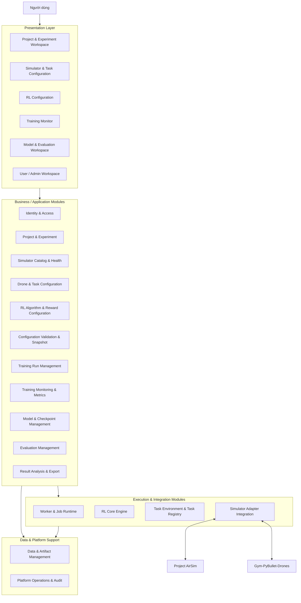
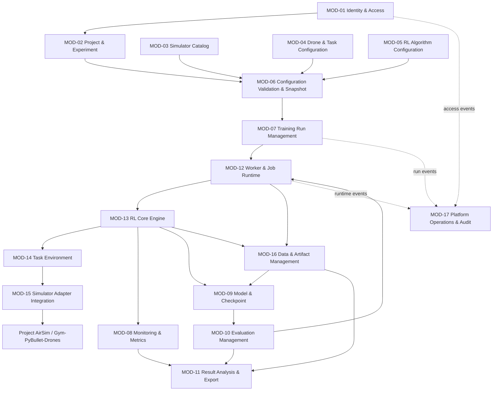

# DANH SÁCH MODULE HỆ THỐNG
## Drone RL Training Platform

| Thuộc tính | Nội dung |
|---|---|
| Tên dự án | Drone RL Training Platform |
| Tên tài liệu | Module Design – Module Inventory |
| Phiên bản | 0.1 – Danh sách module đề xuất |
| Ngày lập | 02/11/2026 |
| Tài liệu đầu vào | `PROJECT_INITIATION.md`; `REQUIREMENTS_ANALYSIS.md`; `SYSTEM_ARCHITECTURE.md` |
| Trạng thái | Bản danh mục module – chờ rà soát và xác nhận ranh giới module |
| Mục đích | Xác định danh sách module, nhóm module, phạm vi trách nhiệm ở mức tổng quan và thứ tự thiết kế chi tiết |

> **Phạm vi tài liệu:** Tài liệu này chỉ xác định danh sách và ranh giới module ở mức tổng quan. Chưa đi vào thiết kế chi tiết từng module như class, function, database schema, API endpoint, giao diện hoặc cấu trúc mã nguồn. Các nội dung đó sẽ được thực hiện trong các tài liệu/phiên làm việc tiếp theo sau khi danh mục module được duyệt.

---

# 1. Mục đích và cơ sở xây dựng danh sách module

## 1.1. Mục đích

Danh sách module là cầu nối giữa tài liệu kiến trúc tổng thể `SYSTEM_ARCHITECTURE.md` và bước thiết kế chi tiết từng module.

Danh mục này được sử dụng để:

1. Chia hệ thống thành các đơn vị chức năng và kỹ thuật có trách nhiệm rõ ràng.
2. Xác định ranh giới giữa nghiệp vụ quản lý thí nghiệm, thực thi RL, tích hợp simulator và lưu trữ dữ liệu.
3. Đối chiếu từng module với các yêu cầu chức năng và phi chức năng.
4. Xác định module nào thuộc MVP, module nào là năng lực hỗ trợ hoặc mở rộng.
5. Làm cơ sở lập kế hoạch thiết kế chi tiết, phát triển và kiểm thử.

## 1.2. Tài liệu đầu vào

| Tài liệu | Nội dung được kế thừa |
|---|---|
| `PROJECT_INITIATION.md` | Mục tiêu, đối tượng sử dụng, phạm vi MVP, hai simulator và các năng lực sản phẩm |
| `REQUIREMENTS_ANALYSIS.md` | User Roles, BR, Business Rules, FR-001 đến FR-052, NFR-001 đến NFR-022, Use Cases và Acceptance Criteria |
| `SYSTEM_ARCHITECTURE.md` | Layered Architecture, Modular Monolith, Worker process riêng, RL Core, Task Environment, Simulator Adapter và Data/Artifact Storage |

**Lưu ý quản lý tài liệu:** Chủ dự án đã xác nhận phê duyệt yêu cầu trong quá trình trao đổi. Tệp `REQUIREMENTS_ANALYSIS.md` được cung cấp vẫn ghi trạng thái dự thảo ở phần metadata; nên cập nhật metadata/phiên bản khi phát hành baseline chính thức, không thay đổi nội dung yêu cầu chỉ vì khác biệt trạng thái này.

## 1.3. Nguyên tắc phân chia module

- **Theo trách nhiệm:** mỗi module có một nhóm nhiệm vụ chính, hạn chế chồng lấn.
- **Theo nghiệp vụ:** các chức năng người dùng nhìn thấy được nhóm theo mục tiêu sử dụng.
- **Theo ranh giới kỹ thuật:** Training Worker, RL Core, Task Environment và Simulator Adapter được tách riêng.
- **MVP-first:** chỉ xác định cấu trúc đủ cho MVP; các điểm mở rộng không đồng nghĩa phải triển khai ngay.
- **Không trộn tầng:** màn hình Frontend, module nghiệp vụ Backend và thành phần thực thi không được xem là cùng một loại module.
- **Có thể truy vết:** mỗi module nghiệp vụ phải liên kết với mã FR/NFR tương ứng.
- **Không thiết kế quá sớm:** không đưa chi tiết database, API hoặc mã nguồn vào danh mục này.

---

# 2. Cách tổ chức module tổng thể

Hệ thống được chia thành ba nhóm chính:

1. **Nhóm module chức năng nghiệp vụ (Business/Application Modules):** đáp ứng trực tiếp các quy trình và yêu cầu mà người dùng thao tác.
2. **Nhóm module thực thi và tích hợp kỹ thuật (Execution & Integration Modules):** thực thi training/evaluation và kết nối các simulator.
3. **Nhóm module dữ liệu và vận hành (Data & Platform Support Modules):** quản lý dữ liệu, artifact, log và hoạt động nền tảng.

Frontend là lớp trình bày các chức năng của những module nghiệp vụ. Các khu vực giao diện được liệt kê riêng ở Mục 5 để tránh nhầm chúng với module xử lý nghiệp vụ phía Backend.

## 2.1. Sơ đồ phân nhóm module

**Diễn giải:** Người dùng thao tác trên Frontend. Các module nghiệp vụ tiếp nhận yêu cầu và quản lý dữ liệu/quy trình. Các tác vụ huấn luyện và đánh giá được chuyển cho nhóm module thực thi. Nhóm tích hợp simulator làm việc với Project AirSim hoặc Gym-PyBullet-Drones thông qua adapter riêng. Dữ liệu có cấu trúc và artifact được quản lý qua nhóm module dữ liệu.

---

# 3. Danh sách module chức năng nghiệp vụ

Đây là nhóm module cung cấp các năng lực nghiệp vụ chính của nền tảng. Các module được tổ chức trong Backend dạng Modular Monolith theo định hướng kiến trúc đã đề xuất.

## 3.1. Bảng tổng hợp module chức năng

| Module ID | Tên module | Mục đích chính | Phạm vi trách nhiệm ở mức tổng quan | Yêu cầu chức năng liên quan | Giai đoạn |
|---|---|---|---|---|---|
| MOD-01 | Identity & Access Management | Quản lý truy cập và quyền sử dụng | Xác thực, vai trò và kiểm tra quyền trên project/experiment/run/model | FR-001–FR-004 | MVP tối thiểu tùy mô hình triển khai; mở rộng theo nhu cầu nhiều người dùng |
| MOD-02 | Project & Experiment Management | Tổ chức dự án nghiên cứu và thí nghiệm | Tạo/quản lý project, experiment, cấu hình thí nghiệm và lịch sử run | FR-005–FR-010 | MVP |
| MOD-03 | Simulator Catalog & Health Management | Quản lý danh sách và trạng thái simulator | Khai báo simulator được hỗ trợ, cấu hình thông tin kết nối, kiểm tra sẵn sàng và phiên bản | FR-011–FR-015 | MVP |
| MOD-04 | Drone, Environment & Task Configuration | Cấu hình drone và bài toán bay | Chọn drone/model, task, điều kiện task, observation/action, reward và termination ở mức được hỗ trợ | FR-016–FR-020 | MVP với task mẫu |
| MOD-05 | RL Algorithm & Training Configuration | Cấu hình thuật toán và tham số RL | Chọn thuật toán đã tích hợp, cấu hình hyperparameters, seed, timestep và checkpoint frequency; quản lý cấu hình reward theo task | FR-022–FR-024, FR-026 | MVP với PPO |
| MOD-06 | Configuration Validation & Snapshot | Kiểm tra và đóng băng cấu hình thí nghiệm | Kiểm tra tương thích simulator-task-observation-action-algorithm; kiểm tra tham số và lưu snapshot cấu hình dùng cho run | FR-009, FR-021, FR-025 | MVP |
| MOD-07 | Training Run Management | Quản lý vòng đời phiên huấn luyện | Kiểm tra điều kiện chạy, tạo run, theo dõi trạng thái, yêu cầu dừng và xử lý thông tin lỗi | FR-027–FR-033 | MVP |
| MOD-08 | Training Monitoring & Metrics | Theo dõi quá trình huấn luyện | Truy vấn và hiển thị trạng thái, tiến độ và metrics được worker ghi nhận | FR-034–FR-038, FR-049 | MVP với metrics cơ bản |
| MOD-09 | Model & Checkpoint Management | Quản lý mô hình đã huấn luyện | Liệt kê, xem metadata, kiểm tra khả năng nạp và tải/xuất model hoặc checkpoint theo định dạng hỗ trợ | FR-039–FR-043 | MVP |
| MOD-10 | Evaluation Management | Quản lý quy trình đánh giá policy | Tạo evaluation run, lựa chọn model/checkpoint và protocol, bảo đảm evaluation không cập nhật policy | FR-044–FR-047 | MVP |
| MOD-11 | Result Analysis & Export | Phân tích, so sánh và xuất kết quả | So sánh kết quả ở mức hỗ trợ, hiển thị dữ liệu quỹ đạo và xuất CSV/báo cáo; biểu đồ training thuộc MOD-08 | FR-048, FR-050–FR-052 | MVP cơ bản; mở rộng ở Phase 2 |

## 3.2. Ranh giới trách nhiệm giữa các module nghiệp vụ

Các module có liên quan chặt chẽ nhưng không thay thế trách nhiệm của nhau:

- **MOD-02** quản lý danh tính và nội dung của project/experiment; không thực thi thuật toán RL.
- **MOD-03** quản lý danh mục simulator và kiểm tra trạng thái; không chứa logic task bay.
- **MOD-04** quản lý cấu hình bài toán bay; không trực tiếp gọi API simulator.
- **MOD-05** quản lý lựa chọn thuật toán và tham số; không thực hiện vòng lặp training.
- **MOD-06** kiểm tra tổ hợp cấu hình và tạo snapshot; không điều phối process.
- **MOD-07** quản lý nghiệp vụ vòng đời run; không trực tiếp chạy vòng lặp RL.
- **MOD-08** cung cấp dữ liệu giám sát cho người dùng; việc thu thập metrics tại thời điểm training thuộc nhóm thực thi.
- **MOD-09** quản lý metadata và khả năng truy xuất model/checkpoint; file nhị phân được quản lý bởi MOD-16.
- **MOD-10** quản lý yêu cầu và kết quả evaluation; thực thi inference thuộc nhóm RL Execution.
- **MOD-11** phục vụ xem, so sánh và xuất kết quả; không tự tính lại dữ liệu vật lý nếu không có định nghĩa metric tương ứng.

---

# 4. Danh sách module thực thi và tích hợp kỹ thuật

Nhóm này không nhất thiết tương ứng với màn hình riêng trên Web. Đây là các module kỹ thuật chịu trách nhiệm thực thi những tác vụ nền và tích hợp simulator theo kiến trúc đã chọn.

## 4.1. Bảng tổng hợp module kỹ thuật

| Module ID | Tên module | Mục đích chính | Phạm vi trách nhiệm ở mức tổng quan | Yêu cầu liên quan | Giai đoạn |
|---|---|---|---|---|---|
| MOD-12 | Worker & Job Runtime Management | Điều phối và cô lập tác vụ dài hạn | Dispatcher, Worker Supervisor, tạo process cho từng run, heartbeat, stop, cleanup và đối soát trạng thái process | FR-027–FR-033, FR-039, FR-044–FR-045; NFR-001, NFR-003–NFR-006, NFR-014, NFR-016 | MVP |
| MOD-13 | RL Core Engine | Thực thi thuật toán RL và điều khiển training/evaluation | Algorithm Registry, Training Controller, Evaluation Controller, Metrics Collector, Checkpoint Manager và Runtime Metadata Collector | FR-022–FR-026, FR-034–FR-036, FR-039, FR-044–FR-045; NFR-013, NFR-015, NFR-019, NFR-020 | MVP với PPO |
| MOD-14 | Task Environment & Task Registry | Định nghĩa và cung cấp các task RL qua Gymnasium | Đăng ký task, Task Contract, tạo Gymnasium Environment, xử lý observation/action theo task, reward và termination | FR-016–FR-021, FR-046–FR-047, FR-050; NFR-017, NFR-018 | MVP với task mẫu |
| MOD-15 | Simulator Adapter Integration | Tích hợp API và runtime của simulator | Adapter Registry, Project AirSim Adapter, Gym-PyBullet-Drones Adapter, mapping state/control, quản lý thời gian mô phỏng và vòng đời kết nối | FR-011–FR-021; NFR-013, NFR-015–NFR-018 | MVP; phải kiểm thử từng simulator |

## 4.2. Các thành phần con thuộc module kỹ thuật

| Module cha | Thành phần con dự kiến | Ghi chú phạm vi |
|---|---|---|
| MOD-12 | Run Dispatcher | Tiếp nhận và claim run đủ điều kiện |
| MOD-12 | Worker Supervisor | Theo dõi process, heartbeat, stop, exit code và cleanup |
| MOD-12 | Isolated Run Process | Process thực thi một Training Run hoặc Evaluation Run |
| MOD-13 | Algorithm Registry | Đăng ký algorithm theo tên/phiên bản; PPO trước trong MVP |
| MOD-13 | Training Controller | Thực thi học và cập nhật policy |
| MOD-13 | Evaluation Controller | Nạp policy và inference; không cập nhật trọng số |
| MOD-13 | Metrics Collector | Thu thập, chuẩn hóa và đóng gói metrics |
| MOD-13 | Checkpoint Manager | Tạo, xác minh và đăng ký checkpoint |
| MOD-13 | Runtime Metadata Collector | Thu thập seed, version và metadata môi trường chạy |
| MOD-14 | Task Registry | Danh mục task và capability tương ứng |
| MOD-14 | Task Contract | Quy ước version hóa observation/action/timing/reward/termination/metrics |
| MOD-14 | Gymnasium Task Environment | Cung cấp reset/step/close theo Gymnasium |
| MOD-15 | Simulator Adapter Registry | Chọn adapter theo simulator/version/capability |
| MOD-15 | Project AirSim Adapter | Kết nối, điều khiển và thu state/sensor theo API đã xác nhận |
| MOD-15 | Gym-PyBullet-Drones Adapter | Khởi tạo, reset, step, render/close PyBullet environment |
| MOD-15 | Coordinate/Unit/Action Mapping | Chuyển đổi theo Task Contract; không giả định hai simulator đồng nhất |

**Lưu ý ranh giới:** MOD-14 chịu trách nhiệm ngữ nghĩa của bài toán RL; MOD-15 chịu trách nhiệm giao tiếp với simulator cụ thể. Reward và điều kiện kết thúc task không nên bị khóa cứng trong adapter của một simulator.

---

# 5. Danh sách module dữ liệu và vận hành nền tảng

| Module ID | Tên module | Mục đích chính | Phạm vi trách nhiệm ở mức tổng quan | Yêu cầu liên quan | Giai đoạn |
|---|---|---|---|---|---|
| MOD-16 | Data & Artifact Management | Quản lý dữ liệu có cấu trúc và tệp kết quả | Quản lý metadata trong PostgreSQL; tổ chức file model/checkpoint/log/trajectory/export; tham chiếu artifact, checksum và trạng thái khả dụng | FR-009–FR-010, FR-032–FR-043, FR-044–FR-052; NFR-005, NFR-007, NFR-019–NFR-022 | MVP |
| MOD-17 | Platform Operations & Audit | Hỗ trợ vận hành, chẩn đoán và truy vết thao tác | Ghi operational logs, lỗi theo tầng, trạng thái thành phần, các sự kiện quan trọng và audit theo chính sách được duyệt | FR-001–FR-004, FR-012–FR-015, FR-032–FR-033; NFR-004, NFR-006, NFR-010–NFR-012, NFR-016, NFR-022 | MVP ở mức log/lỗi cơ bản; audit mở rộng theo mô hình sử dụng |

## 5.1. Nguyên tắc phân chia dữ liệu

- PostgreSQL là nơi quản lý metadata, quan hệ nghiệp vụ và trạng thái run/evaluation.
- Artifact Storage lưu các tệp như checkpoint, model, log, trajectory dataset và file export.
- Database giữ metadata và tham chiếu tới artifact, không lưu trực tiếp toàn bộ tệp checkpoint lớn trong các cột thông thường.
- Mỗi artifact cần truy ngược được về project/experiment/run/model tương ứng.
- Chính sách retention, xóa và backup phải được xác nhận trước khi chốt thiết kế dữ liệu chi tiết.

---

# 6. Các khu vực chức năng trên Web Frontend

Các mục dưới đây là **Frontend Feature Areas** – khu vực giao diện tương ứng với các module nghiệp vụ. Chúng không phải các module Backend độc lập và không được tự ý tạo thêm nghiệp vụ ngoài danh sách yêu cầu.

| UI ID | Khu vực giao diện | Chức năng người dùng thao tác | Module Backend chủ yếu |
|---|---|---|---|
| UI-01 | Project & Experiment Workspace | Xem, tạo và quản lý project/experiment; xem lịch sử run | MOD-01, MOD-02 |
| UI-02 | Simulator Configuration | Xem simulator, kiểm tra kết nối, chọn simulator | MOD-03 |
| UI-03 | Drone & Task Configuration | Chọn drone/task; cấu hình điều kiện bay, observation/action/reward/termination | MOD-04, MOD-06 |
| UI-04 | RL Configuration | Chọn algorithm và nhập tham số huấn luyện | MOD-05, MOD-06 |
| UI-05 | Training Monitor | Khởi chạy/dừng run; theo dõi trạng thái, tiến độ, metrics và log | MOD-07, MOD-08 |
| UI-06 | Model & Checkpoint Workspace | Xem model/checkpoint, metadata và yêu cầu tải/xuất | MOD-09 |
| UI-07 | Evaluation & Results Workspace | Tạo evaluation, xem/so sánh metrics, dữ liệu quỹ đạo và xuất CSV | MOD-10, MOD-11 |
| UI-08 | User & Platform Administration | Quản lý tài khoản/vai trò và một số thông tin vận hành theo quyền | MOD-01, MOD-17 |

> Dashboard tổng quan có thể được bố trí như trang đầu của Frontend, sử dụng dữ liệu tổng hợp từ các module hiện có. Dashboard không được xem là một module nghiệp vụ mới ở giai đoạn này.

---

# 7. Quan hệ và phụ thuộc giữa các module

## 7.1. Luồng phụ thuộc chính

Sơ đồ thể hiện phụ thuộc ở mức khái niệm, không phải thứ tự gọi hàm hoặc hợp đồng API chi tiết. MOD-16 và MOD-17 là các năng lực dùng chung; không nên hiểu chúng là module chỉ được gọi ở cuối quy trình.

## 7.2. Bảng phụ thuộc trọng yếu

| Module | Phụ thuộc chính | Lý do phụ thuộc |
|---|---|---|
| MOD-02 | MOD-01, MOD-16 | Kiểm soát quyền và lưu metadata project/experiment |
| MOD-03 | MOD-15, MOD-17 | Kiểm tra simulator qua adapter và ghi nhận trạng thái/lỗi |
| MOD-04 | MOD-03, MOD-14 | Chỉ cấu hình task/drone trong phạm vi capability được hỗ trợ |
| MOD-05 | MOD-04, MOD-13 | Cấu hình thuật toán phù hợp task và runtime đã đăng ký |
| MOD-06 | MOD-03, MOD-04, MOD-05, MOD-16 | Kiểm tra tính tương thích và lưu snapshot cấu hình |
| MOD-07 | MOD-01, MOD-06, MOD-12, MOD-16 | Xác thực quyền, cấu hình, điều phối run và lưu trạng thái |
| MOD-08 | MOD-07, MOD-13, MOD-16 | Đọc trạng thái và metrics do runtime ghi nhận |
| MOD-09 | MOD-13, MOD-16 | Đăng ký metadata và tham chiếu checkpoint/model |
| MOD-10 | MOD-09, MOD-06, MOD-12, MOD-13, MOD-14, MOD-15 | Nạp artifact, tạo evaluation job và khởi tạo môi trường |
| MOD-11 | MOD-08, MOD-09, MOD-10, MOD-16 | Truy vấn kết quả, so sánh và xuất dữ liệu |
| MOD-12 | MOD-16, MOD-17 | Điều phối process, lưu trạng thái và ghi log vận hành |
| MOD-13 | MOD-14, MOD-16 | Thực thi algorithm trên Task Environment và ghi metrics/artifacts |
| MOD-14 | MOD-15 | Task Environment sử dụng adapter simulator để reset/step và lấy dữ liệu |
| MOD-15 | External Simulators | Giao tiếp với runtime cụ thể |
| MOD-16 | Database/File Storage | Quản lý metadata và artifact |
| MOD-17 | Các module phát sinh sự kiện | Hỗ trợ log, audit và chẩn đoán lỗi |

---

# 8. Phân loại module theo phạm vi phát triển

## 8.1. Module cần có trong MVP

| Module | Phạm vi triển khai MVP |
|---|---|
| MOD-01 | Xác thực/phân quyền ở mức tối thiểu phù hợp mô hình local/LAN được duyệt |
| MOD-02 | Quản lý project, experiment, snapshot và lịch sử run |
| MOD-03 | Danh mục hai simulator, health check và thông tin phiên bản khả dụng |
| MOD-04 | Cấu hình task mẫu Hovering và/hoặc Position Control sau technical spike |
| MOD-05 | PPO và các tham số huấn luyện cốt yếu; cấu hình reward theo task mẫu |
| MOD-06 | Validation và snapshot cấu hình trước run |
| MOD-07 | Tạo, theo dõi, dừng run; ghi nhận lỗi |
| MOD-08 | Hiển thị trạng thái, tiến độ, Reward và các metrics được runtime cung cấp |
| MOD-09 | Lưu, liệt kê, xác minh và truy xuất checkpoint/model |
| MOD-10 | Evaluation độc lập, policy không cập nhật |
| MOD-11 | Metrics cơ bản, dữ liệu quỹ đạo ở mức phù hợp và xuất CSV |
| MOD-12 | Dispatcher/Supervisor và process riêng cho từng run |
| MOD-13 | PPO training controller, evaluation controller, callbacks và checkpoint |
| MOD-14 | Gymnasium Task Environment cho task mẫu |
| MOD-15 | Adapter riêng cho Project AirSim và Gym-PyBullet-Drones; kiểm thử đầu-cuối độc lập |
| MOD-16 | PostgreSQL metadata và local artifact storage |
| MOD-17 | Log lỗi, trạng thái vận hành và khả năng truy vết cơ bản |

**Điều kiện:** Một module nằm trong danh sách MVP không có nghĩa mọi chức năng tương lai của module đó đều phải làm trong MVP. Phạm vi thực tế phải tuân theo MoSCoW và các điều kiện nghiệm thu trong `REQUIREMENTS_ANALYSIS.md`.

## 8.2. Năng lực mở rộng ở Phase 2

- Bổ sung SAC và TD3 trong MOD-05 và MOD-13.
- Bổ sung task Trajectory Tracking và các Task Contract tương ứng trong MOD-04/MOD-14.
- Mở rộng so sánh model/evaluation trong MOD-11.
- Nâng cấp biểu đồ, phân tích quỹ đạo và trực quan hóa trong MOD-08/MOD-11.
- Cải tiến khả năng quản trị người dùng, quyền và audit trong MOD-01/MOD-17.
- Mở rộng worker/job scheduling khi benchmark chứng minh nhu cầu trong MOD-12.

## 8.3. Năng lực Phase 3 hoặc ngoài MVP

- Multi-Agent RL.
- Distributed Training/GPU Resource Manager.
- Domain Randomization nâng cao và Curriculum Learning.
- PX4 SITL/HITL và Sim-to-Real.
- Điều khiển drone thật.
- Tối ưu siêu tham số tự động quy mô lớn.
- Hệ thống multi-tenant phức tạp.

Các nội dung này là hướng mở rộng sản phẩm, không phải module bắt buộc phải phát triển trong MVP.

---

# 9. Ma trận truy vết module với yêu cầu

| Module | FR liên quan | NFR liên quan chính |
|---|---|---|
| MOD-01 | FR-001–FR-004 | NFR-010–NFR-012 |
| MOD-02 | FR-005–FR-010 | NFR-005, NFR-019, NFR-021 |
| MOD-03 | FR-011–FR-015 | NFR-013, NFR-015–NFR-018 |
| MOD-04 | FR-016–FR-020 | NFR-017, NFR-018 |
| MOD-05 | FR-022–FR-024, FR-026 | NFR-013, NFR-015, NFR-019 |
| MOD-06 | FR-009, FR-021, FR-025 | NFR-017–NFR-019 |
| MOD-07 | FR-027–FR-033 | NFR-001, NFR-003–NFR-006, NFR-014, NFR-016 |
| MOD-08 | FR-034–FR-038, FR-049 | NFR-001, NFR-002, NFR-009 |
| MOD-09 | FR-039–FR-043 | NFR-007, NFR-019, NFR-021, NFR-022 |
| MOD-10 | FR-044–FR-047 | NFR-020, NFR-021 |
| MOD-11 | FR-048, FR-050–FR-052 | NFR-009, NFR-020–NFR-022 |
| MOD-12 | FR-027–FR-033, FR-039, FR-044–FR-045 | NFR-001, NFR-003–NFR-006, NFR-014, NFR-016 |
| MOD-13 | FR-022–FR-026, FR-034–FR-036, FR-039, FR-044–FR-045 | NFR-013, NFR-015, NFR-019, NFR-020 |
| MOD-14 | FR-016–FR-021, FR-046–FR-047, FR-050 | NFR-017, NFR-018 |
| MOD-15 | FR-011–FR-021 | NFR-013, NFR-015–NFR-018 |
| MOD-16 | FR-009–FR-010, FR-032–FR-043, FR-044–FR-052 | NFR-005, NFR-007, NFR-019–NFR-022 |
| MOD-17 | FR-001–FR-004, FR-012–FR-015, FR-032–FR-033 | NFR-004, NFR-006, NFR-010–NFR-012, NFR-016, NFR-022 |

> Một FR có thể được nhiều module phối hợp thực hiện. Bảng trên thể hiện module chịu trách nhiệm chính hoặc tham gia trực tiếp; ở bước thiết kế chi tiết cần xác định rõ module owner để tránh trùng trách nhiệm.

---

# 10. Những nội dung chưa chốt và cần xác nhận khi thiết kế chi tiết

Danh sách module được xây dựng theo kiến trúc hiện tại. Các câu hỏi dưới đây chưa được tự ý quyết định thay chủ dự án:

| Mã | Nội dung cần chốt | Module chịu ảnh hưởng |
|---|---|---|
| MD-Q01 | Mô hình triển khai local, LAN hay hybrid và số người dùng thực tế | MOD-01, MOD-12, MOD-17 |
| MD-Q02 | Có cần vai trò Platform Administrator độc lập ngay trong MVP không? | MOD-01, MOD-17 |
| MD-Q03 | Simulator repository/fork và phiên bản chính xác | MOD-03, MOD-15 |
| MD-Q04 | Task đầu tiên để kiểm chứng trên từng simulator là Hovering hay Position Control? | MOD-04, MOD-14, MOD-15 |
| MD-Q05 | Action mode đầu tiên là motor, attitude, velocity hay position setpoint? | MOD-04, MOD-14, MOD-15 |
| MD-Q06 | Observation sử dụng state vector nào; có dùng camera/LiDAR trong MVP không? | MOD-04, MOD-14, MOD-15 |
| MD-Q07 | Chính sách chạy đồng thời và giới hạn tài nguyên của Worker | MOD-07, MOD-12 |
| MD-Q08 | Có yêu cầu Resume chính xác trạng thái training trong MVP không? | MOD-07, MOD-09, MOD-12, MOD-13 |
| MD-Q09 | Bộ metrics tối thiểu và định nghĩa thành công của từng task | MOD-08, MOD-10, MOD-11, MOD-14 |
| MD-Q10 | Phạm vi hiển thị quỹ đạo: dữ liệu CSV, biểu đồ 2D hay 3D tương tác | MOD-11 |
| MD-Q11 | Chính sách lưu trữ, backup, retention và dung lượng artifact | MOD-16, MOD-17 |

---

# 11. Thứ tự đề xuất thiết kế chi tiết từng module

Sau khi danh mục module được rà soát và chốt, nên thiết kế chi tiết theo nhóm có quan hệ phụ thuộc. Không nhất thiết phải hoàn thiện mọi module theo thứ tự số ID.

| Thứ tự | Module ưu tiên thiết kế | Lý do |
|---|---|---|
| 1 | MOD-03 Simulator Catalog; MOD-15 Simulator Adapter Integration | Cần xác định khả năng thực tế của hai simulator |
| 2 | MOD-04 Drone, Environment & Task Configuration; MOD-14 Task Environment & Task Registry | Chốt task contract, observation/action, reward và timing |
| 3 | MOD-05 RL Algorithm & Training Configuration; MOD-13 RL Core Engine | Xác định luồng PPO và cơ chế mở rộng algorithm |
| 4 | MOD-12 Worker & Job Runtime; MOD-07 Training Run Management | Thiết kế cách khởi chạy, giám sát, dừng và cleanup run |
| 5 | MOD-02 Project & Experiment; MOD-06 Configuration Validation & Snapshot | Hoàn thiện quy trình tổ chức và xác thực experiment |
| 6 | MOD-16 Data & Artifact Management; MOD-09 Model & Checkpoint | Chốt quản lý metadata và artifact |
| 7 | MOD-08 Training Monitoring & Metrics; MOD-10 Evaluation Management; MOD-11 Result Analysis & Export | Hoàn thiện giám sát, đánh giá và phân tích kết quả |
| 8 | MOD-01 Identity & Access; MOD-17 Platform Operations & Audit | Chốt các chính sách vận hành và quyền truy cập theo mô hình triển khai |
| 9 | Frontend Feature Areas UI-01 đến UI-08 | Thiết kế màn hình bám theo nghiệp vụ và hợp đồng module đã rõ |

Thứ tự này là đề xuất tổ chức công việc. Một số module có thể được thiết kế song song sau khi các hợp đồng phụ thuộc đã được thống nhất.

---

# 12. Mẫu cấu trúc sẽ sử dụng khi thiết kế chi tiết một module

Mỗi module ở các bước tiếp theo sẽ được mô tả theo cùng một mẫu để tài liệu nhất quán:

1. Thông tin chung: Module ID, tên, mục đích và phạm vi.
2. Vị trí module trong kiến trúc.
3. Trách nhiệm chính và các chức năng thuộc module.
4. Các yêu cầu FR/NFR liên quan.
5. Actor hoặc module gọi đến.
6. Đầu vào và đầu ra.
7. Quy trình xử lý nghiệp vụ/kỹ thuật.
8. Các thành phần con bên trong module.
9. Quan hệ phụ thuộc và tương tác với module khác.
10. Dữ liệu module quản lý ở mức logic (chưa thay thế Database Design).
11. Quy tắc nghiệp vụ và xử lý ngoại lệ.
12. Yêu cầu bảo mật, hiệu năng và độ tin cậy liên quan.
13. Tiêu chí kiểm thử/nghiệm thu.
14. Giới hạn MVP và hướng mở rộng.

Chi tiết API, ERD/bảng dữ liệu, class diagram và mã nguồn chỉ được bổ sung khi bước thiết kế tương ứng bắt đầu.

---

# 13. Kết luận và đề nghị phê duyệt danh mục

Danh mục đề xuất gồm:

- **11 module chức năng nghiệp vụ** (MOD-01 đến MOD-11).
- **4 module thực thi và tích hợp kỹ thuật** (MOD-12 đến MOD-15).
- **2 module dữ liệu và vận hành hỗ trợ** (MOD-16 đến MOD-17).
- **8 khu vực chức năng Frontend** (UI-01 đến UI-08), được tổ chức dựa trên các module nghiệp vụ.

Tổng cộng có **17 module logic** và **8 khu vực giao diện**. Đây là danh mục ở mức phân rã chức năng/kiến trúc; không có nghĩa mỗi module phải triển khai thành một service hoặc một tiến trình độc lập. Backend vẫn theo hướng Modular Monolith; các tiến trình Worker và simulator runtime được tách riêng theo kiến trúc đã đề xuất.

Trước khi chuyển sang thiết kế chi tiết, cần xác nhận:

- Tên và phạm vi của các module.
- Ranh giới giữa module nghiệp vụ và module kỹ thuật.
- Module nào thuộc MVP và phần nào chỉ là hướng mở rộng.
- Mã FR/NFR được gán cho từng module.
- Thứ tự thiết kế chi tiết đề xuất.

---

# 14. Lịch sử phiên bản và phê duyệt

## 14.1. Lịch sử phiên bản

| Phiên bản | Ngày | Nội dung | Trạng thái |
|---|---|---|---|
| 0.1 | 02/11/2026 | Xây dựng danh sách module từ tài liệu khởi tạo, phân tích yêu cầu và kiến trúc hệ thống | Chờ rà soát |

## 14.2. Phê duyệt

| Vai trò | Người phê duyệt | Ngày | Trạng thái |
|---|---|---|---|
| Chủ dự án/Product Owner | Chưa xác định | Chưa xác định | Chờ phê duyệt |
| Software Architect | Chưa xác định | Chưa xác định | Chờ rà soát |
| Đại diện RL/Simulation | Chưa xác định | Chưa xác định | Chờ rà soát |

> **Trạng thái tài liệu:** Đây là bản danh mục module ban đầu. Chỉ sau khi chủ dự án xác nhận danh sách và phạm vi, các module mới được đưa vào bước thiết kế chi tiết.
