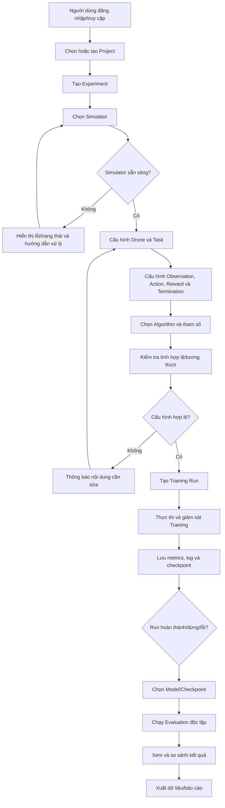
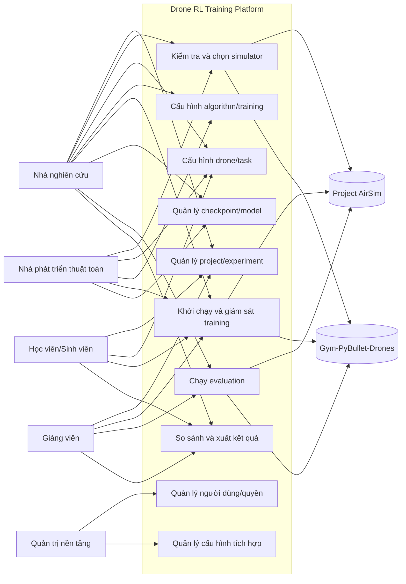

# TÀI LIỆU KHẢO SÁT VÀ PHÂN TÍCH YÊU CẦU

## Drone RL Training Platform

| Thuộc tính | Nội dung |
|---|---|
| Tên dự án | Drone RL Training Platform |
| Tên tài liệu | Requirements Analysis – Khảo sát và phân tích yêu cầu |
| Phiên bản | 1.0 – Bản dự thảo phân tích |
| Ngày lập | 02/11/2026 |
| Tài liệu đầu vào | `PROJECT_INITIATION.md` – Phiên bản 1.0, bản khởi tạo ngày 02/11/2026 |
| Trạng thái | Dự thảo – cần chủ dự án và đại diện kỹ thuật rà soát, xác nhận |
| Người lập | BA/Software Requirement Analyst (vai trò) |

> **Quy ước về mức độ chắc chắn:** Tài liệu phân biệt (1) nội dung đã được xác định trong tài liệu khởi tạo, (2) đề xuất phân tích của BA để cụ thể hóa yêu cầu, và (3) vấn đề đang chờ chủ dự án xác nhận. Những đề xuất chưa được phê duyệt không được xem là baseline chính thức.

---

# 1. Giới thiệu và mục đích tài liệu

## 1.1. Mục đích

Tài liệu này chuyển hóa mục tiêu và phạm vi ban đầu trong `PROJECT_INITIATION.md` thành các yêu cầu có thể quản lý, truy vết, thiết kế và kiểm thử cho Drone RL Training Platform.

Tài liệu tập trung trả lời các câu hỏi:

- Những nhóm người dùng nào sẽ sử dụng hệ thống và họ cần làm gì?
- Hệ thống cần hỗ trợ những nhu cầu nghiệp vụ và quy trình nào?
- Hệ thống phải cung cấp những chức năng gì?
- Hệ thống cần đáp ứng những thuộc tính chất lượng nào?
- Phạm vi nào thuộc MVP, phạm vi nào để ở các giai đoạn sau?
- Điều kiện nào được dùng để xác nhận chức năng đã hoàn thành?

Tài liệu này là đầu vào cho bước thiết kế hệ thống. Tài liệu **không** thay thế thiết kế kiến trúc, thiết kế cơ sở dữ liệu, đặc tả API, thiết kế giao diện chi tiết hoặc mã nguồn.

## 1.2. Cơ sở phân tích

Nguồn chính là `PROJECT_INITIATION.md`. Các định hướng quan trọng được kế thừa:

- Sản phẩm là nền tảng Web quản lý thí nghiệm và huấn luyện RL cho drone.
- Hai môi trường mô phỏng dự kiến là Project AirSim và Gym-PyBullet-Drones.
- Các nhiệm vụ được nêu gồm Hovering, Position Control và Trajectory Tracking.
- PPO là thuật toán ưu tiên cho luồng huấn luyện đầu tiên; SAC và TD3 là hướng mở rộng.
- Các năng lực chính gồm cấu hình, chạy và giám sát training, lưu cấu hình/log/checkpoint/model, evaluation, trực quan hóa và xuất dữ liệu.
- MVP cần chứng minh luồng đầu-cuối; không mặc định mọi thuật toán và mọi nhiệm vụ phải hoàn tất ngay trong lát cắt MVP đầu tiên.
- Việc tích hợp hai simulator, hiệu năng, phần cứng, nguồn lực, chi phí và tiến độ vẫn có các điều kiện cần kiểm chứng.

## 1.3. Thuật ngữ và viết tắt

| Thuật ngữ | Giải thích trong phạm vi dự án |
|---|---|
| RL (Reinforcement Learning) | Học tăng cường; phương pháp học qua tương tác giữa agent và môi trường |
| Simulator | Môi trường mô phỏng drone, ví dụ Project AirSim hoặc Gym-PyBullet-Drones |
| Environment | Môi trường RL cung cấp observation, nhận action và trả reward/trạng thái kết thúc |
| Agent/Policy | Thành phần lựa chọn action dựa trên observation đã nhận |
| Observation | Dữ liệu trạng thái/quan sát được cung cấp cho agent |
| Action | Lệnh điều khiển do agent phát ra |
| Reward | Giá trị thưởng/phạt phản ánh kết quả của một bước tương tác hoặc episode |
| Episode | Một lượt tương tác từ trạng thái khởi tạo đến khi kết thúc theo điều kiện của task |
| Training | Quá trình cập nhật policy/model dựa trên tương tác với môi trường |
| Evaluation | Quá trình đánh giá policy đã lưu; không cập nhật trọng số policy trong lượt đánh giá |
| Checkpoint | Bản lưu trạng thái mô hình tại một thời điểm huấn luyện |
| Experiment | Một cấu hình thí nghiệm có mục tiêu, simulator, task, thuật toán và thông số xác định |
| Training Run/Session | Một lần thực thi cụ thể của experiment |
| Adapter | Thành phần chuyển đổi giao diện và dữ liệu riêng của simulator sang hợp đồng môi trường chung |
| MVP | Phiên bản sản phẩm tối thiểu có thể sử dụng và kiểm chứng giá trị cốt lõi |
| RTM | Requirements Traceability Matrix – Ma trận truy vết yêu cầu |

---

# 2. Phạm vi hệ thống

## 2.1. Mô tả hệ thống

Drone RL Training Platform là nền tảng Web hỗ trợ người dùng tổ chức quy trình nghiên cứu và thực nghiệm RL cho drone. Người dùng tạo dự án nghiên cứu, tạo experiment, chọn simulator và task, cấu hình thuật toán, khởi chạy training, theo dõi tiến trình, quản lý checkpoint/model, chạy evaluation và xem/xuất kết quả.

Các simulator được xem là **hệ thống bên ngoài được tích hợp**, không phải người dùng của nền tảng. Hệ thống cần cung cấp trải nghiệm quản lý nhất quán nhưng không được giả định rằng các simulator có mô hình vật lý, hệ tọa độ, đơn vị, tần số cập nhật, observation space hoặc action space giống nhau.

## 2.2. Trong phạm vi sản phẩm tổng thể

1. Quản lý người dùng và quyền truy cập ở mức phù hợp với cách triển khai được phê duyệt.
2. Quản lý dự án nghiên cứu và experiment.
3. Quản lý cấu hình và trạng thái sẵn sàng của simulator được hỗ trợ.
4. Cấu hình drone, task, observation, action, reward và điều kiện kết thúc episode trong giới hạn môi trường hỗ trợ.
5. Cấu hình thuật toán RL và tham số huấn luyện.
6. Khởi chạy, theo dõi, dừng và phục hồi/tiếp tục training theo khả năng đã xác nhận của training engine.
7. Ghi nhận metrics, log, checkpoint, metadata và model.
8. Chạy evaluation độc lập với training.
9. Trực quan hóa kết quả, so sánh experiment/model và xuất dữ liệu thực nghiệm.

## 2.3. Phạm vi MVP đề xuất

| Nhóm | Phạm vi MVP | Điều kiện/ghi chú |
|---|---|---|
| Simulator | Adapter cơ bản cho Project AirSim và Gym-PyBullet-Drones | Mỗi simulator được công bố là hỗ trợ phải vượt qua kiểm thử đầu-cuối riêng |
| Kiểm tra kết nối | Kiểm tra sẵn sàng, lỗi kết nối và thông tin phiên bản cơ bản | Tùy khả năng cung cấp thông tin của từng simulator |
| Task | Ưu tiên Hovering và/hoặc Position Control làm task kiểm chứng đầu tiên | Chủ dự án và RL Engineer cần chốt task mẫu sau technical spike |
| Trajectory Tracking | Là mục tiêu của sản phẩm; đưa vào MVP khi adapter và task contract được kiểm chứng | Không tự động cam kết triển khai đồng thời trên cả hai simulator nếu chưa chứng minh được |
| Algorithm | PPO cho luồng training đầu-cuối đầu tiên | SAC/TD3 không phải điều kiện bắt buộc của lát cắt MVP đầu tiên |
| Training Configuration | Các tham số PPO cốt yếu, seed, tổng timestep, chu kỳ lưu checkpoint | Không bao gồm tuning tự động quy mô lớn |
| Monitoring | Trạng thái run và metrics cơ bản | Cập nhật theo chu kỳ phù hợp, chưa yêu cầu streaming từng timestep |
| Storage | Cấu hình, log, checkpoint, metadata model và kết quả evaluation | Có thể sử dụng vùng lưu trữ cục bộ giai đoạn đầu |
| Evaluation | Nạp checkpoint và chạy đánh giá riêng, không cập nhật policy | Phải tách rõ cấu hình evaluation khỏi cấu hình training |
| Visualization/Export | Biểu đồ metrics cơ bản, dữ liệu quỹ đạo ở mức phù hợp và xuất CSV | Chưa yêu cầu trình xem 3D tương tác đầy đủ |

## 2.4. Ngoài phạm vi MVP

- Điều khiển drone thật hoặc triển khai policy trực tiếp lên thiết bị bay thật.
- PX4 SITL/HITL và quy trình Sim-to-Real hoàn chỉnh.
- Huấn luyện phân tán trên nhiều máy hoặc điều phối cụm GPU.
- Multi-Agent RL/điều khiển đội hình nhiều drone.
- Domain Randomization nâng cao, Curriculum Learning và Robustness Testing tự động.
- Tối ưu siêu tham số tự động quy mô lớn.
- Phân quyền phức tạp cho nhiều tổ chức/tenant.
- Trình biên tập reward trực quan có khả năng tạo và thực thi mã tùy ý.
- Hệ thống triển khai mô hình thương mại hoặc quản lý đội drone ngoài thực địa.

## 2.5. Ranh giới hệ thống và hệ thống bên ngoài

| Thành phần | Vai trò trong nghiệp vụ | Ghi chú phạm vi |
|---|---|---|
| Người dùng nền tảng | Actor trực tiếp thực hiện nghiệp vụ | Nhà nghiên cứu, giảng viên, học viên/sinh viên, nhà phát triển thuật toán và vai trò quản trị nếu được phê duyệt |
| Project AirSim | Hệ thống mô phỏng bên ngoài | Cung cấp môi trường mô phỏng, điều khiển drone và dữ liệu trạng thái/cảm biến theo khả năng API của phiên bản được chọn |
| Gym-PyBullet-Drones | Hệ thống mô phỏng bên ngoài | Cung cấp môi trường drone dựa trên PyBullet và giao diện Gymnasium theo phiên bản/repository được chọn |
| RL framework | Thành phần thực thi thuật toán, không phải người dùng | PPO trong MVP; SAC/TD3 theo phạm vi được phê duyệt |
| Hệ điều hành/phần cứng/lưu trữ | Hạ tầng vận hành | Năng lực thực tế cần được khảo sát trước khi chốt chỉ tiêu hiệu năng |

---

# 3. Đối tượng sử dụng (User Roles)

## 3.1. Danh sách nhóm người dùng

Các quyền dưới đây là đề xuất ban đầu của BA. Một người có thể kiêm nhiều vai trò. Cơ chế phân quyền cụ thể phụ thuộc vào việc nền tảng chỉ dùng nội bộ hay phục vụ nhiều nhóm người dùng.

| Mã | User Role | Mục đích sử dụng | Nhu cầu chính | Quyền hạn dự kiến |
|---|---|---|---|---|
| UR-01 | Nhà nghiên cứu (Researcher) | Thiết kế, thực hiện và đánh giá thí nghiệm RL cho drone | Cấu hình linh hoạt; tái lập thí nghiệm; theo dõi training; đánh giá và so sánh model; xuất dữ liệu | Tạo/quản lý project và experiment được giao; cấu hình simulator/task/algorithm; chạy training/evaluation; xem và xuất kết quả |
| UR-02 | Giảng viên (Lecturer) | Tổ chức nghiên cứu hoặc hướng dẫn thực hành | Quản lý bài toán mẫu; theo dõi kết quả người học; chia sẻ cấu hình; giải thích kết quả | Tạo/quản lý project; tạo hoặc cung cấp cấu hình mẫu; xem kết quả trong phạm vi phụ trách; hỗ trợ người học |
| UR-03 | Học viên/Sinh viên (Learner) | Học và thử nghiệm thuật toán điều khiển drone | Cấu hình có hướng dẫn; chạy task mẫu; xem metrics và quỹ đạo; lưu kết quả | Tạo experiment trong project được cấp quyền; chạy các cấu hình được phép; xem và xuất kết quả của mình/theo phạm vi được cấp |
| UR-04 | Nhà phát triển thuật toán (Algorithm Developer) | Phát triển hoặc tích hợp algorithm, reward và môi trường mới | Cấu trúc tích hợp rõ ràng; khả năng kiểm thử; log phục vụ debug; khả năng mở rộng | Truy cập cấu hình kỹ thuật được cấp; thử nghiệm algorithm/task/adapter trong môi trường phát triển; xem log và kết quả kiểm thử |
| UR-05 | Quản trị nền tảng (Platform Administrator) – đề xuất | Quản lý hoạt động nền tảng và quyền truy cập | Quản lý tài khoản/role; theo dõi trạng thái hệ thống; hỗ trợ xử lý sự cố | Quản lý tài khoản và quyền; quản lý danh mục simulator được cấu hình; xem nhật ký vận hành; không mặc nhiên có quyền sửa nội dung khoa học của experiment |

**Lưu ý:** UR-05 là vai trò vận hành được đề xuất vì phạm vi dự án có quản lý người dùng và phân quyền. Cần chủ dự án xác nhận có cần tài khoản quản trị riêng trong MVP hay không.

## 3.2. Actor hệ thống bên ngoài

| Mã | External Actor/System | Tương tác với nền tảng | Có phải người dùng? |
|---|---|---|---|
| EA-01 | Project AirSim | Nhận yêu cầu khởi tạo/reset/điều khiển và trả trạng thái, observation hoặc dữ liệu mô phỏng | Không |
| EA-02 | Gym-PyBullet-Drones | Khởi tạo môi trường, nhận action, trả observation/reward/trạng thái episode | Không |
| EA-03 | RL Framework/Training Runtime | Thực thi policy/algorithm, phát sinh metrics, checkpoint và kết quả training | Không |
| EA-04 | Hệ thống tệp/lưu trữ | Lưu và cung cấp log, checkpoint, model, dữ liệu đánh giá | Không; là dịch vụ hạ tầng |

## 3.3. Nhu cầu và khó khăn theo nhóm người dùng

| Nhóm | Nhu cầu nghiệp vụ | Khó khăn cần khảo sát/xác nhận | Kết quả mong muốn |
|---|---|---|---|
| Researcher | Thực hiện experiment có thể tái lập và so sánh được | Cấu hình/seed/phiên bản có đang bị lưu rời rạc không; đánh giá hiện có tách khỏi training không | Mỗi kết quả truy ngược được về experiment, run, cấu hình và model |
| Lecturer | Tổ chức bài thực hành và theo dõi tiến độ | Có cần quản lý lớp/nhóm học viên hay chỉ chia sẻ project? | Có thể cung cấp task/cấu hình và xem kết quả trong phạm vi phụ trách |
| Learner | Thử nghiệm với thao tác rõ ràng | Mức hiểu biết RL và quyền thay đổi tham số đến đâu? | Có thể chạy task mẫu, quan sát metrics và hiểu kết quả |
| Algorithm Developer | Tích hợp thuật toán hoặc task mới | Các điểm mở rộng cần hỗ trợ ở MVP hay chỉ ở giai đoạn sau? | Có thông tin lỗi và kết quả kiểm thử để phát triển adapter/algorithm |
| Platform Administrator | Duy trì hoạt động và quản lý truy cập | Triển khai local, LAN hay hybrid; ai chịu trách nhiệm vận hành? | Nền tảng được cấu hình, truy cập và giám sát theo chính sách đã thống nhất |

## 3.4. Ma trận quyền hạn sơ bộ

Ký hiệu: **C** – tạo; **R** – xem; **U** – cập nhật; **D** – xóa/ngừng sử dụng; **E** – thực thi training/evaluation; **X** – xuất dữ liệu. Đây là ma trận đề xuất, cần xác nhận.

| Nhóm chức năng | Researcher | Lecturer | Learner | Algorithm Developer | Platform Admin |
|---|---|---|---|---|---|
| Quản lý project | C/R/U/D trong phạm vi sở hữu | C/R/U trong phạm vi phụ trách | R; C nếu được cấp quyền | R; C nếu được cấp quyền | Quản lý truy cập; không mặc định sửa nội dung |
| Quản lý experiment | C/R/U/D | C/R/U; R kết quả người học được giao | C/R/U experiment của mình | C/R/U experiment kiểm thử | R khi hỗ trợ vận hành, nếu chính sách cho phép |
| Cấu hình simulator | R; chọn simulator đã cấu hình | R; chọn simulator được phép | R; chọn simulator được cấp | C/U cấu hình kỹ thuật trong môi trường được phép | C/U cấu hình kết nối và trạng thái |
| Cấu hình RL/task | C/R/U | C/R/U cấu hình học tập | Dùng cấu hình được phép; tùy quyền có thể U | C/R/U trong phạm vi phát triển | Không mặc định sửa |
| Training/Evaluation | E | E hoặc giám sát theo project | E trong giới hạn được cấp | E để kiểm thử | Có quyền hỗ trợ/dừng run theo chính sách vận hành cần xác nhận |
| Model/checkpoint | R/X; quản lý model thuộc phạm vi | R/X theo project | R/X model của mình nếu được cấp | R/X phục vụ phát triển | Quản lý lưu trữ/kỹ thuật theo chính sách |
| Người dùng/role | Không | Không | Không | Không | C/R/U/D nếu được phê duyệt |

---

# 4. Yêu cầu nghiệp vụ (Business Requirements)

## 4.1. Danh sách yêu cầu nghiệp vụ

| ID | Yêu cầu nghiệp vụ | Nhu cầu/giá trị | Nhóm liên quan | Ưu tiên |
|---|---|---|---|---|
| BR-001 | Nền tảng phải hỗ trợ tổ chức các hoạt động nghiên cứu RL cho drone theo project và experiment. | Gom các hoạt động liên quan vào một nơi, dễ quản lý và truy xuất. | Researcher, Lecturer, Learner | Must |
| BR-002 | Người dùng phải có thể lựa chọn và sử dụng các simulator nằm trong danh sách được nền tảng hỗ trợ. | Giảm thao tác chuyển đổi công cụ và tạo quy trình sử dụng nhất quán. | Researcher, Developer | Must |
| BR-003 | Người dùng phải cấu hình được task bay và các thành phần của bài toán RL trong giới hạn simulator/task được hỗ trợ. | Cho phép triển khai thí nghiệm phù hợp mục tiêu nghiên cứu. | Researcher, Lecturer, Developer | Must |
| BR-004 | Người dùng phải cấu hình và thực thi được thuật toán RL được nền tảng công bố hỗ trợ. | Tổ chức training có kiểm soát và mở đường bổ sung algorithm. | Researcher, Developer | Must với PPO trong MVP; Should với SAC/TD3 |
| BR-005 | Người dùng phải khởi chạy và theo dõi được trạng thái các phiên training. | Giảm việc kiểm tra thủ công nhiều terminal và phát hiện phiên chạy bất thường. | Researcher, Learner, Lecturer | Must |
| BR-006 | Kết quả training, cấu hình và thông tin phiên chạy phải được lưu gắn kết với experiment/run tương ứng. | Hỗ trợ tái lập và truy nguyên kết quả. | Researcher, Developer | Must |
| BR-007 | Người dùng phải quản lý được checkpoint và model đã tạo. | Có thể phục hồi, tái sử dụng hoặc đánh giá các mô hình. | Researcher, Developer | Must |
| BR-008 | Người dùng phải đánh giá được model bằng quy trình tách biệt với training. | Hạn chế kết luận dựa trên dữ liệu training và bảo đảm policy không bị cập nhật trong evaluation. | Researcher, Lecturer | Must |
| BR-009 | Người dùng phải xem, so sánh và xuất được metrics/kết quả thực nghiệm ở mức được hỗ trợ. | Hỗ trợ phân tích khoa học và báo cáo. | Researcher, Lecturer, Learner | Must với metrics cơ bản và CSV; Should với so sánh nâng cao |
| BR-010 | Nền tảng phải có khả năng mở rộng simulator, task và algorithm mà không làm thay đổi toàn bộ quy trình sử dụng. | Bảo vệ khả năng bảo trì và mở rộng dài hạn. | Developer, Platform Admin | Should |
| BR-011 | Nền tảng phải giới hạn quyền thao tác theo vai trò/phạm vi được cấp. | Bảo vệ project, experiment, model và tài nguyên dùng chung. | Tất cả nhóm người dùng | Should; mức Must nếu triển khai nhiều người dùng |

## 4.2. Quy tắc nghiệp vụ (Business Rules)

Các quy tắc dưới đây cụ thể hóa mục tiêu trong tài liệu khởi tạo. Những quy tắc liên quan đến chính sách quyền, so sánh hoặc cách xử lý run cần được chủ dự án phê duyệt.

| ID | Quy tắc nghiệp vụ | Diễn giải/kiểm soát | Trạng thái |
|---|---|---|---|
| BRL-001 | Mỗi experiment phải có định danh và cấu hình có thể truy xuất. | Tối thiểu ghi nhận project, simulator, task, algorithm, tham số, seed và phiên bản môi trường/thư viện ở mức thu thập được. | Đề xuất BA – cần duyệt |
| BRL-002 | Một training run phải tham chiếu đến một experiment/configuration cụ thể. | Không chỉ lưu metrics rời rạc không có nguồn cấu hình. | Theo định hướng khởi tạo |
| BRL-003 | Simulator chỉ được chọn để chạy khi trạng thái sẵn sàng đã được xác nhận. | Nếu không sẵn sàng, hệ thống không được báo run đã khởi chạy thành công. | Đề xuất BA – cần duyệt |
| BRL-004 | Task, observation, action và algorithm phải tương thích với simulator/adapter được chọn. | Cấu hình không tương thích phải bị từ chối hoặc được cảnh báo trước khi chạy. | Đề xuất BA – cần duyệt |
| BRL-005 | Quy ước hệ tọa độ, đơn vị, thứ tự biến và giới hạn action phải được xác định cho từng task/adapter. | Không mặc định các simulator có semantics giống nhau. | Theo ràng buộc kỹ thuật trong khởi tạo |
| BRL-006 | Training và Evaluation là hai loại hoạt động khác nhau. | Evaluation sử dụng policy/checkpoint đã lưu và không cập nhật trọng số policy. | Theo mục tiêu OBJ-08 và phạm vi MVP |
| BRL-007 | Một evaluation phải chỉ rõ model/checkpoint và bộ cấu hình kiểm thử đã sử dụng. | Kết quả evaluation phải truy ngược được về model và điều kiện đánh giá. | Đề xuất BA – cần duyệt |
| BRL-008 | Mỗi metrics hiển thị phải có định nghĩa, nguồn dữ liệu và đơn vị/thời điểm phù hợp. | Tránh hiển thị chỉ số không rõ ý nghĩa hoặc không thể diễn giải. | Theo mục tiêu chất lượng khởi tạo |
| BRL-009 | Reward, Success Rate, Position Error và Training Loss không được mặc định có cùng ý nghĩa trên mọi task. | Định nghĩa cách tính và điều kiện áp dụng theo task/evaluation protocol. | Đề xuất BA – cần duyệt |
| BRL-010 | So sánh model/experiment chỉ có ý nghĩa khi điều kiện và định nghĩa metrics được công khai. | Hệ thống nên cảnh báo khi simulator, task, điều kiện hoặc protocol khác nhau; không kết luận thay người nghiên cứu. | Đề xuất BA – cần duyệt |
| BRL-011 | Trạng thái run phải phản ánh đúng tình trạng thực thi. | Các trạng thái tối thiểu: Queued/Pending, Running, Completed, Failed, Stopped; trạng thái Paused chỉ dùng khi có hỗ trợ thực tế. | Dựa trên khởi tạo; cần chốt tên trạng thái |
| BRL-012 | Checkpoint chỉ được coi là có thể sử dụng khi việc lưu hoàn tất và metadata cần thiết được ghi nhận. | Tránh nạp checkpoint chưa hoàn tất hoặc không xác định được nguồn gốc. | Đề xuất BA – cần duyệt |
| BRL-013 | Khi run thất bại, hệ thống phải lưu thông tin lỗi cơ bản và trạng thái cuối. | Hỗ trợ truy tìm nguyên nhân ở tầng Web, Backend, Worker, adapter hoặc simulator. | Theo mục tiêu chất lượng khởi tạo |
| BRL-014 | Chỉ được chạy đồng thời trong giới hạn tài nguyên và chính sách vận hành đã cấu hình. | Số run đồng thời chưa được ấn định; cần benchmark và xác nhận. | Chờ khảo sát |

---

# 5. Quy trình nghiệp vụ (Business Process Analysis)

## 5.1. Quy trình tổng thể

## 5.2. BP-01 – Quản lý dự án nghiên cứu và experiment

- **Mục tiêu:** Tổ chức thí nghiệm theo project, bảo đảm mỗi experiment và run có ngữ cảnh rõ ràng.
- **Người tham gia:** Researcher; Lecturer; Learner theo quyền; Platform Administrator khi hỗ trợ.
- **Điều kiện bắt đầu:** Người dùng đã được cấp quyền truy cập nền tảng.
- **Đầu vào:** Tên project, mô tả/mục tiêu, thông tin experiment và quyền truy cập (nếu áp dụng).
- **Kết quả đầu ra:** Project và experiment có thể truy xuất, cập nhật và liên kết với run.
- **Luồng chính:**
  1. Người dùng mở danh sách project được phép truy cập.
  2. Người dùng tạo project hoặc chọn project hiện có.
  3. Người dùng nhập/cập nhật thông tin project.
  4. Người dùng tạo experiment trong project.
  5. Người dùng nhập mục tiêu và thông tin mô tả experiment.
  6. Hệ thống cấp định danh và lưu thông tin.
- **Ngoại lệ:** Thiếu thông tin bắt buộc; trùng tên/định danh theo chính sách; người dùng không có quyền; lỗi lưu trữ.
- **Xử lý ngoại lệ:** Hiển thị trường cần bổ sung hoặc lỗi quyền/lưu trữ; không tạo bản ghi thành công giả.

## 5.3. BP-02 – Kết nối và lựa chọn simulator

- **Mục tiêu:** Xác định simulator có sẵn sàng và phù hợp với experiment hay không.
- **Người tham gia:** Researcher, Algorithm Developer, Platform Administrator; Project AirSim hoặc Gym-PyBullet-Drones là hệ thống ngoài.
- **Điều kiện bắt đầu:** Simulator đã được cài đặt/cấu hình trong môi trường triển khai hoặc có endpoint/kết nối hợp lệ theo cách triển khai.
- **Đầu vào:** Simulator cần sử dụng; cấu hình kết nối; thông tin phiên bản nếu có.
- **Kết quả đầu ra:** Trạng thái kết nối/sẵn sàng và simulator được chọn cho experiment.
- **Luồng chính:**
  1. Người dùng mở danh sách simulator được hỗ trợ.
  2. Người dùng chọn simulator.
  3. Người dùng yêu cầu kiểm tra kết nối/sẵn sàng.
  4. Hệ thống thử giao tiếp và thu thập thông tin khả dụng.
  5. Hệ thống hiển thị trạng thái, thông tin phiên bản và lỗi cơ bản nếu có.
  6. Người dùng xác nhận sử dụng simulator cho experiment.
- **Luồng thay thế:** Simulator đã được kiểm tra và vẫn còn trạng thái hợp lệ trong thời hạn do hệ thống quy định; việc tái sử dụng kết quả kiểm tra phải được xác nhận ở thiết kế.
- **Ngoại lệ:** Không tìm thấy runtime; không kết nối được; sai phiên bản; không tải được world/environment; simulator đang bận hoặc lỗi.
- **Xử lý ngoại lệ:** Không cho bắt đầu run; lưu/hiển thị nguyên nhân ở mức có thể xác định; cho phép người dùng thử lại sau khi xử lý.

## 5.4. BP-03 – Cấu hình drone và nhiệm vụ bay

- **Mục tiêu:** Xác định bài toán mô phỏng mà agent sẽ giải quyết.
- **Người tham gia:** Researcher, Lecturer, Learner theo quyền, Algorithm Developer.
- **Điều kiện bắt đầu:** Đã chọn simulator và xác định task được hỗ trợ.
- **Đầu vào:** Loại drone/mô hình có sẵn, task (Hovering, Position Control, Trajectory Tracking), điều kiện ban đầu và tham số task.
- **Kết quả đầu ra:** Cấu hình task được lưu trong experiment.
- **Luồng chính:**
  1. Người dùng chọn task từ danh sách phù hợp simulator.
  2. Hệ thống hiển thị các tham số mà task hỗ trợ.
  3. Người dùng cấu hình thông số cần thiết.
  4. Hệ thống kiểm tra miền giá trị và tính tương thích.
  5. Người dùng xác nhận cấu hình.
- **Ngoại lệ:** Task không được adapter hỗ trợ; thông số vượt giới hạn; mô hình drone không tồn tại trong simulator.
- **Xử lý ngoại lệ:** Chỉ hiển thị lựa chọn khả dụng hoặc báo rõ mục cấu hình chưa được hỗ trợ.

## 5.5. BP-04 – Cấu hình thuật toán và tham số RL

- **Mục tiêu:** Xác định cách agent học và tương tác với task.
- **Người tham gia:** Researcher, Algorithm Developer; Lecturer/Learner theo quyền.
- **Điều kiện bắt đầu:** Task và simulator đã được lựa chọn.
- **Đầu vào:** Algorithm (PPO trong lát cắt MVP đầu tiên; SAC/TD3 theo giai đoạn), tham số huấn luyện, seed, tổng timestep, cấu hình checkpoint, observation/action/reward/termination.
- **Kết quả đầu ra:** Cấu hình RL hợp lệ gắn với experiment.
- **Luồng chính:**
  1. Người dùng chọn algorithm nằm trong danh sách hỗ trợ.
  2. Hệ thống hiển thị tham số tương ứng algorithm.
  3. Người dùng nhập/cập nhật tham số và seed.
  4. Người dùng chọn hoặc xác nhận cấu hình observation/action/reward/termination mà task cho phép.
  5. Hệ thống kiểm tra giá trị, tính đầy đủ và tính tương thích.
  6. Hệ thống lưu cấu hình đã xác nhận.
- **Ngoại lệ:** Algorithm chưa được tích hợp; tham số không hợp lệ; cấu hình observation/action không tương thích; reward/termination thiếu thành phần bắt buộc.
- **Xử lý ngoại lệ:** Không cho khởi chạy; chỉ rõ trường hoặc quy tắc không đạt.

## 5.6. BP-05 – Khởi chạy và giám sát training

- **Mục tiêu:** Thực thi experiment và cho phép người dùng quan sát trạng thái, tiến độ và metrics.
- **Người tham gia:** Researcher, Learner, Algorithm Developer; Training Runtime là thành phần thực thi ngoài góc độ người dùng.
- **Điều kiện bắt đầu:** Cấu hình hợp lệ; simulator sẵn sàng; người dùng có quyền thực thi; tài nguyên đáp ứng chính sách vận hành.
- **Đầu vào:** Experiment configuration, seed, tổng timestep, thông số thuật toán và thông tin môi trường.
- **Kết quả đầu ra:** Training run; trạng thái; metrics; log; checkpoint theo cấu hình.
- **Luồng chính:**
  1. Người dùng xem lại cấu hình experiment.
  2. Người dùng yêu cầu bắt đầu training.
  3. Hệ thống kiểm tra điều kiện chạy.
  4. Hệ thống tạo run và ghi nhận thời điểm bắt đầu.
  5. Training runtime khởi tạo environment và thuật toán.
  6. Hệ thống cập nhật trạng thái và metrics theo chu kỳ.
  7. Hệ thống lưu log và checkpoint theo cấu hình.
  8. Khi hoàn thành/dừng/lỗi, hệ thống cập nhật trạng thái cuối và lưu thông tin liên quan.
- **Luồng thay thế:** Người dùng yêu cầu dừng run đang chạy; hệ thống gửi yêu cầu dừng và ghi nhận kết quả dừng.
- **Ngoại lệ:** Simulator mất kết nối; worker không khởi chạy; hết tài nguyên; lỗi thuật toán; lỗi lưu checkpoint.
- **Xử lý ngoại lệ:** Run chuyển trạng thái phù hợp; lưu lỗi; không hiển thị metrics cũ như dữ liệu mới; giữ checkpoint hợp lệ gần nhất nếu có.

## 5.7. BP-06 – Quản lý checkpoint và model

- **Mục tiêu:** Tìm kiếm, truy xuất và sử dụng lại các model/checkpoint đã lưu.
- **Người tham gia:** Researcher, Algorithm Developer, Lecturer và Learner theo quyền.
- **Điều kiện bắt đầu:** Có run đã tạo checkpoint/model; người dùng có quyền truy cập.
- **Đầu vào:** Run, checkpoint, tên/nhãn model (nếu áp dụng), thông tin mô hình.
- **Kết quả đầu ra:** Danh mục checkpoint/model và khả năng chọn model cho evaluation.
- **Luồng chính:**
  1. Người dùng mở danh sách run/model.
  2. Người dùng lọc hoặc chọn run.
  3. Hệ thống hiển thị các checkpoint/model đã lưu cùng metadata.
  4. Người dùng chọn checkpoint/model cần xem hoặc đánh giá.
  5. Hệ thống kiểm tra tính sẵn có và khả năng đọc của tệp.
- **Ngoại lệ:** Tệp thiếu/hỏng; metadata không đầy đủ; người dùng không có quyền; phiên bản model không tương thích với runtime.
- **Xử lý ngoại lệ:** Đánh dấu model/checkpoint không khả dụng và hiển thị nguyên nhân; không cho nạp vào evaluation.

## 5.8. BP-07 – Đánh giá model trên kịch bản kiểm thử

- **Mục tiêu:** Đánh giá policy đã huấn luyện mà không cập nhật trọng số.
- **Người tham gia:** Researcher, Lecturer, Algorithm Developer; Learner theo quyền.
- **Điều kiện bắt đầu:** Có checkpoint/model hợp lệ; task và simulator phù hợp; cấu hình evaluation xác định.
- **Đầu vào:** Checkpoint/model; simulator; task; số episode/seed/kịch bản; metrics cần ghi nhận.
- **Kết quả đầu ra:** Evaluation run và kết quả đánh giá độc lập.
- **Luồng chính:**
  1. Người dùng chọn model/checkpoint.
  2. Người dùng chọn hoặc tạo cấu hình evaluation.
  3. Hệ thống kiểm tra tương thích model–task–simulator.
  4. Hệ thống nạp policy ở chế độ inference/evaluation.
  5. Hệ thống chạy các episode kiểm thử.
  6. Hệ thống ghi metrics, trạng thái và dữ liệu quỹ đạo nếu có.
  7. Hệ thống lưu kết quả gắn với model và protocol đã sử dụng.
- **Ngoại lệ:** Checkpoint không tương thích; simulator không sẵn sàng; evaluation runtime lỗi; thiếu metrics hoặc dữ liệu đầu ra.
- **Xử lý ngoại lệ:** Dừng evaluation, ghi nhận lỗi và không cập nhật policy. Kết quả chưa đầy đủ phải được đánh dấu.

## 5.9. BP-08 – So sánh và xuất kết quả

- **Mục tiêu:** Hỗ trợ người dùng phân tích kết quả của nhiều run/model.
- **Người tham gia:** Researcher, Lecturer, Learner theo quyền, Algorithm Developer.
- **Điều kiện bắt đầu:** Có dữ liệu training/evaluation được lưu.
- **Đầu vào:** Danh sách run/model/evaluation; metrics và khoảng dữ liệu cần xem/xuất.
- **Kết quả đầu ra:** Bảng/biểu đồ so sánh và tệp dữ liệu xuất.
- **Luồng chính:**
  1. Người dùng chọn các run/model/evaluation muốn so sánh.
  2. Người dùng chọn metrics cần xem.
  3. Hệ thống kiểm tra định nghĩa và điều kiện so sánh.
  4. Hệ thống hiển thị metrics/biểu đồ và cảnh báo khác biệt điều kiện nếu có.
  5. Người dùng yêu cầu xuất dữ liệu.
  6. Hệ thống tạo tệp xuất và cung cấp cho người dùng.
- **Ngoại lệ:** Thiếu dữ liệu; metrics không tương thích; run thuộc project người dùng không có quyền truy cập; lỗi tạo tệp.
- **Xử lý ngoại lệ:** Hiển thị phần dữ liệu không thể so sánh và nguyên nhân; không đưa ra kết luận tự động khi điều kiện không tương đương.

---

# 6. Yêu cầu chức năng (Functional Requirements)

## 6.1. Quy ước

- Mỗi yêu cầu có một mã `FR-xxx` duy nhất.
- Mỗi yêu cầu mô tả một hành vi hoặc kết quả hệ thống có thể kiểm tra.
- **Must**: bắt buộc trong phạm vi MVP đã xác định.
- **Should**: nên có, có thể triển khai sau lát cắt MVP đầu tiên hoặc trước nghiệm thu nếu được ưu tiên.
- **Could**: tùy chọn, phù hợp giai đoạn mở rộng.
- **TBD**: cần chủ dự án xác nhận.

## 6.2. Module 1 – Quản lý người dùng và phân quyền

| ID | Chức năng | Mục đích và mô tả yêu cầu | Người sử dụng | Đầu vào | Kết quả đầu ra | Quy tắc liên quan | Ưu tiên |
|---|---|---|---|---|---|---|---|
| FR-001 | Truy cập/xác thực người dùng | Hệ thống phải xác định người dùng trước khi cho phép truy cập các chức năng yêu cầu xác thực, theo phương thức đăng nhập được phê duyệt. | Tất cả người dùng | Thông tin xác thực hoặc cơ chế đăng nhập được chọn | Phiên truy cập hợp lệ hoặc thông báo từ chối | BR-011 | Should; Must nếu nhiều người dùng |
| FR-002 | Quản lý vai trò | Hệ thống phải hỗ trợ gán vai trò và kiểm soát quyền thao tác theo project/phạm vi được cấp. | Platform Admin | Người dùng, vai trò, phạm vi quyền | Quyền truy cập được cập nhật | BR-011 | Should |
| FR-003 | Quản lý tài khoản | Người có quyền quản trị phải có thể tạo, xem, cập nhật trạng thái tài khoản theo chính sách được phê duyệt. | Platform Admin | Thông tin tài khoản | Tài khoản được tạo/cập nhật hoặc lỗi | BR-011 | Could; cần xác nhận MVP |
| FR-004 | Kiểm soát truy cập | Hệ thống phải từ chối thao tác khi người dùng không có quyền đối với project, experiment, run hoặc model được yêu cầu. | Tất cả người dùng | Người dùng, đối tượng, hành động | Cho phép hoặc từ chối có thông báo | BR-011 | Must nếu triển khai có nhiều vai trò |

## 6.3. Module 2 – Quản lý dự án và thí nghiệm

| ID | Chức năng | Mục đích và mô tả yêu cầu | Người sử dụng | Đầu vào | Kết quả đầu ra | Quy tắc liên quan | Ưu tiên |
|---|---|---|---|---|---|---|---|
| FR-005 | Tạo project | Hệ thống phải cho phép người có quyền tạo project nghiên cứu với tên và thông tin mô tả cần thiết. | Researcher, Lecturer | Tên, mô tả, thông tin project | Project mới có định danh | BR-001 | Must |
| FR-006 | Xem và cập nhật project | Hệ thống phải cho phép người có quyền xem danh sách/chi tiết và cập nhật thông tin project. | Researcher, Lecturer, Learner (xem theo quyền) | Project được chọn, nội dung cập nhật | Thông tin project hiển thị/cập nhật | BR-001, BR-011 | Must |
| FR-007 | Tạo experiment | Hệ thống phải cho phép tạo experiment thuộc một project và ghi nhận mục tiêu/mô tả thí nghiệm. | Researcher, Lecturer, Learner theo quyền | Project, tên và mô tả experiment | Experiment có định danh | BR-001, BRL-001 | Must |
| FR-008 | Xem và quản lý experiment | Hệ thống phải hiển thị các experiment theo project và cho phép cập nhật thông tin trong phạm vi quyền. | Researcher, Lecturer, Learner, Developer | Bộ lọc/project/experiment | Danh sách/chi tiết experiment | BR-001, BR-011 | Must |
| FR-009 | Lưu snapshot cấu hình experiment | Trước khi tạo run, hệ thống phải lưu hoặc đóng băng bản cấu hình được dùng cho run để truy xuất về sau. | Researcher, Developer | Cấu hình simulator/task/algorithm | Bản cấu hình gắn với run | BRL-001, BRL-002 | Must |
| FR-010 | Xem lịch sử run theo experiment | Hệ thống phải cho phép xem các run phát sinh từ một experiment và trạng thái/kết quả cơ bản của từng run. | Researcher, Lecturer, Learner, Developer | Experiment | Danh sách run và metadata | BRL-002 | Must |

## 6.4. Module 3 – Quản lý và kết nối Simulator

| ID | Chức năng | Mục đích và mô tả yêu cầu | Người sử dụng | Đầu vào | Kết quả đầu ra | Quy tắc liên quan | Ưu tiên |
|---|---|---|---|---|---|---|---|
| FR-011 | Liệt kê simulator hỗ trợ | Hệ thống phải hiển thị danh sách simulator đã được cấu hình và công bố hỗ trợ. | Researcher, Lecturer, Learner, Developer | Không hoặc bộ lọc | Danh sách simulator | BR-002 | Must |
| FR-012 | Kiểm tra kết nối/sẵn sàng | Hệ thống phải cho phép kiểm tra khả năng kết nối và trạng thái sẵn sàng của simulator đã chọn. | Researcher, Developer, Platform Admin | Simulator và cấu hình kết nối | Trạng thái, thông tin khả dụng và lỗi cơ bản | BR-002, BRL-003 | Must |
| FR-013 | Hiển thị thông tin phiên bản | Khi simulator cung cấp thông tin, hệ thống phải ghi nhận/hiển thị phiên bản hoặc định danh build để hỗ trợ tái lập. | Researcher, Developer, Admin | Kết quả kiểm tra simulator | Metadata phiên bản hoặc thông báo không xác định được | BRL-001 | Should |
| FR-014 | Chọn simulator cho experiment | Hệ thống phải cho phép gắn simulator được hỗ trợ vào experiment sau khi kiểm tra điều kiện sẵn sàng. | Researcher, Developer | Experiment, simulator | Simulator được chọn trong cấu hình | BRL-003 | Must |
| FR-015 | Hiển thị lỗi tích hợp | Khi simulator không sẵn sàng hoặc lỗi giao tiếp, hệ thống phải hiển thị trạng thái/lỗi cơ bản và không báo thao tác thành công. | Researcher, Developer, Admin | Kết quả kết nối hoặc lỗi runtime | Thông báo lỗi/trạng thái | BRL-003, BRL-013 | Must |

## 6.5. Module 4 – Cấu hình Environment và Drone

| ID | Chức năng | Mục đích và mô tả yêu cầu | Người sử dụng | Đầu vào | Kết quả đầu ra | Quy tắc liên quan | Ưu tiên |
|---|---|---|---|---|---|---|---|
| FR-016 | Chọn mô hình drone | Hệ thống phải cho phép chọn mô hình drone nằm trong danh mục mà simulator/task tương ứng hỗ trợ. | Researcher, Lecturer, Learner theo quyền, Developer | Simulator, danh mục drone | Mô hình drone được chọn | BRL-004 | Must nếu task yêu cầu chọn model |
| FR-017 | Chọn nhiệm vụ bay | Hệ thống phải cung cấp danh sách task được hỗ trợ, trước mắt gồm các task được xác nhận như Hovering, Position Control và Trajectory Tracking. | Researcher, Lecturer, Learner, Developer | Simulator, task | Task được gắn vào experiment | BR-003, BRL-004 | Must cho task MVP; danh mục đầy đủ TBD |
| FR-018 | Cấu hình điều kiện task | Hệ thống phải cho phép nhập các tham số task được hỗ trợ, ví dụ mục tiêu vị trí/quỹ đạo và điều kiện khởi tạo. | Researcher, Developer | Task và tham số tương ứng | Cấu hình task được lưu | BR-003, BRL-004 | Must với task MVP |
| FR-019 | Cấu hình Observation/Action | Hệ thống phải cho phép chọn hoặc xác nhận observation space và action space nằm trong tập được adapter/task hỗ trợ. | Researcher, Developer | Task, simulator, các trường observation/action | Cấu hình observation/action hợp lệ | BRL-004, BRL-005 | Must |
| FR-020 | Cấu hình Reward/Termination | Hệ thống phải cho phép chọn hoặc cấu hình reward và điều kiện kết thúc episode trong phạm vi được hỗ trợ. | Researcher, Developer | Thành phần reward, điều kiện thành công/thất bại/time limit | Cấu hình reward/termination | BR-003, BRL-009 | Must ở mức task mẫu; custom code TBD |
| FR-021 | Kiểm tra tính tương thích task | Hệ thống phải kiểm tra task, observation, action, reward và simulator có tổ hợp hợp lệ trước khi cho phép run. | Researcher, Developer | Cấu hình experiment | Kết quả kiểm tra và danh sách lỗi/cảnh báo | BRL-004, BRL-005 | Must |

## 6.6. Module 5 – Cấu hình RL Algorithm và Reward Function

| ID | Chức năng | Mục đích và mô tả yêu cầu | Người sử dụng | Đầu vào | Kết quả đầu ra | Quy tắc liên quan | Ưu tiên |
|---|---|---|---|---|---|---|---|
| FR-022 | Chọn thuật toán RL | Hệ thống phải hiển thị các thuật toán đã tích hợp và cho phép chọn thuật toán tương thích với task/simulator. | Researcher, Developer, Lecturer theo quyền | Danh sách thuật toán và cấu hình task | Algorithm được chọn | BR-004, BRL-004 | Must với PPO; SAC/TD3 Should |
| FR-023 | Cấu hình tham số thuật toán | Hệ thống phải cho phép nhập và kiểm tra tham số của algorithm được chọn. | Researcher, Developer | Hyperparameters | Bộ tham số hợp lệ hoặc lỗi kiểm tra | BR-004 | Must với tham số PPO cốt yếu |
| FR-024 | Cấu hình thông số training chung | Hệ thống phải cho phép xác định seed, tổng timestep và chu kỳ lưu checkpoint trong phạm vi runtime hỗ trợ. | Researcher, Developer, Learner theo quyền | Seed, timesteps, checkpoint frequency | Cấu hình training | BR-004, BRL-001 | Must |
| FR-025 | Kiểm tra cấu hình RL | Trước khi chạy, hệ thống phải kiểm tra tham số bắt buộc, miền giá trị và tính tương thích của algorithm với environment. | Researcher, Developer | Cấu hình algorithm/environment | Kết quả validation | BRL-004 | Must |
| FR-026 | Lưu cấu hình reward có phiên bản | Hệ thống phải lưu định nghĩa reward được dùng trong experiment/run để có thể truy xuất khi phân tích kết quả. | Researcher, Developer | Reward configuration/version | Cấu hình reward được lưu cùng experiment/run | BRL-001, BRL-009 | Must |

## 6.7. Module 6 – Quản lý Training Session

| ID | Chức năng | Mục đích và mô tả yêu cầu | Người sử dụng | Đầu vào | Kết quả đầu ra | Quy tắc liên quan | Ưu tiên |
|---|---|---|---|---|---|---|---|
| FR-027 | Kiểm tra điều kiện khởi chạy | Hệ thống phải xác nhận quyền, cấu hình hợp lệ, simulator sẵn sàng và điều kiện tài nguyên trước khi tạo run. | Researcher, Developer | Experiment và trạng thái hệ thống | Kết quả pre-run validation | BRL-003, BRL-004, BRL-014 | Must |
| FR-028 | Khởi chạy training run | Hệ thống phải cho phép người dùng yêu cầu chạy training từ experiment có cấu hình hợp lệ và tạo bản ghi run. | Researcher, Developer, Learner theo quyền | Experiment configuration | Run mới và trạng thái ban đầu | BR-005, BRL-002 | Must |
| FR-029 | Theo dõi trạng thái run | Hệ thống phải cung cấp trạng thái hiện tại và thời điểm cập nhật của run. | Researcher, Lecturer, Learner, Developer | Run ID | Trạng thái và metadata tiến trình | BR-005, BRL-011 | Must |
| FR-030 | Dừng training run | Hệ thống phải cho phép người có quyền yêu cầu dừng run đang hoạt động và ghi nhận trạng thái kết thúc. | Researcher, Developer; Admin theo chính sách | Run đang hoạt động, yêu cầu dừng | Run chuyển trạng thái tương ứng | BR-005, BRL-011 | Must |
| FR-031 | Tiếp tục/phục hồi training | Hệ thống chỉ cung cấp thao tác tiếp tục khi training runtime và checkpoint hỗ trợ phục hồi đúng trạng thái cần thiết; nếu không hỗ trợ phải nêu rõ giới hạn. | Researcher, Developer | Run/checkpoint và yêu cầu tiếp tục | Run tiếp tục hoặc thông báo không hỗ trợ | BR-005, BRL-012 | Should; cần kiểm chứng |
| FR-032 | Ghi nhận lỗi run | Khi run thất bại, hệ thống phải ghi nhận trạng thái, thời điểm và thông tin lỗi cơ bản. | Researcher, Developer, Admin | Lỗi từ runtime/adapter/simulator/storage | Error record/log tham chiếu run | BRL-013 | Must |
| FR-033 | Xem log run | Hệ thống phải cho phép người có quyền xem log liên quan đến một run để hỗ trợ kiểm tra. | Researcher, Developer, Admin theo quyền | Run ID | Log hoặc thông báo log không khả dụng | BRL-013 | Must |

## 6.8. Module 7 – Giám sát quá trình huấn luyện

| ID | Chức năng | Mục đích và mô tả yêu cầu | Người sử dụng | Đầu vào | Kết quả đầu ra | Quy tắc liên quan | Ưu tiên |
|---|---|---|---|---|---|---|---|
| FR-034 | Theo dõi Reward | Hệ thống phải ghi nhận và hiển thị reward theo episode hoặc cách tổng hợp đã định nghĩa cho task. | Researcher, Lecturer, Learner, Developer | Metrics phát sinh từ run | Dữ liệu/biểu đồ reward | BR-005, BRL-008 | Must |
| FR-035 | Theo dõi Episode Length | Hệ thống nên ghi nhận số bước/thời lượng episode khi runtime cung cấp. | Researcher, Developer | Metrics episode | Dữ liệu/biểu đồ episode length | BRL-008 | Should |
| FR-036 | Theo dõi Training Loss | Hệ thống phải hiển thị training loss khi algorithm/runtime cung cấp chỉ số này và định nghĩa được. | Researcher, Developer | Metrics algorithm | Dữ liệu/biểu đồ loss hoặc trạng thái không khả dụng | BR-005, BRL-008 | Should; PPO MVP cần xác nhận metrics cụ thể |
| FR-037 | Theo dõi trạng thái tiến trình | Hệ thống phải hiển thị trạng thái, timestep/episode đã thực hiện và tiến độ nếu runtime cung cấp. | Researcher, Lecturer, Learner, Developer | Run progress | Thông tin tiến trình | BR-005, BRL-011 | Must |
| FR-038 | Xem thông tin tài nguyên cơ bản | Hệ thống có thể hiển thị thông tin tài nguyên tiến trình/máy chạy nếu được thu thập và được chủ dự án phê duyệt. | Developer, Admin, Researcher | CPU/GPU/RAM hoặc thông tin runtime | Thông tin tài nguyên | BRL-014 | Could; ngoài MVP nếu chưa có nhu cầu |

## 6.9. Module 8 – Quản lý Model và Checkpoint

| ID | Chức năng | Mục đích và mô tả yêu cầu | Người sử dụng | Đầu vào | Kết quả đầu ra | Quy tắc liên quan | Ưu tiên |
|---|---|---|---|---|---|---|---|
| FR-039 | Tự động lưu checkpoint | Hệ thống phải lưu checkpoint theo chu kỳ cấu hình hoặc chính sách mặc định của run. | Researcher, Developer (cấu hình); Training Runtime (thực thi) | Checkpoint frequency, trạng thái model | Checkpoint đã lưu hoặc lỗi lưu | BR-007, BRL-012 | Must |
| FR-040 | Liệt kê model/checkpoint | Hệ thống phải hiển thị checkpoint/model gắn với run, thời điểm lưu và metadata có sẵn. | Researcher, Lecturer, Learner, Developer | Project/experiment/run | Danh sách model/checkpoint | BR-007, BRL-001 | Must |
| FR-041 | Xem metadata model | Hệ thống phải hiển thị nguồn run, algorithm, task, simulator, cấu hình và phiên bản liên quan trong phạm vi dữ liệu lưu được. | Researcher, Developer | Model/checkpoint | Metadata có thể truy xuất | BR-006, BRL-001 | Must |
| FR-042 | Tải/xuất model hoặc checkpoint | Hệ thống phải cho phép người có quyền tải model/checkpoint ở định dạng được runtime hỗ trợ. | Researcher, Developer; Learner theo quyền | Model/checkpoint | Tệp xuất hoặc thông báo lỗi | BR-007, BR-011 | Should; xác nhận định dạng |
| FR-043 | Kiểm tra khả năng nạp checkpoint | Trước evaluation/tiếp tục training, hệ thống phải kiểm tra checkpoint tồn tại, đọc được và tương thích với runtime cần dùng. | Researcher, Developer | Checkpoint và runtime | Kết quả kiểm tra | BRL-012 | Must |

## 6.10. Module 9 – Đánh giá và so sánh mô hình

| ID | Chức năng | Mục đích và mô tả yêu cầu | Người sử dụng | Đầu vào | Kết quả đầu ra | Quy tắc liên quan | Ưu tiên |
|---|---|---|---|---|---|---|---|
| FR-044 | Tạo evaluation run | Hệ thống phải cho phép tạo lượt đánh giá từ một model/checkpoint hợp lệ với cấu hình kiểm thử riêng. | Researcher, Lecturer, Developer | Model/checkpoint, task, simulator, evaluation configuration | Evaluation run | BR-008, BRL-006, BRL-007 | Must |
| FR-045 | Chạy evaluation không cập nhật policy | Hệ thống phải chạy policy ở chế độ đánh giá/inference và không cập nhật trọng số policy trong quá trình evaluation. | Researcher, Developer | Model/checkpoint và evaluation configuration | Kết quả evaluation không làm thay đổi policy đã lưu | BR-008, BRL-006 | Must |
| FR-046 | Ghi nhận Success Rate | Với task có định nghĩa thành công, hệ thống phải tính/ghi nhận tỷ lệ episode thành công theo protocol đã xác định. | Researcher, Lecturer, Developer | Kết quả episode và tiêu chí success | Success Rate cùng định nghĩa | BR-009, BRL-009 | Must cho task có tiêu chí success |
| FR-047 | Ghi nhận Position Error | Với task điều khiển vị trí/bám quỹ đạo, hệ thống phải ghi nhận sai số vị trí theo định nghĩa đã thống nhất. | Researcher, Developer | Reference state và actual state | Position Error theo thời gian/tổng hợp | BR-009, BRL-009 | Must cho task liên quan |
| FR-048 | So sánh evaluation/model | Hệ thống phải cho phép chọn nhiều kết quả để so sánh các metrics chung và thông tin điều kiện thực nghiệm. | Researcher, Lecturer, Developer | Danh sách evaluations/models | Bảng/biểu đồ so sánh và cảnh báo khác biệt | BR-009, BRL-010 | Should |

## 6.11. Module 10 – Trực quan hóa và xuất báo cáo

| ID | Chức năng | Mục đích và mô tả yêu cầu | Người sử dụng | Đầu vào | Kết quả đầu ra | Quy tắc liên quan | Ưu tiên |
|---|---|---|---|---|---|---|---|
| FR-049 | Hiển thị biểu đồ training | Hệ thống phải cung cấp biểu đồ các metrics training được ghi nhận, tối thiểu là Reward và trạng thái tiến trình. | Researcher, Lecturer, Learner, Developer | Metrics của run | Biểu đồ training | BR-009, BRL-008 | Must |
| FR-050 | Hiển thị dữ liệu quỹ đạo | Với task có dữ liệu vị trí/quỹ đạo, hệ thống phải cho phép xem dữ liệu tham chiếu và dữ liệu thực tế ở định dạng trực quan phù hợp. | Researcher, Lecturer, Developer | Trajectory/reference và telemetry | Biểu diễn quỹ đạo hoặc dữ liệu tọa độ | BR-009, OBJ-09 | Should; độ sâu 2D/3D TBD |
| FR-051 | Xuất dữ liệu CSV | Hệ thống phải cho phép xuất dữ liệu metrics/trajectory được phép truy cập dưới định dạng CSV hoặc định dạng đã phê duyệt. | Researcher, Lecturer, Learner, Developer | Run/evaluation và trường dữ liệu được chọn | Tệp dữ liệu xuất | BR-009 | Must |
| FR-052 | Xuất báo cáo thực nghiệm cơ bản | Hệ thống có thể tổng hợp thông tin experiment, run, cấu hình và metrics chính thành báo cáo cơ bản. | Researcher, Lecturer | Experiment/run/evaluation | Báo cáo tóm tắt | BR-009 | Could; định dạng TBD |

---

# 7. Yêu cầu phi chức năng (Non-functional Requirements)

> Các yêu cầu dưới đây xác định chất lượng mong muốn và cách kiểm chứng. Những chỉ tiêu định lượng như độ trễ cập nhật, số run đồng thời, thời gian phục hồi, kích thước dữ liệu hoặc thời gian phản hồi chưa có căn cứ trong tài liệu khởi tạo; phải được đo benchmark và phê duyệt trước khi trở thành ngưỡng nghiệm thu.

| ID | Nhóm | Yêu cầu phi chức năng | Tiêu chí kiểm chứng đề xuất | Ưu tiên |
|---|---|---|---|---|
| NFR-001 | Performance | Việc hiển thị/truy vấn trạng thái và metrics không được làm gián đoạn vòng lặp training của simulator/worker. | Chạy thử training đồng thời với việc truy cập màn hình giám sát; đo ảnh hưởng đến tốc độ training; ngưỡng chấp nhận TBD sau benchmark. | Must |
| NFR-002 | Performance | Cập nhật trạng thái và metrics phải đủ kịp thời cho mục đích giám sát, nhưng không yêu cầu ghi/đẩy mọi timestep nếu không cần thiết. | Đo chu kỳ cập nhật thực tế; chủ dự án xác nhận tần suất và độ trễ mục tiêu. | Should |
| NFR-003 | Performance | Hệ thống phải giới hạn và thông báo khi tài nguyên không đủ để nhận thêm run theo chính sách vận hành. | Thử tình huống giới hạn tài nguyên; xác nhận run mới được từ chối/đưa vào hàng đợi theo chính sách. | Must |
| NFR-004 | Reliability | Lỗi simulator, worker hoặc storage phải được phản ánh thành trạng thái run phù hợp; không được báo hoàn thành giả. | Tiêm lỗi/mô phỏng mất kết nối và kiểm tra trạng thái, log, kết quả hiển thị. | Must |
| NFR-005 | Reliability | Dữ liệu cấu hình và metadata của experiment/run đã ghi nhận phải truy xuất được sau khi run kết thúc hoặc thất bại. | Kiểm tra dữ liệu sau run thành công, dừng và lỗi. | Must |
| NFR-006 | Reliability | Cơ chế dừng run phải tránh để lại tiến trình mô phỏng/huấn luyện mồ côi trong các trường hợp hệ thống kiểm soát được. | Kiểm thử yêu cầu stop và kiểm tra tiến trình/tài nguyên sau khi kết thúc. | Must |
| NFR-007 | Reliability | Checkpoint chưa lưu hoàn tất hoặc không đọc được không được hiển thị như checkpoint hợp lệ. | Kiểm thử lỗi ghi file, tệp bị thiếu/hỏng và nạp checkpoint. | Must |
| NFR-008 | Usability | Các bước tạo experiment, cấu hình, chạy, giám sát và evaluation phải có tên gọi nhất quán, thông báo rõ ràng và hướng dẫn khi cấu hình chưa hợp lệ. | Kiểm thử theo kịch bản với đại diện nhóm Researcher/Lecturer/Learner; ghi nhận điểm gây nhầm lẫn. | Should |
| NFR-009 | Usability | Các metrics phải có tên, định nghĩa/ngữ cảnh và đơn vị khi có ý nghĩa vật lý. | Rà soát tất cả màn hình/báo cáo metrics; không để metrics không rõ nghĩa. | Must |
| NFR-010 | Security | Người dùng chỉ được truy cập và thao tác trên project, experiment, model và dữ liệu theo quyền được cấp. | Kiểm thử truy cập hợp lệ/không hợp lệ giữa các vai trò và project. | Must nếu có nhiều người dùng |
| NFR-011 | Security | Thông tin xác thực và cấu hình nhạy cảm của simulator không được hiển thị cho người không có quyền. | Rà soát log, thông báo lỗi và dữ liệu được trả về người dùng. | Should; Must nếu có secret |
| NFR-012 | Security | Các thao tác quan trọng như khởi chạy/dừng run và thay đổi quyền cần có dấu vết người thực hiện khi triển khai nhiều người dùng. | Kiểm tra nhật ký thao tác cho các hành động được phê duyệt. | Should |
| NFR-013 | Scalability | Có thể bổ sung simulator/algorithm mới thông qua điểm tích hợp được quy định mà không phải viết lại các chức năng quản lý experiment cốt lõi. | Thực hiện prototype adapter/algorithm mới và đánh giá phần thay đổi cần thiết. | Should |
| NFR-014 | Scalability | Số run đồng thời phải được kiểm soát theo năng lực phần cứng và cấu hình vận hành. | Benchmark theo các mức tải; ngưỡng đồng thời được xác nhận sau đo đạc. | Must |
| NFR-015 | Maintainability | Phiên bản simulator, thư viện RL và runtime cần được ghi nhận để hỗ trợ tái lập và nâng cấp có kiểm soát. | Kiểm tra metadata run và khả năng xác định bộ phiên bản đã sử dụng. | Must |
| NFR-016 | Maintainability | Lỗi phải có thông tin đủ để phân biệt các tầng chính: nền tảng, training runtime, adapter và simulator. | Kiểm thử lỗi có chủ đích ở từng tầng; kiểm tra log/thông báo. | Must |
| NFR-017 | Compatibility | Mỗi adapter phải tuân theo hợp đồng môi trường chung và giữ đúng semantics của reset/step/observation/reward/termination. | Chạy bộ kiểm thử hợp đồng và integration test riêng cho từng simulator. | Must |
| NFR-018 | Compatibility | Hệ tọa độ, đơn vị, thứ tự observation và giới hạn action phải được khai báo/kiểm tra theo task-adapter. | Dùng trạng thái/action mẫu đã biết để kiểm tra chuyển đổi, dấu trục, đơn vị và giới hạn. | Must |
| NFR-019 | Reproducibility | Hệ thống phải lưu seed, cấu hình task/algorithm, simulator/runtime version và metadata phần cứng ở mức thu thập được. | Tạo run và kiểm tra khả năng truy xuất đầy đủ thông tin tái lập đã thống nhất. | Must |
| NFR-020 | Reproducibility | Evaluation phải lưu cấu hình kiểm thử và phân biệt dữ liệu evaluation với dữ liệu training. | Kiểm tra nguồn dữ liệu, metadata evaluation và việc policy không bị cập nhật. | Must |
| NFR-021 | Data Management | Dữ liệu log, checkpoint và trajectory cần có liên kết rõ với project/experiment/run/model. | Chọn một kết quả bất kỳ và truy ngược về project/configuration/run. | Must |
| NFR-022 | Data Management | Hệ thống cần có chính sách lưu trữ/xóa/backup dữ liệu được chủ dự án phê duyệt. | Rà soát quy trình backup/restore và chính sách retention sau khi được xác nhận. | Should; chi tiết TBD |

## 7.1. Chỉ tiêu cần khảo sát để định lượng sau này

| Chỉ tiêu | Cần đo/xác nhận | Phương pháp đề xuất |
|---|---|---|
| Thời gian phản hồi thao tác quản lý | Tạo project, mở danh sách, truy vấn metrics | Đo trên hạ tầng mục tiêu với dữ liệu đại diện |
| Độ trễ cập nhật metrics | Từ khi worker ghi metrics đến khi người dùng thấy dữ liệu | Đo timestamp tại nguồn và thời điểm hiển thị |
| Số training run đồng thời | Theo simulator, chế độ headless/render và cấu hình máy | Benchmark tăng dần tải, theo dõi CPU/GPU/RAM |
| Simulation throughput | Số bước mô phỏng/giây hoặc tỷ lệ so với thời gian thực | Đo riêng từng simulator và task mẫu |
| Dung lượng lưu trữ | Log, checkpoint, trajectory, video (nếu có) | Đo từ các run đại diện và dự báo thời gian lưu |
| Thời gian dừng run | Từ yêu cầu stop đến khi tiến trình kết thúc | Kiểm thử nhiều trạng thái và loại simulator |
| Khả năng phục hồi | Mức độ tiếp tục được từ checkpoint sau lỗi/dừng | Thử nghiệm khôi phục theo từng algorithm/runtime |

---

# 8. Use Case

## 8.1. Sơ đồ Use Case tổng quan (dạng luồng chức năng)

> Sơ đồ trên thể hiện các actor và nhóm use case ở mức tổng quan. Việc một actor có được phép thao tác hay chỉ xem phụ thuộc ma trận quyền được chủ dự án phê duyệt.

## 8.2. Danh sách Use Case

| ID | Use Case | Actor chính | Mục tiêu | Ưu tiên |
|---|---|---|---|---|
| UC-01 | Tạo và quản lý project/experiment | Researcher, Lecturer | Tổ chức nghiên cứu và các lần chạy | Must |
| UC-02 | Kiểm tra và chọn simulator | Researcher, Developer | Xác định môi trường mô phỏng khả dụng | Must |
| UC-03 | Cấu hình task và drone | Researcher, Developer, Lecturer/Learner theo quyền | Định nghĩa bài toán RL | Must |
| UC-04 | Cấu hình thuật toán RL | Researcher, Developer | Chọn algorithm và tham số | Must với PPO |
| UC-05 | Khởi chạy training | Researcher, Developer, Learner theo quyền | Thực thi một run | Must |
| UC-06 | Giám sát/dừng training | Researcher, Lecturer, Learner, Developer | Theo dõi trạng thái và xử lý run | Must |
| UC-07 | Quản lý checkpoint/model | Researcher, Developer | Truy xuất và tái sử dụng model | Must |
| UC-08 | Chạy evaluation | Researcher, Lecturer, Developer | Đánh giá policy đã lưu | Must |
| UC-09 | So sánh và xuất kết quả | Researcher, Lecturer, Learner, Developer | Phân tích và xuất dữ liệu | Must với CSV; Should với so sánh |
| UC-10 | Quản lý người dùng và quyền | Platform Administrator | Kiểm soát truy cập | Should; mức ưu tiên phụ thuộc mô hình triển khai |

## 8.3. Đặc tả Use Case

### UC-01 – Tạo và quản lý project/experiment

- **Actor:** Researcher; Lecturer; Learner nếu được cấp quyền.
- **Mục tiêu:** Tạo project và experiment làm nơi tổ chức cấu hình, run và kết quả.
- **Preconditions:** Actor truy cập được nền tảng và có quyền tạo trong phạm vi tương ứng.
- **Main Flow:**
  1. Actor mở chức năng quản lý project.
  2. Actor tạo project và nhập thông tin cần thiết.
  3. Hệ thống kiểm tra dữ liệu và tạo project.
  4. Actor mở project và tạo experiment.
  5. Hệ thống cấp định danh experiment và hiển thị chi tiết.
- **Alternative Flow:** Actor chọn project có sẵn và tạo experiment mới trong project đó.
- **Exception Flow:** Không đủ quyền, dữ liệu bắt buộc thiếu, lỗi lưu trữ hoặc project không còn khả dụng.
- **Postconditions:** Project/experiment được lưu và có thể truy xuất theo quyền.

### UC-02 – Kiểm tra và chọn simulator

- **Actor:** Researcher, Algorithm Developer; hệ thống ngoài: Project AirSim/Gym-PyBullet-Drones.
- **Mục tiêu:** Kiểm tra simulator sẵn sàng và gắn simulator vào experiment.
- **Preconditions:** Simulator đã được cài đặt/cấu hình; experiment tồn tại.
- **Main Flow:**
  1. Actor mở danh sách simulator hỗ trợ.
  2. Actor chọn một simulator.
  3. Actor yêu cầu kiểm tra kết nối.
  4. Hệ thống kiểm tra giao tiếp và lấy thông tin khả dụng.
  5. Hệ thống hiển thị trạng thái/kết quả kiểm tra.
  6. Actor xác nhận simulator cho experiment.
- **Alternative Flow:** Actor chuyển sang simulator khác khi simulator hiện tại không sẵn sàng.
- **Exception Flow:** Runtime không chạy, kết nối lỗi, API/phiên bản không tương thích hoặc thiếu cấu hình.
- **Postconditions:** Simulator được gắn vào experiment nếu kiểm tra đạt; lỗi được hiển thị nếu không đạt.

### UC-03 – Cấu hình task và drone

- **Actor:** Researcher, Algorithm Developer; Lecturer/Learner theo quyền.
- **Mục tiêu:** Định nghĩa task bay và cấu hình drone/environment cần cho experiment.
- **Preconditions:** Experiment tồn tại; simulator đã chọn; task có hỗ trợ.
- **Main Flow:**
  1. Actor chọn task.
  2. Hệ thống hiển thị cấu hình được hỗ trợ.
  3. Actor chọn drone/model và nhập tham số task.
  4. Actor xác nhận observation/action/reward/termination theo task.
  5. Hệ thống kiểm tra tính hợp lệ và lưu cấu hình.
- **Alternative Flow:** Actor lưu cấu hình chưa hoàn chỉnh dưới dạng bản nháp nếu chính sách cho phép.
- **Exception Flow:** Task hoặc cấu hình không tương thích với simulator; giá trị ngoài miền cho phép.
- **Postconditions:** Cấu hình task được lưu và sẵn sàng cho bước cấu hình algorithm nếu hợp lệ.

### UC-04 – Cấu hình thuật toán RL

- **Actor:** Researcher, Algorithm Developer.
- **Mục tiêu:** Chọn algorithm và tham số phù hợp với task.
- **Preconditions:** Task và simulator đã được chọn; algorithm đã được tích hợp.
- **Main Flow:**
  1. Actor chọn algorithm (PPO trong MVP đầu tiên).
  2. Hệ thống hiển thị tham số liên quan.
  3. Actor nhập hyperparameters, seed, timesteps và checkpoint frequency.
  4. Hệ thống kiểm tra kiểu, miền giá trị và compatibility.
  5. Actor lưu cấu hình.
- **Alternative Flow:** Actor thay đổi algorithm hoặc quay lại chỉnh task khi cấu hình không tương thích.
- **Exception Flow:** Algorithm chưa hỗ trợ hoặc tham số không hợp lệ.
- **Postconditions:** Cấu hình RL được lưu; chưa tạo run cho đến khi actor yêu cầu thực thi.

### UC-05 – Khởi chạy training

- **Actor:** Researcher, Algorithm Developer, Learner theo quyền.
- **Mục tiêu:** Bắt đầu một training run từ experiment hợp lệ.
- **Preconditions:** Experiment có cấu hình hợp lệ; simulator sẵn sàng; actor có quyền; tài nguyên đáp ứng chính sách.
- **Main Flow:**
  1. Actor xem lại cấu hình.
  2. Actor yêu cầu khởi chạy.
  3. Hệ thống thực hiện pre-run validation.
  4. Hệ thống tạo run và ghi nhận cấu hình snapshot.
  5. Training runtime bắt đầu thực thi.
  6. Hệ thống hiển thị run và trạng thái ban đầu.
- **Alternative Flow:** Run được đưa vào trạng thái chờ nếu chính sách hàng đợi được hỗ trợ và tài nguyên đang bận; chính sách này cần xác nhận.
- **Exception Flow:** Simulator không sẵn sàng, cấu hình không hợp lệ, thiếu tài nguyên hoặc worker không khởi chạy.
- **Postconditions:** Run được ghi nhận với trạng thái đúng; cấu hình và metadata được liên kết.

### UC-06 – Giám sát và dừng training

- **Actor:** Researcher, Lecturer, Learner, Algorithm Developer theo quyền.
- **Mục tiêu:** Theo dõi tiến trình/metrics và dừng run khi cần.
- **Preconditions:** Run đã được tạo; actor có quyền xem hoặc dừng.
- **Main Flow:**
  1. Actor mở chi tiết run.
  2. Hệ thống hiển thị trạng thái, tiến độ và metrics đã ghi nhận.
  3. Actor theo dõi log/biểu đồ.
  4. Nếu cần, actor yêu cầu dừng.
  5. Hệ thống xử lý yêu cầu dừng và cập nhật trạng thái.
- **Alternative Flow:** Run tự hoàn thành trước khi actor yêu cầu dừng.
- **Exception Flow:** Không thể liên lạc worker; run đã kết thúc; yêu cầu dừng thất bại.
- **Postconditions:** Run có trạng thái phù hợp; log/checkpoint hợp lệ được giữ lại.

### UC-07 – Quản lý checkpoint/model

- **Actor:** Researcher, Algorithm Developer, Lecturer/Learner theo quyền.
- **Mục tiêu:** Xem và chọn model/checkpoint đã lưu.
- **Preconditions:** Có model/checkpoint và actor có quyền truy cập.
- **Main Flow:**
  1. Actor mở danh sách model/checkpoint.
  2. Actor lọc theo project/experiment/run.
  3. Hệ thống hiển thị metadata và trạng thái khả dụng.
  4. Actor chọn model/checkpoint để xem, xuất hoặc dùng cho evaluation.
  5. Hệ thống kiểm tra quyền và khả năng đọc tệp.
- **Alternative Flow:** Actor chọn checkpoint khác của cùng run.
- **Exception Flow:** File bị thiếu/hỏng hoặc không tương thích runtime.
- **Postconditions:** Model/checkpoint hợp lệ được xác định cho bước tiếp theo.

### UC-08 – Chạy evaluation

- **Actor:** Researcher, Lecturer, Algorithm Developer; Learner theo quyền.
- **Mục tiêu:** Đánh giá một policy đã lưu trong điều kiện kiểm thử xác định.
- **Preconditions:** Checkpoint/model hợp lệ; task và simulator phù hợp; evaluation configuration hợp lệ.
- **Main Flow:**
  1. Actor chọn model/checkpoint.
  2. Actor chọn simulator/task và cấu hình evaluation.
  3. Hệ thống kiểm tra compatibility.
  4. Hệ thống chạy policy ở chế độ không cập nhật trọng số.
  5. Hệ thống thu thập kết quả episode/metrics.
  6. Hệ thống lưu evaluation result và protocol.
- **Alternative Flow:** Actor đánh giá cùng model trên một protocol khác để có kết quả riêng.
- **Exception Flow:** Checkpoint không nạp được, simulator lỗi hoặc evaluation bị dừng.
- **Postconditions:** Kết quả evaluation được lưu riêng và liên kết đến checkpoint/protocol; policy gốc không bị thay đổi.

### UC-09 – So sánh và xuất kết quả

- **Actor:** Researcher, Lecturer, Learner, Developer theo quyền.
- **Mục tiêu:** Xem và xuất kết quả của một hoặc nhiều run/model/evaluation.
- **Preconditions:** Có dữ liệu kết quả; actor có quyền.
- **Main Flow:**
  1. Actor chọn run/evaluation cần phân tích.
  2. Actor chọn metrics và dữ liệu quỹ đạo cần xem.
  3. Hệ thống hiển thị dữ liệu/biểu đồ.
  4. Hệ thống thông báo khác biệt điều kiện nếu dữ liệu không hoàn toàn tương đương.
  5. Actor yêu cầu xuất CSV hoặc báo cáo được hỗ trợ.
  6. Hệ thống tạo tệp xuất.
- **Alternative Flow:** Actor chỉ xuất một lần run hoặc một metric.
- **Exception Flow:** Thiếu dữ liệu, quyền không đủ hoặc lỗi tạo tệp.
- **Postconditions:** Kết quả được hiển thị hoặc tệp xuất được tạo; nguồn dữ liệu có thể truy xuất.

### UC-10 – Quản lý người dùng và quyền

- **Actor:** Platform Administrator.
- **Mục tiêu:** Quản lý tài khoản/vai trò và giới hạn quyền truy cập.
- **Preconditions:** Cơ chế xác thực và vai trò quản trị đã được phê duyệt.
- **Main Flow:**
  1. Admin mở chức năng quản lý người dùng.
  2. Admin xem danh sách người dùng.
  3. Admin tạo/cập nhật trạng thái tài khoản hoặc gán vai trò.
  4. Hệ thống kiểm tra dữ liệu và quyền thao tác.
  5. Hệ thống lưu thay đổi và ghi nhận thao tác nếu audit được bật.
- **Alternative Flow:** Admin chỉ xem hoặc thu hồi quyền hiện có.
- **Exception Flow:** Dữ liệu tài khoản không hợp lệ, vai trò không tồn tại hoặc admin không có quyền tương ứng.
- **Postconditions:** Quyền truy cập phản ánh thay đổi đã được lưu.

---

# 9. Phạm vi và mức độ ưu tiên

## 9.1. Nguyên tắc MoSCoW

- **Must have:** Thiếu chức năng này thì luồng giá trị cốt lõi của MVP không hoàn thành.
- **Should have:** Quan trọng nhưng có thể triển khai sau lát cắt MVP đầu tiên nếu cần giảm rủi ro.
- **Could have:** Có giá trị nhưng chưa thiết yếu cho vận hành ban đầu.
- **Won't have (this release):** Không thực hiện trong bản phát hành hiện tại; có thể cân nhắc ở giai đoạn tương lai.

## 9.2. Phân loại theo giai đoạn

| Nhóm | Chức năng/khả năng | MoSCoW | Ghi chú |
|---|---|---|---|
| MVP | Tạo project và experiment | Must | Cần để tổ chức thí nghiệm |
| MVP | Liệt kê/chọn và kiểm tra kết nối simulator | Must | Phải chứng minh adapter cho từng simulator được công bố hỗ trợ |
| MVP | Task mẫu Hovering và/hoặc Position Control | Must | Chủ dự án cần chốt một task đầu tiên sau technical spike |
| MVP | Cấu hình observation/action/reward/termination ở mức task mẫu | Must | Không đồng nghĩa hỗ trợ tùy ý mọi cấu hình |
| MVP | PPO và tham số cốt yếu | Must | Luồng training đầu tiên |
| MVP | Tạo, theo dõi và dừng training run | Must | Tiếp tục/resume phụ thuộc khả năng checkpoint |
| MVP | Lưu cấu hình, metadata, log và checkpoint | Must | Phục vụ truy vết/tái lập |
| MVP | Metrics training cơ bản và trạng thái run | Must | Reward, tiến độ; metrics khác phụ thuộc runtime |
| MVP | Evaluation riêng, không cập nhật policy | Must | Điều kiện cốt lõi để đánh giá mô hình |
| MVP | Lưu và xem kết quả evaluation | Must | Bao gồm protocol và model/checkpoint tham chiếu |
| MVP | Xuất dữ liệu CSV cơ bản | Must | Đầu ra phục vụ phân tích ngoài hệ thống |
| MVP/Phase 2 | Position Error, Success Rate theo task | Must khi task có định nghĩa; nếu không thì Should | Định nghĩa metric phải được chốt |
| MVP/Phase 2 | Trajectory Tracking | Should trong MVP; Must trong mục tiêu sản phẩm đã duyệt | Tùy kết quả technical spike |
| Phase 2 | SAC và TD3 | Should | Bổ sung sau khi PPO và adapter ổn định |
| Phase 2 | So sánh nhiều model/evaluation | Should | Dựa trên protocol và metrics tương thích |
| Phase 2 | Hiển thị quỹ đạo 2D/3D nâng cao | Could/Should | Phạm vi hiển thị cần xác nhận |
| Phase 2 | Báo cáo thực nghiệm định dạng bổ sung | Could | CSV là ưu tiên ban đầu |
| Phase 2 | Quản lý cấu hình mẫu và chia sẻ project | Could | Nhu cầu của Lecturer cần khảo sát |
| Phase 3 | Domain Randomization/Curriculum Learning | Won't have this release | Ngoài MVP |
| Phase 3 | Multi-Agent RL | Won't have this release | Ngoài MVP |
| Phase 3 | Distributed Training/GPU Resource Manager | Won't have this release | Ngoài MVP |
| Phase 3 | PX4 SITL/HITL và Sim-to-Real | Won't have this release | Ngoài MVP |
| Phase 3 | Automatic Hyperparameter Tuning quy mô lớn | Won't have this release | Ngoài MVP |
| Phase 3 | Điều khiển drone thật | Won't have this release | Không thuộc MVP và cần đánh giá an toàn riêng |

## 9.3. Phạm vi không thực hiện trong release MVP

Các chức năng nằm trong nhóm Phase 2/Phase 3 không được hiểu là cam kết đã triển khai ở MVP. Mọi yêu cầu mở rộng phải đi qua quy trình thay đổi phạm vi và đánh giá tác động tới nguồn lực, tiến độ và rủi ro.

---

# 10. Tiêu chí nghiệm thu (Acceptance Criteria)

Các tiêu chí dưới đây là tiêu chí kiểm thử đề xuất ở mức nghiệp vụ/chức năng. Các ngưỡng định lượng về hiệu năng sẽ được bổ sung sau benchmark và phê duyệt.

## AC-001 – Tạo project và experiment

- **Given:** Người dùng có quyền tạo project.
- **When:** Người dùng nhập thông tin bắt buộc và yêu cầu tạo project, sau đó tạo experiment trong project.
- **Then:** Hệ thống tạo project/experiment với định danh riêng và hiển thị được trong danh sách tương ứng.
- **And:** Experiment được liên kết đúng với project đã chọn.

## AC-002 – Kiểm tra simulator sẵn sàng

- **Given:** Simulator đã được cấu hình trong môi trường triển khai.
- **When:** Người dùng yêu cầu kiểm tra kết nối.
- **Then:** Hệ thống trả về trạng thái thành công hoặc thất bại; nếu có lỗi thì hiển thị thông tin lỗi cơ bản.
- **And:** Hệ thống không đánh dấu simulator sẵn sàng khi kiểm tra thất bại.

## AC-003 – Không khởi chạy với simulator không sẵn sàng

- **Given:** Simulator được chọn đang không sẵn sàng hoặc không kết nối được.
- **When:** Người dùng yêu cầu bắt đầu training.
- **Then:** Hệ thống từ chối khởi chạy và thông báo nguyên nhân.
- **And:** Không tạo run ở trạng thái Running.

## AC-004 – Kiểm tra cấu hình task/observation/action

- **Given:** Người dùng đã chọn simulator và task.
- **When:** Người dùng nhập observation/action không tương thích với task hoặc adapter.
- **Then:** Hệ thống hiển thị lỗi/cảnh báo xác định được và không cho khởi chạy cấu hình đó.

## AC-005 – Cấu hình PPO

- **Given:** Task mẫu và simulator được hỗ trợ; PPO đã được tích hợp.
- **When:** Người dùng nhập các tham số PPO bắt buộc và thông số training chung hợp lệ.
- **Then:** Hệ thống lưu được cấu hình PPO gắn với experiment.
- **And:** Cấu hình đã lưu có thể được truy xuất trước khi chạy.

## AC-006 – Tạo training run

- **Given:** Experiment có cấu hình hợp lệ, simulator sẵn sàng, quyền và tài nguyên đáp ứng chính sách.
- **When:** Người dùng yêu cầu khởi chạy training.
- **Then:** Hệ thống tạo một run, ghi nhận cấu hình snapshot và hiển thị trạng thái ban đầu.
- **And:** Run được liên kết đúng với project và experiment.

## AC-007 – Giám sát training

- **Given:** Một training run đang chạy và runtime có phát sinh metrics.
- **When:** Người dùng mở trang/chi tiết giám sát run.
- **Then:** Hệ thống hiển thị trạng thái và các metrics đã nhận được, kèm định nghĩa/đơn vị khi áp dụng.
- **And:** Dữ liệu hiển thị phải thuộc đúng run và có thông tin thời điểm/nguồn.

## AC-008 – Dừng training

- **Given:** Run đang hoạt động và người dùng có quyền dừng.
- **When:** Người dùng yêu cầu dừng run.
- **Then:** Hệ thống chuyển yêu cầu dừng tới tiến trình thực thi, cập nhật trạng thái cuối phù hợp và ghi nhận thời điểm dừng.
- **And:** Run không tiếp tục được hiển thị là Running sau khi tiến trình đã dừng.

## AC-009 – Lưu checkpoint

- **Given:** Run đang chạy và cấu hình checkpoint đã được xác định.
- **When:** Đến mốc lưu checkpoint hoặc runtime yêu cầu lưu.
- **Then:** Hệ thống lưu checkpoint và metadata liên quan.
- **And:** Chỉ checkpoint lưu hoàn tất/đọc được mới được đánh dấu khả dụng.

## AC-010 – Truy xuất metadata model

- **Given:** Model/checkpoint đã được lưu hợp lệ.
- **When:** Người dùng có quyền mở chi tiết model/checkpoint.
- **Then:** Hệ thống hiển thị được thông tin nguồn gốc tối thiểu gồm run, experiment, algorithm, task, simulator và metadata phiên bản đã thu thập.

## AC-011 – Evaluation không cập nhật policy

- **Given:** Người dùng chọn checkpoint/model hợp lệ và cấu hình evaluation tương thích.
- **When:** Người dùng bắt đầu evaluation.
- **Then:** Hệ thống chạy policy ở chế độ evaluation/inference, ghi nhận kết quả và lưu protocol.
- **And:** Trọng số policy đã chọn không bị cập nhật bởi evaluation.

## AC-012 – Lưu kết quả evaluation

- **Given:** Evaluation run hoàn thành hoặc kết thúc do lỗi/dừng.
- **When:** Hệ thống tổng kết evaluation.
- **Then:** Hệ thống lưu trạng thái, model/checkpoint tham chiếu, protocol và metrics thu được.
- **And:** Kết quả không đầy đủ phải được đánh dấu phù hợp, không trình bày như kết quả hoàn chỉnh.

## AC-013 – Metrics có định nghĩa

- **Given:** Hệ thống hiển thị Reward, Success Rate, Position Error hoặc Training Loss.
- **When:** Người dùng xem thông tin metric.
- **Then:** Hệ thống cung cấp định nghĩa/ngữ cảnh và đơn vị khi có ý nghĩa.
- **And:** Metric không áp dụng hoặc không được runtime cung cấp phải được ghi nhận là không khả dụng, không tự tạo giá trị.

## AC-014 – Xuất CSV

- **Given:** Người dùng có quyền xem dữ liệu run/evaluation.
- **When:** Người dùng chọn dữ liệu được hỗ trợ và yêu cầu xuất CSV.
- **Then:** Hệ thống tạo tệp CSV chứa dữ liệu tương ứng và có thể truy xuất.
- **And:** Dữ liệu xuất phải khớp với phạm vi run/evaluation đã chọn.

## AC-015 – Truy vết thí nghiệm

- **Given:** Một run đã hoàn thành, dừng hoặc thất bại.
- **When:** Người dùng mở chi tiết run.
- **Then:** Hệ thống cho phép truy ngược về experiment, cấu hình, simulator/task/algorithm và metadata phiên bản đã lưu.

## AC-016 – Phân quyền

- **Given:** Người dùng không có quyền trên một project/model/run.
- **When:** Người dùng yêu cầu xem hoặc thao tác với đối tượng đó.
- **Then:** Hệ thống từ chối truy cập/thao tác và không tiết lộ dữ liệu vượt quyền.

## AC-017 – Lỗi run

- **Given:** Một run phát sinh lỗi từ runtime, adapter, simulator hoặc lưu trữ.
- **When:** Hệ thống nhận biết lỗi.
- **Then:** Run được cập nhật trạng thái lỗi phù hợp và lưu thông tin lỗi cơ bản.
- **And:** Người dùng có quyền có thể xem thông tin phục vụ chẩn đoán.

## AC-018 – Kiểm thử adapter cho từng simulator

- **Given:** Một adapter được công bố là hỗ trợ simulator cụ thể.
- **When:** Bộ kiểm thử adapter/integration được thực thi.
- **Then:** Adapter phải chứng minh được các thao tác bắt buộc của task mẫu: khởi tạo/reset, nhận action, trả observation, kết thúc episode và ghi nhận lỗi.
- **And:** Kết quả kiểm thử phải gắn với phiên bản simulator/adapter được kiểm thử.

---

# 11. Giả định, ràng buộc và vấn đề cần xác nhận

## 11.1. Giả định đang sử dụng trong bản phân tích

| ID | Giả định | Lý do | Tác động nếu sai | Người cần xác nhận |
|---|---|---|---|---|
| ASM-001 | “Gym-Bullet” được hiểu là Gym-PyBullet-Drones. | Tài liệu khởi tạo đã nêu cách hiểu này. | Phải cập nhật phạm vi adapter, dependency và effort nếu package khác. | Chủ dự án/RL Engineer |
| ASM-002 | PPO là algorithm đầu tiên cần có luồng training đầu-cuối. | Tài liệu khởi tạo ưu tiên PPO. | Thay đổi thứ tự tích hợp algorithm. | Chủ dự án/RL Engineer |
| ASM-003 | MVP hướng tới nhóm người dùng nhỏ trong môi trường nghiên cứu/phòng thí nghiệm. | Phù hợp định hướng vận hành ban đầu trong tài liệu khởi tạo. | Ảnh hưởng xác thực, phân quyền, tải đồng thời và hạ tầng. | Chủ dự án |
| ASM-004 | Lưu trữ cục bộ có thể được sử dụng trong MVP nếu hạ tầng đáp ứng. | Được nêu là phương án ban đầu trong tài liệu khởi tạo. | Cần thiết kế lại chính sách lưu trữ/backup nếu triển khai tập trung. | Chủ dự án/System Admin |
| ASM-005 | Task đầu tiên sẽ được chọn sau technical spike. | Tài liệu khởi tạo chưa chốt task; ưu tiên Hovering/Position Control. | Ảnh hưởng reward, observation/action và tiêu chí nghiệm thu. | RL Engineer/Chủ dự án |
| ASM-006 | Mỗi simulator được tuyên bố hỗ trợ phải có kiểm thử đầu-cuối riêng. | Điều kiện MVP trong tài liệu khởi tạo. | Không đáp ứng thì phải thu hẹp phạm vi simulator công bố. | RL Engineer/Simulation Engineer |

## 11.2. Câu hỏi cần chủ dự án xác nhận

| ID | Câu hỏi | Vì sao cần quyết định | Tác động liên quan | Trạng thái |
|---|---|---|---|---|
| Q-001 | Gym-Bullet chính xác là repository/fork/phiên bản nào? | Tránh tích hợp nhầm package/API. | Simulator, dependency, technical spike | Open |
| Q-002 | Project AirSim dùng release/commit nào và phiên bản Unreal Engine nào (nếu có)? | API và khả năng tương thích phụ thuộc phiên bản. | Simulator Adapter, triển khai | Open |
| Q-003 | Hệ thống triển khai local, LAN, cloud hay hybrid? | Xác định cách kết nối frontend/backend/worker/simulator. | Security, deployment, operation | Open |
| Q-004 | Project AirSim và Web/worker chạy cùng máy hay tách máy? | Ảnh hưởng kết nối, tài nguyên và cấu hình runtime. | Simulator, performance | Open |
| Q-005 | Task đầu tiên dùng để nghiệm thu tích hợp là Hovering hay Position Control? | Cần một task có observation/action/reward/termination rõ để làm chuẩn. | MVP, acceptance criteria | Open |
| Q-006 | Trajectory Tracking có bắt buộc trong MVP đầu tiên hay là mốc kế tiếp? | Tài liệu khởi tạo đặt task này tùy mức sẵn sàng simulator. | Scope, schedule | Open |
| Q-007 | Action của policy là motor command, attitude, velocity hay position setpoint? | Đây là quyết định ảnh hưởng sâu đến API và tính khả chuyển policy. | Task definition, adapter, evaluation | Open |
| Q-008 | Observation gồm state động lực học nào? Có dùng camera/LiDAR không? | Xác định dữ liệu, tải mô phỏng và cách chuẩn hóa. | Task, simulator, performance | Open |
| Q-009 | Hệ tọa độ và đơn vị chuẩn của task sẽ dùng quy ước nào? | Tránh sai dấu trục/đơn vị khi đổi simulator. | Adapter, compatibility | Open |
| Q-010 | Reward function được chọn từ mẫu cấu hình hay cho phép người dùng viết custom code? | Custom code làm tăng rủi ro bảo mật và độ phức tạp. | Reward configuration, MVP | Open |
| Q-011 | Có bắt buộc hỗ trợ SAC và TD3 ngay trong MVP không? | Tài liệu khởi tạo ưu tiên PPO, SAC/TD3 là mở rộng. | Algorithm scope, schedule | Open |
| Q-012 | Có cần chạy nhiều training run đồng thời không? Nếu có, mục tiêu bao nhiêu? | Cần benchmark CPU/GPU/RAM và chính sách phân bổ tài nguyên. | Performance, operation | Open |
| Q-013 | Cần bao nhiêu người dùng và có cần quản lý lớp/nhóm nghiên cứu không? | Xác định mô hình phân quyền và chia sẻ project. | User management, security | Open |
| Q-014 | Vai trò Platform Administrator có nằm trong MVP không? | Quyết định chức năng user/role management. | Scope, security | Open |
| Q-015 | Training có yêu cầu resume chính xác từ checkpoint hay chỉ restart từ model gần nhất? | Không phải mọi checkpoint đều chứa đủ trạng thái optimizer/runtime. | Training lifecycle | Open |
| Q-016 | Metrics nào bắt buộc cho từng task và công thức tính chính xác là gì? | Tránh so sánh metric khác định nghĩa. | Monitoring, evaluation | Open |
| Q-017 | Evaluation dùng bao nhiêu episode/seed và có cần nhiều kịch bản môi trường không? | Xác định protocol đánh giá có thể tái lập. | Evaluation, metrics | Open |
| Q-018 | Quỹ đạo cần hiển thị 2D, 3D hay cả hai? Có cần xem video render không? | Ảnh hưởng phạm vi trực quan hóa và tài nguyên. | Visualization, storage | Open |
| Q-019 | Định dạng xuất ngoài CSV có cần thiết không (JSON, XLSX, PDF)? | Xác định phạm vi báo cáo. | Export | Open |
| Q-020 | Phần cứng, GPU, RAM, SSD và hệ điều hành hiện có là gì? | Không thể chốt hiệu năng/chi phí khi thiếu dữ liệu. | Feasibility, performance | Open |
| Q-021 | Ngân sách và mốc thời gian mong muốn là gì? | Cần cho kế hoạch và đánh giá nguồn lực. | Schedule, economic feasibility | Open |
| Q-022 | Dữ liệu/checkpoint/log cần được lưu trong bao lâu và có yêu cầu backup không? | Xác định chính sách dữ liệu. | Data management, operations | Open |
| Q-023 | Người học có được phép thay đổi reward/algorithm hay chỉ dùng cấu hình mẫu? | Ảnh hưởng quyền và an toàn vận hành. | User roles, permissions | Open |
| Q-024 | Có cần ghi lại video/render hoặc dữ liệu cảm biến thô trong MVP không? | Dữ liệu lớn có thể làm tăng chi phí lưu trữ. | Storage, performance | Open |

## 11.3. Ràng buộc đã biết

1. Dự án tập trung vào nền tảng Web hỗ trợ nghiên cứu/huấn luyện drone bằng RL.
2. Simulator mục tiêu ban đầu là Project AirSim và Gym-PyBullet-Drones.
3. Không được xem hai simulator có cùng mô hình vật lý hoặc cùng semantics của observation/action.
4. Mọi tuyên bố hỗ trợ simulator/algorithm phải dựa trên tích hợp và kiểm thử thực tế.
5. Evaluation phải tách khỏi training và không cập nhật policy.
6. Chưa có dữ liệu chính thức về phần cứng, ngân sách, nhân lực, số lượng người dùng, hiệu năng và thời hạn.
7. Điều khiển drone thật, PX4 SITL/HITL và Sim-to-Real nằm ngoài MVP.

## 11.4. Phụ thuộc giữa các module

| Module/đầu ra | Phụ thuộc vào | Lý do |
|---|---|---|
| Cấu hình task | Simulator Adapter và danh mục task | Chỉ hiển thị task/param thực sự được hỗ trợ |
| Cấu hình observation/action | Task contract và adapter | Phải thống nhất semantics, đơn vị và giới hạn |
| Cấu hình algorithm | Environment/action/observation | Algorithm cần tương thích dạng dữ liệu và không gian hành động |
| Training run | Project/experiment, simulator, task, algorithm, resource availability | Cần đủ dữ liệu để chạy và truy vết |
| Monitoring | Training runtime và metrics definition | Không có nguồn metrics thì không thể hiển thị có ý nghĩa |
| Checkpoint/model | Training runtime và storage | Cần ghi tệp và metadata nhất quán |
| Evaluation | Model/checkpoint, task, simulator và evaluation protocol | Cần nạp model đúng ngữ cảnh và không cập nhật policy |
| Comparison | Evaluation/training results và metric definitions | So sánh cần điều kiện và định nghĩa metrics rõ |
| Export/report | Dữ liệu đã lưu và quyền truy cập | Chỉ xuất đúng phạm vi người dùng được phép |

## 11.5. Mâu thuẫn/điểm cần làm rõ

| ID | Điểm cần làm rõ | Nhận định BA | Hướng xử lý |
|---|---|---|---|
| CL-001 | Mô tả sản phẩm liệt kê PPO, SAC, TD3 nhưng MVP chỉ yêu cầu PPO đầu tiên. | Không phải mâu thuẫn nếu phân biệt mục tiêu sản phẩm dài hạn và lát cắt MVP. | Ghi rõ algorithm được nghiệm thu ở từng release. |
| CL-002 | Trajectory Tracking có trong nhóm task dự kiến nhưng MVP có thể chỉ ưu tiên Hovering/Position Control. | Cần xác định mốc release của Trajectory Tracking. | Chủ dự án chốt trong Q-006. |
| CL-003 | Tài liệu nói theo dõi Success Rate/Position Error/Training Loss nhưng các metric phụ thuộc task/algorithm. | Không phải mọi metric đều có ý nghĩa trong mọi task. | Định nghĩa catalog metric theo task và nguồn dữ liệu. |
| CL-004 | “Tiếp tục training” được định hướng nhưng khả năng resume tùy checkpoint/runtime. | Không được cam kết resume nếu chưa lưu đủ trạng thái cần thiết. | Đưa thành Should, kiểm chứng qua prototype. |
| CL-005 | Có module quản lý người dùng/phân quyền nhưng triển khai ban đầu có thể chỉ dùng cục bộ. | Mức đầu tư auth/role phụ thuộc mô hình triển khai và số người dùng. | Chốt Q-013/Q-014 trước thiết kế. |

---

# 12. Ma trận truy vết yêu cầu (Requirements Traceability Matrix – RTM)

Ma trận dưới đây liên kết mục tiêu trong `PROJECT_INITIATION.md` với yêu cầu nghiệp vụ, yêu cầu chức năng, Use Case và tiêu chí nghiệm thu. Đây là ma trận ban đầu; cần cập nhật khi yêu cầu được xác nhận hoặc thay đổi.

| Project Objective | Business Requirement | Functional Requirement | Use Case | Acceptance Criteria |
|---|---|---|---|---|
| OBJ-01 – Tích hợp môi trường mô phỏng | BR-002 | FR-011–FR-015 | UC-02 | AC-002, AC-003, AC-018 |
| OBJ-02 – Chuẩn hóa giao tiếp môi trường RL | BR-002, BR-003 | FR-019, FR-021 | UC-02, UC-03 | AC-004, AC-018 |
| OBJ-03 – Hỗ trợ task điều khiển drone | BR-003 | FR-016–FR-021 | UC-03 | AC-004 |
| OBJ-04 – Hỗ trợ thuật toán RL | BR-004 | FR-022–FR-026 | UC-04 | AC-005 |
| OBJ-05 – Quản lý phiên huấn luyện | BR-001, BR-005 | FR-007–FR-010, FR-027–FR-033 | UC-01, UC-05, UC-06 | AC-006, AC-008, AC-017 |
| OBJ-06 – Theo dõi chỉ số | BR-005, BR-009 | FR-034–FR-038, FR-049 | UC-06, UC-09 | AC-007, AC-013 |
| OBJ-07 – Lưu trữ kết quả | BR-006, BR-007 | FR-009, FR-032–FR-033, FR-039–FR-043 | UC-05, UC-06, UC-07 | AC-009, AC-010, AC-015, AC-017 |
| OBJ-08 – Đánh giá mô hình | BR-008 | FR-043–FR-047 | UC-07, UC-08 | AC-011, AC-012 |
| OBJ-09 – Trực quan hóa và xuất dữ liệu | BR-009 | FR-048–FR-052 | UC-09 | AC-013, AC-014 |
| Mục tiêu hỗ trợ nhiều nhóm người dùng | BR-001, BR-011 | FR-001–FR-004 | UC-01, UC-10 | AC-001, AC-016 |

## 12.1. Kiểm tra độ bao phủ ban đầu

| Kiểm tra | Kết quả dự thảo | Ghi chú |
|---|---|---|
| Mỗi mục tiêu OBJ có BR liên quan | Có | OBJ-01 đến OBJ-09 đã được ánh xạ |
| BR có chức năng hỗ trợ | Có | BR-001 đến BR-011 có FR liên quan |
| Quy trình nghiệp vụ có Use Case | Có | 8 quy trình BP được ánh xạ vào UC tương ứng |
| Chức năng MVP quan trọng có Acceptance Criteria | Có | Các luồng cốt lõi có AC-001 đến AC-018 |
| NFR có phương pháp kiểm chứng | Có | Một số ngưỡng định lượng còn TBD sau benchmark |
| Các giả định và câu hỏi mở được ghi nhận | Có | ASM-001 đến ASM-006; Q-001 đến Q-024 |

---

# 13. Kết luận và đề xuất bước tiếp theo

## 13.1. Kết luận phân tích

Drone RL Training Platform cần được xem là một nền tảng quản lý vòng đời thí nghiệm RL cho drone, bao gồm cấu hình, thực thi, giám sát, lưu trữ, evaluation và phân tích kết quả. Giá trị cốt lõi không chỉ nằm ở giao diện Web mà ở khả năng kết nối simulator có kiểm chứng, lưu được ngữ cảnh thí nghiệm và tách bạch training với evaluation.

Phân tích yêu cầu xác định các nhóm người dùng chính gồm Researcher, Lecturer, Learner và Algorithm Developer; vai trò Platform Administrator được đề xuất nhưng cần xác nhận. Hai simulator là hệ thống bên ngoài, không phải actor người dùng. Các yêu cầu cốt lõi của MVP tập trung vào PPO, task mẫu, luồng training/evaluation đầu-cuối, lưu metadata/checkpoint, monitoring cơ bản và xuất dữ liệu.

## 13.2. Đề xuất thứ tự công việc tiếp theo

1. Chủ dự án rà soát và trả lời các câu hỏi Q-001 đến Q-024, ưu tiên simulator/fork/version, task đầu tiên, observation/action, mô hình triển khai và phần cứng.
2. RL Engineer/Simulation Engineer xác nhận task contract, observation/action, hệ tọa độ, đơn vị, reward, termination và evaluation protocol.
3. Chạy technical spike riêng cho Project AirSim và Gym-PyBullet-Drones để chứng minh reset/step/action/observation và PPO mẫu.
4. Chốt phạm vi MVP, vai trò người dùng, quyền và tiêu chí nghiệm thu.
5. Cập nhật tài liệu này thành baseline yêu cầu được phê duyệt.
6. Sau khi baseline được duyệt mới chuyển sang System Design: kiến trúc module, thiết kế dữ liệu, hợp đồng tích hợp/API và thiết kế giao diện.

## 13.3. Điều kiện để tài liệu trở thành baseline

- Chủ dự án phê duyệt Problem/Scope/MVP được kế thừa từ tài liệu khởi tạo.
- Xác nhận simulator/repository/phiên bản và task đầu tiên.
- Phê duyệt danh sách user role và ma trận quyền.
- Phê duyệt các BR, FR, NFR và MoSCoW.
- Chốt các Acceptance Criteria của MVP.
- Ghi nhận người chịu trách nhiệm và trạng thái cho các câu hỏi còn mở.

---

# 14. Lịch sử phiên bản và phê duyệt

## 14.1. Lịch sử phiên bản

| Phiên bản | Ngày | Nội dung thay đổi | Trạng thái |
|---|---|---|---|
| 1.0 | 02/11/2026 | Phát hành bản dự thảo khảo sát và phân tích yêu cầu dựa trên `PROJECT_INITIATION.md` phiên bản 1.0 | Chờ rà soát |

## 14.2. Phê duyệt

| Vai trò | Người phê duyệt | Ngày | Trạng thái |
|---|---|---|---|
| Chủ dự án/Product Owner | Chưa xác định | Chưa xác định | Chờ phê duyệt |
| Project Manager | Chưa xác định | Chưa xác định | Chờ phê duyệt |
| Đại diện RL/Control | Chưa xác định | Chưa xác định | Chờ phê duyệt |
| Đại diện Simulation/Infrastructure | Chưa xác định | Chưa xác định | Chờ phê duyệt |

> **Trạng thái tài liệu:** Dự thảo phân tích. Các yêu cầu và quyền hạn mang nhãn “đề xuất BA” hoặc “TBD” chỉ trở thành yêu cầu chính thức sau khi được chủ dự án/đại diện nghiệp vụ phê duyệt.
