# THIẾT KẾ KIẾN TRÚC HỆ THỐNG

## Drone RL Training Platform

| Thuộc tính | Nội dung |
|---|---|
| Tên dự án | Drone RL Training Platform |
| Tên tài liệu | System Architecture Design – Thiết kế kiến trúc hệ thống |
| Phiên bản | 0.1 – Đề xuất kiến trúc ban đầu |
| Ngày lập | 02/11/2026 |
| Tài liệu cơ sở | `PROJECT_INITIATION.md`; `REQUIREMENTS_ANALYSIS.md` |
| Trạng thái | Bản đề xuất – cần rà soát kỹ thuật và xác nhận các quyết định còn mở |
| Phạm vi ưu tiên | MVP, có định hướng mở rộng |

> **Ghi chú về baseline:** Chủ dự án đã xác nhận phê duyệt yêu cầu trong quá trình trao đổi. Tuy nhiên, phần metadata của tệp `REQUIREMENTS_ANALYSIS.md` được cung cấp vẫn ghi trạng thái “Dự thảo – cần ... rà soát, xác nhận”. Nên cập nhật trạng thái/phiên bản của tệp yêu cầu để đồng nhất hồ sơ quản lý trước khi phát hành baseline chính thức. Tài liệu kiến trúc này kế thừa phạm vi MVP và các mã yêu cầu hiện có; không tự ý thay đổi chúng.

---

# 1. Giới thiệu và mục đích tài liệu

## 1.1. Mục đích

Tài liệu mô tả kiến trúc phần mềm cấp hệ thống cho Drone RL Training Platform. Mục tiêu là xác định các thành phần chính, trách nhiệm, ranh giới, phương thức giao tiếp, luồng dữ liệu và cách triển khai để làm cơ sở cho các bước thiết kế module, cơ sở dữ liệu, API, giao diện và lập trình.

Kiến trúc cần hỗ trợ vòng đời thí nghiệm RL cho drone:

1. Tạo project và experiment.
2. Chọn, kiểm tra simulator và cấu hình task.
3. Cấu hình observation, action, reward, termination và thuật toán RL.
4. Tạo và thực thi training run.
5. Giám sát trạng thái và metrics.
6. Lưu log, checkpoint, model và metadata.
7. Chạy evaluation độc lập.
8. Xem, so sánh và xuất kết quả.

## 1.2. Tài liệu đầu vào và mức độ ưu tiên

| Tài liệu | Vai trò trong thiết kế |
|---|---|
| `PROJECT_INITIATION.md` | Cơ sở về mục tiêu, vấn đề, giá trị, tính khả thi và phạm vi tổng thể |
| `REQUIREMENTS_ANALYSIS.md` | Cơ sở về actor, business requirements, quy trình, FR, NFR, use case, acceptance criteria và các câu hỏi mở |
| Tài liệu kỹ thuật chính thức của công nghệ được chọn | Nguồn kiểm chứng khả năng/API/giới hạn của phiên bản cụ thể trong technical spike |

Khi có xung đột, mục tiêu và phạm vi đã được chủ dự án phê duyệt là cơ sở nghiệp vụ. Các chi tiết kỹ thuật chưa được kiểm chứng phải ghi là giả định hoặc quyết định chờ xác nhận, không được trình bày như năng lực đã có.

## 1.3. Phạm vi tài liệu

**Có trong tài liệu:**
- System Context và kiến trúc mức cao.
- Phân chia lớp, module và trách nhiệm thành phần.
- Cơ chế tích hợp Project AirSim và Gym-PyBullet-Drones qua adapter riêng.
- Kiến trúc thực thi Training và Evaluation.
- Luồng dữ liệu, giao tiếp và triển khai MVP.
- Khả năng mở rộng, NFR, rủi ro và quyết định kiến trúc.

**Không đi sâu trong tài liệu này:**
- Database schema, ERD, kiểu dữ liệu và migration chi tiết.
- Danh sách API endpoint, request/response schema cụ thể.
- Thiết kế từng màn hình UI và wireframe.
- Thiết kế mã nguồn chi tiết hoặc triển khai thuật toán RL.
- Thông số phần cứng, hiệu năng hoặc số lượng run đồng thời chưa được benchmark.

## 1.4. Thuật ngữ

| Thuật ngữ | Ý nghĩa trong tài liệu |
|---|---|
| Experiment | Cấu hình thí nghiệm có mục tiêu, simulator, task, algorithm và tham số xác định |
| Training Run | Một lần thực thi huấn luyện cụ thể từ snapshot cấu hình của experiment |
| Evaluation Run | Một lần đánh giá model/checkpoint với protocol riêng; không cập nhật policy |
| Training Worker | Tiến trình nền thực thi training/evaluation ngoài HTTP request |
| Simulator Adapter | Bộ chuyển đổi API và trạng thái của một simulator cụ thể |
| Task Environment | Lớp Gymnasium biểu diễn một nhiệm vụ bay cụ thể trên adapter được chọn |
| Artifact | Tệp tạo ra hoặc sử dụng bởi thí nghiệm, ví dụ checkpoint, model, log, trajectory |
| Task Contract | Quy ước được phiên bản hóa về observation, action, reward, termination, đơn vị và thời gian điều khiển |
| Capability Registry | Danh mục simulator/task/algorithm và các tổ hợp đã được kiểm thử hỗ trợ |

---

# 2. Cơ sở thiết kế và phạm vi kiến trúc

## 2.1. Định hướng sản phẩm được kế thừa

Drone RL Training Platform là nền tảng Web quản lý thí nghiệm và huấn luyện RL cho drone, không chỉ là một giao diện hiển thị biểu đồ hay điều khiển simulator.

Các năng lực sản phẩm tổng thể gồm quản lý project/experiment, lựa chọn simulator, cấu hình drone và task, cấu hình thuật toán, training, monitoring, checkpoint/model management, evaluation, trực quan hóa và xuất dữ liệu.

## 2.2. Phạm vi kiến trúc MVP

| Hạng mục | Thiết kế cho MVP | Ngoài cam kết của lát cắt MVP đầu tiên |
|---|---|---|
| Simulator | Adapter riêng cho Project AirSim và Gym-PyBullet-Drones; từng adapter phải qua kiểm thử đầu-cuối riêng | Không giả định đồng nhất vật lý, API hoặc hiệu năng |
| Task | Ưu tiên một task đầu tiên trong nhóm Hovering/Position Control sau technical spike | Trajectory Tracking tùy kết quả kiểm chứng và quyết định phạm vi |
| Algorithm | PPO có luồng training đầu-cuối | SAC/TD3 là điểm mở rộng, không mặc nhiên yêu cầu hoàn tất trong MVP đầu tiên |
| Training | Tạo, chạy, theo dõi, dừng run; checkpoint theo cấu hình | Resume chính xác chỉ khi runtime lưu/khôi phục đủ trạng thái |
| Monitoring | Trạng thái run và metrics cơ bản cập nhật theo chu kỳ | Không yêu cầu gửi mọi timestep lên Web |
| Storage | Metadata trong PostgreSQL; artifacts trong file storage | Video/cảm biến thô dung lượng lớn chưa mặc định lưu trong MVP |
| Evaluation | Nạp checkpoint/model và chạy protocol riêng, không cập nhật policy | Không mặc định đánh giá chuyển giao policy giữa simulator nếu chưa xác nhận compatibility |
| Visualization/export | Biểu đồ cơ bản, dữ liệu quỹ đạo phù hợp, CSV | Trình xem 3D tương tác đầy đủ là quyết định phạm vi riêng |
| Deployment | Local hoặc máy chủ nội bộ, cấu hình đơn nút ban đầu | Distributed training, cluster GPU và multi-tenant phức tạp ngoài MVP |

## 2.3. Giả định thiết kế

| Mã | Giả định/đề xuất | Tình trạng và tác động |
|---|---|---|
| A-01 | MVP hướng tới nhóm người dùng nhỏ, triển khai local/LAN | Kế thừa ASM-003; cần trả lời Q-003, Q-013, Q-014 |
| A-02 | Backend được triển khai dạng modular monolith | Đề xuất kiến trúc để giảm vận hành phức tạp; có thể tách dịch vụ khi có nhu cầu thực tế |
| A-03 | Training Worker là tiến trình riêng với Backend API | Quyết định kiến trúc để đáp ứng FR-028–FR-033 và NFR-001, NFR-004, NFR-006 |
| A-04 | PostgreSQL là nguồn dữ liệu chuẩn cho metadata và trạng thái run | Đề xuất; schema chi tiết thuộc `DATABASE_DESIGN.md` |
| A-05 | Artifact binary lưu ngoài PostgreSQL | Đề xuất để tránh đưa checkpoint/video/log lớn vào bảng metadata |
| A-06 | Gymnasium là hợp đồng môi trường ở biên giữa RL engine và Task Environment | Kế thừa định hướng kỹ thuật; phải kiểm chứng đúng semantics reset/step |
| A-07 | MVP có thể chạy một run tại một thời điểm trên mỗi tài nguyên/simulator được cấu hình | Giả định vận hành an toàn ban đầu; concurrency thực tế phải benchmark |
| A-08 | Redis không bắt buộc ở MVP | Ưu tiên hàng đợi/job state dựa trên PostgreSQL; chỉ bổ sung broker khi có nhu cầu đã chứng minh |
| A-09 | Reward/termination được cấu hình từ các thành phần/mẫu đã hỗ trợ; chưa cho phép chạy mã Python tùy ý từ Web | Đề xuất an toàn cho MVP; cần quyết định Q-010, Q-023 |
| A-10 | Phiên bản simulator, Python, Gymnasium, SB3 và PyTorch sẽ được khóa theo môi trường triển khai | Bắt buộc để tái lập; cần xác định sau technical spike |

## 2.4. Ràng buộc kỹ thuật kế thừa

1. Project AirSim và Gym-PyBullet-Drones là các hệ thống mô phỏng bên ngoài nền tảng.
2. Hai simulator có thể khác nhau về API, mô hình vật lý, hệ tọa độ, đơn vị, tần số mô phỏng, observation và action.
3. Một policy không mặc nhiên có thể chuyển từ simulator này sang simulator kia.
4. Mọi tuyên bố hỗ trợ simulator/task/algorithm cần được kiểm chứng thực tế.
5. Evaluation phải tách khỏi training và không cập nhật trọng số policy.
6. Điều khiển drone thật, PX4 SITL/HITL và Sim-to-Real nằm ngoài MVP.
7. Không có căn cứ để chốt phần cứng, throughput, độ trễ, số run đồng thời hoặc chi phí tại thời điểm thiết kế.

---

# 3. Nguyên tắc thiết kế kiến trúc

| Mã | Nguyên tắc | Áp dụng |
|---|---|---|
| AP-01 | MVP-first, tránh over-engineering | Modular monolith cho Backend; chỉ tách tiến trình cần thiết cho training/runtime |
| AP-02 | Separation of concerns | Frontend, API, orchestration, training, simulator integration và storage có trách nhiệm riêng |
| AP-03 | Long-running work outside HTTP | Training/Evaluation chạy trong Worker/process riêng, không chạy trong vòng đời request HTTP |
| AP-04 | Adapter per simulator | Mỗi simulator có adapter riêng; RL core không phụ thuộc API riêng của simulator |
| AP-05 | Task semantics are explicit | Observation/action/reward/termination/time-step phải được định nghĩa theo task và adapter |
| AP-06 | Single source of truth for run state | Trạng thái run và metadata quan trọng có nguồn chuẩn trong PostgreSQL |
| AP-07 | Artifacts are file-based | Checkpoint, model, log và trajectory lưu dạng file; DB lưu metadata và vị trí |
| AP-08 | Reproducibility by design | Đóng băng configuration snapshot, seed, phiên bản phần mềm và metadata runtime cho từng run |
| AP-09 | Training and evaluation isolation | Evaluation sử dụng policy đã lưu, môi trường/protocol riêng và không cập nhật trọng số |
| AP-10 | Observable and recoverable | Run có trạng thái, heartbeat, log, lỗi, checkpoint và cơ chế dừng có kiểm soát |
| AP-11 | Capability-driven configuration | Chỉ hiển thị/chấp nhận tổ hợp simulator-task-algorithm đã khai báo và kiểm thử |
| AP-12 | Secure extension points | Không chạy custom code không tin cậy từ Web trong MVP; giới hạn quyền và quyền truy cập file |

---

# 4. Tổng quan kiến trúc hệ thống

## 4.1. Mô hình kiến trúc đề xuất

Đề xuất kết hợp ba cách tổ chức:

1. **Layered Architecture** trong Backend để tách API, application services, domain logic và persistence.
2. **Modular Monolith** cho các chức năng quản lý của Backend, tránh chia microservices quá sớm.
3. **Process/Worker Isolation** cho các tác vụ training/evaluation kéo dài và các runtime simulator có yêu cầu phụ thuộc riêng.

Đây là kiến trúc triển khai đơn giản ở MVP nhưng vẫn tách biệt các ranh giới có rủi ro cao: API quản lý, RL training runtime, simulator adapter và artifact storage.

## 4.2. System Context Diagram

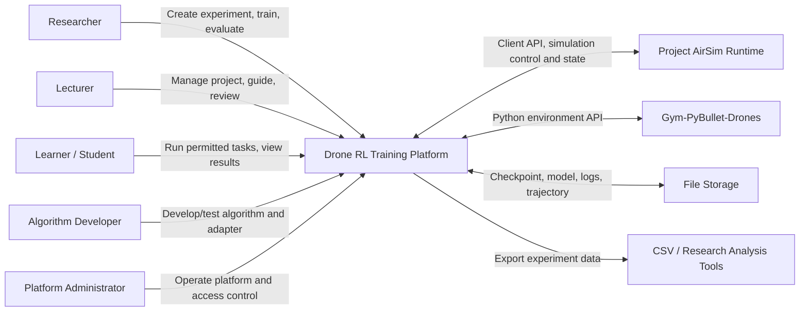

**Giải thích:** Người dùng tương tác với nền tảng qua Web. Project AirSim và Gym-PyBullet-Drones chỉ là hệ thống mô phỏng bên ngoài. Công cụ phân tích ngoài hệ thống nhận tệp xuất, không phải thành phần cần kết nối trực tiếp với vòng lặp training.

## 4.3. High-level / Container Architecture

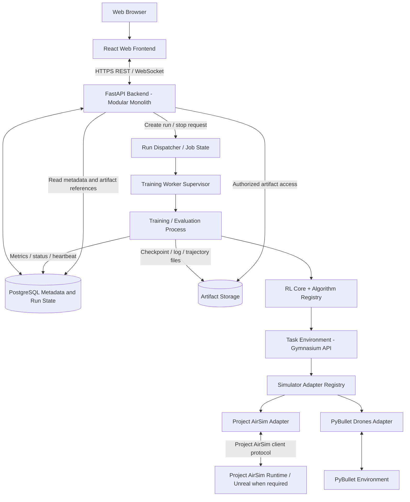

**Giải thích:** Backend tiếp nhận và quản lý yêu cầu; Worker thực thi tác vụ dài hạn. RL Core chỉ giao tiếp với Task Environment theo Gymnasium. Task Environment ghép logic nhiệm vụ với một adapter simulator. Dữ liệu trạng thái/metrics tần suất thấp được lưu trong DB; file lớn nằm ở Artifact Storage.

## 4.4. Lựa chọn modular monolith thay vì microservices

| Tiêu chí | Modular monolith + Worker | Microservices đầy đủ |
|---|---|---|
| Độ phức tạp triển khai MVP | Thấp hơn; ít dịch vụ cần vận hành | Cao hơn; cần discovery, network policy, tracing và quản lý nhiều dịch vụ |
| Tách biệt training | Được đáp ứng bằng Worker/process riêng | Được đáp ứng nhưng không cần tách mọi module thành service |
| Bảo trì module | Ranh giới package/module rõ ràng | Ranh giới service rõ nhưng phát sinh giao tiếp phân tán |
| Mở rộng | Có thể scale worker độc lập trước | Có thể scale từng service nhưng chi phí vận hành cao |
| Đề xuất | **Chọn cho MVP** | Chỉ xem xét khi tải, đội ngũ hoặc yêu cầu vận hành chứng minh cần thiết |

---

# 5. Phân chia lớp và thành phần hệ thống

## 5.1. Các lớp kiến trúc

| Lớp | Thành phần | Trách nhiệm |
|---|---|---|
| Presentation Layer | React Web Frontend | Thu thập cấu hình, hiển thị project/experiment/run/metrics/model và gửi yêu cầu tới API |
| Application Layer | FastAPI modular backend | Xác thực, phân quyền, kiểm tra nghiệp vụ, điều phối project/experiment/run, cung cấp dữ liệu cho Frontend |
| Orchestration Layer | Run Dispatcher, Worker Supervisor | Xếp lịch, cấp phát run, quản lý tiến trình, heartbeat, stop request và trạng thái vòng đời |
| RL Execution Layer | RL Core, Algorithm Registry, Metrics/Checkpoint callbacks | Thực thi PPO trong MVP; cung cấp điểm mở rộng cho algorithm khác; ghi metrics/checkpoint |
| Task Layer | Task Registry, Task Environment, Task Contract | Biểu diễn task bay, observation/action, reward, termination và metrics theo task |
| Simulator Integration Layer | Adapter Registry và adapter theo simulator | Điều khiển simulator, chuyển đổi state/action và quản lý vòng đời môi trường |
| Data Layer | PostgreSQL + Artifact Storage | Lưu dữ liệu có cấu trúc và tệp kết quả |
| External Runtime Layer | Project AirSim, Gym-PyBullet-Drones | Mô phỏng vật lý, drone và dữ liệu trạng thái/cảm biến |

## 5.2. Component Architecture Diagram

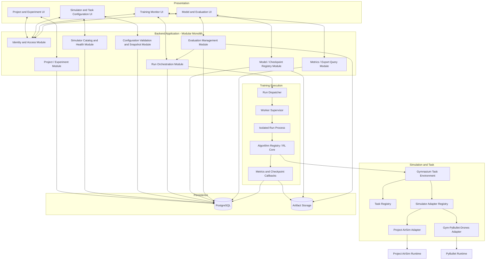

## 5.3. Trách nhiệm và hợp đồng thành phần

### 5.3.1. Web Frontend

| Thuộc tính | Mô tả |
|---|---|
| Mục đích | Cung cấp giao diện làm việc cho người dùng |
| Trách nhiệm | Hiển thị project/experiment, cấu hình task/algorithm, khởi chạy/dừng run, theo dõi metrics, quản lý model và evaluation |
| Đầu vào | Thao tác người dùng; dữ liệu REST; sự kiện WebSocket |
| Đầu ra | Yêu cầu API, bộ lọc/truy vấn, cấu hình được người dùng nhập |
| Tương tác | Chỉ giao tiếp với Backend API |
| Không chịu trách nhiệm | Không gọi trực tiếp simulator, không chạy Python/RL trong trình duyệt, không lưu artifact tùy ý |

### 5.3.2. Backend API – Modular Monolith

| Module | Trách nhiệm | Dữ liệu đầu vào/đầu ra chính |
|---|---|---|
| Identity & Access | Xác thực và kiểm tra quyền theo project/object | User, role, permission decision |
| Project & Experiment | Tạo, xem, cập nhật project/experiment; lịch sử run | Project/experiment metadata |
| Simulator Catalog | Danh sách simulator được cấu hình, health check và version metadata | Simulator profile, health result |
| Configuration Validation | Kiểm tra tổ hợp simulator-task-observation-action-algorithm và đóng băng snapshot | Experiment configuration, validation report, config snapshot |
| Run Orchestration | Tạo run, kiểm tra preconditions, yêu cầu stop và truy vấn trạng thái | Training/Evaluation run metadata, command/status |
| Model Registry | Liệt kê model/checkpoint, metadata và khả năng truy xuất artifact | Model/checkpoint metadata và file reference |
| Evaluation Management | Tạo evaluation run từ checkpoint/model hợp lệ; lưu protocol/kết quả | Evaluation configuration/result |
| Metrics & Export Query | Đọc metrics, trả dữ liệu biểu đồ và tạo CSV được phép | Metrics/time series/export request |
| Audit/Operations | Ghi nhận hành động quan trọng và thông tin vận hành ở mức được phê duyệt | Audit events, operational events |

Backend không trực tiếp điều khiển vòng lặp mô phỏng. Health check có thể gọi adapter/service kiểm tra qua một lệnh/tiến trình kiểm tra ngắn, nhưng không khởi tạo một training loop trong request quản lý.

### 5.3.3. Run Dispatcher và Worker Supervisor

| Thuộc tính | Mô tả |
|---|---|
| Mục đích | Tách vòng đời job khỏi request/response HTTP |
| Trách nhiệm | Nhận run ở trạng thái chờ, kiểm tra capacity, claim run, khởi chạy process, giám sát heartbeat, truyền yêu cầu dừng, ghi nhận exit/failure |
| Đầu vào | Run ID, immutable config snapshot, resource policy, stop request |
| Đầu ra | Process ID/worker identity, trạng thái, heartbeat, lỗi, thời điểm kết thúc |
| Tương tác | PostgreSQL, Run Process, Artifact Storage; Backend đọc trạng thái qua DB |
| Giới hạn | Không tự tính reward hoặc triển khai thuật toán RL |

MVP có thể dùng một supervisor với concurrency giới hạn cấu hình. Mỗi run được thực thi trong một process riêng để cô lập lỗi và phụ thuộc môi trường Python tốt hơn. Số process đồng thời cần được giới hạn theo benchmark.

### 5.3.4. RL Core Engine

| Thành phần | Trách nhiệm |
|---|---|
| Algorithm Registry | Ánh xạ tên/version algorithm tới factory khởi tạo; MVP đăng ký PPO trước |
| Training Controller | Khởi tạo model/policy, thực hiện `learn`, nhận stop/callback và tổng kết trạng thái |
| Evaluation Controller | Nạp model và chạy inference/evaluation không cập nhật policy |
| Metrics Collector | Chuẩn hóa metrics có sẵn từ runtime/task; gắn metric definition, step/episode và timestamp |
| Checkpoint Manager | Lưu checkpoint, xác minh file/metadata và đăng ký artifact khả dụng |
| Runtime Metadata Collector | Thu thập seed, cấu hình, version, hệ điều hành và metadata phần cứng khi lấy được |

RL Core không biết chi tiết API của Project AirSim hoặc PyBullet. Nó nhận một Gymnasium Task Environment đã được tạo và xác thực.

### 5.3.5. Task Layer

Task Layer chịu trách nhiệm biểu diễn bài toán điều khiển cụ thể, ví dụ Hovering hoặc Position Control.

Trách nhiệm:
- Xác định observation space và cách tạo observation theo task.
- Xác định action space và ý nghĩa vật lý của action.
- Chuyển action agent thành control setpoint phù hợp.
- Tính reward theo task.
- Xác định success/failure/termination/time limit.
- Thu thập metrics riêng của task, ví dụ position error hoặc success indicator.
- Khai báo metadata/contract cần để kiểm tra compatibility.

**Phân định quan trọng:** Simulator Adapter chịu trách nhiệm tương tác với simulator và chuyển đổi dữ liệu vật lý; Task Environment chịu trách nhiệm ngữ nghĩa của bài toán RL. Không đặt toàn bộ reward/termination vào adapter riêng của simulator, nếu không sẽ làm task bị khóa vào một simulator.

### 5.3.6. Simulator Adapter Registry và các adapter

| Adapter | Trách nhiệm |
|---|---|
| Project AirSim Adapter | Kết nối Python client tới runtime, chọn world/drone, reset/khởi tạo episode theo khả năng API, gửi command, điều khiển bước mô phỏng/clock nếu hỗ trợ, thu thập state/sensor, xử lý lỗi và đóng kết nối |
| Gym-PyBullet-Drones Adapter | Khởi tạo environment PyBullet đã chọn, reset, step/advance, nhận state/observation gốc, điều khiển render/close và chuẩn hóa thông tin runtime |
| Adapter Registry | Đăng ký adapter theo tên/version/capability; tạo adapter tương ứng với cấu hình đã kiểm tra |

Không yêu cầu hai adapter trả về cùng một vector state thô. Adapter phải khai báo capability và cách chuyển đổi; Task Environment đảm bảo observation/action hợp lệ cho task đã chọn.

### 5.3.7. Data & Artifact Storage

**PostgreSQL lưu metadata và dữ liệu có cấu trúc:** user/role, project, experiment, config snapshot, simulator metadata, run/evaluation state, metrics đã chọn, model/checkpoint metadata, error references và audit records.

**Artifact Storage lưu tệp:** model/checkpoint, log, trajectory dataset và dữ liệu export; video hoặc sensor raw chỉ lưu nếu được phê duyệt.

PostgreSQL lưu định danh, trạng thái, checksum, dung lượng, MIME/type, đường dẫn hoặc object key và quan hệ với project/experiment/run. Không lưu toàn bộ checkpoint binary trong các cột thông thường.

---

# 6. Kiến trúc tích hợp Simulator

## 6.1. Mục tiêu

Tạo một ranh giới tích hợp ổn định để RL Engine có thể sử dụng nhiều simulator mà không phụ thuộc trực tiếp vào API riêng. Mục tiêu là chuẩn hóa **hợp đồng môi trường và semantics được định nghĩa**, không phải làm cho hai simulator có vật lý giống nhau.

## 6.2. Hai mức trừu tượng: Simulator Adapter và Task Environment

Đề xuất kiến trúc hai lớp:

1. **Simulator Adapter:** thao tác với simulator cụ thể, nhận/gửi state và control, quản lý thời gian mô phỏng và vòng đời kết nối.
2. **Task Environment (Gymnasium):** đóng gói một task bay và thực hiện `reset()` / `step()` theo Gymnasium; tạo observation, tính reward và xác định terminated/truncated.

Lớp Task Environment được tạo bởi Environment Factory từ `task_id`, `simulator_id`, task configuration và adapter tương thích.

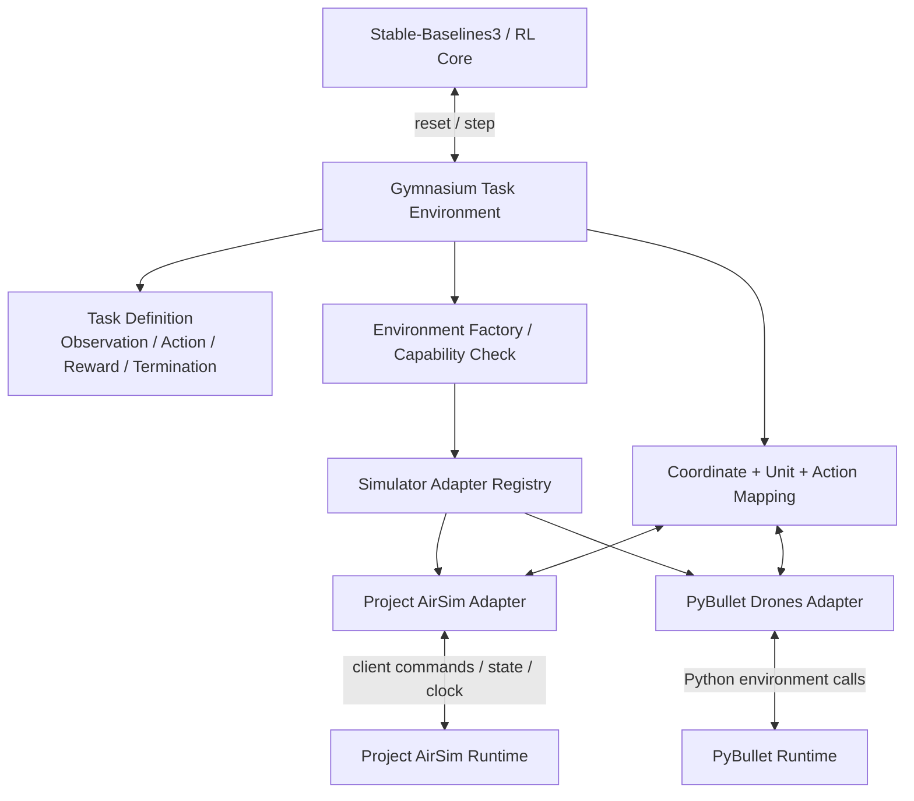

## 6.3. Hợp đồng Gymnasium ở lớp Task Environment

Hợp đồng logic phải tuân theo semantics Gymnasium:

- `reset(seed, options)` trả về `(observation, info)`.
- `step(action)` trả về `(observation, reward, terminated, truncated, info)`.
- `terminated` biểu thị kết thúc theo điều kiện MDP/task, ví dụ đạt mục tiêu, va chạm hoặc trạng thái thất bại.
- `truncated` biểu thị kết thúc do giới hạn bên ngoài như hết thời lượng/episode time limit.
- `close()` giải phóng tài nguyên môi trường và kết nối.

**Không được đồng nhất `terminated` và `truncated`.** Cần định nghĩa rõ semantics theo từng task và viết contract test.

## 6.4. Task Contract

Task Contract là cấu hình có phiên bản, tối thiểu mô tả:

| Nhóm | Thuộc tính cần khai báo |
|---|---|
| Identity | task ID, version, mô tả, mục tiêu nhiệm vụ |
| Simulator compatibility | Simulator/adapter được hỗ trợ, capability bắt buộc |
| Drone | Model/vehicle profile và các tham số phù hợp |
| Observation | Thành phần trạng thái, thứ tự biến, shape, dtype, đơn vị, frame, normalization |
| Action | Kiểu điều khiển (ví dụ motor/attitude/velocity/position setpoint), shape, bounds, đơn vị, mapping và control rate |
| Timing | Physics time step, control interval, số physics substeps mỗi action, timeout |
| Reward | Thành phần reward, trọng số/tham số và version; định nghĩa rõ đơn vị/scale nếu áp dụng |
| Termination | Success, failure, collision, instability và time limit |
| Metrics | Các metrics áp dụng, công thức, đơn vị, cách tổng hợp và nguồn dữ liệu |
| Reproducibility | Seed, initial conditions, simulator version và task version |

Task Contract chưa phải Database Schema; định nghĩa cấu trúc lưu trữ chi tiết thuộc bước Database Design.

## 6.5. Capability Registry và kiểm tra tương thích

Hệ thống cần biết một simulator/adapter hỗ trợ những capability nào. Ví dụ:

- Loại drone/model có thể khởi tạo.
- Các control mode được hỗ trợ.
- Các sensor/state channel có thể đọc.
- Khả năng reset episode và điều khiển simulation clock.
- Headless/render mode.
- Task contract được kiểm thử.
- Phiên bản adapter/runtime.

Trước khi tạo run, Configuration Validator kiểm tra:

1. Simulator được cấu hình và health check đạt.
2. Adapter version tương thích với runtime version.
3. Task được đăng ký và được adapter hỗ trợ.
4. Observation/action dimensions, dtype và bounds tương thích với algorithm.
5. Các sensor/field bắt buộc sẵn có.
6. Reward/termination config hợp lệ.
7. Control interval và physics step có thể thực hiện.

Nếu thiếu capability, cấu hình phải bị từ chối hoặc cảnh báo; không được để lỗi xuất hiện muộn trong training nếu có thể phát hiện trước.

## 6.6. Hệ tọa độ, đơn vị và mapping

Không chọn một vector observation/action phổ quát cho mọi simulator. Mỗi Task Contract phải quy định rõ:

- World frame và body frame.
- Quy ước trục và chiều dương.
- Đơn vị vị trí/vận tốc/gia tốc (ví dụ m, m/s, m/s²) và góc (rad hoặc degree).
- Thứ tự quaternion/Euler nếu sử dụng.
- Quy ước yaw/pitch/roll.
- Dấu và giới hạn action.
- Chuẩn hóa input/output của policy.

Project AirSim có tài liệu đề cập quy ước NED và đơn vị SI; môi trường PyBullet có quy ước world/frame riêng theo implementation được chọn. Vì vậy, conversion phải nằm ở adapter/mapping layer, được kiểm tra với các vector/state mẫu đã biết. Quy ước chuẩn nội bộ cuối cùng cần được RL/Simulation Engineer xác nhận (Q-009).

## 6.7. Action Mapping

Policy output không được gửi thẳng vào API simulator khi chưa diễn giải.

Luồng đề xuất:

1. Policy tạo action theo action space đã khai báo trong Task Contract.
2. Task Environment kiểm tra shape, dtype, finite values và bounds.
3. Action Mapper giải chuẩn hóa hoặc scale theo tham số được version hóa.
4. Adapter chuyển thành API/control command cụ thể của simulator.
5. Simulator tiến một khoảng thời gian theo control interval.
6. Adapter thu state/sensor cần thiết và trả dữ liệu để Task Environment tạo observation tiếp theo.

Action mode (motor, attitude, velocity hoặc position setpoint) còn là câu hỏi mở Q-007. Không quyết định mặc định trong tài liệu kiến trúc này.

## 6.8. Observation Mapping

1. Adapter thu dữ liệu trạng thái/sensor mà simulator cung cấp.
2. Kiểm tra trường bắt buộc, timestamp, đơn vị và độ hợp lệ.
3. Chuyển frame/units theo Task Contract.
4. Task Environment chọn thành phần observation và thứ tự biến.
5. Áp dụng normalization nếu được cấu hình và lưu version/parameters.
6. Kiểm tra shape/dtype/range trước khi đưa observation cho policy.

Nếu sử dụng camera/LiDAR hoặc sensor raw, cần đánh giá riêng kích thước dữ liệu, pipeline tiền xử lý và throughput. Q-008 đang mở; không mặc định đưa raw sensor vào MVP.

## 6.9. Đồng bộ thời gian mô phỏng

Thời gian mô phỏng là một quyết định kiến trúc quan trọng. Cần phân biệt:

- **Physics time step:** chu kỳ cập nhật vật lý bên trong simulator.
- **Control interval:** khoảng thời gian giữa hai action policy.
- **Simulation clock:** thời gian mô phỏng được tiến lên khi adapter thực hiện step.
- **Wall-clock time:** thời gian thực tế trên máy tính.

Mỗi lần `TaskEnvironment.step(action)` phải có semantics rõ ràng: action được giữ trong bao nhiêu bước vật lý, clock tiến bao lâu, state được lấy tại thời điểm nào. Không dùng `sleep()` theo thời gian thực như cơ chế đồng bộ mặc định nếu simulator hỗ trợ stepping có kiểm soát; cách làm thực tế phải được kiểm chứng theo simulator version.

**Technical spike bắt buộc:** đo thời gian mỗi step, số physics substeps, khả năng reset lặp lại, clock control và behavior khi renderer bật/tắt trên từng simulator.

## 6.10. Reward và Termination

Reward là thành phần của Task Definition, không được mặc định giống nhau giữa mọi task hoặc mọi simulator. Với cùng task cần công khai các thành phần reward, hệ số, đơn vị/ngữ cảnh và cách tổng hợp.

Các điều kiện kết thúc cần phân biệt ít nhất:
- Thành công theo tiêu chí task.
- Thất bại/va chạm/mất ổn định theo tiêu chí task.
- Hết thời gian hoặc hết giới hạn bước.
- Lỗi simulator/runtime (đây là lỗi thực thi, không nên giả làm một episode kết thúc bình thường).

Task Environment phản ánh điều kiện MDP qua `terminated` và giới hạn ngoài qua `truncated`; lỗi hạ tầng được chuyển thành run failure ở tầng điều phối.

## 6.11. Xử lý lỗi và vòng đời adapter

| Tình huống | Xử lý kiến trúc |
|---|---|
| Simulator không sẵn sàng trước run | Pre-run validation từ chối run; không đặt trạng thái Running (AC-002, AC-003) |
| Mất kết nối khi đang chạy | Adapter phát sinh lỗi có phân loại; Worker ghi error/log, đóng môi trường nếu có thể, cập nhật run Failed |
| Observation thiếu/NaN/shape sai | Task Environment kiểm tra; dừng run với lỗi cấu hình/runtime có ngữ cảnh; không tự thay bằng giá trị giả |
| Action ngoài bounds | Chặn hoặc xử lý theo policy rõ ràng của Task Contract; ghi lỗi/cảnh báo; không âm thầm cắt giá trị nếu chưa được quy định |
| Reset/close lỗi | Ghi tầng lỗi; cố gắng cleanup có timeout; Supervisor kiểm tra process còn sống |
| Checkpoint không hợp lệ | Đánh dấu không khả dụng; không dùng cho evaluation/resume |

## 6.12. Simulator Integration Diagram

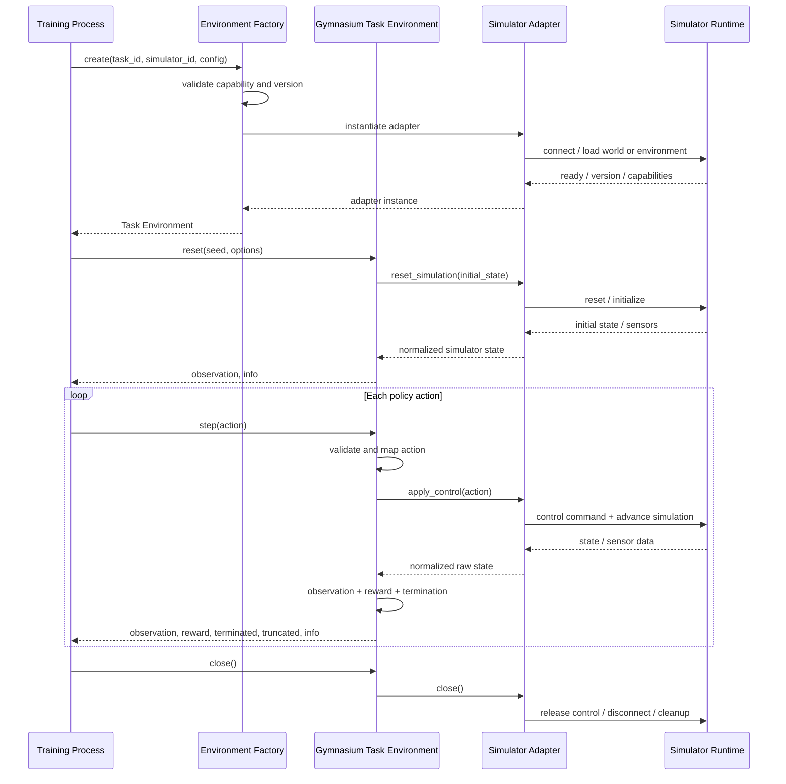

---

# 7. Kiến trúc huấn luyện RL (RL Training Architecture)

## 7.1. Các thành phần

1. **Run Orchestration (Backend):** xác thực quyền, xác minh cấu hình/simulator/resource, tạo Training Run và immutable configuration snapshot.
2. **Run Dispatcher:** chọn run ở trạng thái chờ dựa trên chính sách tài nguyên.
3. **Worker Supervisor:** claim run, khởi chạy process độc lập, cập nhật heartbeat, theo dõi trạng thái và cleanup.
4. **Training Process:** nạp cấu hình snapshot, khởi tạo Task Environment và Algorithm, chạy vòng lặp RL.
5. **Metrics/Checkpoint Callbacks:** ghi metrics theo chu kỳ, lưu checkpoint và phát tín hiệu dừng an toàn.
6. **Persistence:** lưu run state, metrics, checkpoint metadata và artifact references.

## 7.2. Training Flow

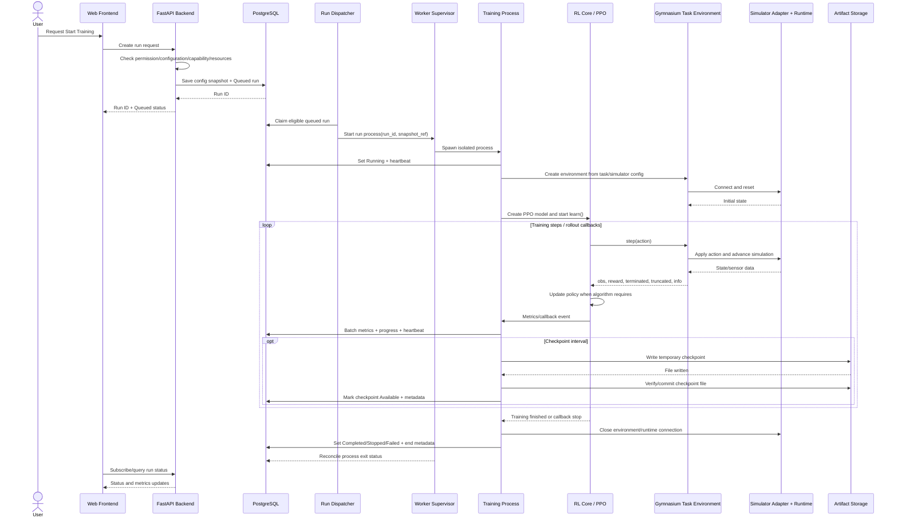

## 7.3. Trình tự tạo và thực thi run

1. Người dùng gửi yêu cầu training từ experiment.
2. Backend xác thực người dùng và quyền đối với project/experiment.
3. Configuration Validator kiểm tra task, simulator, observation/action, algorithm và các tham số.
4. Pre-run check xác nhận simulator sẵn sàng và tài nguyên còn trong giới hạn.
5. Backend lưu snapshot cấu hình, metadata phiên bản hiện có và tạo run ở trạng thái `Queued`.
6. Dispatcher/Worker claim run; không tạo hai worker thực thi cùng một run.
7. Worker tạo process riêng và gắn `worker_id`, process identity, heartbeat.
8. Process khởi tạo adapter, Task Environment và algorithm từ snapshot.
9. RL Core thực thi training; callback thu metrics và checkpoint.
10. Worker cập nhật trạng thái cuối và giải phóng simulator/resource.

## 7.4. Vòng đời trạng thái run

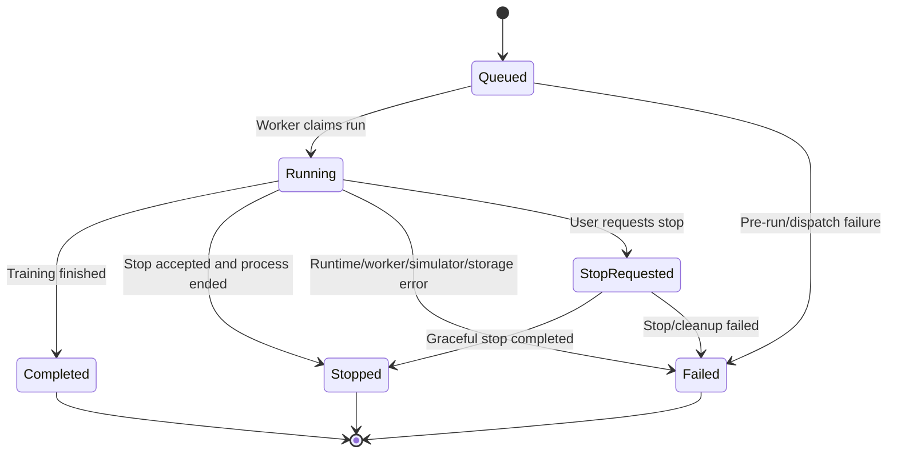

Các trạng thái chính được kế thừa từ BRL-011: Queued/Pending, Running, Completed, Failed, Stopped. `StopRequested` là trạng thái điều phối nội bộ được đề xuất để thể hiện yêu cầu dừng đang xử lý; cần thống nhất khi thiết kế DB/API. `Paused` chỉ bổ sung nếu thực sự triển khai pause/resume.

## 7.5. Stop, crash và cleanup

- Backend ghi nhận yêu cầu dừng; không cố dừng vòng lặp bằng cách đóng HTTP request.
- Worker nhận lệnh dừng qua trạng thái dùng chung hoặc cơ chế IPC được lựa chọn.
- Training callback kiểm tra cancellation ở các điểm an toàn (ví dụ giữa rollout/callback), sau đó yêu cầu algorithm ngừng.
- Worker cố gắng flush metrics/checkpoint cần thiết, gọi `env.close()` và giải phóng runtime.
- Supervisor kiểm tra process exit và heartbeat; nếu process bị treo, áp dụng timeout và chính sách terminate đã cấu hình.
- Không báo `Stopped` cho tới khi process đã dừng hoặc supervisor xác định được kết quả cleanup. Nếu không thể xác nhận, ghi trạng thái lỗi/reconciliation cần xử lý.

## 7.6. Checkpoint và Resume

Cần phân biệt:

1. **Model checkpoint:** trọng số/policy được lưu để inference hoặc evaluation.
2. **Training-resume state:** trạng thái đủ để tiếp tục training gần như chính xác, có thể gồm optimizer state, timestep, normalization state, replay buffer (với thuật toán có replay) và metadata runtime phù hợp.

Không được mặc định một file model checkpoint là đủ để resume chính xác. FR-031 là Should và Q-015 vẫn mở. MVP phải bảo đảm lưu checkpoint có thể nạp để evaluation; resume chỉ công bố khi đã kiểm chứng cho algorithm/runtime cụ thể.

### Quy trình ghi checkpoint an toàn

1. Callback gọi Checkpoint Manager tại mốc cấu hình.
2. Ghi vào file tạm hoặc thư mục staging.
3. Flush/close và kiểm tra tệp tồn tại, kích thước, checksum hoặc khả năng load theo khả năng kiểm tra.
4. Commit/rename sang artifact path cuối.
5. Ghi metadata và chỉ chuyển trạng thái sang `Available` khi file được xác minh.
6. Nếu thất bại, lưu lỗi và không hiển thị checkpoint như artifact khả dụng.

## 7.7. Evaluation Flow

Evaluation là một loại job riêng, dùng Worker/Runtime orchestration tương tự nhưng có controller khác. Policy/checkpoint được nạp ở chế độ inference; không gọi training/update API và không ghi ngược trọng số vào artifact nguồn.

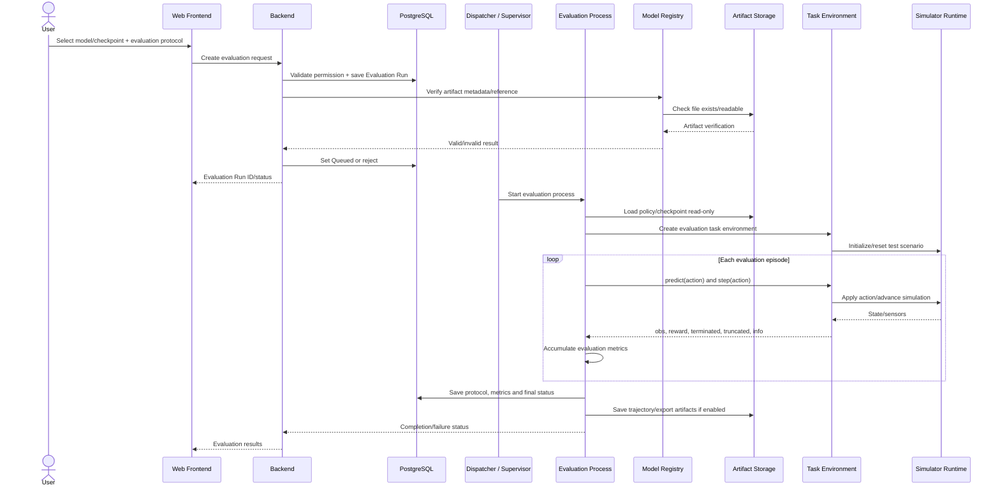

**Kiểm soát bắt buộc:** policy artifact là input chỉ đọc; Evaluation Controller chỉ gọi inference/predict; evaluation metrics và protocol được lưu dưới Evaluation Run riêng; test kiểm tra checksum/metadata của policy trước và sau evaluation không thay đổi (AC-011, AC-012, NFR-020).

---

# 8. Kiến trúc luồng dữ liệu (Data Flow Architecture)

## 8.1. Luồng dữ liệu tổng thể

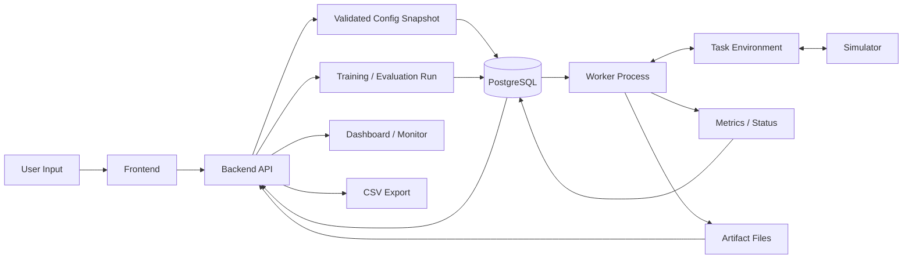

## 8.2. Phân loại dữ liệu và nơi lưu

| Loại dữ liệu | Ví dụ | Nơi xử lý/lưu đề xuất | Ghi chú |
|---|---|---|---|
| User/project metadata | User, role, project, membership | PostgreSQL | Dữ liệu có cấu trúc |
| Experiment metadata | Task, simulator, algorithm, trạng thái cấu hình | PostgreSQL | Có version/snapshot để tái lập |
| Configuration snapshot | Task/algorithm/reward/training parameters | PostgreSQL hoặc cấu hình JSON được version hóa trong DB | Lưu bản bất biến gắn với run; thiết kế schema chi tiết ở bước sau |
| Run status | Queued, Running, Completed, Stopped, Failed, timestamps | PostgreSQL | Nguồn trạng thái chuẩn |
| Heartbeat/progress | Worker ID, process identity, current timestep, last heartbeat | PostgreSQL hoặc kênh runtime nội bộ; DB lưu bản gần nhất | Không cập nhật DB ở mọi timestep |
| Training metrics | Reward, episode length, loss khi có, timestamp, step | PostgreSQL theo batch ở MVP; tối ưu theo benchmark | Cần metric catalog và định nghĩa |
| Evaluation metrics | Success Rate, Position Error, return và thống kê theo protocol | PostgreSQL; trajectory chi tiết ở file | Phải phân tách với training metrics |
| Checkpoint/model | SB3 model archive, policy weights, optional resume state | File/Object Storage | DB chỉ lưu metadata, checksum, status và file key |
| Logs | Worker log, adapter log, exception trace | File Storage; DB lưu link/summary | Không lưu secret trong log |
| Trajectory | Reference/actual position, timestamp, telemetry | File Storage dạng CSV/Parquet tùy quyết định; DB lưu metadata | Q-018/Q-024 cần xác nhận độ chi tiết |
| Video/raw sensors | Render video, camera/LiDAR raw | Ngoài MVP trừ khi được phê duyệt | Dữ liệu lớn, ảnh hưởng hiệu năng/lưu trữ |
| Export | CSV từ metrics/trajectory | Tệp tạm/artifact download | Phải kiểm tra quyền và phạm vi dữ liệu |

## 8.3. Chính sách ghi metrics

- Không gửi tất cả timestep hoặc toàn bộ observation/action lên Backend nếu không có nhu cầu phân tích rõ ràng.
- Callback ghi metrics theo episode, rollout hoặc khoảng cập nhật cấu hình.
- Worker batch dữ liệu để giảm overhead I/O.
- Mỗi record/series phải truy được về run và có step/episode/timestamp/metric definition.
- Loss chỉ hiển thị khi algorithm/runtime cung cấp metric phù hợp; nếu không có, đánh dấu `not_available` thay vì tạo giá trị.
- Status/heartbeat có tần suất đủ để phát hiện worker mất hoạt động; chu kỳ cụ thể TBD sau benchmark.

## 8.4. Data Flow theo nghiệp vụ

1. **Tạo project/experiment:** Frontend gửi metadata → Backend kiểm tra quyền → PostgreSQL lưu project/experiment.
2. **Cấu hình:** Frontend tải simulator/task/algorithm capabilities → người dùng cấu hình → Backend validation → lưu cấu hình nháp/snapshot.
3. **Tạo run:** Backend kiểm tra cấu hình, simulator health và capacity → tạo immutable snapshot + run record → trạng thái Queued.
4. **Training:** Worker đọc snapshot → tạo task environment → trao đổi observation/action với simulator → tích lũy reward/metrics.
5. **Checkpoint:** Worker ghi file staging → xác minh → commit file → ghi metadata khả dụng trong PostgreSQL.
6. **Monitoring:** Frontend truy vấn trạng thái/metrics qua API và nhận cập nhật qua WebSocket hoặc cơ chế polling có kiểm soát.
7. **Evaluation:** Worker đọc checkpoint ở chế độ chỉ đọc → thực thi protocol → lưu evaluation metrics và trajectory.
8. **Export:** Backend xác nhận quyền → đọc metadata và artifact → tạo CSV trong phạm vi yêu cầu.

---

# 9. Kiến trúc giao tiếp giữa các thành phần

## 9.1. Giao thức đề xuất

| Kết nối | Cơ chế đề xuất | Dữ liệu | Lý do/ghi chú |
|---|---|---|---|
| Browser ↔ Backend | HTTPS REST | CRUD, cấu hình, tạo run, truy vấn kết quả | Giao tiếp request/response chuẩn |
| Browser ↔ Backend | WebSocket cho status/metrics updates; có thể dùng polling ở lát cắt ban đầu | Run state, metrics summary, event | Dùng cập nhật có tần suất kiểm soát; không truyền timestep thô |
| Backend ↔ PostgreSQL | Driver/ORM Python | Metadata, config snapshot, run state, metrics, artifact refs | Nguồn dữ liệu chuẩn |
| Backend ↔ Dispatcher | Cơ chế job record trong PostgreSQL ở MVP | Run ID, job type, priority/queued time, state | Tránh thêm message broker trước khi cần; đảm bảo claim an toàn |
| Dispatcher ↔ Worker Process | Process spawn/IPC hoặc local process supervisor | Run ID, config reference, stop/cancel, exit status | Cô lập tiến trình training và dependency |
| Worker ↔ PostgreSQL | DB repository hoặc internal persistence interface | Status, heartbeat, metrics batch, artifact metadata | Worker không gọi public API qua vòng lặp từng step |
| Worker ↔ Artifact Storage | Filesystem API/object client | Model, checkpoint, log, trajectory | File lớn không đi qua REST response thông thường |
| Project AirSim Adapter ↔ Project AirSim | Python client/API theo version khóa | Control commands, clock/world operations, state/sensor | Phụ thuộc API và runtime version; bắt buộc spike |
| PyBullet Adapter ↔ Gym-PyBullet-Drones | Python library/API trong process runtime riêng | reset, step, action, observation, render/close | Không cần network hop nếu chạy cùng worker process |

## 9.2. REST và WebSocket

REST dùng cho các thao tác có tính nghiệp vụ: tạo project/experiment, lưu cấu hình, validate, tạo/dừng run, xem model, tạo evaluation và xuất dữ liệu.

WebSocket chỉ dùng cho sự kiện cần cập nhật màn hình: run state changed, progress updated, metric batch ready, warning/error. Frontend cần có khả năng tải lại trạng thái qua REST sau khi reconnect; WebSocket không phải nguồn dữ liệu duy nhất.

## 9.3. Backend–Worker: lựa chọn cơ chế job

**Đề xuất cho MVP:** PostgreSQL là nguồn trạng thái chuẩn và nơi đăng ký công việc. Dispatcher/worker lấy run có trạng thái Queued theo cơ chế claim nguyên tử; worker cập nhật trạng thái/heartbeat. Cần có xử lý chống claim trùng, stale heartbeat và reconciliation khi worker chết.

**Không mặc định cần Redis/Celery trong MVP.** Khi số worker, số máy hoặc throughput job tăng và benchmark chứng minh PostgreSQL-backed dispatch không còn phù hợp, có thể bổ sung broker (ví dụ Redis + Celery/RQ hoặc giải pháp tương đương). Khi chuyển, DB vẫn phải là nguồn dữ liệu chuẩn của run và artifact metadata.

## 9.4. Quy tắc giao tiếp

- Mọi command phải có `run_id`/correlation ID để truy vết.
- Các thao tác tạo run phải idempotent hoặc có khóa chống gửi trùng phù hợp.
- Worker chỉ được claim run ở trạng thái hợp lệ.
- Lỗi giao tiếp phải có timeout và thông tin tầng lỗi.
- Không truyền checkpoint qua WebSocket.
- Không expose simulator port/API trực tiếp ra mạng người dùng.
- WebSocket cần xác thực và kiểm tra quyền truy cập run tương ứng.

---

# 10. Kiến trúc triển khai (Deployment Architecture)

## 10.1. Phương án MVP: một máy trạm/máy chủ nội bộ

Đề xuất triển khai ban đầu trên một máy tính/máy chủ nội bộ nếu đáp ứng được yêu cầu Project AirSim, Unreal Engine (nếu bật render), PyBullet và huấn luyện PPO. Các thành phần quản lý có thể chạy bằng Docker Compose; simulator runtime có thể chạy native hoặc container riêng tùy khả năng tương thích driver/GPU/Unreal.

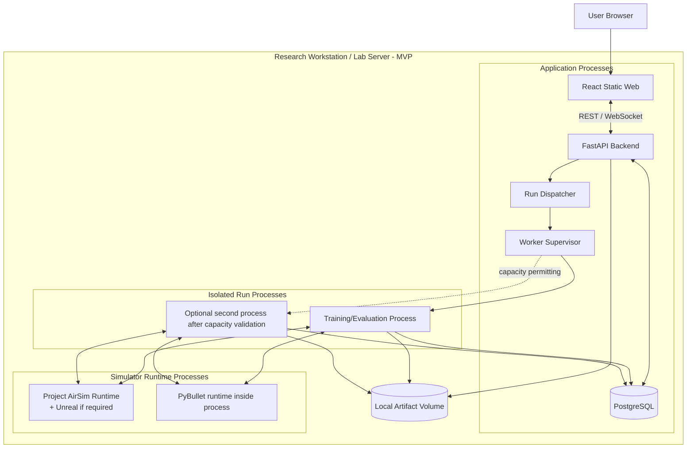

**Lưu ý:** Sơ đồ thể hiện các khả năng logic, không có nghĩa một Project AirSim world/runtime có thể được nhiều worker dùng đồng thời an toàn. Khả năng multi-client, world isolation và reset độc lập của runtime phải được xác nhận trong technical spike. Cho MVP, mặc định giới hạn một run trên mỗi runtime/world độc quyền cho tới khi có bằng chứng khác.

## 10.2. Deployment thành phần

| Thành phần | Cách chạy đề xuất trong MVP | Ghi chú |
|---|---|---|
| React Frontend | Static build qua web server hoặc Backend static serving trong môi trường dev | Tách process/host sau này không làm đổi hợp đồng API |
| FastAPI | Process/container riêng | Chỉ xử lý API/orchestration/queries, không chạy RL loop |
| PostgreSQL | Container hoặc service cài đặt nội bộ | Backup theo chính sách; không công khai trực tiếp ra Internet |
| Dispatcher | Process Python riêng hoặc tiến trình quản lý cùng bộ triển khai | Lấy run đã queued và chuyển cho supervisor |
| Worker Supervisor | Process riêng | Theo dõi child process và capacity |
| Training Process | Process riêng cho từng run | Cô lập crash, dependency và tài nguyên |
| Gym-PyBullet-Drones | Thư viện trong runtime Python của worker | Có thể đóng gói theo environment/lockfile riêng |
| Project AirSim Runtime | Native process hoặc runtime service được hỗ trợ | Có thể kết hợp Unreal Engine khi cần; xác định đúng OS/GPU/API version |
| Artifact Storage | Local filesystem volume ban đầu | Backup, checksum, quyền truy cập và retention cần cấu hình |

## 10.3. Cách quản lý dependency

Project AirSim và PyBullet có thể có dependency, native library và yêu cầu OS khác nhau. Không nên ép mọi simulator vào cùng một Python environment nếu có xung đột.

Đề xuất:
- Giữ package/hợp đồng chung cho training/task orchestration ở mức độc lập với simulator.
- Dùng environment/lockfile riêng cho PyBullet worker và Project AirSim worker nếu dependency đòi hỏi.
- Version hóa adapter và runtime matrix.
- Tự động chạy contract/integration tests trong từng environment trước khi công bố adapter hỗ trợ.

## 10.4. Phương án mở rộng LAN/hybrid

Khi cần tách máy:

- Frontend/Backend/PostgreSQL tiếp tục chạy trên máy chủ quản lý.
- Worker và simulator runtime chuyển sang máy compute.
- Worker kết nối Backend/DB/Storage qua mạng nội bộ được bảo vệ.
- Nếu file storage tập trung, dùng shared storage/object storage; tránh phụ thuộc path cục bộ không chia sẻ.
- Mỗi worker node đăng ký capability, runtime version và resource capacity.
- Dispatcher chọn worker node dựa trên simulator compatibility và resource policy.

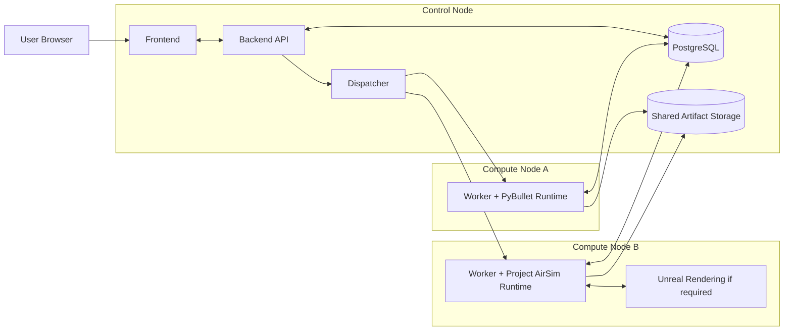

Đây là phương án mở rộng tương lai, không phải yêu cầu phải hoàn thiện trong MVP.

## 10.5. Tài nguyên phần cứng và benchmark

Không đưa ra cấu hình CPU/GPU/RAM cố định khi chưa có thông tin máy mục tiêu. Trước khi chốt cấu hình deployment cần đo:

- Simulator throughput (steps/second) cho từng task.
- Thời gian reset và step.
- Mức sử dụng CPU/GPU/RAM/VRAM ở headless và render.
- Kích thước checkpoint, log, trajectory theo một run đại diện.
- Tác động của metrics collection/monitoring tới tốc độ training.
- Khả năng chạy đồng thời và mức suy giảm hiệu năng.
- Thời gian dừng run và cleanup.

---

# 11. Khả năng mở rộng và bảo trì

## 11.1. Mở rộng thuật toán RL

Algorithm Registry nhận một `algorithm_id` và version rồi trả factory tạo trainer/model. Các thuật toán mới phải tuân thủ contract chung của RL Core: nhận environment/action/observation spaces tương thích, cấu hình được validate, hỗ trợ callbacks/metrics, save/load model và evaluation.

PPO là implementation đầu tiên. SAC/TD3 chỉ được đăng ký là khả dụng khi đã có cấu hình, test và artifact compatibility phù hợp. Không xây dựng logic riêng cho PPO rải rác trong Backend hoặc Frontend.

## 11.2. Mở rộng simulator

Simulator mới cần:
1. Implement adapter contract.
2. Khai báo capability/runtime version.
3. Cung cấp mapping state/control và timing semantics.
4. Đăng ký task contracts tương thích.
5. Vượt qua unit tests, adapter contract tests và integration tests.

Không cần sửa Project/Experiment Management nếu simulator mới tuân theo contract và capability registry.

## 11.3. Mở rộng task và reward

Task Registry chứa các task version hóa. Reward/termination thuộc task version để đảm bảo kết quả cũ có thể truy xuất đúng định nghĩa đã dùng.

Trong MVP, ưu tiên cấu hình reward từ các thành phần/parameter đã định nghĩa. Nếu sau này cho phép custom Python code, phải có thiết kế sandbox, xác thực, resource limits, allowlist và quy trình review riêng; không thực thi code tùy ý trong Backend process.

## 11.4. Mở rộng nhiều Training Run

Mở rộng concurrency theo từng bước:
1. Một run trên một worker/runtime để ổn định vòng đời.
2. Nhiều run trên các runtime độc lập sau khi benchmark.
3. Nhiều worker node nếu cần tài nguyên phân tán.

Scheduler phải xét capability và capacity theo loại simulator; không chỉ xét tổng CPU/GPU. Một runtime/world có thể không hỗ trợ nhiều session song song độc lập.

## 11.5. Versioning và reproducibility

Mỗi run cần lưu snapshot/metadata có thể truy xuất:
- Experiment ID và immutable config snapshot.
- Task ID/version.
- Simulator name/version/build và adapter version.
- Algorithm name/version và hyperparameters.
- Seed và các initial conditions được thu thập.
- Python, Gymnasium, Stable-Baselines3, PyTorch và dependency versions.
- OS, CPU/GPU metadata ở mức lấy được.
- Observation/action contract version, reward/termination version.
- Checkpoint artifact ID/checksum và training/evaluation timestamps.

---

# 12. Đáp ứng yêu cầu phi chức năng

| NFR | Yêu cầu | Giải pháp kiến trúc | Thành phần chịu trách nhiệm | Cách kiểm chứng |
|---|---|---|---|---|
| NFR-001 | Monitoring không làm gián đoạn training loop | Worker ghi metrics theo batch/chu kỳ; Backend query DB; không truy vấn simulator mỗi lần render UI | Worker Metrics Collector, DB, Backend | Chạy training đồng thời với việc xem monitor; đo throughput/latency so với baseline |
| NFR-002 | Metrics cập nhật đủ kịp thời | WebSocket/polling có chu kỳ; không gửi mọi timestep mặc định | Backend, Frontend, Metrics Collector | Đo thời gian từ metric event tới UI; ngưỡng TBD |
| NFR-003 | Giới hạn run theo tài nguyên | Capacity gate theo simulator/worker/resource profile; reject hoặc queue theo chính sách | Dispatcher, Worker Supervisor | Thử khởi chạy khi capacity đạt giới hạn |
| NFR-004 | Lỗi runtime/storage phản ánh đúng trạng thái | Error classification, heartbeat, exit reconciliation và run state machine | Worker Supervisor, Run Orchestration | Fault injection ở API, worker, adapter, simulator, storage |
| NFR-005 | Metadata run truy xuất sau khi run kết thúc/lỗi | DB là nguồn trạng thái chuẩn; snapshot được lưu trước khi chạy | Backend, Persistence | Kiểm tra run thành công/dừng/thất bại |
| NFR-006 | Stop không để process mồ côi | Cooperative cancellation, timeout, supervisor cleanup và process tracking | Worker Supervisor, Training Process | Dừng run ở các trạng thái khác nhau và kiểm tra process/runtime còn lại |
| NFR-007 | Checkpoint lỗi không hiển thị hợp lệ | Staging → verify → atomic commit → metadata Available | Checkpoint Manager, Artifact Storage | Giả lập lỗi ghi/đứt lưu trữ/tệp hỏng |
| NFR-008 | Luồng thao tác dễ hiểu | Tên trạng thái và khái niệm nhất quán; form validation; hướng dẫn lỗi theo bước | Frontend, Backend | Usability test với Researcher/Lecturer/Learner |
| NFR-009 | Metric có định nghĩa/đơn vị | Metric catalog theo task và algorithm; UI lấy metadata mô tả | Task Registry, Metrics API, Frontend | Rà soát chart/table/export |
| NFR-010 | Quyền truy cập theo project/object | Central authorization ở Backend cho mọi truy vấn/thao tác | Identity & Access Module | Test truy cập chéo project/object |
| NFR-011 | Secret không lộ ra người không có quyền | Tách secret khỏi config hiển thị; env/secret store; redact logs | Backend, Adapter deployment | Rà soát response, logs và file config |
| NFR-012 | Audit thao tác quan trọng | Ghi user/action/object/time cho start/stop và thay đổi quyền khi multi-user | Backend Audit Module | Truy xuất audit trail theo test case |
| NFR-013 | Thêm simulator/algorithm qua điểm tích hợp | Adapter/Algorithm Registry và contract tests | Simulator/Algorithm Registry | Prototype thêm adapter hoặc algorithm mẫu |
| NFR-014 | Kiểm soát run đồng thời | Capacity policy cấu hình; mỗi runtime có lock/lease nếu độc quyền | Dispatcher, Supervisor | Load test theo mức tăng dần |
| NFR-015 | Ghi nhận phiên bản simulator/library/runtime | Runtime Metadata Collector và immutable run metadata | Worker, Backend | Tạo run và kiểm tra metadata đầy đủ |
| NFR-016 | Phân biệt tầng lỗi | Error code/category, component name, correlation ID và log tham chiếu | Tất cả backend/worker/adapter | Fault injection theo từng tầng |
| NFR-017 | Adapter giữ đúng Gymnasium semantics | Contract tests reset/step/close và terminated/truncated | Task Environment, Adapter | Chạy test suite cho từng simulator |
| NFR-018 | Coordinate/unit/action bounds được khai báo | Task Contract + explicit mappers + golden test vectors | Task Registry, Adapter | Test trục, dấu, đơn vị, giới hạn và thứ tự vector |
| NFR-019 | Lưu metadata tái lập | Frozen config, seed, runtime/version manifest | Backend, Worker, Storage | Truy xuất một run và tái tạo môi trường gần nhất có thể |
| NFR-020 | Evaluation độc lập và không update policy | Evaluation process/controller riêng, model read-only, protocol snapshot | Evaluation Controller | Kiểm tra policy artifact không đổi trước/sau |
| NFR-021 | Artifact liên kết project/experiment/run/model | Artifact metadata registry và immutable parent references | Model Registry, Storage | Truy ngược từ artifact về nguồn |
| NFR-022 | Retention/delete/backup có chính sách | Backup DB + artifact volume; retention job theo policy được duyệt | Operations/Storage | Backup/restore drill; kiểm tra retention sau khi chốt policy |

**Nguyên tắc:** Các ngưỡng định lượng của NFR-001, NFR-002, NFR-003, NFR-014 và các chỉ tiêu benchmark chỉ được chốt sau khi chạy thử trên phần cứng đích.

---

# 13. Đề xuất công nghệ

## 13.1. Stack đề xuất cho MVP

| Lớp | Công nghệ đề xuất | Vai trò | Lý do và giới hạn |
|---|---|---|---|
| Frontend | React + TypeScript | Web application | Phù hợp giao diện cấu hình/monitor có trạng thái; không xử lý RL |
| UI Framework | Ant Design | Form, table, navigation, layout | Giảm thời gian xây dựng giao diện nghiệp vụ; theme/customization cần thống nhất |
| Charts | ECharts hoặc Plotly | Metrics và biểu đồ thực nghiệm | Chọn một thư viện chính để tránh trùng lặp; quyết định theo nhu cầu zoom/export/large series |
| Backend | FastAPI | REST API, validation, WebSocket | Python-native, thuận lợi chia sẻ model/typing với hệ thống RL; không xử lý training loop trong request |
| Schema validation | Pydantic | Validate cấu hình và message contracts | Dùng ở biên API/worker; schema version cần quản lý |
| RL environment API | Gymnasium | Hợp đồng Task Environment | Chuẩn hóa reset/step; adapter phải giữ semantics |
| RL algorithm | Stable-Baselines3 + PyTorch | PPO MVP, algorithm mở rộng | Có sẵn framework; khóa version và xác nhận tương thích environment |
| Database | PostgreSQL | Metadata, configuration snapshot, run state, metrics summary | Phù hợp dữ liệu quan hệ; schema chi tiết thiết kế ở bước Database Design |
| Job coordination | PostgreSQL-backed queue/dispatcher trong MVP | Điều phối run | Ít thành phần vận hành; cần atomic claim, heartbeat và stale-job recovery |
| Background execution | Python Worker Supervisor + child process | Chạy training/evaluation | Tách lỗi và vòng đời khỏi Backend; concurrency cần giới hạn |
| Artifact Storage | Local filesystem trong MVP | Checkpoint, model, log, trajectory, export | Dễ bắt đầu; cần backup, permission, checksum và storage quota |
| Deployment | Docker Compose cho các service phù hợp; simulator runtime native/container tùy hỗ trợ | Đóng gói môi trường | Không ép Unreal/GPU runtime vào container nếu chưa kiểm chứng tương thích |
| Cache/Message Broker | Chưa bắt buộc Redis ở MVP | Có thể bổ sung khi mở rộng | Chỉ thêm khi có nhiều worker/node hoặc PostgreSQL polling không đáp ứng |
| 3D Visualization | Chưa bắt buộc; cân nhắc Three.js ở giai đoạn sau | Quỹ đạo/scene 3D | FR-050 chỉ yêu cầu trực quan hóa phù hợp; 2D/3D còn là quyết định mở |

## 13.2. Quyết định về worker/job queue

| Phương án | Ưu điểm | Hạn chế | Kết luận |
|---|---|---|---|
| Background task trong FastAPI process | Ít thành phần, dễ tạo prototype ngắn | Training dài chiếm lifecycle/resource của API; deploy/restart API có thể ảnh hưởng job | Không chọn cho training RL |
| Python Worker + PostgreSQL job state | Ít dịch vụ, DB là nguồn trạng thái chuẩn, phù hợp MVP đơn nút | Cần tự xử lý claim, retry/reconciliation, polling | **Chọn ban đầu** |
| Celery + Redis | Queue/retry/routing và worker ecosystem phong phú | Thêm broker, vận hành và consistency giữa DB/queue | Xem xét khi có nhu cầu multi-worker/host hoặc throughput cao |

## 13.3. Versioning và dependency management

- Khóa Python/runtime version theo simulator worker.
- Dùng dependency lock file riêng cho từng worker environment nếu cần.
- Ghi nhận versions thực tế trong mỗi run.
- Không nâng cấp simulator/framework độc lập trong môi trường production/research mà không chạy contract/integration tests.
- Quản lý config schema và task contract version để kết quả cũ có thể diễn giải.

---

# 14. Rủi ro và quyết định kiến trúc

## 14.1. Rủi ro kiến trúc

| ID | Rủi ro | Ảnh hưởng | Giảm thiểu/kiểm soát |
|---|---|---|---|
| AR-01 | API Project AirSim thay đổi giữa các phiên bản | Adapter lỗi hoặc hành vi khác | Pin version/commit; version adapter; integration tests sau nâng cấp |
| AR-02 | Gym-PyBullet-Drones repository/fork hoặc environment class chưa chốt | Sai API/dependency | Trả lời Q-001; khóa repository, commit, dependency; spike độc lập |
| AR-03 | Khác biệt frame/unit và action semantics | Policy nhận sai state hoặc gửi control sai | Task Contract; mapping rõ; golden tests; không tự động giả định policy portability |
| AR-04 | Simulation clock/control interval không phù hợp | Training không ổn định hoặc kết quả không tái lập | Technical spike về stepping/timing; log timing metadata |
| AR-05 | Một runtime AirSim bị nhiều worker dùng đồng thời | Xung đột world/drone/control | Mặc định runtime lease/exclusive run cho tới khi kiểm chứng multi-session |
| AR-06 | Worker crash hoặc process treo | Run state sai, tài nguyên mồ côi | Supervisor, heartbeat, timeout, process cleanup, reconciliation |
| AR-07 | Checkpoint lưu dở/hỏng | Model không thể evaluation hoặc resume | Staging, checksum/load verification, atomic commit và trạng thái availability |
| AR-08 | Metrics collection làm chậm training | Hiệu năng giảm, metrics sai nhịp | Batch/decimation; tách monitor query khỏi simulator loop; benchmark overhead |
| AR-09 | Reward/task không tương đương giữa simulator | So sánh thiếu ý nghĩa | Dùng protocol và metric definitions; thông báo khác biệt; không kết luận tự động |
| AR-10 | Dependency xung đột giữa simulator | Không cài/chạy ổn định | Worker environments riêng và lock file riêng |
| AR-11 | Người dùng nhập custom code | Rủi ro thực thi mã tùy ý | Không hỗ trợ custom Python code trong MVP; nếu cần phải sandbox |
| AR-12 | Lưu quá nhiều trajectory/video/sensor data | Thiếu disk, ảnh hưởng training | Retention, quota, optional capture, benchmark storage growth |

## 14.2. Architecture Decision Records (ADR)

### ADR-001 – Modular Monolith cho Backend

- **Quyết định:** Backend API là một ứng dụng modular monolith; các module quản lý có ranh giới package rõ.
- **Lý do:** Phù hợp MVP, ít vận hành phân tán, dễ refactor khi domain còn đang được kiểm chứng.
- **Đánh đổi:** Các module cùng release/deploy; phải giữ ranh giới phụ thuộc để tránh monolith không cấu trúc.
- **Truy vết:** FR-005–FR-052; NFR-013, NFR-015.

### ADR-002 – Training/Evaluation chạy trong Worker process riêng

- **Quyết định:** Không chạy RL loop trong FastAPI request; Worker Supervisor tạo process riêng cho từng run.
- **Lý do:** Cô lập workload dài, dễ stop/cleanup, tránh làm gián đoạn API/monitor.
- **Đánh đổi:** Cần quản lý process, heartbeat và trạng thái đồng bộ.
- **Truy vết:** FR-027–FR-033, FR-039, FR-044–FR-045; NFR-001, NFR-003–NFR-006, NFR-016.

### ADR-003 – Gymnasium Task Environment là hợp đồng của RL Core

- **Quyết định:** RL Core làm việc với Gymnasium Task Environment; không gọi API simulator trực tiếp.
- **Lý do:** Chuẩn hóa reset/step/observation/reward/termination và giữ ranh giới domain.
- **Đánh đổi:** Phải tự thiết kế Task Environment, mapping và contract tests; không thể xóa khác biệt vật lý giữa simulator.
- **Truy vết:** FR-016–FR-026; NFR-017, NFR-018.

### ADR-004 – Task Layer tách khỏi Simulator Adapter

- **Quyết định:** Reward, task observation, action semantics và task termination được định nghĩa ở Task Environment; Adapter phụ trách API simulator, state/control và timing.
- **Lý do:** Có thể sử dụng cùng khái niệm task trên simulator khác khi các capability tương thích, không khóa task vào API của một simulator.
- **Đánh đổi:** Cần quản lý mapping và compatibility matrix kỹ.
- **Truy vết:** FR-017–FR-021, FR-026, FR-046–FR-050; NFR-017, NFR-018.

### ADR-005 – PostgreSQL là nguồn trạng thái chuẩn; chưa bắt buộc Redis

- **Quyết định:** Dùng PostgreSQL cho metadata và run/job state trong MVP; Dispatcher claim job từ trạng thái đã lưu. Redis/broker chỉ thêm khi cần.
- **Lý do:** Giảm số dịch vụ và tránh có hai nguồn trạng thái job trong MVP đơn nút.
- **Đánh đổi:** Phải triển khai atomic claim, retry/reconciliation và giới hạn polling.
- **Truy vết:** FR-027–FR-033; NFR-003–NFR-006, NFR-014.

### ADR-006 – Metadata trong DB, artifacts ngoài DB

- **Quyết định:** Checkpoint/model/log/trajectory lưu trong filesystem hoặc object storage; PostgreSQL giữ metadata/reference/checksum/status.
- **Lý do:** Quản lý tệp lớn, export và backup độc lập hơn.
- **Đánh đổi:** Cần giữ consistency giữa DB record và file; phải có cơ chế orphan cleanup và restore đồng bộ.
- **Truy vết:** FR-039–FR-043, FR-050–FR-052; NFR-007, NFR-021, NFR-022.

### ADR-007 – Training và Evaluation tách biệt về controller và record

- **Quyết định:** Evaluation là job riêng, nạp policy read-only và ghi kết quả theo Evaluation Run riêng.
- **Lý do:** Không làm thay đổi policy; tách protocol và dữ liệu đánh giá khỏi training.
- **Đánh đổi:** Cần môi trường evaluation và metadata protocol riêng.
- **Truy vết:** FR-044–FR-048; NFR-020.

### ADR-008 – Metrics ghi theo batch/chu kỳ, không theo mọi timestep

- **Quyết định:** Worker gom metrics theo episode/rollout/chu kỳ; UI đọc dữ liệu đã lưu.
- **Lý do:** Giảm overhead và tránh monitor làm chậm training.
- **Đánh đổi:** Metrics trên UI có độ trễ; chu kỳ cần benchmark.
- **Truy vết:** FR-034–FR-038, FR-049; NFR-001, NFR-002, NFR-009.

### ADR-009 – Tách Python runtime theo simulator nếu dependency yêu cầu

- **Quyết định:** Cho phép worker environments/lock files khác nhau theo simulator; giữ interface chung ở package contracts.
- **Lý do:** Giảm rủi ro dependency/native libraries xung đột.
- **Đánh đổi:** Cần build/test nhiều runtime image/environment.
- **Truy vết:** FR-011–FR-015; NFR-015–NFR-018.

## 14.3. Architecture Assumptions và Open Decisions

| ID nguồn | Vấn đề | Quyết định/giả định tạm thời trong kiến trúc | Cần làm rõ trước khi khóa thiết kế |
|---|---|---|---|
| Q-001 | Repository/fork Gym-Bullet chính xác | Tạm hiểu Gym-PyBullet-Drones như tài liệu yêu cầu | Chốt URL, fork, commit/version và environment class |
| Q-002 | Project AirSim release/commit và Unreal version | Adapter được version hóa; chưa khóa API cụ thể | Chốt commit/release và UE version nếu dùng |
| Q-003 | Local/LAN/Cloud/Hybrid | Thiết kế local-first, có đường mở rộng LAN | Chủ dự án chọn deployment target |
| Q-004 | AirSim và Worker cùng máy hay tách máy | MVP ưu tiên cùng máy nếu phần cứng/API cho phép | Spike về network, GPU, runtime ownership |
| Q-005 | Task đầu tiên | Chọn sau technical spike; ưu tiên Hovering hoặc Position Control | Chốt Task Contract và AC |
| Q-006 | Trajectory Tracking trong MVP | Không mặc định bắt buộc lát cắt MVP đầu tiên | Chốt release/mốc nghiệm thu |
| Q-007 | Action mode | Không chọn mặc định; action mapping là cấu hình task | Chọn motor/attitude/velocity/position setpoint |
| Q-008 | Observation/camera/LiDAR | MVP ưu tiên state observation gọn nếu task cho phép; chưa mặc định raw sensor | Chốt state fields và sensor |
| Q-009 | Coordinate frame và unit | Khai báo theo task/adapter; kiểm thử conversion | Chốt canonical convention và golden test |
| Q-010 | Reward mẫu hay custom code | MVP ưu tiên reward config từ thành phần đã hỗ trợ | Chốt có cho phép custom code không |
| Q-011 | SAC/TD3 trong MVP | Không bắt buộc trong lát cắt MVP đầu tiên | Chốt release scope |
| Q-012 | Nhiều run đồng thời | Giới hạn theo capacity; mặc định một run/runtime tới khi benchmark | Chốt concurrency target sau benchmark |
| Q-013 | Số người dùng/lớp/nhóm | Nhóm người dùng nhỏ | Xác nhận user count và quản lý group/class |
| Q-014 | Platform Admin trong MVP | Vai trò đề xuất; auth/role mức tối thiểu theo deployment | Chủ dự án xác nhận |
| Q-015 | Resume chính xác | Không cam kết; chỉ model checkpoint/evaluation là bắt buộc | Test optimizer/runtime state cho từng algorithm |
| Q-016 | Metrics/công thức | Dùng metric catalog theo task; không có metric thì hiển thị unavailable | Chốt định nghĩa và đơn vị |
| Q-017 | Evaluation episode/seed/scenario | Evaluation config lưu riêng và version hóa | Chốt số episode/seed/scenario |
| Q-018 | Quỹ đạo 2D/3D/video | Dữ liệu quỹ đạo cơ bản; viewer 3D/video chưa mặc định | Chốt chiều hiển thị và video |
| Q-019 | Định dạng export | CSV ưu tiên | Chốt JSON/XLSX/PDF nếu cần |
| Q-020 | Hardware/OS | Không chỉ định thông số | Khảo sát máy đích và benchmark |
| Q-021 | Budget/schedule | Không ấn định | Lập kế hoạch sau spike và resource assessment |
| Q-022 | Retention/backup | Có backup và retention policy nhưng chưa gán thời hạn | Chủ dự án/System Admin phê duyệt |
| Q-023 | Learner có sửa reward/algorithm không | Mặc định dùng cấu hình được cấp; quyền chỉnh sửa theo role policy | Chốt ma trận quyền |
| Q-024 | Raw sensor/video trong MVP | Không lưu mặc định | Phê duyệt nếu có use case và capacity |

---

# 15. Ma trận truy vết kiến trúc tới yêu cầu

Các mã FR/NFR dưới đây được lấy từ `REQUIREMENTS_ANALYSIS.md`. Việc ánh xạ thể hiện thành phần kiến trúc chính chịu trách nhiệm, không thay thế RTM nghiệp vụ.

| Thành phần/Quyết định kiến trúc | FR liên quan | NFR liên quan | Ghi chú |
|---|---|---|---|
| Identity & Access Module | FR-001–FR-004 | NFR-010–NFR-012 | Xác thực, quyền object/project, secret và audit |
| Project/Experiment Module | FR-005–FR-010 | NFR-005, NFR-015, NFR-019, NFR-021 | Snapshot và truy vết run |
| Simulator Catalog/Health | FR-011–FR-015 | NFR-004, NFR-015–NFR-018 | Health check, version và lỗi adapter |
| Task Environment/Adapter | FR-016–FR-021 | NFR-017, NFR-018 | Task compatibility và semantics |
| Algorithm Registry/Config | FR-022–FR-026 | NFR-013, NFR-015, NFR-019 | PPO MVP, version algorithm và reward config |
| Run Dispatcher/Worker | FR-027–FR-033 | NFR-001, NFR-003–NFR-006, NFR-014, NFR-016 | Long-running process, stop, failure, resource gate |
| Metrics Collector/Monitor | FR-034–FR-038, FR-049 | NFR-001, NFR-002, NFR-009 | Batch metrics và metric metadata |
| Model/Checkpoint Registry | FR-039–FR-043 | NFR-007, NFR-015, NFR-019, NFR-021 | File verification và model lineage |
| Evaluation Controller | FR-044–FR-048 | NFR-020 | Policy read-only và protocol riêng |
| Visualization/Export | FR-048–FR-052 | NFR-008, NFR-009, NFR-021, NFR-022 | Chỉ xuất dữ liệu người dùng được phép |
| Artifact Storage/Backup | FR-039–FR-043, FR-050–FR-052 | NFR-007, NFR-021, NFR-022 | Artifact lifecycle và phục hồi |

## 15.1. Truy vết tới Acceptance Criteria chính

| Acceptance Criteria | Thành phần kiến trúc chủ đạo |
|---|---|
| AC-001 – Tạo project và experiment | Project/Experiment Module + PostgreSQL |
| AC-002 – Kiểm tra simulator sẵn sàng | Simulator Catalog/Health + Adapter |
| AC-003 – Không chạy khi simulator chưa sẵn sàng | Configuration Validator + Run Orchestration |
| AC-004 – Kiểm tra task/observation/action | Task Contract + Capability Registry + Validator |
| AC-005 – Cấu hình PPO | Algorithm Registry + Config Snapshot |
| AC-006 – Tạo training run | Run Orchestration + Dispatcher |
| AC-007 – Giám sát training | Worker Metrics Collector + Backend Query + WebSocket/polling |
| AC-008 – Dừng training | Cancellation mechanism + Worker Supervisor |
| AC-009 – Lưu checkpoint | Checkpoint Manager + Artifact Storage |
| AC-010 – Truy xuất metadata model | Model Registry + PostgreSQL |
| AC-011 – Evaluation không cập nhật policy | Evaluation Controller + read-only model artifact |
| AC-012 – Lưu kết quả evaluation | Evaluation Management + DB/Artifact Storage |
| AC-013 – Metrics có định nghĩa | Metric Catalog + Task/Algorithm metadata |
| AC-014 – Xuất CSV | Export Query + Authorization + Artifact Storage |
| AC-015 – Truy vết thí nghiệm | Config Snapshot + Run/Artifact lineage |
| AC-016 – Phân quyền | Identity & Access Module |
| AC-017 – Lỗi run | Worker Supervisor + Error Classification + Run State |
| AC-018 – Kiểm thử adapter | Adapter Contract Tests + Simulator-specific Integration Tests |

---

# 16. Kết luận và định hướng triển khai

## 16.1. Kết luận kiến trúc

Kiến trúc phù hợp cho Drone RL Training Platform ở giai đoạn hiện tại là **modular monolith cho Backend kết hợp Training Worker/process riêng và Simulator Adapter độc lập**. Cách tiếp cận này giữ đơn giản cho MVP nhưng tách được các workload kéo dài, dependency simulator và vòng đời training khỏi Web API.

RL Core làm việc với Gymnasium Task Environment. Task Environment kết hợp Task Definition với một Simulator Adapter cụ thể. Cấu trúc này cho phép chuẩn hóa hợp đồng tương tác mà không che giấu khác biệt về vật lý, hệ tọa độ, observation/action hoặc thời gian mô phỏng.

PostgreSQL lưu metadata và trạng thái có cấu trúc; Artifact Storage lưu model, checkpoint, log và trajectory. Training và Evaluation là hai luồng thực thi phân biệt. Mọi run phải có config snapshot và runtime metadata để hỗ trợ truy nguyên/tái lập.

## 16.2. Trình tự triển khai kiến trúc

| Thứ tự | Công việc | Đầu ra/điều kiện hoàn thành |
|---|---|---|
| 1 | Xác nhận Q-001, Q-002, Q-003, Q-004, Q-005, Q-007, Q-008, Q-009 | Khóa simulator/fork/version, runtime target, task đầu tiên, action/observation và coordinate convention |
| 2 | Technical spike Project AirSim | Client connect, init/reset, control, simulation step/clock, state retrieval, close/error handling |
| 3 | Technical spike Gym-PyBullet-Drones | Chọn environment class/version, reset/step, action/observation, PPO mẫu và cleanup |
| 4 | Xây dựng Gymnasium Task Environment + contract test | `reset/step/close` đúng semantics; kiểm thử action/observation/time/termination |
| 5 | Prototype PPO training process | Huấn luyện task mẫu, metrics, checkpoint và evaluation run |
| 6 | Chốt resource/capacity policy | Benchmark throughput, memory, runtime exclusivity và số run đồng thời |
| 7 | Hoàn thiện Backend/Worker skeleton | Tạo run, worker claim, heartbeat, stop, failure reconciliation |
| 8 | Thiết kế Database và API chi tiết | `DATABASE_DESIGN.md`, `API_SPECIFICATION.md` dựa trên kiến trúc đã được duyệt |
| 9 | Thiết kế UI/UX và tích hợp | `UI_UX_DESIGN.md`, sau đó triển khai Frontend |
| 10 | Kiểm thử MVP | Đạt AC-001–AC-018 trong phạm vi được xác nhận và NFR đã đo/duyệt |

## 16.3. Điều kiện trước khi khóa kiến trúc

- [ ] Xác nhận repository/fork/version của Gym-PyBullet-Drones.
- [ ] Xác nhận Project AirSim version/commit và Unreal version (nếu sử dụng).
- [ ] Xác nhận deployment local/LAN/hybrid và vị trí runtime.
- [ ] Chọn task nghiệm thu đầu tiên.
- [ ] Chọn action mode, observation fields và coordinate convention.
- [ ] Chạy technical spike cho reset/step/control/observation trên từng simulator.
- [ ] Benchmark thời gian mô phỏng, tài nguyên và giới hạn concurrent run.
- [ ] Xác nhận chính sách checkpoint/resume, metrics, evaluation protocol và artifact retention.

---

# 17. Tài liệu tham khảo

## 17.1. Tài liệu dự án

1. `PROJECT_INITIATION.md` – Tài liệu khởi tạo dự án Drone RL Training Platform, phiên bản 1.0.
2. `REQUIREMENTS_ANALYSIS.md` – Tài liệu khảo sát và phân tích yêu cầu, phiên bản 1.0; các mã FR-001–FR-052, NFR-001–NFR-022 và AC-001–AC-018 được dùng để truy vết kiến trúc.

## 17.2. Tài liệu kỹ thuật tham khảo

Các liên kết dưới đây là tài liệu tham chiếu ban đầu, không thay thế việc khóa version và chạy technical spike với dependency thực tế.

1. Project AirSim – API Overview: https://github.com/iamaisim/ProjectAirSim/blob/main/docs/api.md
   - Tài liệu mô tả Client, World, Drone và các kênh điều khiển/telemetry; API có thể thay đổi, không đặt mục tiêu giữ tương thích ngược nghiêm ngặt với AirSim cũ.
2. Project AirSim – Repository: https://github.com/iamaisim/ProjectAirSim
3. Project AirSim – Documentation: https://iamaisim.github.io/ProjectAirSim/
4. Gym-PyBullet-Drones – Repository được nêu trong tài liệu dự án: https://github.com/learnsyslab/gym-pybullet-drones
   - Cần xác nhận fork/commit và phiên bản chính xác theo Q-001 trước khi triển khai.
5. Gymnasium – Environment API: https://gymnasium.farama.org/api/env/
   - Tham chiếu semantics `reset()` và `step()`.
6. Stable-Baselines3 – Callbacks: https://stable-baselines3.readthedocs.io/en/master/guide/callbacks.html
   - Tham chiếu cơ chế callback, checkpoint và evaluation; cần kiểm tra version đang khóa.
7. FastAPI – WebSockets: https://fastapi.tiangolo.com/advanced/websockets/

**Ngày tham chiếu tài liệu:** 02/11/2026. Cần kiểm tra lại khi khóa version triển khai.

---

# 18. Lịch sử phiên bản và phê duyệt

## 18.1. Lịch sử phiên bản

| Phiên bản | Ngày | Nội dung | Trạng thái |
|---|---|---|---|
| 0.1 | 02/11/2026 | Đề xuất kiến trúc tổng thể, module, adapter, training/evaluation, data flow, deployment và ADR | Chờ rà soát kỹ thuật |

## 18.2. Phê duyệt

| Vai trò | Người phê duyệt | Ngày | Trạng thái |
|---|---|---|---|
| Chủ dự án/Product Owner | Chưa ghi nhận | Chưa xác định | Chờ phê duyệt kiến trúc |
| Software Architect/Đại diện kỹ thuật | Chưa ghi nhận | Chưa xác định | Chờ rà soát |
| RL/Control Engineer | Chưa ghi nhận | Chưa xác định | Chờ xác nhận Task Contract |
| Simulation/Infrastructure Engineer | Chưa ghi nhận | Chưa xác định | Chờ xác nhận adapter/deployment |

> **Trạng thái:** Đây là đề xuất kiến trúc có thể dùng làm cơ sở cho thiết kế chi tiết. Chỉ khóa thành baseline sau khi technical spike, các quyết định mở và phạm vi MVP được xác nhận.
